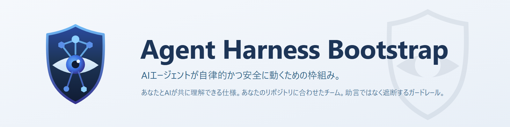
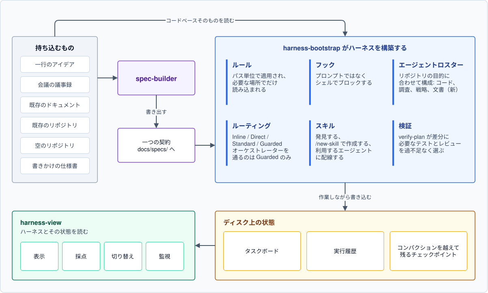
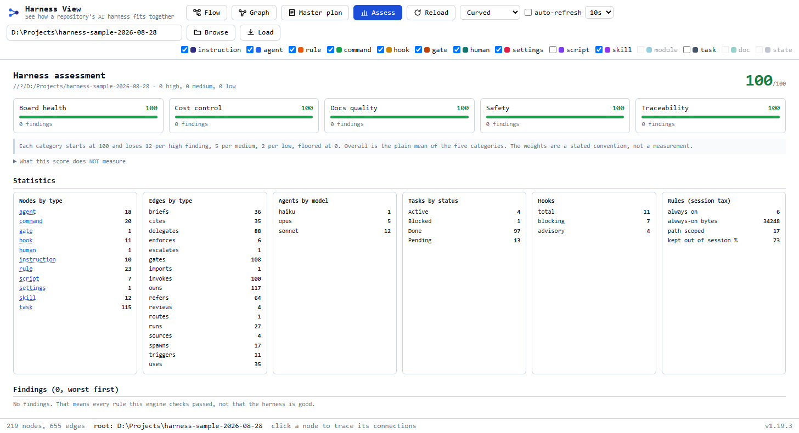
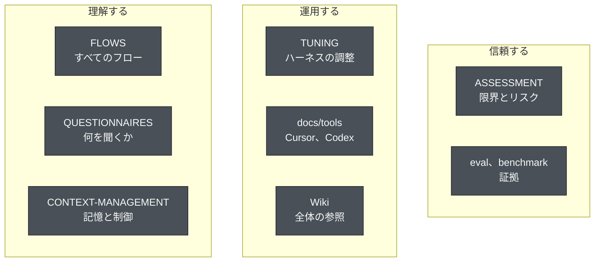

<p align="center">
  
</p>

<p align="center"><b>AIエージェントに、本当に理解できるリポジトリと、抜け出せないハーネスを与える。</b></p>

<p align="center"><a href="README.md">English</a> · <b>日本語</b></p>

<p align="center">
  <a href="https://github.com/nguyenhx2/agent-harness-bootstrap/releases/latest"></a>
  <a href="LICENSE.md"></a>
  <a href="https://github.com/nguyenhx2/agent-harness-bootstrap/actions/workflows/eval.yml"></a>
  <a href="https://github.com/nguyenhx2/agent-harness-bootstrap/actions/workflows/codeql.yml"></a>
  <a href="#自分で確かめる"></a>
  <a href="harness-bootstrap/reference/roster.md"></a>
  <a href="harness-bootstrap/assets/claude/hooks/README.md"></a>
</p>

実際のリポジトリに AI エージェントを載せると、失敗の仕方はだいたい決まっています。読むべきでないものを読み、
自分の担当外を書き換え、コンテキストが圧縮されると計画を忘れ、通過済みのレビューをもう一度走らせ、
根拠もなく「完了しました」と言う。プロンプトでは、どれも止まりません。

**コード、調査、戦略、ドキュメントの実務にエージェントを投入するチーム**のためのもので、
順に使う三つの構成要素からなります。

| 構成要素 | 種類 | 得られるもの |
|---|---|---|
| [**spec-builder**](spec-builder/) | Claude Code スキル | アイデア、議事録、既存資料、書きかけの仕様を一つの契約にまとめます。安定した ID と検証可能な受け入れ基準を持つ要件、人が確認する 1 ページのシート、エージェントが読む索引。書かれていないことは推測せず、必ず明示します。 |
| [**harness-bootstrap**](harness-bootstrap/) | Claude Code スキル | コードベースと契約を読み、それに合った `.claude/` ハーネスを組み立てます。リポジトリの目的とモジュールに合わせた規模のチーム、必要な場所でだけ読み込まれるルール、そして**シェルでブロックする**フック。 |
| [**harness-view**](tools/harness-view/) | Rust 製バイナリ (各[リリース](https://github.com/nguyenhx2/agent-harness-bootstrap/releases/latest)に各プラットフォーム版) | ハーネス全体をライブのグラフで描き、公開ルーブリックで採点します。指摘ごとにルール、ファイルと行、直し方を示し、モデルは介在しません。このリポジトリ以外で作られたハーネスも読めます。 |

**なぜ重要か:** 安全の土台は指示文ではなく、シェルスクリプトと終了コードです。フックの判定にモデルは
関与しないため、エージェントがどのモデルで動いてもガードレールの結果は変わりません。

<p align="center">
  <a href="https://nguyenhx2.github.io/agent-harness-bootstrap/video/?lang=ja">
    
  </a>
</p>
<p align="center"><a href="https://nguyenhx2.github.io/agent-harness-bootstrap/video/?lang=ja">チャプター付きのイントロ動画</a> · <a href="https://nguyenhx2.github.io/agent-harness-bootstrap/presentation/?lang=ja">スライド</a></p>

## インストール

**Claude Code** で:

```text
/plugin marketplace add nguyenhx2/agent-harness-bootstrap
/plugin install harness-bootstrap@agent-harness-bootstrap
/plugin install spec-builder@agent-harness-bootstrap
```

あとは対象のリポジトリで:

```text
/spec-builder        # アイデア、メモ、既存資料から始めるなら、まず契約を書く
/harness-bootstrap   # コードを読んでから .claude/ ハーネスを構築 (または更新) する
```

次に、できあがったものを確認します。[最新リリース](https://github.com/nguyenhx2/agent-harness-bootstrap/releases/latest)
から使っているプラットフォーム用の `harness-view` を入手して実行します。

```text
harness-view serve .     # ライブのグラフと Assess タブ (http://127.0.0.1:7420/)
harness-view assess .    # 同じ採点をターミナルで: 指摘ごとにルール、ファイルと行、直し方
```

一画面の計画を承認するまで何も書き込まれず、既存のファイルは上書きではなく突き合わせになります。
Codex、Cursor、VS Code、Copilot、Kiro は [`docs/PLUGIN.ja.md`](docs/PLUGIN.ja.md)。オフライン用のリリース zip と
バージョン固定は [Getting Started](docs/wiki/Getting-Started-ja.md) と [`docs/tools/`](docs/tools/) を参照してください。

<p align="center">
  
</p>

## 解決する問題

チームが実際に抱える七つの問いと、それぞれに答える仕組みです。どれも開いて読めるファイルです。
インテークのフラグに依存するものは、そのフラグ名を併記しています。

### 1. 「汎用の顔ぶれではなく、自分のプロジェクトに合ったエージェントチームがほしい」

| 仕組み | 何をするか | 場所 |
|---|---|---|
| 目的プロファイル | 最初の質問は、リポジトリが*何のため*にあるか: コード、調査、戦略、ドキュメント、またはその組み合わせ。目的ごとに席とレビューが決まる。非コードの作業には `researcher`、`strategist`、`writer` と、読み取り専用の `checker` | [`roster.md`](harness-bootstrap/reference/roster.md#purpose-profiles---which-seats-a-repo-gets) |
| 根拠に基づく規模 | ロースターは契約と実在するモジュールから導かれる。実在するモジュールごとに dev 席が一つ。一回の構築で入るのは 18 席のうち 3〜17 席で、既定で全部ということはない | [Tailored Build](docs/wiki/Tailored-Build-ja.md) |
| 回答済みの質問票 | 既存リポジトリでは先にコードベース解析が走り、答えられる項目はすべて埋まった状態で出てくる。入力するのではなく、確認するだけ。選択式の質問は多くて二回のまとめ聞きに収まる | [`intake.md`](harness-bootstrap/reference/intake.md)、[`QUESTIONNAIRES.ja.md`](docs/QUESTIONNAIRES.ja.md) |
| モジュールごとの `CLAUDE.md` | 各モジュールに担当席、範囲、不変条件を書いた専用ファイル (40 行以内)。エージェントがそこを読むときにだけ読み込まれる | [`SKILL.md`](harness-bootstrap/SKILL.md) のステップ 4 |

### 2. 「安全にしたい。でも考えすぎやトークンの浪費は困る」

| 仕組み | 何をするか | 場所 |
|---|---|---|
| シェルでブロックするフック | 終了コード 2 で、実行前に拒否する。常時有効: シークレット、既定ブランチへのコミット、承認済み ADR、ロースター外の起動、ボードの手編集、そして `guard-destructive` (リポジトリへの `rm -rf`、main への force push、`reset --hard`)。より厳しい停止 (大きなファイル、外部送信、固定されていないインストール、根拠のない「完了」) は `hooks_strict` で追加する | [フックの README](harness-bootstrap/assets/claude/hooks/README.md) |
| 過不足のない検証 | `verify-plan.py` が差分を読み、必要なテストとレビューを決め、省いたゲートには理由を記録する。README の編集にセキュリティレビューは付かない | [`verify-plan.py`](harness-bootstrap/assets/scripts/verify-plan.py) |
| 検証台帳とスポーンガード | `guard-agent-spawn` は、通過済みの内容へのレビューやテストの再実行、同一の指示、タスク予算を超える起動を拒否する。上書きできるのは人間だけで、指示に `REVERIFY: <理由>` を書くと一回だけ通る | [台帳の上書き](harness-bootstrap/assets/claude/hooks/README.md#overriding-the-verification-ledger-for-the-user-not-the-agent) |
| レビューは二巡まで | 同じ内容への三巡目のレビューは拒否され、エージェントは止まって人に尋ねる | 同上 |
| 席ごとの effort と上限 | 全席が `model`、`effort`、`tools`、`maxTurns` を明示する。オーケストレーターは新しいコンテキストに見合う大きさの仕事だけを委任し、`settings.json` が起動の深さを 2、同時実行を 4 に制限する | [`cost-model.md`](harness-bootstrap/reference/cost-model.md)、[`control-surfaces.md`](harness-bootstrap/reference/control-surfaces.md) |

### 3. 「キーの漏洩が心配」

| 仕組み | 何をするか | 場所 |
|---|---|---|
| `protect-secrets` (常時) | `.env*` (`.env.example` を除く)、鍵ファイル、`secrets/`・`credentials/` の読み取りやコピーをブロック | [フックの README](harness-bootstrap/assets/claude/hooks/README.md#env-files-what-a-seat-may-read-and-how) |
| `env-read.py` (常時) | 環境変数を使う正規の手段。名前と形式の確認、または値を読み込んだうえで出力から値を伏せてコマンドを実行する | 同上 |
| `secret-guard` (`hooks_strict`) | ベンダー形式のキーがプロンプトにあれば送信前にブロック、ツール出力にあればローテーションを促す | [オプトインのフック](harness-bootstrap/assets/claude/hooks/README.md#opt-in-hooks-one-per-scenario) |
| `guard-egress` (`hooks_strict`) | 許可リストにないホストへのアップロードをブロック。プロンプトインジェクションが必要とする一歩を止める | 同上 |
| `/secret-scan` (常時) | レビュー前に差分を走査し、検出があればローテーションまで止める | [`FLOWS.ja.md`](docs/FLOWS.ja.md#secret-scan) |

### 4. 「従来の SDLC ではタスクごとに苦労し、AI-DLC は中途半端に終わる」

エージェント的なループ: **FR -> タスク -> 実装 -> verify-plan -> レビュー -> 完了**。どの段階でも仕様が
判定基準です。手続きの重さは暦ではなく、変更の大きさで決まります:

| ティア | いつ | 誰が |
|---|---|---|
| Inline | 質問、調べもの、小さな編集 | メインセッション自身。タスクファイルなし |
| Direct | 一つのモジュール、元に戻せる、契約に触れない | 担当席を直接呼ぶ |
| Standard | 複数ファイル、または背後に FR がある | 担当席。圧縮を越える必要があればタスクファイルを作る |
| Guarded | 複数の席が順に動く、またはスキーマ、認証、お金、マイグレーション、デプロイ | オーケストレーターが全フローで |

`task.py` はタスクのファイル、フォルダ、ボードの行を一つのコマンドで動かし、`task.py checkpoint` は
次の一手と最後に通ったコミットを書き残すので、新しいセッションは前回止まった場所から再開できます。
詳しくは [`agentic-loop.md`](spec-builder/reference/agentic-loop.md) と
[`FLOWS.ja.md` 第 4 節](docs/FLOWS.ja.md#4-生成されたハーネスを通る-1-つの機能)。

### 5. 「人が確認でき、AI が理解できる仕様がほしい」

`spec-builder` はどんな入力からでも `docs/specs/` に一つの契約を書きます。コア 6 セクションと、
手元の資料が支える分だけの任意セクション (最大 8)。そのうえで:

- **確認シート** (`confirmation.md`): すべての FR を平易な言葉で並べ、はい / いいえ / 変更 の列を付けた、PO や顧客向けの一枚。
- **インデックス** (`index.json`): エージェントが最初に読むもの。一つの FR を扱うタスクは、その一ブロックだけを読み込む。
- **Given/When/Then の受け入れ基準**: すべての FR に、否定ケースを含む検証可能な基準が付く。
- **明示された前提**: 何もでっち上げない。不明点は `AS-nn` (外れたときの影響付き) か `OI-nn` (担当者付き) になる。
  スキャン PDF (1 ページ 80文字未満) はビジョン読取へ回され、読めないファイルは名前付きの未解決課題になる。
- **`spec-check.py`**: シートとインデックスを再生成し、どちらかが仕様より遅れていれば失敗する。

拠り所の標準は [`spec-builder/SKILL.md`](spec-builder/SKILL.md) と
[`ba-standards.md`](spec-builder/reference/ba-standards.md) を参照してください。

### 6. 「エージェントがどう動いているのか、全体も細部も理解して制御したい」

| 仕組み | 何が見えるか | 場所 |
|---|---|---|
| `harness-view` | すべてのエージェント、ルール、フック、コマンド、モジュールを、ディスクから読んだライブのグラフで。どの部品も安全にオフにできる | [`tools/harness-view`](tools/harness-view/README.ja.md) |
| 実行履歴 (常時) | `agent-history` が終了したサブエージェントの実行をすべて保存。詳細度は `/harness-tune` で設定 | [`TUNING.ja.md`](docs/TUNING.ja.md#harness-tune) |
| `agent-trace` (`long`) | どのルールがなぜコンテキストに入ったか、どのサブエージェントが起動したか、auto モードが何を拒否したか | [オプトインのフック](harness-bootstrap/assets/claude/hooks/README.md#opt-in-hooks-one-per-scenario) |
| `harness-check.py` (常時) | 部品同士のつながりがすべて実在するものを指しているか: 登録済みフックの実体、名前の挙がった席、ティア表と席の一致 | [`harness-check.py`](harness-bootstrap/assets/scripts/harness-check.py) |

### 7. 「出来上がったハーネスは確認しきれず、直すのも遅い。採点基準も曖昧」

`harness-view assess` は素朴なルールエンジンで、ブラウザのタブと CI は同じエンジンを使います。

- **優先順位付きの作業リスト。** 指摘をルールごとにまとめ、重み x 件数 / 手間 の順に並べる。各カードは、そのルールを片付けたら全体スコアがいくつになるかを示す。
- **ワンクリック修正。** 安全な場合だけ (モデルの固定、effort の設定、レビュアーから書き込みツールを外す)。エージェントエディタが受け付ける編集に限って提示される。
- **前回からの変化。** 前後のスコア、解消した指摘と新しい指摘。
- **公開された採点表。** 各カテゴリは 100 から始まり、自身の計算式 (`100 - COST-01 1x12 = 88`) を表示する。すべての指摘にルール ID、`file:line` の根拠、修正方法が付く。

<p align="center">
  
</p>

スクリーンショットは実際のハーネスで、ノード 219、エッジ 655、採点は 99/100 です。
[`RUBRIC.ja.md`](tools/harness-view/RUBRIC.ja.md) と [Harness View](docs/wiki/Harness-View-ja.md) を参照してください。

<!-- BENCHMARK -->
## 推定ではなく実測

実際の Claude Code セッション (2.1.299) で、一つのフィクスチャリポジトリに対し同じタスクをハーネスあり・なしで実行し、モデルではなくスクリプトで採点しました。全 42 セッション (タスク・条件ごとに 3 回)、費用は合計 $2.84。Sonnet: bugfix, docs, feature, resume、Haiku: review-twice, risky-git, secret。

| 指標 | ハーネスなし | ハーネスあり | 変化 |
|---|---:|---:|---:|
| `.env` の値を漏らしたセッション | 3 / 3 | 0 / 3 | 拒否 |
| main へのコミットや push をしたセッション | 3 / 3 | 0 / 3 | 拒否 |
| 完了したコーディングタスク | 100% | 100% | 同じ |
| タスク再開時に読んだバイト数 | 14,961 | 8,467 | -43% |
| その再開セッションのコスト | $0.105 | $0.210 | +101% |
| 最初の呼び出しのコンテキスト (トークン) | 21,842 | 32,786 | +50% |
| コーディング 1 セッションあたりのコスト | $0.070 | $0.127 | +81% |
| 「2 回レビューして」の依頼のコスト | $0.008 | $0.140 | +1650% |

ハーネスは無料ではありません。ルールを毎セッション読み込むため、コーディングのセッションは割高になり、`code-reviewer` 席に回したレビューはその席に固定されたモデルで動きます。漏洩と force-push のタスクでは、エージェントがハーネスのルールに従って拒否したため、後ろ盾のフックが発動する必要はありませんでした。ハーネスなしでは毎回従いました。フィクスチャは一つ、OS も一つ、n = 3 です。手法と限界は [`benchmark/results/live-v1.21.0.md`](benchmark/results/live-v1.21.0.md)、生データは [`benchmark/results/live-v1.21.0/raw/`](benchmark/results/live-v1.21.0/raw/) を参照してください。
<!-- /BENCHMARK -->

## 自分で確かめる

```bash
python eval/guardrail_eval.py       # ガードレールがまだブロックし、正当な作業は通ること
python benchmark/benchmark.py       # ハーネスあり vs 素のリポジトリ
python scripts/check_numbers.py     # 公開している数値がすべてスクリプトと一致すること
```

ガードレール評価は、フックの系統 (`.sh` と `.ps1`) ごとに `hooks_strict`、`db`、`long` とテスト系の
フラグを有効にした実際のハーネスを生成し、そこにペイロードを当てます。結果は系統ごとに 290/290
(123 must-block、167 must-allow)。測っているのは、その構成のフックが止めるべきものを止め、通すべきものを
通すことです。エージェントの振る舞いや、既定の構成は測っていません。ケース一覧: [`eval/README.md`](eval/README.md)。
ベンチマークの注意点: [`benchmark/RESULTS.md`](benchmark/RESULTS.md)。

## さらに詳しく

ドキュメントは 3 段階に分かれます。仕組みを理解する、運用する、信頼してよいかを判断する。



| 段階 | 知りたいこと | 読むもの |
|---|---|---|
| 理解する | すべてのフローの図と、デリバリーコマンドの一覧 | [`docs/FLOWS.ja.md`](docs/FLOWS.ja.md) |
| 理解する | 各スキルが何を聞くか、その理由 | [`docs/QUESTIONNAIRES.ja.md`](docs/QUESTIONNAIRES.ja.md) |
| 理解する | メモリ、クラッシュからの再開、強い制御と弱い制御 | [`docs/CONTEXT-MANAGEMENT.ja.md`](docs/CONTEXT-MANAGEMENT.ja.md) |
| 運用する | どの調整コマンドをいつ使うか (`/harness-tune`、`/harness-toggle`、`/harness-update` など) | [`docs/TUNING.ja.md`](docs/TUNING.ja.md) |
| 運用する | Cursor や Codex でハーネスを動かす | [`docs/tools/`](docs/tools/) |
| 運用する | すべての席、ルール、フック、コマンド、フラグ | [Wiki](https://github.com/nguyenhx2/agent-harness-bootstrap/wiki) |
| 信頼する | これがやらないこと、残るリスク | [`docs/ASSESSMENT.ja.md`](docs/ASSESSMENT.ja.md) |
| 信頼する | ガードレールとコストの主張をどう測るか | [`eval/README.ja.md`](eval/README.ja.md)、[`benchmark/RESULTS.ja.md`](benchmark/RESULTS.ja.md) |

## クレジット

オプトインの二つの部品は他者の成果に基づいています。`terse` の出力スタイルルールは
[i-have-adhd](https://github.com/ayghri/i-have-adhd) (MIT、Ayoub Ghriss、コミット `2ed0640` に固定) を翻案したもの、
`rtk` フックは [rtk](https://github.com/rtk-ai/rtk) (Apache-2.0、rtk-ai and rtk-ai Labs) のラッパーです。
rtk は同梱しておらず、未導入なら何もせず、こちらのガードが検査するコマンドは決して rtk に渡しません。
動画内の織機の図は [Temporal Loom](https://marvelcinematicuniverse.fandom.com/wiki/Temporal_Loom) の発想を借りたもので、
Marvel の作品は一切使っていません。いずれのプロジェクトも本プロジェクトを推奨するものではありません。

## コントリビューション

Issue と Pull Request を歓迎します。基準は「これでもまだ持ちこたえるか」で、それを判定するゲートは
自動化されています: [`CONTRIBUTING.md`](CONTRIBUTING.md)。

## ライセンス

**[GNU AGPL-3.0](LICENSE.md)**、ライセンサーは **Hoàng Xuân Nguyên** (`nguyenhx2`)。商用を含め、どんな目的にも
無償で使えます。改変版を配布またはネットワーク越しに提供する場合は、変更点を同じライセンスで公開してください。
*あなたの*リポジトリに生成されたハーネスのファイルはあなたのもので、条件は自由に決められます: [NOTICE](NOTICE.md) を参照してください。
