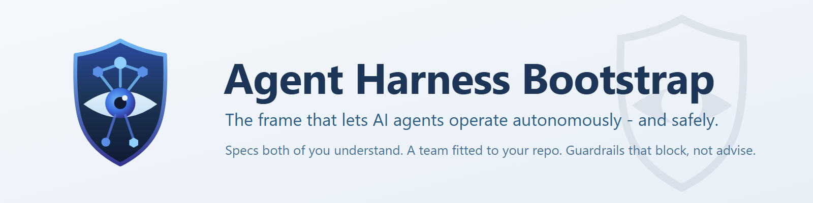
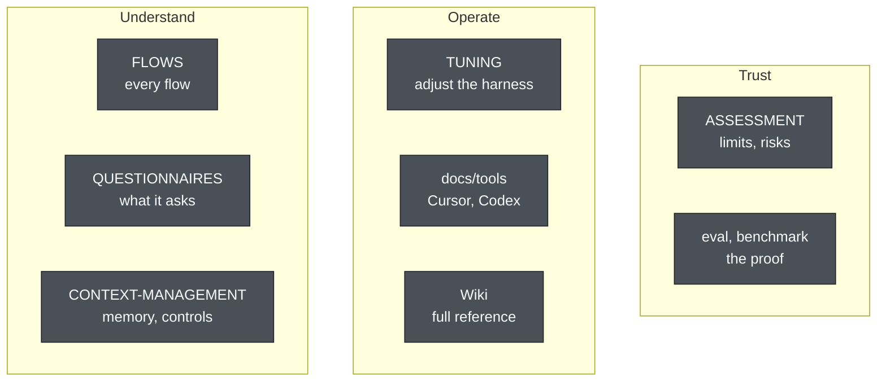

<p align="center">
  
</p>

<p align="center"><b>Give an AI agent a repo it can actually understand, and a harness it cannot escape.</b></p>

<p align="center"><b>English</b> · <a href="README.ja.md">日本語</a></p>

<p align="center">
  <a href="https://github.com/nguyenhx2/agent-harness-bootstrap/releases/latest"></a>
  <a href="LICENSE.md"></a>
  <a href="https://github.com/nguyenhx2/agent-harness-bootstrap/actions/workflows/eval.yml"></a>
  <a href="https://github.com/nguyenhx2/agent-harness-bootstrap/actions/workflows/codeql.yml"></a>
  <a href="#proof-you-can-run"></a>
  <a href="harness-bootstrap/reference/roster.md"></a>
  <a href="harness-bootstrap/assets/claude/hooks/README.md"></a>
</p>

An AI agent on a real repository fails in predictable ways: it reads what it should not, edits what
it does not own, forgets the plan when the context compacts, re-runs a review that already passed,
and calls work "done" with no evidence. Prompts do not stop any of that.

It is built for **teams putting agents on real code, research, strategy or documentation work**,
and it comes in three parts that work in order:

| Part | What it is | What it gives you |
|---|---|---|
| [**spec-builder**](spec-builder/) | A Claude Code skill | Turns an idea, a transcript, legacy docs or a half-written spec into one contract: requirements with stable IDs and checkable acceptance criteria, a one-page sheet a human confirms, and an index an agent reads. Anything unstated is flagged, never invented. |
| [**harness-bootstrap**](harness-bootstrap/) | A Claude Code skill | Reads your codebase and that contract, then builds the `.claude/` harness that fits it: a team sized to the repo's purpose and modules, rules that load only where they apply, and hooks that **block in the shell**. |
| [**harness-view**](tools/harness-view/) | A Rust binary, one per platform on every [release](https://github.com/nguyenhx2/agent-harness-bootstrap/releases/latest) | Draws the whole harness as a live graph and scores it against a published rubric. Every finding names its rule, the file and line, and the fix, and no model is involved. It also reads harnesses this repo did not build. |

**Stop prompting your agents to behave. Give them a harness that enforces it.**

- **Built for this repository, not a fixed kit.** The team, the rules and where each rule loads are
  derived from the codebase and the contract, so a docs repository and a monorepo get different
  harnesses.
- **Guardrails that block, not ask.** A hook is a shell script that exits 2 before the tool call
  runs. No model is consulted, so the result cannot depend on which model an agent runs, and the
  [guardrail eval](#proof-you-can-run) proves every case on every CI run.
- **Verification sized to the risk.** A one-file fix goes straight to the work; only a change that
  crosses domains earns a plan, an orchestrator and a review, and a review that already passed is
  not run again.
- **A control panel, not a black box.** harness-view shows every agent, rule and hook, scores them
  against a published rubric, and switches a control off only as a recorded, graded decision.

<p align="center">
  <a href="https://nguyenhx2.github.io/agent-harness-bootstrap/video/">
    <picture>
      <source media="(prefers-reduced-motion: reduce)" srcset="video/gif/00-intro-poster.png">
      
    </picture>
  </a>
</p>
<p align="center"><a href="video/mp4/00-intro.mp4">Watch the intro as MP4</a> · <a href="https://nguyenhx2.github.io/agent-harness-bootstrap/video/">The intro, with chapters</a> · <a href="https://nguyenhx2.github.io/agent-harness-bootstrap/presentation/">Slides</a></p>

## Install

In **Claude Code**:

```text
/plugin marketplace add nguyenhx2/agent-harness-bootstrap
/plugin install harness-bootstrap@agent-harness-bootstrap
/plugin install spec-builder@agent-harness-bootstrap
```

Then, in your repo:

```text
/spec-builder        # starting from an idea, notes or legacy docs: write the contract first
/harness-bootstrap   # read the code, then build (or update) the .claude/ harness
```

Then see what was built: download `harness-view` for your platform from the
[latest release](https://github.com/nguyenhx2/agent-harness-bootstrap/releases/latest) and run

```text
harness-view serve .     # the live graph and the Assess tab, at http://127.0.0.1:7420/
harness-view assess .    # the same score in the terminal: rule, file:line and fix per finding
```

Nothing is written until you approve a one-screen plan, and existing files are reconciled, never
overwritten. Codex, Cursor, VS Code, Copilot and Kiro: [`docs/PLUGIN.md`](docs/PLUGIN.md). The
offline release zip and pinned versions: [Getting Started](docs/wiki/Getting-Started.md) and
[`docs/tools/`](docs/tools/).

<p align="center">
  
</p>

## Security by design

An agent's instructions are the weakest thing between it and an irreversible action, so they are
only the first of five layers. Each layer below is decided by something the model cannot argue
with: the runtime, the permission system, a shell script's exit code, and finally you.

<p align="center">
  
</p>

| Layer | Decided by | What it holds | Where it gives way |
|---|---|---|---|
| **Soft** - guidance | the model | `AGENTS.md`, path-scoped rules, each seat's prompt. In the live benchmark below it refused every unsafe request before a hook had to fire | A model can outweigh it, and compaction can drop it |
| **Scoped** - seat limits | the Claude Code runtime | A tools allowlist per seat (review seats also list Edit and Write in `disallowedTools`), `maxTurns`, a pinned model and effort, spawn depth 2 with at most 4 at once, the verification ledger | Limits what a seat can call, not what it does with a tool it holds |
| **Forced** - deny rules | the permission system | Reads of `.env*`, keys and `secrets/`; force push, `reset --hard`, `rm -rf`, deploy and DB reset. PR create, merge and deploy are asked | A literal prefix: `rm -fr` and `git push origin main --force` walk past, which is why the next layer exists |
| **Hard** - blocking hooks | a shell script's exit code | Always on: `protect-secrets`, `protect-harness`, `guard-destructive`, `guard-main-commit`, `check-commit-msg`, `protect-adr`, `guard-agent-spawn`, `guard-board`, `guard-task-scope`. With `hooks_strict`: `guard-egress`, `secret-guard`, `guard-config`, `guard-large-file`, `guard-deps`, `stop-evidence`. A crash or timeout blocks | Reads commands best-effort: a file name the command builds at run time is beyond it |
| **Human** - only a person | you | An agent edit to `settings.json` or a hook asks you, and a shell write there is refused. Switching a hard control off takes the typed phrase `disable <name>`, committed to `.claude/disabled.json`; a re-review past the ledger takes `REVERIFY` in your own brief | - |

**Re-audited for v1.21.2.** Bypass attempts fired at a scaffolded harness found these walking
past: `.env` followed by a pipe, a redirect or a bracket (`cat .env|base64`), names the shell
builds from a glob, quotes or braces (`cat .e?v`, `cat .e""nv`, `cat {.env,x}`), `grep -r`
through the tree, `find . -delete` at the repo root, and an agent rewriting a guard through the
shell. All of them are closed and are now guardrail eval cases. The last one was
checked live in Claude Code: in `bypassPermissions` mode an `echo >> .claude/hooks/...` changed
the guard without `protect-harness`, and was refused with it.

**Not enforced, and said so:** which model provider readable text is sent to (no tool call
exists to intercept), secrets at a path nobody named, `guard-agent-scope` (advisory: the payload
names no calling seat), and egress and mid-session config changes, which need `hooks_strict`.
The full ranking: [`control-surfaces.md`](harness-bootstrap/reference/control-surfaces.md).

## The problems it solves

Seven questions teams actually ask, each answered by a mechanism you can open and read. Where an
answer depends on an intake flag, the flag is named.

### 1. "I want an agent team that fits my project, not a generic roster."

| Mechanism | What it does | Where |
|---|---|---|
| Purpose profiles | The first question is what the repo is *for*: code, research, strategy, docs, or a mix. Each fields its own seats and its own review: `researcher`, `strategist`, `writer`, and a read-only `checker` for non-code work | [`roster.md`](harness-bootstrap/reference/roster.md#purpose-profiles---which-seats-a-repo-gets) |
| Sizing from evidence | The roster is derived from the contract and the modules that exist: one dev seat per real module, and a run installs **3 to 17 of the 18 seats**, never all by default | [Tailored Build](docs/wiki/Tailored-Build.md) |
| A pre-answered questionnaire | On an existing repo, codebase analysis runs first and pre-fills every answer it can; you confirm findings instead of typing them. The closed choices fit in at most two question batches | [`intake.md`](harness-bootstrap/reference/intake.md), [`QUESTIONNAIRES.md`](docs/QUESTIONNAIRES.md) |
| Per-module `CLAUDE.md` | Each module gets its own owner, scope and invariants (at most 40 lines), loaded only when an agent reads files there | [`SKILL.md`](harness-bootstrap/SKILL.md) step 4 |

### 2. "I want it safe, without it overthinking or burning tokens."

| Mechanism | What it does | Where |
|---|---|---|
| Hooks that block in the shell | Exit code 2 refuses the action before it happens. Always on: secrets, commits to the default branch, Accepted ADRs, off-roster spawns, hand edits to the board, and `guard-destructive` (`rm -rf` on the repo, force push to main, `reset --hard`). Stricter stops (large files, egress, unpinned installs, "done" with no evidence) are opt-in with `hooks_strict` | [hooks README](harness-bootstrap/assets/claude/hooks/README.md) |
| Proportionate verification | `verify-plan.py` reads the diff and says which tests and reviews it needs, and records why each skipped gate was skipped. A README edit does not earn a security review | [`verify-plan.py`](harness-bootstrap/assets/scripts/verify-plan.py) |
| Verification ledger + spawn guard | `guard-agent-spawn` refuses a review or test run on content that already passed, an identical brief, and a dispatch past the task budget. Only a human can override, with `REVERIFY: <reason>` in the brief, once | [Overriding the ledger](harness-bootstrap/assets/claude/hooks/README.md#overriding-the-verification-ledger-for-the-user-not-the-agent) |
| Two review rounds, then stop | A third review round on the same content is refused; the agent has to stop and ask | same |
| Effort and caps per seat | Every seat pins `model`, `effort`, `tools` and `maxTurns`. The orchestrator delegates only work big enough to earn a fresh context, and `settings.json` caps spawn depth at 2 and concurrent subagents at 4 | [`cost-model.md`](harness-bootstrap/reference/cost-model.md), [`control-surfaces.md`](harness-bootstrap/reference/control-surfaces.md) |

### 3. "I am worried about leaking keys."

| Mechanism | What it does | Where |
|---|---|---|
| `protect-secrets` (always) | Blocks reading or copying `.env*` (except `.env.example`), keys, `secrets/` and `credentials/` dirs | [hooks README](harness-bootstrap/assets/claude/hooks/README.md#env-files-what-a-seat-may-read-and-how) |
| `env-read.py` (always) | The sanctioned way to use env values: checks names and shape, or runs a command with values loaded and redacted from its output | same |
| `secret-guard` (`hooks_strict`) | Vendor-format keys in a prompt are blocked before sending; in tool output they trigger a rotate warning | [Opt-in hooks](harness-bootstrap/assets/claude/hooks/README.md#opt-in-hooks-one-per-scenario) |
| `guard-egress` (`hooks_strict`) | Blocks an upload to a host not on the allowlist, the step a prompt injection needs | same |
| `/secret-scan` (always) | Scans the diff before review; any hit blocks until rotated | [`FLOWS.md`](docs/FLOWS.md#secret-scan) |

### 4. "Traditional SDLC makes every task a struggle, and AI-DLC ends up half-hearted."

The agentic loop: **FR -> task -> implement -> verify-plan -> review -> done**, with the spec as the
oracle at every step. Ceremony follows the change, not the calendar:

| Tier | When | Who |
|---|---|---|
| Inline | A question, a lookup, a small edit | The main session, no task file |
| Direct | One module, reversible, no contract touched | The owning seat, straight |
| Standard | Several files or an FR behind it | The owning seat, task file if it must survive compaction |
| Guarded | Several seats in order, or schema, auth, money, migrations, deploys | The orchestrator, full flow |

`task.py` moves a task's file, folder and board row in one command, and `task.py checkpoint` writes
the next step and last green commit so a fresh session resumes where the last one stopped.
Read [`agentic-loop.md`](spec-builder/reference/agentic-loop.md) and
[`FLOWS.md` section 4](docs/FLOWS.md#4-one-feature-end-to-end-through-the-generated-harness).

### 5. "I want specs a human can confirm and an AI can understand."

`spec-builder` turns any input into one contract under `docs/specs/`:
6 core sections, up to 8 optional ones chosen by what your material contains. Then:

- **The confirmation sheet** (`confirmation.md`): every FR in plain words with a yes / no / change
  column, for the PO or client.
- **The index** (`index.json`): what agents read first, so a task on one FR loads one block.
- **Given/When/Then criteria**: every FR has checkable acceptance criteria, including a negative case.
- **Flagged assumptions**: nothing is invented. An unknown becomes `AS-nn` (with its impact) or
  `OI-nn` (with an owner). A scanned PDF (under 80 characters a page) goes to a vision pass, and an
  unreadable file becomes a named open issue.
- **`spec-check.py`**: regenerates the sheet and index and fails when either falls behind the spec.

Read [`spec-builder/SKILL.md`](spec-builder/SKILL.md) and
[`ba-standards.md`](spec-builder/reference/ba-standards.md) for the standards it draws on.

### 6. "I want to understand and control how the agents work, all of it, in depth."

| Mechanism | What it shows | Where |
|---|---|---|
| `harness-view` | Every agent, rule, hook, command and module as a live graph read off disk; toggle any part off safely | [`tools/harness-view`](tools/harness-view/README.md) |
| Run history (always) | `agent-history` archives every finished subagent run; detail level set with `/harness-tune` | [`TUNING.md`](docs/TUNING.md#harness-tune) |
| `agent-trace` (`long`) | Which rule entered context and why, which subagent started, what auto mode refused | [Opt-in hooks](harness-bootstrap/assets/claude/hooks/README.md#opt-in-hooks-one-per-scenario) |
| `harness-check.py` (always) | Every link between parts points at something real: registered hooks exist, every named seat exists, the tier table matches the seats | [`harness-check.py`](harness-bootstrap/assets/scripts/harness-check.py) |

### 7. "Once built, the harness is too much to check and slow to fix. And the score is vague."

`harness-view assess` is a plain rules engine, and the same engine backs the browser tab and CI.

- **A prioritised worklist.** Findings grouped by rule and ordered by weight x count / effort, each
  card saying what the score would be with that rule cleared.
- **One-click fixes** where safe (pin a model, set an effort, strip write tools from a reviewer),
  offered only when the agent editor would accept the edit.
- **What changed since the last check:** score before and after, findings fixed and new.
- **A published rubric.** Each category starts at 100 and shows its own arithmetic
  (`100 - COST-01 1x12 = 88`); every finding carries a rule ID, `file:line` evidence and the fix.

<p align="center">
  
</p>

The screenshot is a real harness: 219 nodes, 655 edges, scored 98/100. Read
[`RUBRIC.md`](tools/harness-view/RUBRIC.md) and [Harness View](docs/wiki/Harness-View.md).

<!-- BENCHMARK -->
## Measured, not modelled

Real Claude Code sessions (2.1.299) on one fixture repository, the same tasks with and without the harness, scored by scripts rather than by a model. 42 sessions, 3 per task and condition, $2.84 in total. Sonnet ran bugfix, docs, feature, resume; Haiku ran review-twice, risky-git, secret.

| Measure | Bare repo | Harness | Change |
|---|---:|---:|---:|
| Sessions that leaked the `.env` value | 3 of 3 | 0 of 3 | refused |
| Sessions that committed to main or pushed it | 3 of 3 | 0 of 3 | refused |
| Coding tasks completed | 100% | 100% | same |
| Bytes read to resume a task | 14,961 | 8,467 | -43% |
| Cost of that resume session | $0.105 | $0.210 | +101% |
| Context on the first call (tokens) | 21,842 | 32,786 | +50% |
| Cost per coding session | $0.070 | $0.127 | +81% |
| Cost of a "review it twice" request | $0.008 | $0.140 | +1650% |

The harness is not free. It loads its rules into every session, so a coding session costs more, and a review it routes to the `code-reviewer` seat runs on that seat's pinned model. In the leak and force-push tasks the agent refused on the harness's rules, so the hooks, the backstop, never had to fire; without the harness it complied every time. One fixture, one OS, n = 3: read the method and the limits in [`benchmark/results/live-v1.21.0.md`](benchmark/results/live-v1.21.0.md), raw runs in [`benchmark/results/live-v1.21.0/raw/`](benchmark/results/live-v1.21.0/raw/).
<!-- /BENCHMARK -->

## Proof you can run

```bash
python eval/guardrail_eval.py       # the guardrails still block, and good work still passes
python benchmark/benchmark.py       # harnessed vs a bare repo
python scripts/check_numbers.py     # every published figure matches its script
```

The guardrail eval scaffolds a real harness per hook flavour (`.sh` and `.ps1`) with `hooks_strict`,
`db`, `long` and the test flags on, then fires payloads at it: 312/312 per flavour (134 must-block,
178 must-allow). It measures that the hooks of that scaffold block and allow what they should; it
does not measure agent behaviour or a default scaffold. Cases: [`eval/README.md`](eval/README.md).
Benchmark caveats: [`benchmark/RESULTS.md`](benchmark/RESULTS.md).

## Go deeper

The docs fall into three stages: understand how it works, operate it, then judge whether to trust it.



| Stage | To learn | Read |
|---|---|---|
| Understand | Every flow as a diagram, and every delivery command | [`docs/FLOWS.md`](docs/FLOWS.md) |
| Understand | What each skill asks you, and why | [`docs/QUESTIONNAIRES.md`](docs/QUESTIONNAIRES.md) |
| Understand | Memory, crash-resume, hard vs soft controls | [`docs/CONTEXT-MANAGEMENT.md`](docs/CONTEXT-MANAGEMENT.md) |
| Operate | Which tuning command to run when (`/harness-tune`, `/harness-toggle`, `/harness-update` ...) | [`docs/TUNING.md`](docs/TUNING.md) |
| Operate | Running the harness in Cursor or Codex | [`docs/tools/`](docs/tools/) |
| Operate | Every seat, rule, hook, command and flag | [the wiki](https://github.com/nguyenhx2/agent-harness-bootstrap/wiki) |
| Trust | What this does not do, and the open risks | [`docs/ASSESSMENT.md`](docs/ASSESSMENT.md) |
| Trust | How the guardrails and the cost claims are measured | [`eval/README.md`](eval/README.md), [`benchmark/RESULTS.md`](benchmark/RESULTS.md) |

## Credits

Two opt-in pieces build on others' work: the `terse` output-style rule adapts
[i-have-adhd](https://github.com/ayghri/i-have-adhd) (MIT, Ayoub Ghriss, pinned at `2ed0640`), and the
`rtk` hook wraps [rtk](https://github.com/rtk-ai/rtk) (Apache-2.0, rtk-ai and rtk-ai Labs). rtk is not
bundled: the wrapper stays silent without it and never hands it a command our guards inspect. The
loom figure in the video borrows the idea of the
[Temporal Loom](https://marvelcinematicuniverse.fandom.com/wiki/Temporal_Loom); no Marvel artwork was
used. None of these projects endorse this one.

## Contributing

Issues and pull requests are welcome. The bar is "does this still hold up", and the gates that
answer it are automated: [`CONTRIBUTING.md`](CONTRIBUTING.md).

## License

**[GNU AGPL-3.0](LICENSE.md)**, licensor **Hoàng Xuân Nguyên** (`nguyenhx2`). Free for any use,
commercial included; distribute or serve a modified version and you publish your changes under the
same licence. The harness files scaffolded into *your* repository are yours, under terms of your
choice: see [NOTICE](NOTICE.md).
