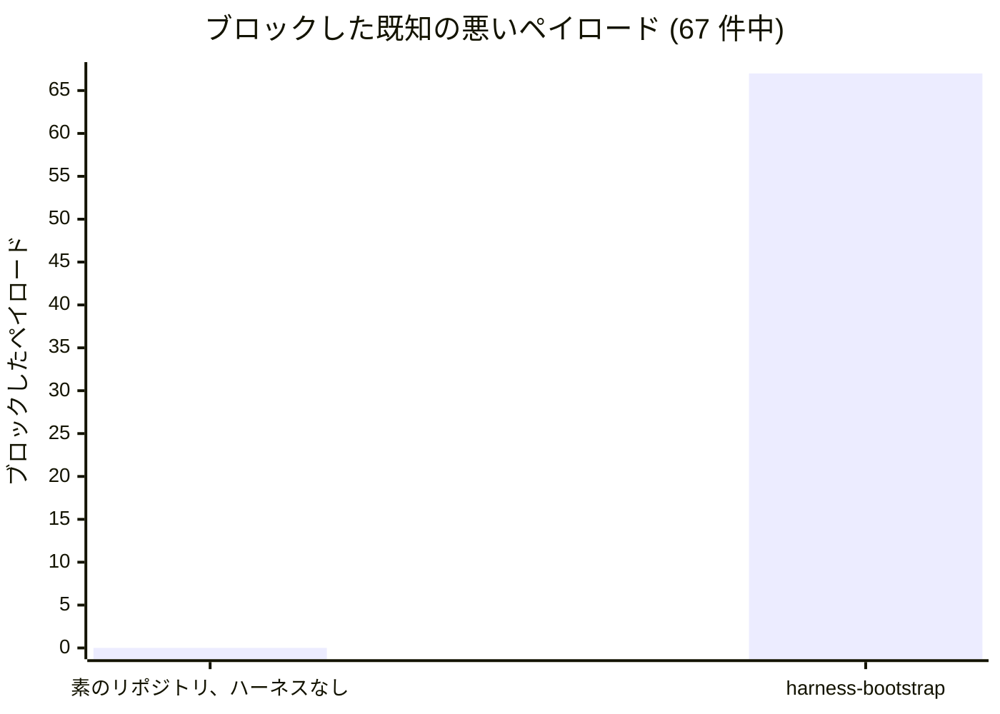
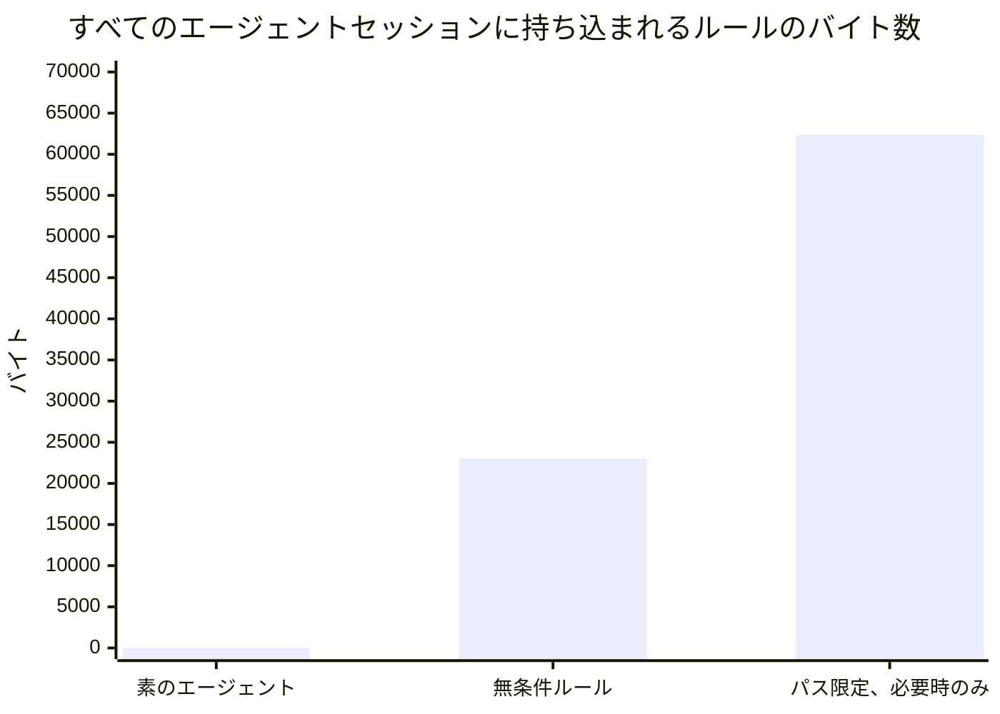

# ベンチマーク結果

[English](RESULTS.md) · **日本語**

`harness-bootstrap` を採用すると何が得られるのかを、採用しない場合に取るはずの 3 つの選択肢と比べて測ります。
何もしない、手作業で作る、制御層なしで素のプロンプトを使う、の 3 つです。以下はすべて、ディスク上のファイルから
数えたか実際の実行で得たもので、1 つのコマンドで再現できます。

```bash
python benchmark/benchmark.py
```

## 概要

| | ハーネスなし | harness-bootstrap |
|---|---:|---:|
| ブロックした既知の悪い操作 (67 件のフックペイロード) | **0** | **67** |
| 自分で書くハーネスのバイト数 | **652,677** | **0** |
| すべてのエージェントセッションに読み込まれるルールのバイト数 | **0** | **23,047** |
| 立ち上げにかかる時間 | - | 2 秒未満 |

3 行目は誤植ではなく、こちらに有利な数字でもありません。素のエージェントは、強制すべきルールがないのでルールを
持ちません。それがこのプロジェクトの取っているトレードオフであり、それを隠すベンチマークには読む価値がありません。

## ベースライン A - ハーネスなし

`eval/guardrail_eval.py` が投げるのと同じ既知の悪いペイロードを、生成したハーネスと素のリポジトリに送ります。
2 つのリポジトリはファイルも git 履歴も同一で、違いは `.claude/` があるかどうかだけです。

ここでのハーネスは eval 自身のものです。`guardrail_eval.py` の `VARS` にあるフラグでスキャフォールドしており、
その中には `hooks_strict`、`long`、`db` が含まれます。したがって strict フック、長時間セッション用フック、
マイグレーションガードは 67 件に含まれており、既定のインストールで入るフックはここで測ったハーネスより少なくなります。
ペイロードは eval のフックスイートの must-block ケースで、同じ順に再生し、宣言し直さずにインポートしています。



| | ブロック | ケース数 |
|---|---:|---:|
| 素のリポジトリ、ハーネスなし | 0 | 67 |
| harness-bootstrap | 67 | 67 |

素のリポジトリでは、67 件のペイロードのどれにも受け止めるフックがありませんでした。フックファイルは 0 個で、
`settings.json` もありません。

「何も止めなかった」は主張ではなく実証です。スクリプトは素のリポジトリで実際の操作を行い、その結果で確認します。

| 操作 | 結果 | 証拠 |
|---|---|---|
| `.env` を読む | 完了 | `API_KEY` を含む 51 バイトを読み取り |
| 既定ブランチへ直接コミット | 完了 | `main` の `HEAD` が移動 |
| AI 帰属トレーラー付きで `stuff` をコミット | 完了 | コミットされ、トレーラーも残った |
| Accepted の ADR を編集 | 完了 | ファイルが 25 から 53 バイトに増加 |

これがこのプロジェクトの拠って立つ主張です。ガードレールはフックと deny ルール、つまりシェルスクリプト、終了コード、
glob マッチなので、モデルには一切問い合わせず、結果はモデルに左右されません。

## ベースライン B - 手作業

同じハーネスを立ち上げるために自分で書くことになる量です。1 つスキャフォールドし、生成されたものを量って測りました。

| 種類 | ファイル数 | バイト数 |
|---|---:|---:|
| スクリプト | 12 | 324,988 |
| フック | 15 | 119,298 |
| ルール | 16 | 79,300 |
| コマンド | 21 | 54,622 |
| エージェント | 9 | 31,814 |
| ルートのファイル | 8 | 20,197 |
| docs の骨組み | 15 | 18,492 |
| `settings.json` | 1 | 3,966 |
| **合計** | **97** | **652,677** |

モデルにあなたの代わりに書かせた場合、推定でおよそ 181,300 トークンです。

正直な但し書きが 2 つあります。

- **これはあなたが書かずに済む部分であって、仕事のすべてではありません。** この上で、`tech-stack.md`、
  `coding-standards.md`、`git-workflow.md`、オーケストレーターのルーティング表、各開発エージェントの担当範囲は
  引き続き自分で書きます。この 3 つのルールは意図的にアセットとしては一切出荷していません。あなたのリポジトリに
  ついての判断であり、どんなテンプレートも代わりに下せないからです。
- **スクリプトの行が最も議論の余地のある行です。** この 12 個は設定ではなく実際に動くツールです。グラフスキャナー、
  タスクボードの CLI、検証プランナー、トグル、env リーダー、チェッカーなどです。手作業でやるチームがこれらを作らない
  のは十分あり得ることで、その場合の正直な数字は 652,677 バイトではなく 327,689 バイトです。

時間では意図的に示していません。時間はリポジトリから測れるものではなく、ここに書く数字はどれも白衣を着た当て推量に
なってしまいます。

## ベースライン C - 制御層なしの直接の LLM 呼び出し

測れるのはコンテキストです。`paths:` フロントマターを持たないルールは、すべてのエージェントのすべてのセッションに、
ずっと読み込まれます。それは家賃です。



| | ルール数 | バイト数 | トークン (推定) |
|---|---:|---:|---:|
| 素のエージェント、ハーネスなし | 0 | 0 | 0 |
| 無条件、常に読み込み | 7 | 23,047 | ~6,402 |
| パス限定、必要時に読み込み | 10 | 62,365 | ~17,324 |

ルール本文の 73% は既定セッションから外れます。パスで限定できない 7 つは、どの glob にもマッチしようがないものです。
`00-overview`、`agent-guardrails`、`task-tracking`、`conventional-commits` (ファイルではなくコミット
*メッセージ* を律するもので、そのため意図的に 25 行未満に抑えています)、`output-style` (エージェントの書き方を律する
もので、どのパスからも予測できません)、そして 2 つのガバナンスルール `model-policy` と `ai-governance` です。
後者の 2 つは、どのファイルにも触れる前に、何をどこへ送ってよいかを決めます。表はすべてのフラグを有効にした全体を
数えています。`ai-governance` は `ai` フラグ、`output-style` は `terse` フラグがあるときだけ出荷されるので、
既定のインストールで読み込まれる量はもっと少なくなります。席の階層は `model-policy` にはなく、パス限定の
`model-tiers` にあります。

**ここで測れず、主張もしていないこと:** エージェントが生み出すコードが、ハーネスがある場合のほうがない場合より
良いかどうか。出力の品質、タスクの成功率、正しい変更までの時間、レビューの負担はどれも実在し、どれもこのページには
ありません。どれもリポジトリから数えられないからです。ベースライン A が測るのは強制であって、判断ではありません。

## プロセス - セッションが持ち歩くものと 1 つの変更のコスト

ハーネスは変更ごとにどれだけのプロセスをかけるかを決めます。それは描画されたファイルの上で測れます。

- **すべてのセッションとサブエージェントが持ち歩くもの**: `AGENTS.md`、`CLAUDE.md` と無条件ルール。
  `ui`、`db`、`ai`、`ddd`、`tests` を有効にすると 31,179 バイト (8 ファイル)、`tests` のみなら 27,308 バイト
  (7 ファイル) です。
- **各階層を誰が実行するか**: Inline はメインセッション自身、Direct は担当席を直接呼ぶもの、Standard は担当席で、
  作業がコンパクションを越えて残る必要がある場合にだけタスクファイルを持つもの、Guarded はオーケストレーターで、
  一度に 1 つずつです。
- **変更の種類ごとのレビューゲート** (`verify-plan.py`): docs だけ、または設定だけの diff はレビュー席もテスト実行も
  不要です。ソースファイル 1 つならコードレビューとフルスイートを 1 回ずつ。認証コードと依存関係の更新には
  セキュリティレビューが加わります。秘密情報のスキャンは常に実行します。
- **検証台帳**: 模擬ミッション (3 ユニット、最終チェック、修正 1 回、再レビュー) では、レビューとスイートの
  ディスパッチが 17 回のゲート実行から 11 回に減り、残りの 6 回は台帳の行を根拠として `guard-agent-spawn` が拒否します。
- **セッションログが 40 行あるタスクの再開**: 丸ごと読むと 8,253 バイト、`task.py` でログを区切ると 5,901 バイト、
  `task.py resume` のダイジェストなら 966 バイト (~268 トークン) です。

## スキャフォールド

初回の実行は **2 秒未満** (他の作業も動いているマシンで実行ごとに 0.8-1.7 秒) で、120 個のパスを作り、終了コード 0 で
終わります。再実行では `KEPT` と報告し、何も上書きしません。未解決の `{{VAR}}` があれば、ルールにプレースホルダーを
出荷する代わりに非ゼロで終了します。

ここでの比較は、何秒と何秒の比較ではありません。決定的なファイルコピーと、約 180,000 の出力トークンを生成する
モデルとの比較です。後者は数分かかり、実際にお金がかかり、動かないフックを幻覚することもあります。

## 参考記録 - 前身のスキルとの比較

このベンチマークはかつて、`harness-bootstrap` を、それが置き換えたスキル `project-bootstrap` と比べていました。
その数字は事実なので残していますが、格下げしています。それが答えるのは「書き直しは前回の試みに勝ったか」であり、
私たちには重要でも、これを採用するかどうか選ぶ人には誰にとっても重要ではないからです。

Read path: 234,196 から 178,719 バイト、約 -24%。

この数字はスキルの参照ドキュメントが変わるたびに動き、前回のリリース以降、機能が増えるにつれて下がってきました
(用途プロファイル、検証台帳、インテークの質問票)。良くなる一方のベンチマークは、マーケティング資料です。

## 方法論

- **バイト数は正確** で、ディスク上のファイルから数えています。**トークン数は推定** で、`ANTHROPIC_API_KEY` が
  設定されていなければ 3.6 文字/トークンで見積もります。キーがあれば、スクリプトは実際の `count_tokens`
  エンドポイントを呼びます。どちらの場合も出典を表示し、導出した数字を実測値として出すことはありません。
- **ベースライン A は eval 自身のペイロードスイートをインポート** し、宣言し直しません。そのため安全性の数字が、
  それが代表すると称するスイートから外れることはありません。`.sh` のフックフレーバーで実行し、`bash` が使えない
  場合はメッセージを出してスキップします。
- **ベースライン A が数えるのは、eval のフックスイートにある 67 件の must-block ペイロードだけ** です。eval の
  フレーバーあたり 250 件の全ケースには、must-allow ケースや、スキャフォールド、台帳、トグルのスイートが含まれますが、
  それらは別の性質を測るもので、安全性の成果ではありません。
- **素のリポジトリはハーネスありのものと同じフィクスチャから作り**、その後 `.claude/` を取り除きます。もし `.env` や
  ADR がなければ、「何もブロックされなかった」は自明に真になってしまいます。
- **ここで測っていないもの:** モデル階層をまたいだコスト (`benchmark/model_cost.py` が別にモデル化しています) と、
  ディスパッチごとのツールスキーマのコスト。後者には、このスクリプトが持たない実行時の計測が必要です。

ハードウェア: Windows 11、Python 3.13。スキャフォールドの時間は実時間で、1 回の実行です。
ベースライン A だけが遅い部分なので、`python benchmark/benchmark.py --skip-guardrails` でスキップできます。
2 つを同時に実行するには、`HARNESS_BENCH_WORKDIR` をそれぞれ別のディレクトリに向ける必要があります。そうしないと、
互いのハーネスを実行途中で削除してしまいます。
