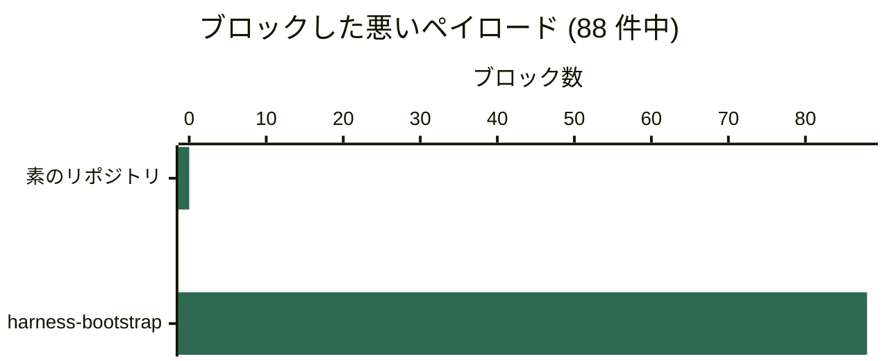
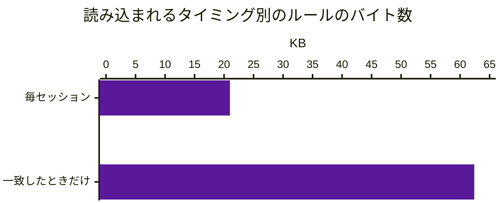
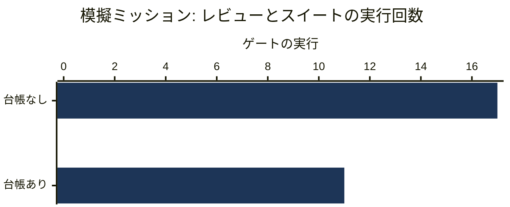

# ベンチマーク結果

[English](RESULTS.md) · **日本語**

`harness-bootstrap` を導入すると何が得られるかを、他の三つの選択肢と比べます: 何もしない、同じものを
手で作る、統制の層のない素のプロンプト。数字はすべてディスク上のファイルから数えたか実際の実行で
得たもので、一つのコマンドで再現できます:

```bash
python benchmark/benchmark.py
```

## 概要

| | ハーネスなし | harness-bootstrap |
|---|---:|---:|
| ブロックされた既知の悪い操作 (フックのペイロード 88) | **0** | **88** |
| 自分で書くハーネスのバイト数 | **667,658** | **0** |
| すべてのエージェントセッションに読み込まれるルールのバイト数 | **0** | **21,016** |
| 立ち上げにかかる時間 | - | 2 秒未満 |

三行目は私たちに有利ではありません。素のエージェントがルールを持たないのは、強制するものが何もない
からです。それがトレードオフで、それを隠すベンチマークは読む価値がありません。

## ベースライン A - ハーネスなし

eval 自身の既知の悪いペイロードを、生成したハーネスと素のリポジトリに送ります。二つのリポジトリの
ファイルと git の履歴は同一で、違いは `.claude/` だけです。



素のリポジトリにはフックのファイルが 0 個で `settings.json` もないので、88 のペイロードのどれにも
受け取るフックがありませんでした。「何も止めなかった」は主張ではなく実演です。スクリプトは素の
リポジトリで実際に操作を行い、その効果で確かめます。

| 素のリポジトリでの操作 | 結果 | 証拠 |
|---|---|---|
| `.env` を読む | 完了 | `API_KEY` を含む 51 バイトを読んだ |
| 既定ブランチに直接コミット | 完了 | `main` の `HEAD` が動いた |
| AI の帰属表示付きで `stuff` をコミット | 完了 | コミットされ、帰属表示が残った |
| 承認済み ADR を編集 | 完了 | ファイルが 25 バイトから 53 バイトに増えた |

ハーネスは eval のもので、`guardrail_eval.py` の `VARS` のフラグ (`hooks_strict`、`long`、`db` を
含む) で生成しています。既定のインストールは、測ったものより少ないフックを持ちます。ガードレールは
フックと拒否ルール (シェルスクリプト、終了コード、glob の一致) なので、モデルには問い合わせず、
結果はモデルに左右されません。このプロジェクトが拠って立つ主張です。

## ベースライン B - 手で作る

同じハーネスを立ち上げるために自分で書くもの。一つ生成して、置かれたものを量りました。

| 種類 | ファイル | バイト |
|---|---:|---:|
| スクリプト | 12 | 329,568 |
| フック | 15 | 137,519 |
| ルール | 16 | 77,269 |
| コマンド | 21 | 54,622 |
| エージェント | 9 | 27,946 |
| ドキュメントの骨組み | 15 | 18,492 |
| ルートのファイル | 8 | 17,370 |
| `settings.json` | 1 | 4,872 |
| **合計** | **97** | **667,658** |

モデルに書かせると推定約 185,400 トークンです。

- **これは自分で書かずに済む部分で、仕事の全部ではありません。** `tech-stack.md`、
  `coding-standards.md`、`git-workflow.md`、オーケストレーターのルーティング表、各 dev エージェントの
  スコープは今も書きます。これらは意図してアセットにしていません。あなたのリポジトリについての
  決定だからです。
- **スクリプトの行が最も議論の余地があります。** 12 本は設定ではなく実際に動く道具 (グラフの
  スキャナ、タスクボードの CLI、検証プランナー、トグル、チェッカー) です。手で作るチームは作らない
  かもしれず、その場合は 338,090 バイトです。

時間 (何時間) では示しません。時間はリポジトリから測れません。

## ベースライン C - 統制の層のない直接の LLM 呼び出し

測れるのはコンテキストです。`paths:` フロントマターのないルールは、すべてのエージェントの
すべてのセッションに読み込まれます。パス限定のルールは、一致するファイルに触れたときだけです。



| | ルール | バイト | トークン (推定) |
|---|---:|---:|---:|
| 素のエージェント、ハーネスなし | 0 | 0 | 0 |
| 無条件、常に読み込み | 7 | 21,016 | ~5,838 |
| パス限定、必要なときに読み込み | 10 | 62,365 | ~17,324 |

ルール本文の 75% が既定セッションの外に残ります。残る七つは、どの glob でも一致させられないものです:
`00-overview`、`agent-guardrails`、`task-tracking`、`conventional-commits` (ファイルではなくコミット
*メッセージ*を律する)、`output-style` (エージェントの書き方)、そしてファイルに触れる前に何をどこへ
送ってよいかを決める `model-policy` と `ai-governance` です。表は全フラグ有効時の数え方で、
`ai-governance` は `ai`、`output-style` は `terse` のときだけ入ります。席の階層はパス限定の
`model-tiers` にあります。

**測っておらず、主張もしないこと:** ハーネスがあるとエージェントのコードが良くなるか。出力の質、
タスクの成功率、正しい変更までの時間、レビューの負担は、リポジトリからは数えられません。ベースライン
A が測るのは強制であって、判断ではありません。

## プロセス - セッションが何を運び、一つの変更に何がかかるか



- **すべてのセッションが運ぶもの** (`AGENTS.md`、`CLAUDE.md`、無条件のルール): `ui`、`db`、`ai`、
  `ddd`、`tests` 有効で 8 ファイル 26,169 バイト、`tests` のみで 7 ファイル 23,098 バイト。
- **各階層を誰が担うか:** どの階層もメインセッション。Standard は作業がコンパクションを越える必要が
  あるときだけタスクファイルを作り、Guarded は必須のゲート (テストと独立したレビュー) を加える。
  オーケストレーターは任意で、複数のドメインやリポジトリにまたがるミッションのときだけ使う。
- **変更の種類ごとのレビューゲート** (`verify-plan.py`): ドキュメントだけ、設定だけの差分はレビュー席も
  テストも不要。ソースファイル一つでコードレビューとフルスイートを一回。認証のコードと依存の更新は
  セキュリティレビューが加わる。シークレットスキャンは常に走る。
- **検証台帳:** 模擬ミッション (3 単位、最終チェック、修正の一巡、再レビュー) でゲートの実行が 17 回
  から 11 回に減り、残り 6 回は `guard-agent-spawn` が台帳の行を示して拒否します。
- **セッションログ 40 行のタスクの再開:** 全体を読むと 8,253 バイト、`task.py` でログを絞ると 5,901
  バイト、`task.py resume` の要約は 966 バイト (~268 トークン)。

## スキャフォールド

初回は **2 秒未満** (ここでは 1.62 秒) で、120 のパスを作り、終了コード 0 で終わります。再実行は
`KEPT` を報告し、何も壊しません。未解決の `{{VAR}}` があると、プレースホルダを置く代わりに非ゼロで
終わります。

比べているのは秒数ではありません。決定的なファイルのコピーと、約 185,000 の出力トークンを生成する
モデルの比較です。後者は何分もかかり、お金がかかり、動かないフックをでっち上げることがあります。

## 記録として - 前身のスキルとの比較

このベンチマークはかつて、置き換え前のスキル `project-bootstrap` と比べていました。事実なので残し、
「書き直しは前回の試みに勝ったか」に答えるだけで、導入を検討する人には関係ないので格下げしました。

読み込みの経路: 234,196 バイトから 136,249 バイト、-42%。スキルの参照文書が変わるたびに、どちらの
方向にも動きます。良くなる一方のベンチマークは宣伝文書です。

## 方法

- **バイトは正確**で、ディスクから数えています。**トークンは推定**で、`ANTHROPIC_API_KEY` がなければ
  3.6 文字/トークン、あれば実際の `count_tokens` エンドポイントを呼びます。どちらの場合も出どころを
  明記します。
- **ベースライン A は eval のペイロードを読み込んで使い**、宣言し直しません。安全性の数字がスイートと
  ずれることはありません。`.sh` の種類で実行し、`bash` がなければメッセージを出して飛ばします。
- **ベースライン A が数えるのは、eval のフックスイートのブロックすべき 88 のペイロードだけ**です。
  eval のフック種類あたり 290 のケースには must-allow のケースや、スキャフォールド、台帳、トグルの
  スイートが含まれ、別の性質を測っているので安全性の成果には数えません。
- **素のリポジトリは同じフィクスチャから作り**、`.claude/` を取り除いています。`.env` や ADR が
  なければ「何もブロックされなかった」は当たり前になってしまいます。
- **ここで測らないもの:** モデル階層ごとのコスト (`benchmark/model_cost.py` がモデル化) と、
  ディスパッチごとのツールスキーマのコスト (実行時の計測が必要)。

ハードウェア: Windows 11、Python 3.13。スキャフォールドの時間は実時間、一回の実行です。
`python benchmark/benchmark.py --skip-guardrails` で、唯一遅いベースライン A を飛ばせます。同時に二つ
走らせるときは `HARNESS_BENCH_WORKDIR` を別々のディレクトリにしてください。そうしないと互いの
ハーネスを途中で消し合います。
