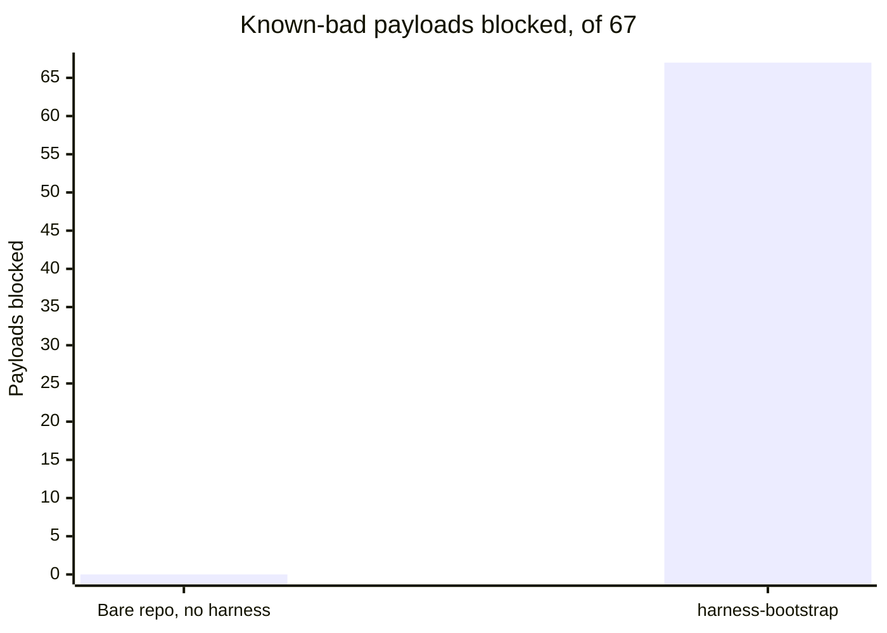
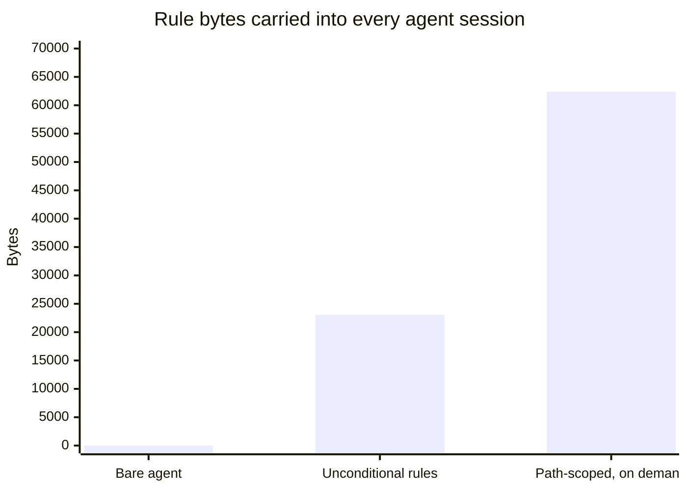

# Benchmark results

**English** · [日本語](RESULTS.ja.md)

What you get for adopting `harness-bootstrap`, measured against the three things you would
otherwise do: nothing, it by hand, or plain prompting with no control layer. Everything below is
counted from files on disk or produced by a real run, and reproduced by one command.

```bash
python benchmark/benchmark.py
```

## At a glance

| | No harness | harness-bootstrap |
|---|---:|---:|
| Known-bad actions blocked (67 hook payloads) | **0** | **67** |
| Bytes of harness you author yourself | **652,677** | **0** |
| Rule bytes loaded into every agent session | **0** | **23,047** |
| Time to stand it up | - | under 2s |

The third row is not a typo and it is not in our favour. A bare agent carries no rules because
there are none to enforce. That is the trade this project is making, and a benchmark that hid it
would not be worth reading.

## Baseline A - no harness at all

The same known-bad payloads that `eval/guardrail_eval.py` fires, sent to a generated harness and to
a bare repo. The two repos have identical files and identical git history. The only difference is
the presence of `.claude/`.

The harness here is the eval's own: scaffolded with the flags in `VARS` in `guardrail_eval.py`,
`hooks_strict`, `long` and `db` among them. So the strict hooks, the long-session hooks and the
migration guard are part of the 67, and a default install carries fewer hooks than the harness
measured. The payloads are the must-block cases of the eval's hook suite, replayed in order and
imported rather than re-declared.



| | Blocked | Of cases |
|---|---:|---:|
| Bare repo, no harness | 0 | 67 |
| harness-bootstrap | 67 | 67 |

All 67 payloads had no hook to receive them in the bare repo: it contains 0 hook files and no
`settings.json`.

"Nothing stopped it" is demonstrated, not asserted. The script performs the underlying actions in
the bare repo and checks them by effect:

| Action | Result | Evidence |
|---|---|---|
| Read `.env` | COMPLETED | 51 bytes read, including `API_KEY` |
| Commit straight to the default branch | COMPLETED | `HEAD` moved on `main` |
| Commit `stuff` with an AI-attribution trailer | COMPLETED | landed, trailer present |
| Edit an Accepted ADR | COMPLETED | file grew 25 to 53 bytes |

This is the claim the project actually rests on. The guardrails are hooks and deny rules - shell
scripts, exit codes and glob matching - so no model is consulted and the result cannot depend on the
model.

## Baseline B - by hand

What you would author yourself to stand up the same harness. Measured by scaffolding one and
weighing what landed.

| Kind | Files | Bytes |
|---|---:|---:|
| Scripts | 12 | 324,988 |
| Hooks | 15 | 119,298 |
| Rules | 16 | 79,300 |
| Commands | 21 | 54,622 |
| Agents | 9 | 31,814 |
| Root files | 8 | 20,197 |
| Docs scaffolding | 15 | 18,492 |
| `settings.json` | 1 | 3,966 |
| **Total** | **97** | **652,677** |

Around 181,300 estimated tokens if a model authors it instead of you.

Two honest qualifications:

- **This is the part you do not author. It is not the whole job.** On top of it you still write
  `tech-stack.md`, `coding-standards.md`, `git-workflow.md`, the orchestrator's routing table and
  each dev agent's scope. Those three rules ship as no asset at all, deliberately: they are
  decisions about your repo and no template can make them for you.
- **The scripts row is the most arguable line.** Those twelve are working tools - the graph
  scanners, the task board CLI, the verification planner, the toggle, the env reader, the checkers -
  not configuration. A team doing this by hand might reasonably not build them, in which case the
  honest figure is 327,689 bytes, not 652,677.

Deliberately not stated in hours. Hours are not measurable from a repository, and any number here
would be a guess wearing a lab coat.

## Baseline C - direct LLM calls, no control layer

The measurable part is context. Every rule without `paths:` frontmatter loads into every session of
every agent, forever. That is rent.



| | Rules | Bytes | Tokens (est.) |
|---|---:|---:|---:|
| Bare agent, no harness | 0 | 0 | 0 |
| Unconditional, always loaded | 7 | 23,047 | ~6,402 |
| Path-scoped, loaded on demand | 10 | 62,365 | ~17,324 |

73% of rule content stays out of the default session. The seven that cannot be scoped are the ones
no glob can match: `00-overview`, `agent-guardrails`, `task-tracking`, `conventional-commits` (it
governs commit *messages*, not files, which is why it is kept under 25 lines on purpose),
`output-style` (it governs how the agent writes, which no path predicts), and the two governance
rules `model-policy` and `ai-governance`, which decide what may be sent where before any file is
touched. The table counts the full set with every flag on: `ai-governance` ships only with the `ai`
flag and `output-style` only with `terse`, so a default install loads fewer. Seat tiers are not in
`model-policy`: they live in the path-scoped `model-tiers`.

**What is not measurable here, and is not claimed:** whether the code an agent produces is better
with a harness than without. Output quality, task success rate, time to a correct change and review
burden are all real and all absent from this page, because none of them can be counted from a
repository. Baseline A measures enforcement, not judgment.

## Process - what a session carries and what one change costs

The harness decides how much process a change gets, and that is measurable on the rendered files.

- **What every session and subagent carries**: `AGENTS.md`, `CLAUDE.md` and the unconditional rules.
  31,179 bytes (8 files) with `ui`, `db`, `ai`, `ddd` and `tests` on; 27,308 bytes (7 files) with
  `tests` only.
- **Who runs each tier**: Inline is the main session itself, Direct is the owning seat called
  straight, Standard is the owning seat with a task file only when the work must survive a
  compaction, and Guarded is the orchestrator, one at a time.
- **The review gate per change class** (`verify-plan.py`): a docs-only or config-only diff needs no
  review seat and no test run; one source file earns code review and the full suite once; auth code
  and a dependency bump add the security review. The secret scan always runs.
- **The verification ledger**: in a simulated mission (3 units, a final check, a fix round, a
  re-review) the review and suite dispatches fall from 17 gate runs to 11, and the other 6 are
  refused by `guard-agent-spawn` with a ledger line to cite.
- **Resuming a task with 40 session-log rows**: 8,253 bytes read whole, 5,901 bytes with the log
  bounded by `task.py`, and a 966-byte `task.py resume` digest (~268 tokens).

## Scaffold

A first run takes **under 2s** (0.8-1.7s across runs on a machine with other work running), creates
120 paths, and exits 0. A re-run reports `KEPT` and clobbers nothing. An unresolved `{{VAR}}` makes it
exit non-zero rather than ship a placeholder into a rule.

The comparison is not a second against some other number of seconds. It is deterministic file
copying against a model generating ~180,000 output tokens, which takes minutes, costs real money,
and can hallucinate a hook that does not run.

## For the record - against the predecessor skill

This benchmark used to compare `harness-bootstrap` against `project-bootstrap`, the skill it
replaced. That number is kept because it is true, and demoted because it answers "did our rewrite
beat our last attempt", which matters to us and to nobody choosing whether to adopt this.

Read path: 234,196 to 178,719 bytes, about -24%.

That figure moves whenever the skill's reference docs change, and it has moved down since the last
release as capability landed (purpose profiles, the verification ledger, intake questionnaires). A
benchmark that only ever improves is a marketing document.

## Methodology

- **Bytes are exact**, counted from files on disk. **Tokens are estimated** at 3.6 chars/token when
  no `ANTHROPIC_API_KEY` is set; with a key the script calls the real `count_tokens` endpoint. The
  source is labelled either way, and a derived number is never printed as a measured one.
- **Baseline A imports the eval's own payload suite** rather than re-declaring it, so the safety
  number cannot drift from the suite it claims to represent. It runs the `.sh` hook flavor and is
  skipped with a message if `bash` is unavailable.
- **Baseline A counts only the 67 must-block payloads** in the eval's hook suite. The eval's full
  250 cases per flavor include must-allow cases and the scaffold, ledger and toggle suites, which
  measure different properties and are not safety wins.
- **The bare repo is built from the same fixtures** as the harnessed one, then has `.claude/`
  removed. If it lacked the `.env` or the ADR, "nothing was blocked" would be trivially true.
- **Not measured here:** cost across model tiers (`benchmark/model_cost.py` models that separately)
  and per-dispatch tool-schema cost, which needs runtime instrumentation this script does not have.

Hardware: Windows 11, Python 3.13. Scaffold timings are wall-clock, single run.
Run `python benchmark/benchmark.py --skip-guardrails` to skip Baseline A, the only slow part.
Two runs at once need `HARNESS_BENCH_WORKDIR` pointing at separate directories, or each deletes the
other's harness mid-run.
