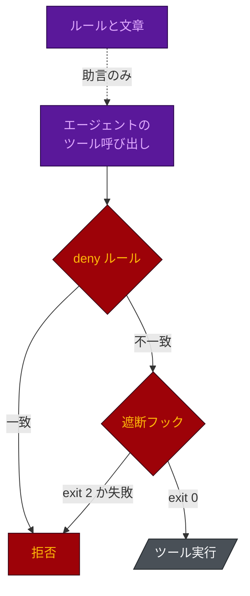

# 評価

[English](ASSESSMENT.md) · **日本語**

このリポジトリが、土台にしている主張に対して何を達成し、何を達成していないかをまとめます。主張として数えるのは、
リポジトリ内のファイルか実行できるスクリプトが裏付けるものだけです。それ以外は「未提供」と記します。

> モデルはコモディティ化しており、持続的な優位性を築く場所としては不向きだ。優位性は **エージェントハーネス**、
> **企業のコンテキスト**、**ワークフロー連携** に移る。ガバナンスは今や **プライバシー、知的財産、モデルの主権**
> を覆わなければならない。AI の能力を *どのモデルを使うか* で位置づけてはならない。**多数のモデル** を、
> ROI があり、データを管理下に置き、本番で安全に動くエージェントシステムに変える力として位置づけること。

## スコアカード

| 柱 | 状態 | 根拠、または不足 |
|---|---|---|
| モデルはコモディティ化している | 対応済み | `reference/cost-model.md` は現行の価格を使う。Opus は Sonnet の 1.67 倍で、5 倍ではない。階層の選択が効くのは安い側 (Haiku) で、Opus と Sonnet の間ではない。 |
| 優位性はハーネスにある | 提供済み、再実行可能 | `eval/guardrail_eval.py` はスキャフォールドしたハーネスに 314 件のペイロード (遮断すべきもの 134、許可すべきもの 180) を撃ち込む。フック形式ごとに 314/314、`sh` と `ps1` を合わせて 628/628。モデルには問い合わせない。 |
| ROI | 半分提供 | ロースターごとのコストはモデル化し (`benchmark/model_cost.py`)、ハーネス自身のオーバーヘッドは測定している (`benchmark/RESULTS.md`)。機能あたりの価値の測定は始まったばかり。Gap 3 を参照。 |
| プライバシー | 提供済み | `security-privacy.md`。`protect-secrets` と `settings.json` の deny ルールで強制し、どちらも評価に含まれる。監査モードでは製品のソースを読み取り専用でマウントする。 |
| ガバナンス: 知的財産 | 提供済み | `ip-compliance.md`: ライセンスのファミリー単位の許可/拒否、SaaS での AGPL の発動条件、再現したブロックの出所、レビュアー向けの差分チェック。 |
| ガバナンス: モデルの主権 | データには強制、ルーティングには助言 | Gap 1。 |
| 多数のモデル、一つのシステム | 未提供 | Gap 2。ベンダーは一社。階層は差し替えられるが、ベンダーは差し替えられない。 |
| 企業のコンテキスト | 部分的 | 仕様、ADR、用語集、ビジネスルール、タスクボード、モジュール境界マップがエージェントに配線されている。チケット管理、SSO、CMDB、社内レジストリとの連携はない。 |
| ワークフロー連携 | 部分的 | スラッシュコマンド、フック、圧縮後も残るボード、保守層 (`/harness-update`、`/harness-tune`、`/board-audit`、`/harness-toggle`、`/agent-permissions`、`/skill-wire`、`/new-skill`)。CI テンプレート、PR の自動化、チケット同期はない。 |

## 強制と助言

ハーネスの制御は、どれも二つの側のどちらかにあります。**ゲート** はモデルの意図に関係なくツール呼び出しを止めます。
**ルール** はモデルが読み、たいていは従うテキストです。以下の Gap はすべて、重要なものがまだルールの側にある箇所です。

- **deny ルール** (`settings.json` の `permissions.deny`) は、エージェントが見ることさえできないものを決めます。
- **遮断フック** は失敗時に閉じます。どれも `"onFailure": "block"` と 30 秒のタイムアウトで登録され、クラッシュや
  タイムアウトは呼び出しを通さず拒否します (v1.20.1)。
- **ルール** (`.claude/rules/`、エージェント本文、コマンドファイル) は振る舞いを形作ります。Claude Code 自身の文書は、
  これが強制の層ではないと述べています。

## リスク

状態: **修正済み** (記載のリリースで解消)、**緩和** (減らしたが無くしてはいない)、**未対応** (把握済み、未着手)、
**受容** (意図したトレードオフ)、**基盤待ち** (このリポジトリが制御できない Claude Code の機能が必要)。

| リスク | 影響 | 緩和策 | 状態 |
|---|---|---|---|
| 遮断ガードのタイムアウトやクラッシュ | 止めるべきコマンドが実行される。実際に、負荷下で `.ps1` ガードが 13.2 秒かかり、`Remove-Item -Recurse -Force .` が走った | すべての遮断ガードに `onFailure: block` と 30 秒のタイムアウト。ガードがこのフィールドを失うと評価が失敗する | 修正済み (v1.20.1) |
| git のグローバルオプション (`git -c k=v commit`、`git -C . commit`) | コミットと破壊的コマンドのガードをすり抜けた。実際に main へのコミットが成立した | ガードはグローバルオプションの先まで解析する。`if` フィルタは `*git *` を使い、ラップされた呼び出しにも一致する | 修正済み (v1.20.1) |
| Windows PowerShell 5.1 がペイロードの先頭に BOM を付ける | 検証台帳が何も読めず、すべての起動を許可していた | フックと `verify-plan.py` で BOM を除去。読めない起動ペイロードは遮断する | 修正済み (v1.20.1) |
| `protect-secrets` が PowerShell ツールを見ていなかった | そこでの `Get-Content .env` が検査されなかった | フックが `Bash` に加えて `PowerShell` にも一致する | 修正済み (v1.20.1) |
| シェル呼び出しごとのフックの遅延 | Bash 呼び出しのたびに Bash 向けのガードが起動する。Windows ではサブプロセス一つに 50-250 ms かかる | フックは並列に走り、最も遅いものが全体を決める。`if` フィルタで素の `ls` が起動するフックは 4 から 2 に (`hooks_strict`、`long`、`rtk` では 9 から 6)。v1.21.0 は、ガードが決して遮断しないコマンドを組み込みコマンドだけで判定する高速経路を加える | 緩和 |
| 2.1.295 より古い Claude Code | `onFailure` と `if` が無視され、ガードが失敗時に開く可能性がある | 要件はフックの README に明記。リリースごとの検証はしていない | 未対応 |
| bash のガードが `jq`、`perl`、`python3` のどれも見つけられない | そのガードは警告して許可する | deny ルールが最後の守り。`guard-agent-spawn` だけは拒否する | 受容 |
| レビュー、テスト実行、起動の繰り返し | 変わっていない内容の再確認にトークンを使い、ループする | 検証台帳、レビューは最大 2 ラウンド、`dispatch_budget` (既定 24)、`attempts` の上限 3、全席の `maxTurns`、起動の深さ 2、同時実行 4 | 緩和 |
| コード以外のリポジトリに過大なハーネス | コードを出荷しないのにテストスイートとコードレビューのゲートが付く | 目的プロファイル: 調査、戦略、文書のハーネスは `checker` を含む少数の席で、コード用の道具を持たない | 緩和 |
| 機密テキストが方針で禁じられたモデルに送られる | データが許可された境界の外に出る | Restricted のパスは読み取りの時点で拒否。ルーティングそのものはルールのテキストだけ | 未対応 (Gap 1) |
| 名前を付けられるパスがない Restricted データ | deny リストで覆えない | 導入時にその事実を認めさせる。認めることは制御ではない | 未対応 (Gap 1) |
| ベンダーが一社 | プロバイダーの交換は設定変更ではなく移植になる | `AGENTS.md` はベンダー中立。`harness-check.py` が席と `model-tiers.md` の一致を保つ | 未対応 (Gap 2) |
| 起動境界が Cursor や Codex に移らない | それらのツールではロースターがルールのテキストになる | 両ツールともサブエージェント開始のフックを持つようになった。ペイロードの対応付けがまだ必要 | 未対応 (Gap 2) |
| 価値を測っていない | 機能あたりの価値のないコストは ROI ではない | `benchmark/live/` (v1.21.0) が実セッションを素のリポジトリとハーネス付きで比べる。モデル階層の比較はまだない | 未対応 (Gap 3) |
| 席が自分のモジュールの外を編集する | 担当者のレビューを経ないモジュール間の変更 | `guard-agent-scope` はコンテキストを加えるだけで遮断しない。`graph-stale` が新しいモジュール間 import を指摘する | 基盤待ち (Gap 4) |
| サードパーティのスキルの雑なレビュー | その指示がルールと同じように信頼される | 信頼度ルーブリックと `/skill-wire` の再レビュー。どちらもモデルが実行する手順 | 未対応 (Gap 4) |
| 一覧にないコマンドでの `.env` の読み取り | Python のワンライナーが値を読む | `protect-secrets` はファイル系ツールと一覧のシェルコマンドを遮断する。`env-read.py` は安全な既定であり、強制された経路ではない | 未対応 (Gap 4) |
| `tech-presets.md` が古くなる | ブートストラップが古いバージョンを提案する | 導入済みの現実がプリセットに優先する。ファイルを定期的に再確認するものはない | 未対応 (Gap 5) |
| 評価が厳格なスキャフォールドを測っている | 既定のインストールは、数字が覆うより少ないフックしか持たない | フラグの組み合わせは `eval/guardrail_eval.py` の `VARS` にあり、数字を載せる箇所ではどこでも明記する | 受容 |

## Gap 1 - モデルの主権: データには強制、ルーティングには助言

`model-policy.md` は、各データクラス (Public、Internal、Confidential、Restricted) を処理してよいモデルに結びつけます。
分類は席の階層に優先します。クラスがその階層のモデルを禁じるなら、作業は別の経路に回るか、委任されません。

**強制されているもの。** 強制の対象はモデルではなくデータです。導入時に Restricted データの場所を尋ね、その答えが
`settings.json` の deny リスト先頭の `{{RESTRICTED_DENIES}}` 枠を埋めます。エージェントが読めないものは、どのモデルにも
送れません。

**助言にとどまるもの。**

- **ルーティング。**「このテキストをあのプロバイダーに送った」という形のツール呼び出しは存在しないので、読める
  Confidential のテキストがプロンプトに入るのを止められるフックはありません。
- **パスのないデータ。** 組織が Restricted データの場所を名指しできなければ、deny リストでは覆えません。

## Gap 2 - 多数のモデル: ベンダー一社のハーネス

エージェント定義は Claude Code のフロントマターです。`model:` が取るのは `opus`、`sonnet`、`haiku`、`fable` の、
一社の 4 モデルです。階層は差し替えられますが、ベンダーは差し替えられません。

**部分的に役立つもの。**

- `AGENTS.md` はベンダー中立で、`CLAUDE.md` はそれを取り込みます。他のツールが得るのはルールだけで、フック、
  deny ルール、権限モデルは得られません。
- `port.py` は、ルールとシェルおよびファイルのガード (`guard-main-commit`、`check-commit-msg`、`protect-secrets`、
  `protect-adr`) を、文書化した注意点つきで Cursor と Codex に移植します。
- `model-tiers.md` は席の階層をモデルに対応付け、`harness-check.py` は `model:` が自分の行と矛盾する席を失敗させます。
  これは整合性の検査であり、抽象化ではありません。席は今もモデルを直接名指ししています。

**起動境界。** `guard-agent-spawn` は Claude Code の `Agent|Task` ツールを鍵にしています。Cursor は `subagentStart`
(拒否できると文書化) を、Codex は `SubagentStart` (遮断は文書化されておらず未検証) を備えています。フックの接点は
制御そのものではありません。間には二つの作業があります。

- **ペイロードのフィールドが違う。** フックが読むのは `subagent_type`、`model`、`prompt`。Cursor が送るのは
  `subagent_type`、`subagent_model`、`task`。Codex が送るのは `agent_type` と `agent_id`。
- **ロースターの同一性が保たれないかもしれない。** 検査は「`.claude/agents/<type>.md` が存在するか」です。Cursor が
  文書化しているのは汎用のサブエージェント種別だけで、Codex はエージェント種別を `[agents.<name>]` の TOML 表から読みます。

`port.py` は今も「どちらのツールにもサブエージェント起動のフック接点がない」と表示します。このメッセージは両方の
イベントより前のもので、古くなっています。

**解消するには:** 席が階層を宣言し、スキャフォルダーが階層表から `model:` を生成する。そうすればベンダーの交換は
1 ファイルの編集と再実行で済みます。

## Gap 3 - ROI にはまだ分子がない

このリポジトリは、ハーネスのコストを測っています。`benchmark/model_cost.py` によれば、sonnet のみのロースターは
既定の 0.85 倍、haiku のみは 0.26 倍です。安い出力が出荷に値するかどうかは分からず、主張が拠って立つのはその問いです。

`eval/guardrail_eval.py` が測るのは床、つまりモデルが何をさせてもらえないかです。v1.21.0 は `benchmark/live/` を加えます。
これは固定のタスクで実際の `claude -p` セッションを、素のリポジトリとハーネス付きのリポジトリで走らせ、すべての判定を
決定的な検査でリポジトリから読み取ります。分子の出発点です。ただし同じタスクで一つのハーネスをモデル階層ごとに
走らせてはおらず、主張を検証するのはその比較です。

## Gap 4 - ゲートが欲しい場所の助言

ゲートに見えて、実は手順である制御が四つあります。

- **モジュールの範囲。** `Edit|Write` の `PreToolUse` ペイロードは呼び出し元のサブエージェントを名指ししないので、
  どの席が書いているかをフックは判別できません。そのため `guard-agent-scope` は設計上、助言です。別の席が担当する
  モジュールへの編集で、アクティブなタスクがそれを挙げていないときにコンテキストを加え、状況が曖昧なら黙り、常に
  exit 0 です。解消には、Claude Code がツールのペイロードに呼び出し元を載せる必要があります。ここでコードを増やしても
  解決しません。
- **スキルの導入。** `reference/skill-discovery.md` と `/skill-wire` は、候補スキルの全ファイルを読み、秘密への
  アクセス、外部送信、設定編集の指示を確認するよう求めます。読むのは、そのスキルをこれから信頼するモデル自身です。
  ゲートは `AskUserQuestion` と変更履歴の 1 行です。
- **env ファイル。** `protect-secrets` は `.env*` への `Read`/`Edit`/`Write` と、一覧のシェルコマンド (`cat`、`head`、
  `type`、`Get-Content` など) を `Bash` と `PowerShell` の両方で遮断します。Python や Node のワンライナーは認識できる形では
  ありません。`env-read.py` を使えという規則は文章です。
- **データのルーティング。** Gap 1。

## Gap 5 - 鮮度確認のない技術プリセットは古びる

`reference/tech-presets.md` はコードベース分析にバージョンのカタログを与え、モデルが古い学習データからバージョンを
提案しないようにします。`codebase-analysis.md` は、導入済みの現実が優先し、矛盾するプリセットは移行の提案になると
述べています。その規則はテキストです。カタログをパッケージレジストリと突き合わせるスクリプトはなく、古さを
指摘する定期ジョブもありません。

**解消するには:** 固定したバージョンを定期的に抜き取りでレジストリと照合し、ずれがしきい値を超えたら失敗するジョブ。
ネットワークを必要としてはならないブートストラップ本体ではなく、別のジョブにします。

## 今日このリポジトリが支えるもの

1. **安全性はモデルに依存しない。** フック形式ごとに 314/314、再実行可能。`hooks_strict`、`long`、`db` を有効にして
   スキャフォールドしたハーネスで測定。
2. **フックは、台本のペイロードだけでなく実セッションで確かめてある。** v1.20.1 は `claude -p` の中でフックを走らせ、
   そこでしか現れなかった四つの穴を塞いだ。評価は `ps1` 形式を settings が呼ぶのと同じ Windows PowerShell で、`.sh`
   フックを Git Bash で走らせる。
3. **ハーネスは持ち運びが安い。** 先代スキルに対して、モデルが書くバイト数は -90%、ルール本文の 75% が既定セッションの
   外に出る。読み取り経路の数字は `benchmark/RESULTS.md` にある。
4. **コストは意思決定である。** すべての席が明示的な `model:` と `effort:` を持つ。既定のロースターは sonnet のみより多くを
   Opus のレビューゲートに使う。これは明言した賭けで、コスト表を使えば逆の側に賭けられる。
5. **釣り合いは強制される。** 段階の表は小さな作業には 1 回の確認だけを求め、テストと独立レビューを必須にするのは Guarded の変更だけにする。検証台帳は、すでに通った内容に
   対するレビューやスイートの再実行、3 ラウンド目のレビュー、同一の指示、タスクの予算を超える起動を拒否する。
6. **起動境界はゲートである。** `guard-agent-spawn` は、ロースター外の席、モデルの上書き、`TASK-NNN` も
   `TIER: direct` / `TIER: standard` の印も持たない書き込み可能な席の起動を遮断する (オプトインの `orchestrator` はタスクを登録する側なので対象外)。
7. **ハーネスは置きっぱなしではなく保守される。** `/harness-update` は差分のあるファイルを決して上書きしない。
   `/harness-tune` は差分を見せてからでないと設定を変えない。どちらも `harness-check.py` で締める。

## 残りの作業 (優先順)

1. **モデル階層をまたぐ品質評価** を、ライブベンチマークのタスクで。主張が誤りだと示しうる唯一の項目 (Gap 3)。
2. **席の階層から `model:` を生成する** (スキャフォールド時。Gap 2 の機械的な半分)。
3. **起動境界を Cursor の `subagentStart` に移植する。** ペイロードの対応付けと、ロースターの同一性をそろえる手段。
   同じ変更で `port.py` のメッセージも直す (Gap 2)。
4. **スキル導入時の一次の内容スキャン。** モデルのレビューの前に、秘密へのアクセス、外部の送信先、設定編集の指示を
   grep する (Gap 4)。
5. **`protect-secrets` をインタプリタのワンライナーまで広げる。** さもなければ、`env-read.py` は既定であって強制された
   経路ではないと、あらゆる箇所で明記する (Gap 4)。
6. **`tech-presets.md` の定期的な鮮度確認** (Gap 5)。
7. **CI テンプレートと `devops` のパイプライン。** ワークフロー連携が保守コマンドの先まで届くように。
8. **ここでは対応できない:** 遮断するモジュール範囲のフックは、Claude Code が `Edit`/`Write` のペイロードに呼び出し元を
   載せるのを待つ (Gap 4)。
