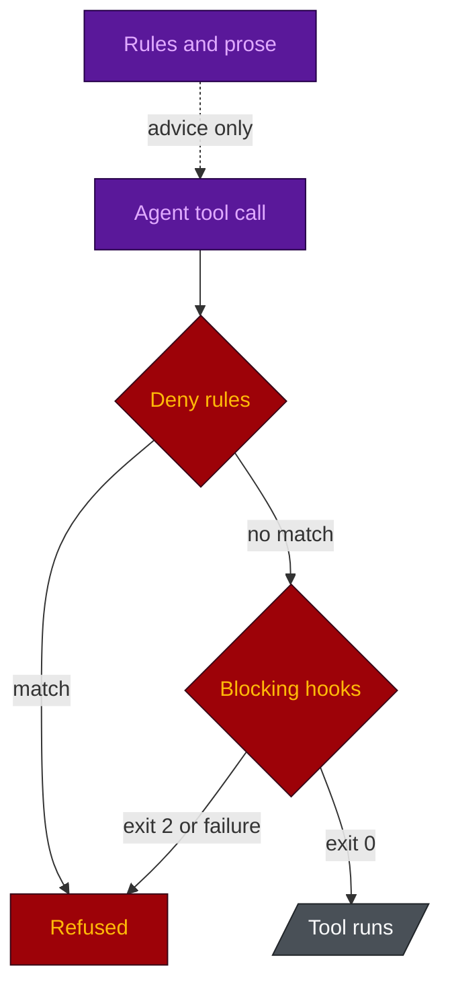

# Assessment

**English** · [日本語](ASSESSMENT.ja.md)

What this repo delivers against the thesis it is built on, and what it does not. A claim counts only
when a file or a runnable script in this repo backs it. Anything else is marked not delivered.

> Models are commoditising and are a poor place to build durable advantage. The advantage moves to
> the **agent harness**, to **enterprise context**, and to **workflow integration**. Governance now
> has to cover **privacy, IP, and model sovereignty**. Position AI capability not around *which model
> we use*, but around the ability to turn **many models** into an agent system that has ROI, keeps
> data under control, and runs safely in production.

## Scorecard

| Pillar | Status | Evidence, or the gap |
|---|---|---|
| Models are commoditising | Acted on | `reference/cost-model.md` uses current pricing: Opus is 1.67x Sonnet, not 5x. Tier choice pays at the cheap end (Haiku), not between Opus and Sonnet. |
| Advantage is the harness | Delivered, re-runnable | `eval/guardrail_eval.py` fires 312 payloads (134 must-block, 178 must-allow) at a scaffolded harness: 312/312 per hook flavour, 624/624 for `sh` and `ps1` together. No model is consulted. |
| ROI | Half delivered | Cost per roster is modelled (`benchmark/model_cost.py`) and the harness's own overhead is measured (`benchmark/RESULTS.md`). Value per feature is only starting to be measured. See Gap 3. |
| Privacy | Delivered | `security-privacy.md`, enforced by `protect-secrets` and `settings.json` deny rules, both in the eval. Audit mode mounts product source read-only. |
| Governance: IP | Delivered | `ip-compliance.md`: licence allow/deny by family, the AGPL-on-SaaS trigger, provenance of reproduced blocks, a diff check for reviewers. |
| Governance: model sovereignty | Enforced on data, advisory on routing | Gap 1. |
| Many models, one system | Not delivered | Gap 2. One vendor; tier is swappable, vendor is not. |
| Enterprise context | Partial | Specs, ADRs, glossary, business rules, the task board and a module-boundary map are wired into the agents. No integration with ticketing, SSO, a CMDB or an internal registry. |
| Workflow integration | Partial | Slash commands, hooks, a board that survives compaction, and a maintenance layer (`/harness-update`, `/harness-tune`, `/board-audit`, `/harness-toggle`, `/agent-permissions`, `/skill-wire`, `/new-skill`). No CI templates, PR automation or ticket sync. |

## Enforced versus advised

Every control in the harness sits on one of two sides. A **gate** stops a tool call whatever the
model intends. A **rule** is text the model reads and usually follows. The gaps below are all places
where something important still sits on the rule side.

- **Deny rules** (`settings.json` `permissions.deny`) decide what an agent cannot even see.
- **Blocking hooks** fail closed: each one is registered with `"onFailure": "block"` and a 30 s
  timeout, so a crash or a timeout refuses the call instead of waving it through (v1.20.1).
- **Rules** (`.claude/rules/`, agent bodies, command files) shape behaviour. Claude Code's own
  documentation says they are not an enforcement layer.

## Risks

Status: **Fixed** (closed in the named release), **Mitigated** (reduced, not eliminated), **Open**
(known, not addressed), **Accepted** (a deliberate trade-off), **Platform** (needs a Claude Code
capability this repo does not control).

| Risk | Impact | Mitigation | Status |
|---|---|---|---|
| A blocking guard times out or crashes | The command it should stop runs. Seen live: a `.ps1` guard took 13.2 s under load and `Remove-Item -Recurse -Force .` ran | `onFailure: block` and a 30 s timeout on every blocking guard. The eval fails if a guard loses the field | Fixed (v1.20.1) |
| Git global options (`git -c k=v commit`, `git -C . commit`) | Walked past the commit and destructive-command guards. A commit landed on main live | Guards parse past global options. `if` filters use `*git *` so wrapped calls still match | Fixed (v1.20.1) |
| Windows PowerShell 5.1 prefixes a BOM to the payload | The verification ledger read nothing and allowed every dispatch | BOM stripped in the hook and in `verify-plan.py`. An unreadable spawn payload now blocks | Fixed (v1.20.1) |
| `protect-secrets` ignored the PowerShell tool | `Get-Content .env` there was not checked | The hook now matches `PowerShell` as well as `Bash` | Fixed (v1.20.1) |
| Hook latency on every shell call | Each Bash call starts the Bash-matched guards. On Windows each subprocess costs 50-250 ms | Hooks run in parallel, so the slowest decides. `if` filters cut a plain `ls` from 4 hook processes to 2 (9 to 6 with `hooks_strict`, `long`, `rtk`). v1.21.0 adds a builtins-only fast path for commands a guard can never block | Mitigated |
| Claude Code older than 2.1.295 | `onFailure` and `if` may be ignored, so guards could fail open | The requirement is stated in the hooks README. Not verified release by release | Open |
| A bash guard finds no `jq`, `perl` or `python3` | That guard warns and allows | Deny rules remain the backstop. `guard-agent-spawn` refuses instead | Accepted |
| Repeated reviews, test runs and dispatches | Tokens spent re-checking unchanged content, loops | Verification ledger, two review rounds at most, `dispatch_budget` (default 24), `attempts` cap of 3, `maxTurns` on every seat, spawn depth 2, concurrency 4 | Mitigated |
| An oversized harness for a non-code repo | Test suites and code review gates where no code ships | Purpose profiles: research, strategy and docs harnesses field a few seats with a `checker`, no code tooling | Mitigated |
| Confidential text routed to a model the policy forbids | Data leaves the permitted boundary | Restricted paths are denied at read time. Routing itself is rule text only | Open (Gap 1) |
| Restricted data with no nameable path | The deny list cannot cover it | Intake forces the admission. An admission is not a control | Open (Gap 1) |
| Single vendor | A provider swap is a port, not a config change | `AGENTS.md` is vendor-neutral. `harness-check.py` keeps seats and `model-tiers.md` in agreement | Open (Gap 2) |
| Spawn boundary does not travel to Cursor or Codex | The roster is rule text on those tools | Both tools now have subagent-start hooks. A payload mapping is still needed | Open (Gap 2) |
| No value measurement | Cost per feature without value per feature is not ROI | `benchmark/live/` (v1.21.0) runs real sessions, bare against harnessed. It does not yet compare model tiers | Open (Gap 3) |
| A seat edits outside its module | Cross-module change without review by the owner | `guard-agent-scope` adds context, never blocks. `graph-stale` names a new cross-module import | Platform (Gap 4) |
| A third-party skill gets a careless review | Its instructions are trusted like a rule | Trust rubric and `/skill-wire` re-review. Both are procedures the model runs | Open (Gap 4) |
| An `.env` read through an unlisted command | A Python one-liner reads the value | `protect-secrets` blocks file tools and the listed shell readers. `env-read.py` is a safer default, not a forced path | Open (Gap 4) |
| `tech-presets.md` goes stale | A bootstrap proposes outdated versions | Installed reality wins over the preset. Nothing re-checks the file on a schedule | Open (Gap 5) |
| The eval measures a strict scaffold | A default install carries fewer hooks than the figure covers | The flag set is `VARS` in `eval/guardrail_eval.py` and is stated wherever the figure is | Accepted |

## Gap 1 - Model sovereignty: enforced on data, advisory on routing

`model-policy.md` binds each data class (Public, Internal, Confidential, Restricted) to the models
allowed to process it. Classification beats seat tier: if the class forbids the tier's model, the
work re-routes or is not delegated.

**What is enforced.** Enforcement is on the data, not the model. Intake asks where Restricted data
lives, and the answers fill the `{{RESTRICTED_DENIES}}` slot at the head of the `settings.json` deny
list. What an agent cannot read, it cannot send to any model.

**What is advisory.**

- **Routing.** No tool call is shaped like "sent this text to that provider", so no hook can stop
  readable Confidential text from going into a prompt.
- **Data without a path.** If the organisation cannot name where Restricted data lives, the deny
  list cannot cover it.

## Gap 2 - Many models: a single-vendor harness

Agent definitions are Claude Code frontmatter. `model:` takes `opus`, `sonnet`, `haiku` or `fable`:
four models from one vendor. The tier is swappable. The vendor is not.

**What partly helps.**

- `AGENTS.md` is vendor-neutral and `CLAUDE.md` imports it. Other tools get the rules, not the
  hooks, deny rules or permission model.
- `port.py` ports the rules and the shell and file guards (`guard-main-commit`, `check-commit-msg`,
  `protect-secrets`, `protect-adr`) to Cursor and Codex, with documented caveats.
- `model-tiers.md` maps seat tiers to models, and `harness-check.py` fails a seat whose `model:`
  contradicts its row. That is a consistency check, not an abstraction: seats still name the model.

**The spawn boundary.** `guard-agent-spawn` keys on Claude Code's `Agent|Task` tool. Cursor ships
`subagentStart` (documented as able to deny) and Codex ships `SubagentStart` (blocking not
documented, so unverified). A hook point is not the control. Two pieces of work stand between them:

- **Payload fields differ.** The hook reads `subagent_type`, `model` and `prompt`. Cursor sends
  `subagent_type`, `subagent_model` and `task`. Codex sends `agent_type` and `agent_id`.
- **Roster identity may not survive.** The check is "does `.claude/agents/<type>.md` exist". Cursor
  documents only generic subagent types. Codex reads agent types from an `[agents.<name>]` TOML table.

`port.py` still prints that neither tool has a subagent-spawn hook point. That message predates both
events and is out of date.

**What would close it:** seats declare a tier, and the scaffolder generates `model:` from the tier
table. A vendor swap would then be a one-file edit and a re-run.

## Gap 3 - ROI has no numerator yet

The repo measures what the harness costs. `benchmark/model_cost.py` puts a sonnet-only roster at
0.80x the default and haiku-only at 0.26x. It cannot say whether the cheaper output is worth
shipping, and that is the question the thesis rests on.

`eval/guardrail_eval.py` measures the floor: what a model is prevented from doing. v1.21.0 adds
`benchmark/live/`, which runs real `claude -p` sessions on fixed tasks, bare repo against
harnessed repo, and reads every verdict from the repository with a deterministic checker. That is
the start of a numerator. It still does not run one harness across model tiers on the same tasks,
which is what would test the thesis.

## Gap 4 - Advice where a gate is wanted

Four controls look like gates and are procedures.

- **Module scope.** A `PreToolUse` payload for `Edit|Write` names no calling subagent, so no hook can
  tell which seat is writing. `guard-agent-scope` is therefore advisory by design: it adds context
  when an edit lands in a module another seat owns and the active task never named it, stays silent
  when the picture is ambiguous, and always exits 0. Closing this needs caller identity on tool
  payloads from Claude Code. More code here would not help.
- **Skill install.** `reference/skill-discovery.md` and `/skill-wire` require reading every file of
  a candidate skill for secret access, egress and config-edit instructions. The model that is about
  to trust the skill does the reading. The gate is an `AskUserQuestion` and a changelog line.
- **Env files.** `protect-secrets` blocks `Read`/`Edit`/`Write` on `.env*` and the listed shell
  readers (`cat`, `head`, `type`, `Get-Content` and others) in both `Bash` and `PowerShell`. A
  Python or Node one-liner is not a shape it recognises. The rule to use `env-read.py` is prose.
- **Data routing.** Gap 1.

## Gap 5 - Tech presets rot without a currency check

`reference/tech-presets.md` gives codebase analysis a version catalogue, so a model does not propose
a version from stale training data. `codebase-analysis.md` says installed reality wins and a
contradicting preset becomes a migration proposal. That rule is text. No script diffs the catalogue
against a package registry, and no scheduled job flags it as stale.

**What would close it:** a scheduled job that spot-checks pinned versions against their registries
and fails past a drift threshold. Not the bootstrap itself, which must not need the network.

## What the repo supports today

1. **Safety does not depend on the model.** 290/290 per hook flavour, re-runnable, on a harness
   scaffolded with `hooks_strict`, `long` and `db` on.
2. **The hooks are proven in real sessions, not only on scripted payloads.** v1.20.1 ran them inside
   `claude -p` and fixed the four holes that only showed up there. The eval now runs the `ps1`
   flavour under the same Windows PowerShell the settings call, and `.sh` hooks through Git Bash.
3. **The harness is cheap to carry.** Measured against the predecessor skill:
   bytes the model must write -90%, and 75% of rule content kept out of the default session.
   Read-path figures are in `benchmark/RESULTS.md`.
4. **Cost is a decision.** Every seat carries an explicit `model:` and `effort:`. The default roster
   spends more than sonnet-only on Opus review gates. That is a stated bet, and the cost table lets
   you take the other side.
5. **Proportion is enforced.** The tier table sends small work Inline or Direct. The verification
   ledger refuses a review or suite re-run on content that already passed, a third review round, an
   identical brief, or a dispatch past the task's budget.
6. **The spawn boundary is a gate.** `guard-agent-spawn` blocks a seat outside the roster, a model
   override, and a write-capable dispatch with neither a `TASK-NNN` nor a `TIER: direct` /
   `TIER: standard` marker.
7. **The harness is maintained, not dropped.** `/harness-update` never overwrites a differing file.
   `/harness-tune` changes a dial only after showing the diff. Both end on `harness-check.py`.

## Remaining work, in priority order

1. **A quality eval across model tiers** on the live benchmark's tasks. It is the one item that
   could prove the thesis wrong (Gap 3).
2. **Generate `model:` from the seat tier** at scaffold time (Gap 2, mechanical half).
3. **Port the spawn boundary** to Cursor's `subagentStart`: a payload mapping plus a way to make
   roster identity line up. Update `port.py`'s message in the same change (Gap 2).
4. **A first-pass content scan on skill install** that greps for secret access, external endpoints
   and config-edit instructions before the model's review (Gap 4).
5. **Widen `protect-secrets`** to interpreter one-liners, or say everywhere that `env-read.py` is a
   default, not an enforced path (Gap 4).
6. **A scheduled currency check** for `tech-presets.md` (Gap 5).
7. **CI templates and a `devops` pipeline**, so workflow integration reaches past the maintenance
   commands.
8. **Not actionable here:** a blocking module-scope hook waits on Claude Code exposing caller
   identity on `Edit`/`Write` payloads (Gap 4).
