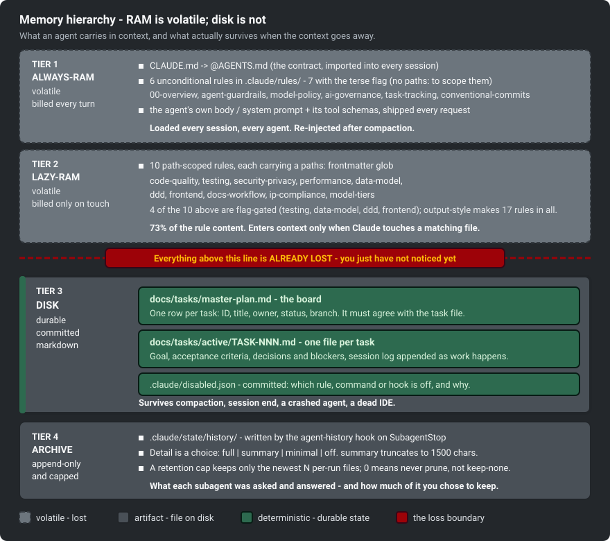
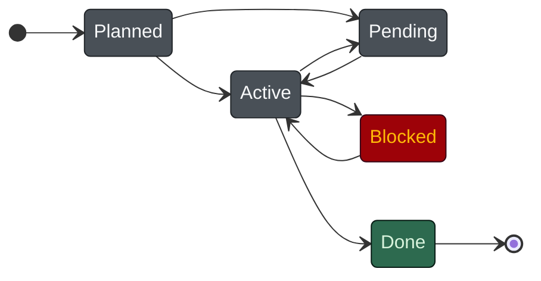
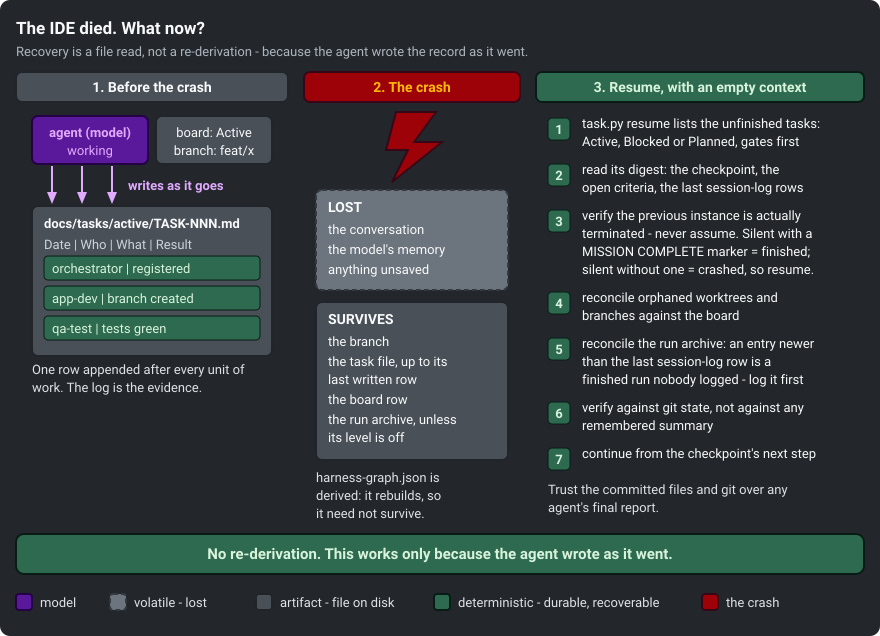
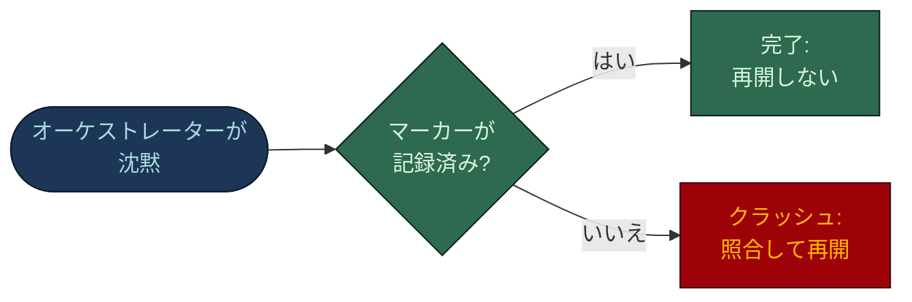

# コンテキスト管理: 状態はモデルの中ではなくディスクに置く

[English](CONTEXT-MANAGEMENT.md) · **日本語**

作業の状態は、モデルのコンテキストウィンドウではなく、コミットされたファイルにあります。タスクは何か、何が
決まったか、何が実行され、何が通り、何が止まっていて、誰が担当か。これらは会話で誰かが主張する前に書き残されます。
だから圧縮、セッションの終了、強制終了されたプロセス、落ちた IDE で失うのは会話であって、ミッションではありません。

このページは、メモリの層、それを支えるファイル、再開の手順、そしてそれぞれの限界を扱います。

## 土台にした考え方

Alberto Arena は [CLAUDE.md is RAM, not disk](https://albertoarena.it/posts/claude-md-is-ram-not-disk/) で、
コンテキストを予算として捉えています。

- `CLAUDE.md` は **RAM**: すべてのセッションのすべてのターンで読み込まれる。
- `docs/` は **ディスク**: 必要になったときに読み、それまでは読まない。
- テストは一つ: *「Claude はこれを毎回必要とするか、時々だけか。毎回なら CLAUDE.md、時々なら docs/」*。
- 肥大した `CLAUDE.md` は Claude を悪くする。ウィンドウを埋め、無関係な分を毎ターン課金する。劣化の始まりを
  彼は「200 行あたり」としている。
- 入れ子の `CLAUDE.md` は詳細をフォルダーに閉じ込めるので、ルートの負担にならない。

生成されるハーネスはこれに従います。`CLAUDE.md` は `@AGENTS.md` の import 一つと Claude 固有の層だけで、
`AGENTS.md` は予算をコメントとして持ちます (*"Keep AGENTS.md and CLAUDE.md under 200 lines combined"*)。分析で
見つかった各モジュールには 40 行までの専用の `CLAUDE.md` があり、そこのファイルが読まれたときだけ読み込まれます。

## このリポジトリがさらに進める点

Arena のたとえは **大きさ**、つまり毎ターン読み込む価値のあるものの話です。このリポジトリは **耐久性**、つまり
ウィンドウが失われたときに何が残るかを加えます。

RAM は高いだけでなく揮発します。圧縮は要約して具体を捨て、セッションの終了は破棄し、クラッシュは道連れにします。
だから設計上の問いはこうなります。

> **空のコンテキストの新しいエージェントが、作業が止まった場所からそのまま引き継げるように、何を書き残すか。**

## 1. メモリの階層

4 つの層があります。Arena の 2 層はどちらも RAM で、その下の 2 層が作業の状態を持ちます。



| 層 | そこにあるもの | 読み込まれる時 | 圧縮のあと |
|---|---|---|---|
| **常時 RAM** | `CLAUDE.md` と `AGENTS.md`、無条件の 7 ルール、エージェント自身の本体、ツールのスキーマ | すべてのセッション、すべてのエージェントで、どのファイルにも触れる前に | ルートの `CLAUDE.md` は再注入される。入れ子のものは、そのフォルダーのファイルが再び読まれたときだけ戻る |
| **遅延 RAM** | パススコープ付きの 10 ルール (`paths:` フロントマター)、モジュールの `CLAUDE.md` | Claude が合致するファイルに触れたときだけ | 消え、次に合致するファイルで再読み込みされる |
| **ディスク** | ボード `docs/tasks/master-plan.md` とタスクファイル | 必要なときに、明示的に読む | 影響なし。コミットされた Markdown はあらゆることに耐える |
| **アーカイブ** | `.claude/state/history/`。終了したサブエージェントの実行ごとに 1 ファイル | 誰かが読まない限り読み込まれない | 影響なし。フックが事後に書く |

### 常時 RAM: 無条件の 7 ルール

`paths:` フロントマターのないルールは、すべてのセッションに `CLAUDE.md` と同じ優先度で読み込まれます。だから
その枠を得られるのは、どのファイルにも触れる前に振る舞いを縛るルールだけです。フラグをすべて有効にすると 7 つです。

| ルール | パススコープにできない理由 |
|---|---|
| `00-overview.md` | 読み込みの約束事とルールの一覧 |
| `agent-guardrails.md` | 最小権限、信頼できないデータ、ゲート付きの操作。最初の読み取りの前から効く |
| `model-policy.md` | どのモデルがどのデータ分類を見てよいかを、ファイルを開く前に決める |
| `task-tracking.md` | *"Loaded in every session, deliberately: an agent that forgets where state lives will invent it."* |
| `conventional-commits.md` | コミットメッセージを律する。メッセージはファイルではないので、どのグロブも合致しない |
| `ai-governance.md` | `ai` フラグのときだけ: AI 機能の出荷 |
| `output-style.md` | `terse` フラグのときだけ: すべての回答の形を決める。常時読み込みのルールは恒久的なコストなので、既定ではオフ |

`model-policy.md` は、すべてのセッションに必要なものだけを持ちます。席の階層、モデルの差し替え手順、拒否リストに
よる強制は、パススコープ付きの `model-tiers.md` にあり、エージェントのファイルか `settings.json` が変わるときだけ
読み込まれます。

### 遅延 RAM: パススコープ付きのルール

それ以外のルールはすべて `paths:` ブロックを持ちます。

```markdown
---
paths:
  - "{{UI_GLOBS}}"
---
# Frontend
```

`benchmark/RESULTS.md` が効果を測っています。**ルール本文の 75% が既定のセッションの外に出ます。** データベースの
エージェントはフロントエンドのルールを抱えず、UI のエージェントはマイグレーションのルールを抱えません。Arena の
テストを機械的に適用したものです: *毎回* は無条件、*時々* にはグロブ。

### ディスク: ミッションの状態がある場所

登録された作業 (Guarded の変更と、利用者が追跡を求めたもの) にはタスクファイルがあります。Inline、Direct、
Standard の作業にはありません。その記録はコミットと報告です。

- **`docs/tasks/master-plan.md`** はボードです。タスクごとに 1 行で、ID、題名、担当、依存、優先度、フェーズ、
  状態を持ちます。タスク ID を割り当てるのはボードで、ブリーフではありません。
- **`docs/tasks/<state>/TASK-NNN-<slug>.md`** は `docs/templates/TASK.md` から作るタスクごとのファイルです。状態、
  目標、入力、受け入れ基準、決定と阻害要因、**チェックポイント** (次の一手、最後に緑だったコミット、未解決の問い)、
  そして **セッションログ** を持ちます。古いログ行は `docs/tasks/log/` に移り、コミットはされますが再開時には
  読み込まれません。

状態は 2 か所にあります。ファイルのフロントマターとボードの行で、ファイルのフォルダーもそれに従います。状態を
変える唯一の方法が `python .claude/scripts/task.py` です (`new`、`move`、`log`、`gate`、`checkpoint`、`attempt`、
`resume`、`check`)。どのサブコマンドもすべてを同時に書き、行を読み戻します。タスク行の手での編集は `guard-board`
フックが止め、`task.py new` は `guard-task-scope` と同じものを拒否するので、このコマンドがフックの抜け道には
なりません。

5 つの状態は `reference/task-control.md` とテンプレートで一度だけ定義されています。



| 状態 | 意味 | フォルダー |
|---|---|---|
| `Planned` | 登録済みで範囲も決まっているが未着手 | `active/` |
| `Active` | 進行中。担当はちょうど一人 | `active/` |
| `Blocked` | 着手したが進めない。理由と、解除する人を記録 | `active/` |
| `Pending` | 意図的に保留 | `pending/` |
| `Done` | 完了し、結果を記録済み | `done/` |

**`Planned` のファイルは `pending/` ではなく `active/` に置きます。** セッション開始時の走査は `active/` を
「作業キューにある」として読むので、`pending/` に置いた新しいタスクは拾われません。フォルダーの構成は、再開の
手順が走査する索引です。

ディスク上の状態には役割の違う 2 種類があります。

- `docs/tasks/` は **チェックポイント** の層: タスク単位で頻繁に書き換わり、再開時に最初に読む。
- `docs/context/` (業務ルール、用語集、既知の問題、ツールの変更履歴) は **蓄積** の層: リポジトリの寿命を通じて
  積み上がるプロジェクトの知識。

タスクファイルはコミットされ、それが説明する作業と同じ PR で出荷されます。だからセッションだけでなく、マシンが
変わっても残ります。

### アーカイブ: 追記のみの実行記録

`agent-history` は **`SubagentStop`** にマッチャー `*` で登録されています。どのサブエージェントが終了しても、その
トランスクリプトを読み、与えられたプロンプトと最終応答を `.claude/state/history/` に書きます。

- **エージェントが選んで行うことではありません。** ログを書かずにクラッシュしたエージェントも、停止イベントで
  フックが発火するので、アーカイブには記録が残ります。
- **必ず 0 で終了します。** ヘッダーには *"This hook must never block a run and never throw."* とあります。ビルドを
  壊しうる監査証跡は、いずれ無効にされます。

`history-tracker` (`haiku`、`effort: low`、`maxTurns: 10`) がアーカイブを読み、空白を埋めないよう指示されています:
*"if the archive does not say, the answer is 'the archive does not say'."* 再開時にはオーケストレーターもアーカイブを
確認します。タスクの最後のログ行より新しいアーカイブのファイルは、終わったのに記録されなかった実行です。
`/board-audit` はこの点検を必要なときに実行します。

**限界:** `.claude/state/` は gitignore されています。アーカイブは、エージェントを動かしたマシンの上では圧縮、
セッションの終了、クラッシュに耐えますが、別の場所の新しいクローンには残りません。永続する層はコミットされた
タスクファイルで、アーカイブは調査用の層です。

### 長期セッション用のフック

長いセッションが居場所を見失う瞬間は 2 つあり、どちらもフックには見えてルールには見えません。`long` フラグで:

- **`compact-checkpoint`** (`PreCompact`) は、圧縮のたびに `.claude/state/compact-checkpoint.md` を書きます。
  ブランチ、各進行中タスクの状態、担当、チェックポイント、最初の未完了項目、未コミットの変更です。タイムスタンプは
  なく、毎回上書きされ、決してブロックしません。自動の圧縮をブロックすると、リクエストが失敗するからです。
- **`session-context`** (`SessionStart`) は、進行中のタスクを最大 8 件、担当と次の一手つきで注入し、圧縮のあとは
  チェックポイントのファイルを指し示します。

どちらもタスクファイルを指し示すだけで、その代わりにはなりません。

### バイトの安定性: ディスクが RAM をキャッシュ可能にする理由

`reference/cost-model.md`:

> **Agent bodies, rule files, and CLAUDE.md must be byte-stable across runs.**

プロンプトキャッシュは `tools`、`system`、`messages` の順の前方一致です。エージェントのファイルに
`Generated: 2026-07-14` の一行があるだけで、そのエージェントのキャッシュは毎回外れます。*"Volatile state belongs in
the task file, which the agent reads as a message."* 状態を永続させる規律と、常時読み込みの層をキャッシュに
乗せ続ける規律は同じもので、一つのルールを両端から見たものです。

## 2. 会話の記憶が記録ではない理由

防ぎたい失敗は、エージェントが忘れることではありません。覚えていても、その記憶が証拠として役に立たないことです。
テストが緑になるのを見て書き残さなかったエージェントは、オーケストレーターには読めず、圧縮でぼやけ、クラッシュで
消える、正しい思い込みを抱えているだけです。

だからハーネスは、それを起きなかったこととして扱います。

- `task-tracking.md`: *"The conversation is not the record; it gets compacted."* と **"A gate counts as passed only when
  a log row records the run"**。それ以外は主張にすぎない。
- `orchestrator.md`: *A gate passed only when the session log records the run; an unlogged "reviewed" is unverified.*
- `AGENTS.md` の原則 4: **"Verify, do not trust."** 「done」「passed」「merged」は git とタスクファイルで確かめる
  主張であり、*"This includes your own claims."*

書き残すことは、作業に後付けした事務ではありません。作業をした本人以外にも検証できるようにする方法です。

## 3. 再開の手順



### セッション開始: ミッションを受ける前に走査する

新しいミッションを受ける前に、オーケストレーターは次を実行します。

```
python .claude/scripts/task.py resume
python .claude/scripts/task.py check
```

引数なしの `resume` は未完了のタスクをすべて、人間のゲートを先頭にして一覧します。`check` はボードとタスクファイルが
一致していることを確かめます。未完了の作業は新しいミッションより優先されるので、走査が先です。走査の前に新しい
ブリーフを受けたオーケストレーターは、すでにボードを分岐させています。

### ファイルから組み立て直す

組み立て直しは `/task-resume TASK-NNN` が行います。許可されたツールそのものが統制になっています。`git status`、
`git diff`、`git log`、`python`、`Read`、`Grep` だけで、`Edit` も `Write` もありません。読んで照合するだけで、
コミットも push もできません。

1. `task.py resume TASK-NNN` が、ボードの行、チェックポイント、未達の受け入れ基準、最後のセッションログ行、そして
   HEAD と作業ツリーがチェックポイントと一致するかを表示します。
2. **会話の記憶よりこの要約を信じます。** タスクファイルは、要約で答えが出ない部分だけ読みます。
3. ずれや未コミットのパスがあれば、先に照合します。未コミットの作業は完成させるかエスカレーションし、stash、
   破棄、上書きは決してしません。
4. チェックポイントの次の一手から続けます。完了した単位ごとに `task.py log`、状態の変更は `task.py move`、止める前に
   新しいチェックポイントを書きます。

### クラッシュからの復旧

`task-control.md` より:

- **プロジェクトを動かすオーケストレーターは一度に一つだけ。** クラッシュしたインスタンスは自動で再開しうるので、
  後継は何かを割り当てる前に、前のものが終了していることを確かめます。推測はしません。
- **黙って止まるのはクラッシュです。** 待ちにはすべて期限があり、監督者は長い沈黙をクラッシュとみなしてファイルの
  状態から再開します。
- **コミットされたファイルと git の状態は、どのエージェントの報告にも勝ります。** 報告は存在しないブランチや作業を
  挙げることがあります。

クラッシュ後の最初の割り当ての前に照合します。

1. `git worktree list`、`git branch -a`、`git log` をボードとタスクファイルと比べる。
2. 進行中のブランチやワークツリーを分類する: マージ済み (片付ける)、完成したが未マージ (ゲートを再実行してから
   マージ)、途中で放棄 (差分を調べ、引き取るかやり直す)。
3. 孤立してロックされたワークツリーと古いブランチを取り除く。
4. 影響を受けたタスクファイルにインシデントを記録する。

### MISSION COMPLETE マーカー

完了して待機しているオーケストレーターと、クラッシュしたものは、同じに見えます。沈黙です。完了したミッションを
再び割り当てれば作業が重複し、クラッシュしたものを放置すれば作業を失います。だから締めくくりでディスクに印を残します。

1. ミッションのタスクをすべて `task.py move` で終端の状態にする。
2. `task.py log TASK-NNN "MISSION COMPLETE - board audited" Done`。
3. まとめを渡して **終了する**。*"An idle instance is indistinguishable from a crashed one, and a lingering one
   invites a duplicate orchestrator to be spawned against the same board."*

監督者は推測ではなく、ファイルの確認で判断します。



### 手順: タスクの途中で IDE が落ちた

1. **開き直し、ブリーフし直さない。** エージェントがしていたと思うことを貼り付けると、記憶が記録にすり替わります。
   この設計が防ごうとしている失敗そのものです。
2. **古いプロセスが終わったことを確かめる。** IDE のウィンドウが閉じても、エージェントが止まったとは限りません。
3. **引数なしの `/task-resume`** で未完了のタスクをすべて一覧する。
4. 進行中だったものに **`/task-resume TASK-NNN`**。要約を読む。
5. **git と照合する**: `git status`、`git diff`、`git log`、`git worktree list`。
6. **インシデントを記録する。** セッションログに一行。
7. チェックポイントの次の一手から **続ける**。

クラッシュしたエージェントが何を頼まれ、最後に何を言ったかは、`.claude/state/history/` を読むか
`history-tracker` に尋ねます。

## 4. 統制の面を、硬さで序列づける

何が **強制** されるか (拒否ルール、`PreToolUse` フック、ツールの許可リスト、`maxTurns`) と、何が **助言** に
とどまるか (ルール、エージェントの本体、`effort:`) は、独立した一枚の文書にまとめてあります:
[`harness-bootstrap/reference/control-surfaces.md`](../harness-bootstrap/reference/control-surfaces.md)。助言を強制に
変える方法と、硬くできなかったものも扱います。

## 5. 失敗の具体例

開発エージェントが `TASK-014` に取りかかって 40 分。自分のワークツリーで `feat/task-014-invoicing` に `FR-07` を
実装しています。失敗するテストを書いて通し、2 回コミットし、ログを 3 行書きました。4 つ目の変更の途中で、IDE の
プロセスが強制終了されます。

| 失われるもの | 残るもの |
|---|---|
| 会話のすべてのターン | ブランチと 2 つのコミット (ワークツリーの中) |
| 作業記憶: 退けた案、組み立て中の次の編集 | タスクファイル: 状態、担当、基準、決定、チェックポイント、最後の行までのセッションログ |
| エディターのバッファにしかなかった編集 | ボードの行 `TASK-014 / Active` |
| | アーカイブ: 割り当て時の正確なプロンプトと、最後に完了した応答 |
| | ディスクに保存済みの未コミットの変更。`git status` で見える |

**復旧。** 新しいオーケストレーターは `task.py resume` を実行し、新しい仕事を受ける前に `TASK-014` を見つけます。
古いプロセスが終わっていることを確かめ、`/task-resume TASK-014` で要約を読みます。`git status`、`git diff`、
`git log`、`git worktree list` は、ワークツリーが無傷で、コミットが 2 つ、未コミットの差分が 1 つあることを示します。
インシデントを一行記録し、差分を引き取り、チェックポイントが示す基準から続けます。

何も導き直さず、どの決定も二度はしていません。ミッションが失ったのは 40 分の会話で、作業はゼロです。クラッシュの
瞬間に巧妙なことは何も起きていません。プロセスが止まっただけです。うまくいったのは、エージェントが進めながら
書き残していたからです。クラッシュからの復旧は後から足す機能ではなく、必要になる前に状態がディスクにあったときに
得られる性質です。

## 出典

上の主張はすべて、このリポジトリのファイルに辿れます。

- `harness-bootstrap/reference/task-control.md` - 状態機械、クラッシュからの復旧、単一インスタンスの規律、完了マーカー。
- `harness-bootstrap/reference/control-surfaces.md` - 強制と助言の統制。
- `harness-bootstrap/reference/cost-model.md` - パススコープ付きのルール、バイトの安定性、`maxTurns`。
- `harness-bootstrap/assets/claude/rules/task-tracking.md` - 記録としてのタスクファイル、ゲートの証拠のルール、
  圧縮後の手順。
- `harness-bootstrap/assets/claude/rules/00-overview.md` - ルールの読み込みの約束事。
- `harness-bootstrap/assets/claude/agents/orchestrator.md` - セッション開始時の走査、アーカイブの照合、締めくくりの
  マーカー。
- `harness-bootstrap/assets/claude/agents/history-tracker.md` - アーカイブを読む者。
- `harness-bootstrap/assets/docs/templates/TASK.md` - タスクファイルとセッションログ。
- `harness-bootstrap/assets/claude/commands/task-resume.md`、`board-audit.md` - 再開と点検。
- `harness-bootstrap/assets/scripts/task.py` - タスクの状態を変える唯一のコマンド。
- `harness-bootstrap/assets/claude/hooks/agent-history.sh`、`compact-checkpoint.sh`、`session-context.sh`、
  `hooks/README.md` - アーカイブと長期セッション用のフック。
- `harness-bootstrap/assets/root/AGENTS.md`、`CLAUDE.md` - 契約と Claude 固有の層。
- `benchmark/RESULTS.md` - 既定のセッションの外に出るルール本文の割合。
- `eval/guardrail_eval.py` - 厳格な足場でフックを実行 (フラグの組は `VARS` が示す)。
- `docs/ASSESSMENT.md` - 何が強制され、何が助言で、なぜルーティングはフックにできないか。

外部: Alberto Arena、[CLAUDE.md is RAM, not disk](https://albertoarena.it/posts/claude-md-is-ram-not-disk/) - RAM と
ディスクのたとえ、毎回か時々かのテスト、肥大した `CLAUDE.md` が性能を下げるという観察。耐久性への拡張、4 つの層、
再開の手順はこのリポジトリのものです。
