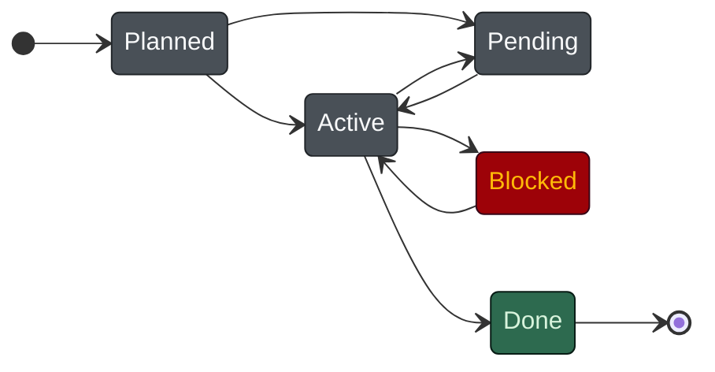
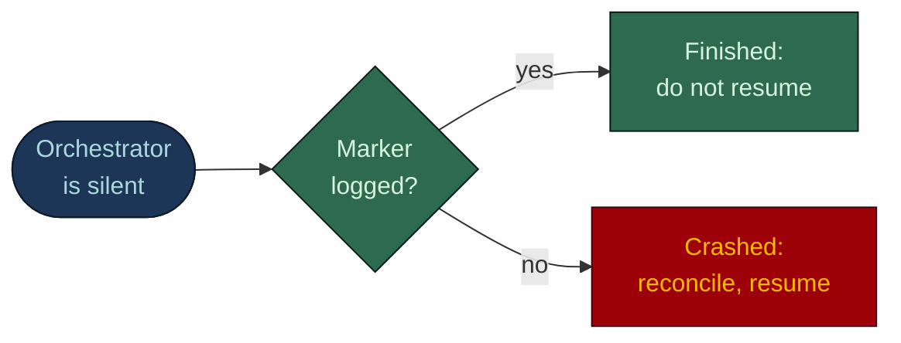

# Context management: state on disk, not in the model

**English** · [日本語](CONTEXT-MANAGEMENT.ja.md)

The state of the work lives in committed files, not in the model's context window. What the task
is, what was decided, what ran, what passed, what is blocked and who owns it are written down
before anyone claims them in a conversation. So a compaction, a session end, a killed process or a
dead IDE costs a conversation, never a mission.

This page covers the memory tiers, the files behind them, the resume protocol, and the limits of
each.

## The framing this builds on

Alberto Arena, in [CLAUDE.md is RAM, not disk](https://albertoarena.it/posts/claude-md-is-ram-not-disk/),
frames context as a budget:

- `CLAUDE.md` is **RAM**: loaded on every turn of every session.
- `docs/` is **disk**: read when needed, not before.
- The test: *"Does Claude need this every time, or only sometimes? Every time goes in CLAUDE.md.
  Sometimes goes in docs/"*.
- A bloated `CLAUDE.md` makes Claude worse. It crowds the window and charges for the irrelevance on
  every turn; he puts the onset "somewhere around line two hundred".
- A nested `CLAUDE.md` scopes detail to a folder so it does not tax the root.

The generated harness follows it. `CLAUDE.md` is a single `@AGENTS.md` import plus the
Claude-specific surface; `AGENTS.md` carries the budget as a comment (*"Keep AGENTS.md and
CLAUDE.md under 200 lines combined"*); and each module from the analysis gets its own `CLAUDE.md`,
40 lines at most, loaded only when a file there is read.

## Where this repo goes further

Arena's metaphor is about **size**: what is worth loading every turn. This repo adds
**durability**: what survives when the window does not.

RAM is volatile as well as expensive. Compaction summarises it and drops the specifics; a session
end discards it; a crash takes it along. So the design question becomes:

> **What is written down so that a fresh agent, with an empty context, can pick the work up exactly
> where it stopped?**

## 1. The memory hierarchy

Four tiers. Arena's two are both RAM; the two below them hold the state of the work.


| Tier | What lives there | When it loads | After a compaction |
|---|---|---|---|
| **Always-RAM** | `CLAUDE.md` and `AGENTS.md`, the 7 unconditional rules, the agent's own body, its tool schemas | Every session, every agent, before any file is touched | The root `CLAUDE.md` is re-injected. A nested one returns only when a file in its folder is read again |
| **Lazy-RAM** | The 10 path-scoped rules (`paths:` frontmatter), module `CLAUDE.md` files | Only when Claude touches a matching file | Gone, and reloaded on the next matching file |
| **Disk** | The board `docs/tasks/master-plan.md` and the task files | On demand, by an explicit read | Untouched. Committed markdown survives everything |
| **Archive** | `.claude/state/history/`, one file per finished subagent run | Never, unless someone reads it | Untouched. A hook writes it after the fact |

### Always-RAM: the 7 unconditional rules

A rule without `paths:` frontmatter loads into every session at `CLAUDE.md` priority, so only rules
that bind behaviour before any file is touched earn that slot. With every flag on there are seven:

| Rule | Why it cannot be path-scoped |
|---|---|
| `00-overview.md` | The loading contract and the rule list |
| `agent-guardrails.md` | Least privilege, untrusted data, gated actions: they apply before the first read |
| `model-policy.md` | Decides which model may see which data class, before a file is opened |
| `task-tracking.md` | *"Loaded in every session, deliberately: an agent that forgets where state lives will invent it."* |
| `conventional-commits.md` | Governs commit messages, and a message is not a file, so no glob can match it |
| `ai-governance.md` | Only with the `ai` flag: shipping AI features |
| `output-style.md` | Only with the `terse` flag: it shapes every answer. Off by default, since an always-loaded rule is a permanent cost |

`model-policy.md` keeps only what every session needs. The seat tiers, the model-swap procedure and
the deny-list enforcement live in the path-scoped `model-tiers.md`, which loads only when an agent
file or `settings.json` changes.

### Lazy-RAM: path-scoped rules

Every other rule carries a `paths:` block:

```markdown
---
paths:
  - "{{UI_GLOBS}}"
---
# Frontend
```

`benchmark/RESULTS.md` measures the effect: **75% of the rule content is kept out of the default
session**. The database agent no longer carries the frontend rules, and the UI agent no longer
carries the migration rules. It is Arena's test applied mechanically: *every time* is
unconditional, *sometimes* gets a glob.

### Disk: where the mission state lives

Registered work (Guarded changes, and anything the user asked to track) gets a task file. Inline,
Direct and Standard work does not: its record is the commit and the report.

- **`docs/tasks/master-plan.md`**, the board: one row per task with ID, title, owner, dependencies,
  priority, phase and status. The board allocates task IDs, never the brief.
- **`docs/tasks/<state>/TASK-NNN-<slug>.md`**, one file per task from `docs/templates/TASK.md`:
  status, goal, inputs, acceptance criteria, decisions and blockers, a **checkpoint** (next step,
  last green commit, open questions) and the **session log**. Older log rows fold into
  `docs/tasks/log/`, still committed but not reloaded on resume.

Status lives in two places, the file's frontmatter and its board row, and the file's folder follows
it. `python .claude/scripts/task.py` is the only way state changes (`new`, `move`, `log`, `gate`,
`checkpoint`, `attempt`, `resume`, `check`). Each subcommand writes all of them together and reads
the row back. The `guard-board` hook blocks a hand edit of a task row, and `task.py new` refuses what
`guard-task-scope` refuses, so the command is not a way around the hook.

The five states are defined once, in `reference/task-control.md` and the template:



| State | Meaning | Folder |
|---|---|---|
| `Planned` | Registered and scoped, not started | `active/` |
| `Active` | In progress, exactly one owner | `active/` |
| `Blocked` | Started, cannot proceed; the reason and the unblocker are recorded | `active/` |
| `Pending` | Deliberately parked | `pending/` |
| `Done` | Complete, results recorded | `done/` |

**A `Planned` file lives in `active/`, not `pending/`.** The session-start scan reads `active/` as
"on the work queue"; a new task filed under `pending/` would never be picked up. The folder layout
is the index the resume protocol scans.

Two kinds of disk state serve different jobs:

- `docs/tasks/` is the **checkpoint** tier: task-scoped, rewritten often, read first on resume.
- `docs/context/` (business rules, glossary, known issues, tool changelog) is the **store** tier:
  project knowledge that accumulates over the life of the repo.

Task files are committed and ship in the same PR as the work they describe, which is why they
survive a change of machine, not just of session.

### Archive: the append-only run record

`agent-history` is registered on **`SubagentStop`** with matcher `*`. When any subagent finishes, it
reads that subagent's transcript and writes the prompt it was given and its final response to
`.claude/state/history/`.

- **The agent does not choose to do this.** An agent that crashes without logging still leaves an
  archive entry, because the hook fires on the stop event.
- **It always exits 0.** Its header: *"This hook must never block a run and never throw."* An audit
  trail that can break a build is one people turn off.

`history-tracker` (`haiku`, `effort: low`, `maxTurns: 10`) reads the archive and is told not to
fill gaps: *"if the archive does not say, the answer is 'the archive does not say'."* On resume the
orchestrator also checks it: an archive file newer than a task's last log row is a run that finished
but was never logged. `/board-audit` runs that sweep on demand.

**The limit:** `.claude/state/` is gitignored. The archive survives compaction, session end and a
crash on the machine that ran the agent, not a fresh clone elsewhere. Committed task files are the
durable tier; the archive is the forensic one.

### The long-session hooks

A long session loses its place at two moments a hook can see and a rule cannot. With the `long`
flag:

- **`compact-checkpoint`** (`PreCompact`) writes `.claude/state/compact-checkpoint.md` before each
  compaction: the branch, each active task's status, owner, checkpoint and first unchecked item, and
  the uncommitted changes. No timestamp, overwritten each time, and it never blocks, because
  blocking an automatic compaction fails the request.
- **`session-context`** (`SessionStart`) injects up to eight active tasks with owner and next step,
  and after a compaction points at the checkpoint file.

Both point at the task files; neither replaces them.

### Byte-stability: why disk is what keeps RAM cacheable

`reference/cost-model.md`:

> **Agent bodies, rule files, and CLAUDE.md must be byte-stable across runs.**

Prompt caching is a prefix match over `tools`, then `system`, then `messages`. One
`Generated: 2026-07-14` line in an agent file cold-misses that agent's cache on every run. *"Volatile
state belongs in the task file, which the agent reads as a message."* So the discipline that makes
state durable is the same one that keeps the always-loaded tier cached: one rule, seen from two
ends.

## 2. Why conversation memory is not the record

The failure this prevents is not that the agent forgets. It is that the agent remembers, and the
memory is worthless as evidence. An agent that saw the suite go green and did not write it down
holds a true belief the orchestrator cannot read, compaction will blur and a crash will delete.

So the harness treats it as not having happened:

- `task-tracking.md`: *"The conversation is not the record; it gets compacted."* and **"A gate counts
  as passed only when a log row records the run"**; anything else is a claim.
- `orchestrator.md`: *A gate passed only when the session log records the run; an unlogged
  "reviewed" is unverified.*
- `AGENTS.md`, principle 4: **"Verify, do not trust."** A "done", "passed" or "merged" is a claim to
  check against git and the task file, *"This includes your own claims."*

Writing it down is not bookkeeping on top of the work. It is how the work becomes verifiable to
anyone but the agent that did it.

## 3. The resume protocol


### Session start: scan before accepting a mission

Before it accepts a new mission, the orchestrator runs:

```
python .claude/scripts/task.py resume
python .claude/scripts/task.py check
```

`resume` with no argument lists every unfinished task, human gates first; `check` confirms the board
and the task files agree. Unfinished work outranks a new mission, so the scan comes first: an
orchestrator that accepts the new brief before scanning has already forked the board.

### Rebuild from the files

`/task-resume TASK-NNN` does the rebuild. Its allowed tools are a control in themselves: `git status`,
`git diff`, `git log`, `python`, `Read` and `Grep`, with no `Edit` or `Write`. It reads and
reconciles; it cannot commit or push.

1. `task.py resume TASK-NNN` prints the board row, the checkpoint, the open acceptance criteria, the
   last session-log rows, and whether HEAD and the working tree match the checkpoint.
2. **Trust that digest over conversation memory.** Read more of the task file only for what it does
   not answer.
3. On drift or uncommitted paths, reconcile first. Uncommitted work is driven to completion or
   escalated, never stashed, discarded or clobbered.
4. Continue from the checkpoint's next step: `task.py log` per completed unit, `task.py move` for
   status, a fresh checkpoint before stopping.

### Crash recovery

From `task-control.md`:

- **Only one orchestrator drives a project at a time.** A crashed instance can auto-resume, so a
  replacement verifies the old one is terminated, never presumes it, before dispatching anything.
- **A silent stall is a crash.** Every wait has a deadline, and a supervisor treats prolonged
  silence as a crash and resumes from file state.
- **Committed files and git state beat any agent's report.** A report can name branches or work that
  do not exist.

Before the first dispatch after a crash, reconcile:

1. Compare `git worktree list`, `git branch -a` and `git log` with the board and the task files.
2. Classify each in-flight branch or worktree: merged (clean up), complete but unmerged (re-run the
   gates, then merge), abandoned mid-work (inspect the diff, adopt or redo).
3. Remove orphaned locked worktrees and stale branches.
4. Log the incident in the affected task files.

### The MISSION COMPLETE marker

A finished orchestrator sitting idle and a crashed one look the same: silence. Re-dispatching a
finished mission duplicates work; abandoning a crashed one loses it. So close-out leaves a mark on
disk:

1. `task.py move` each of the mission's tasks to a terminal state.
2. `task.py log TASK-NNN "MISSION COMPLETE - board audited" Done`.
3. Deliver the summary and **terminate**. *"An idle instance is indistinguishable from a crashed
   one, and a lingering one invites a duplicate orchestrator to be spawned against the same board."*

A supervisor then decides with a file check instead of a guess:



### Procedure: the IDE died mid-task

1. **Reopen; do not re-brief.** Pasting in what you think the agent was doing turns a memory into a
   record, the failure the design exists to prevent.
2. **Confirm the old process is gone.** A closed IDE window does not always mean a stopped agent.
3. **`/task-resume`** with no argument lists every unfinished task.
4. **`/task-resume TASK-NNN`** on the one in flight. Read the digest.
5. **Reconcile against git**: `git status`, `git diff`, `git log`, `git worktree list`.
6. **Log the incident** as a session-log row.
7. **Continue** from the checkpoint's next step.

For what the crashed agent was asked and last said, read `.claude/state/history/`, or ask
`history-tracker`.

## 4. Control surfaces, ranked by hardness

What is **enforced** (deny rules, `PreToolUse` hooks, tool allowlists, `maxTurns`) and what is only
**advisory** (rules, agent bodies, `effort:`) is ranked in a standalone one-pager:
[`harness-bootstrap/reference/control-surfaces.md`](../harness-bootstrap/reference/control-surfaces.md).
It also covers how an advisory control becomes an enforced one, and what could not be made hard.

## 5. A worked failure scenario

A dev agent is 40 minutes into `TASK-014`, implementing `FR-07` on `feat/task-014-invoicing` in its
own worktree. It has written failing tests, made them pass, committed twice and logged three rows.
Midway through a fourth change, the IDE process is killed.

| Lost | Survives |
|---|---|
| The conversation, every turn of it | The branch and its two commits, in the worktree |
| Working memory: rejected approaches, the half-formed next edit | The task file: status, owner, criteria, decisions, checkpoint, the session log to its last row |
| Edits that existed only in the editor buffer | The board row `TASK-014 / Active` |
| | The archive entry: the exact dispatch prompt and the last completed response |
| | Uncommitted changes saved to disk, visible to `git status` |

**The recovery.** A fresh orchestrator runs `task.py resume` and finds `TASK-014` before it accepts
anything new. It confirms the old process is dead, runs `/task-resume TASK-014` and reads the
digest. `git status`, `git diff`, `git log` and `git worktree list` show the worktree intact, two
commits, one uncommitted hunk. It logs an incident row, adopts the hunk, and continues from the
criterion the checkpoint names.

Nothing was re-derived and no decision was made twice: the mission lost 40 minutes of conversation
and no work. Nothing clever happened at crash time; the process simply stopped. It worked because
the agent had been writing as it went. Crash recovery is not a feature you add; it is what you get
when the state was on disk before you needed it.

## Sources

Every claim above traces to a file in this repository:

- `harness-bootstrap/reference/task-control.md` - the state machine, crash recovery, single-instance
  discipline, the completion marker.
- `harness-bootstrap/reference/control-surfaces.md` - enforced versus advisory controls.
- `harness-bootstrap/reference/cost-model.md` - path-scoped rules, byte-stability, `maxTurns`.
- `harness-bootstrap/assets/claude/rules/task-tracking.md` - task files as the record, the gate
  evidence rule, the post-compaction step.
- `harness-bootstrap/assets/claude/rules/00-overview.md` - the rule-loading contract.
- `harness-bootstrap/assets/claude/agents/orchestrator.md` - the session-start scan, the archive
  reconciliation, the close-out marker.
- `harness-bootstrap/assets/claude/agents/history-tracker.md` - who reads the archive.
- `harness-bootstrap/assets/docs/templates/TASK.md` - the task file and its session log.
- `harness-bootstrap/assets/claude/commands/task-resume.md`, `board-audit.md` - resume and audit.
- `harness-bootstrap/assets/scripts/task.py` - the one command that changes task state.
- `harness-bootstrap/assets/claude/hooks/agent-history.sh`, `compact-checkpoint.sh`,
  `session-context.sh`, `hooks/README.md` - the archive and the long-session hooks.
- `harness-bootstrap/assets/root/AGENTS.md`, `CLAUDE.md` - the contract and its Claude surface.
- `benchmark/RESULTS.md` - the share of rule content kept out of the default session.
- `eval/guardrail_eval.py` - the hooks, exercised on a strict scaffold (`VARS` names the flag set).
- `docs/ASSESSMENT.md` - what is enforced, what is advisory, and why routing cannot be hooked.

External: Alberto Arena, [CLAUDE.md is RAM, not disk](https://albertoarena.it/posts/claude-md-is-ram-not-disk/) -
the RAM/disk metaphor, the every-time-versus-sometimes test, and the observation that a bloated
`CLAUDE.md` degrades performance. The extension to durability, the four tiers and the resume
protocol are this repository's.
