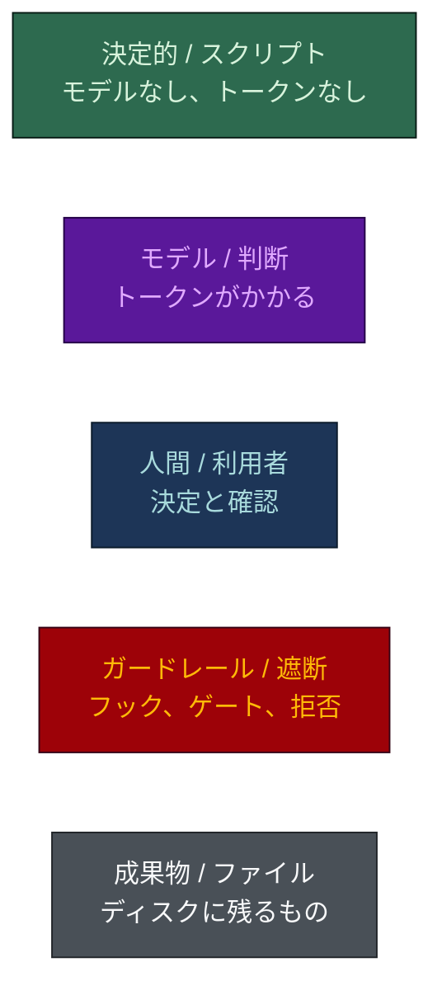
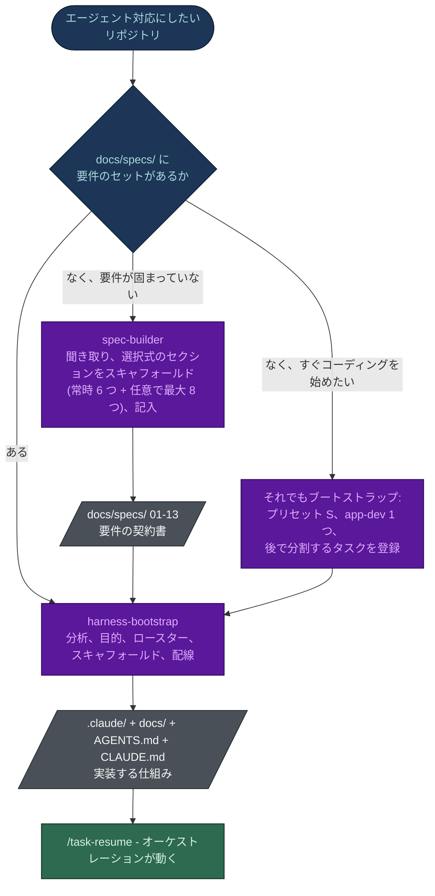
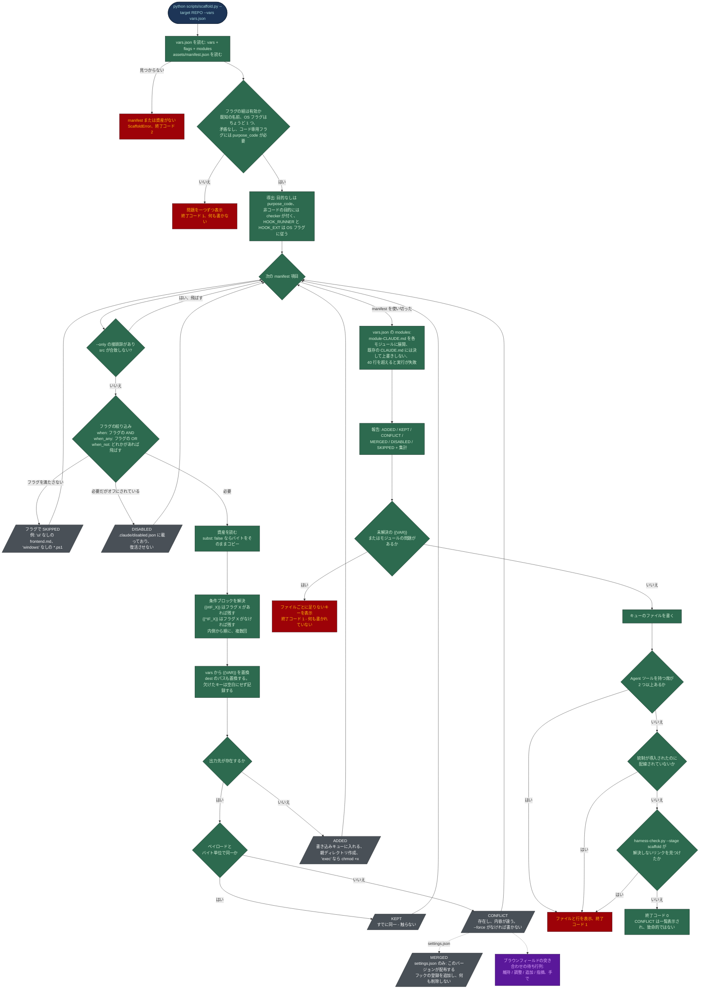
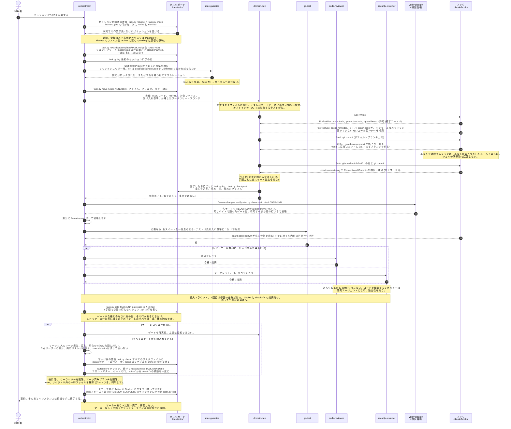
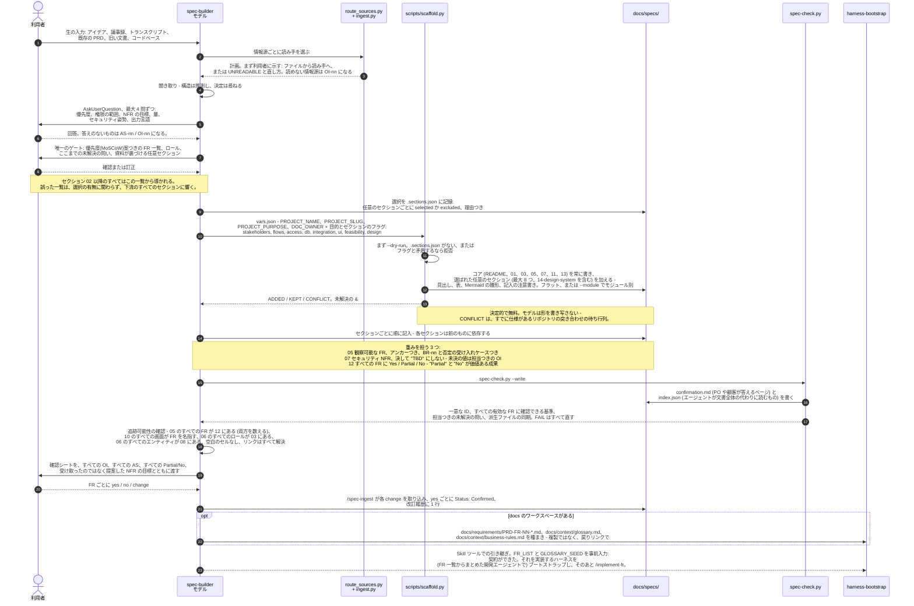
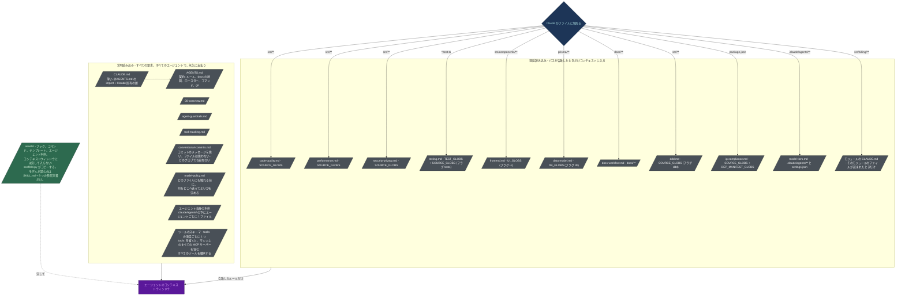

# フロー

[English](FLOWS.md) · **日本語**

このリポジトリの 2 つのスキルの視覚的な参照です。要件の契約書を作る `spec-builder` と、それを実装する仕組みを作る
`harness-bootstrap`。

以下の図はすべて Mermaid で、GitHub 上でそのまま描画されます。図の主張は次のソースから取っています:
`harness-bootstrap/SKILL.md`、その `reference/` 文書、`scripts/scaffold.py`、`assets/manifest.json`、
`assets/claude/settings.json`、`assets/claude/hooks/README.md`、`spec-builder/SKILL.md`、
`benchmark/RESULTS.md`。セクション 7 だけは例外で、図ではなく書き下ろしのコマンド参照です。図 4 のシーケンスが
実際に呼ぶコマンドを説明するので、ここに置いています。

## 凡例

色には意味があります。**緑は無料、紫は課金されます。** スクリプトが決定的に、トークンゼロで行う手順は緑、
モデルが考える必要がある手順は紫です。`harness-bootstrap` は、作業をできるだけ紫から緑へ移します。資産は
`scaffold.py` がコピーする本物のファイルであって、モデルが書き写す 1,300 行の散文ではありません。

Mermaid の `classDef` はフローチャートにだけ適用され、シーケンス図には効きません。そのため、下の 2 つの
シーケンス図は、同じ意味を塗り分けではなく、文章と注記で伝えます。

## 1. システム全体のフロー - 2 つのスキルの関係

`spec-builder` が契約書を書き、`harness-bootstrap` がそれを実装する仕組みを作ります。別のスキルなのは、答える問いが
違うからです。*何が真でなければならないか* と、*誰が、どんなガードレールの下で、いくらで作るか*。分岐点は
`docs/specs/` にすでに要件のセットがあるかどうかです。あれば `harness-bootstrap` にそのまま進みます。なければ、
先に `spec-builder` を走らせるか、単一の `app-dev` でブートストラップして、モジュールが見えてきたら分割する
タスクを登録します。`harness-bootstrap` は仕様の存在を必須とせず、ないときはより小さなロースターを置きます。
導入時に仕様が見つからなければ、ギャップを記すだけでなく `Skill` ツール経由で `spec-builder` を呼び出し、その
引き継ぎは確定した `purpose_*` フラグを spec-builder の `vars.json` に運びます。そのため目的は 2 つのスキルで一度だけ
尋ねられ、コードを出荷しないリポジトリは spec-builder の軽い契約書になります。

依存は一方向です。`spec-builder` は `harness-bootstrap` が作る docs ツリーに書き込むので、docs ツリーがまったく
ないリポジトリでは `harness-bootstrap` が先に走り、`spec-builder` がそれが作った `docs/specs/` フォルダを
埋めます。セクション 03 (用語集) と 05 (機能要件) が埋まると、`spec-builder` は `docs/requirements/PRD-FR-NN-*.md`、
`docs/context/glossary.md`、`docs/context/business-rules.md` も種まきします - 種まきであって複製ではなく、
仕様セクションが正本のまま、context のファイルがそこへ戻りリンクします。

## 2. harness-bootstrap の全体

3 つの帯として読みます。モデルが必要な **紫** の分析と決定の段階、スクリプトが大量のコピーを無料で行う **緑** の
スキャフォールドの手順、そしてテンプレートでは知りえないこと - 経路表、各開発エージェントの範囲、実際の deny
コマンド - のための 2 つ目の **紫** の段階。スキャフォルダから出る `CONFLICT` の枝はエラー経路ではありません。
ブラウンフィールドの突き合わせの待ち行列で、スキャフォルダが利用者の書いたファイルを決して上書きしない理由
です。リポジトリの **目的** (コード、リサーチ、戦略、ドキュメント - 一つ以上) は導入時の最初の質問で、ベースの
ロースターと検証を決めるので、リサーチやドキュメントのリポジトリにテストスイートやコードレビューのゲートが
渡されることはありません。

```mermaid
flowchart TD
    START(["利用者が /harness-bootstrap を実行"])
    MODE{"モード"}

    GF["グリーンフィールド<br/>空に近いリポジトリ"]
    BF["ブラウンフィールド<br/>ソースがあり、エージェントが書き換える"]
    AU["監査<br/>エージェントが分析し、人が修正を適用する"]

    ANALYZE["コードベース分析 - 必須<br/>スタック、モジュール、データ層、連携、<br/>規約、危険な操作、既存の .claude/、git の実態"]
    INV[/"インベントリレポート<br/>対応表: モジュールから開発エージェント、<br/>規約からルール、危険な操作から deny とフック"/]
    CONFIRM{"利用者がレポートを<br/>確認または訂正"}

    INTAKE["導入: まず目的、次にその目的が必要とするものだけ。<br/>事前に答えを埋めた質問票 1 つ、AskUserQuestion は最大 2 回、<br/>利用者が書いた言語で。<br/>ブラウンフィールド: 証拠から事前入力し、コードで決まらないことだけ聞く"]
    NOSPECS["仕様がまだない?<br/>Skill ツールで spec-builder を呼ぶ。<br/>確定した目的のフラグを運ぶ"]
    TOOLS["対象ツールを検出して確認<br/>順位付きの証拠: settings.json のフック、.cursor/、<br/>.codex/ 固有の形式だけが強い証拠 - CLAUDE.md と<br/>.claude/agents は弱く、AGENTS.md だけなら尋ねる。<br/>回答は target_cursor / target_codex として残る"]
    PLAN{"1 画面のセットアップ計画:<br/>作成 / 維持 / 変更、<br/>各席のモデル + effort つきのロースター。<br/>利用者が確認"}

    ROSTER["ロースターを選ぶ<br/>目的がベースを決める: コードにはレビューゲートと開発エージェント<br/>(プリセット S/M/L)、リサーチ・戦略・ドキュメントには checker を含む 3 から 5 席。<br/>すべてのエージェントに明示的な model、effort、tools、maxTurns"]
    SKILLS["スキルの探索と導入 (質問票が求めたとき)<br/>信頼度ルーブリック + 必須の内容確認、スキルごとに了承。<br/>/skill-wire で席に結ぶ。合うものがなければ /new-skill"]
    OS["開発 OS を検出<br/>Windows は .ps1、macOS または Linux は .sh<br/>windows / posix フラグを設定"]
    VARS[/"vars.json<br/>vars + フラグ: purpose_code / research / strategy / docs の一つ以上、<br/>ui, db, db_engineer, db_seeder, ai, audit, tdd, ddd, light, unit, e2e, tests,<br/>deploy_ask, long, solo_review, merge_gate, hooks_strict, terse, rtk, pr_cli,<br/>target_cursor, target_codex、windows / posix のちょうど一方<br/>+ modules: モジュールごとの CLAUDE.md、40 行まで"/]

    DRY["scaffold.py --dry-run"]
    SCAFFOLD["scaffold.py<br/>assets/ の決定的なコピー"]
    HCHECK["harness-check.py --stage scaffold<br/>席、フック、ルール、コマンド、スキルのリンクがすべて解決する"]

    ADDED[/"ADDED<br/>ファイルがなかった"/]
    KEPT[/"KEPT<br/>存在し、バイト単位で同一"/]
    CONFLICT[/"CONFLICT<br/>存在し、内容が違う - 書かない"/]
    MISSINGVAR["未解決の {{VAR}}<br/>終了コード 1、何も書かない"]

    RECONCILE["手で整合させる:<br/>維持 / 調整 / 追加 / 指摘。<br/>利用者が書いたものを決して上書きしない"]

    GAPFILL["モデルによる穴埋め<br/>オーケストレーターの経路表、開発エージェントの範囲、<br/>tech-stack.md、coding-standards.md、git-workflow.md、<br/>実際のスタックに合わせた settings.json の allow/deny、.env.example"]
    WIRE["オーケストレーションの配線<br/>master-plan の索引表、分析のギャップ一覧から種まきした<br/>フェーズ 1、AGENTS.md の入口、<br/>薄い @AGENTS.md の import としての CLAUDE.md"]

    GATE{"品質ゲート<br/>構造 / コストとコンテキスト / 安全 /<br/>ガバナンス / 土台づけ / 引き継ぎ"}
    SMOKE["ループの動作確認: 実際のタスクファイル、<br/>master-plan の行、セッションログの行、/task-resume、<br/>board-check.py が終了コード 0"]
    MAPS["マップを作る: code-graph.py (モジュール境界マップ)、<br/>docs-graph.py --check (孤立 ID)、<br/>harness-graph.py --html (配線)"]
    PORT["記録された移植先へ移植<br/>port.py --tool cursor / codex / all:<br/>.cursor/rules + アダプタ、.codex/hooks.json。<br/>/harness-update はそれを読み直し、尋ね直さない"]
    DONE(["ハーネスがオーケストレーションの下で動く"])

    START --> MODE
    MODE -->|"ソースなし"| GF
    MODE -->|"ソースあり、エージェントが書く"| BF
    MODE -->|"ソースあり、エージェントは書かない"| AU

    GF --> INTAKE
    BF --> ANALYZE
    AU --> ANALYZE
    ANALYZE --> INV --> CONFIRM
    CONFIRM -->|"訂正が発見に優先"| ANALYZE
    CONFIRM -->|"確認済み"| INTAKE

    INTAKE -->|"docs/specs/ なし"| NOSPECS --> INTAKE
    INTAKE --> TOOLS --> PLAN
    PLAN -->|"変更の要望"| INTAKE
    PLAN -->|"確認済み"| ROSTER
    ROSTER --> SKILLS --> OS --> VARS
    VARS --> DRY --> SCAFFOLD

    SCAFFOLD --> ADDED
    SCAFFOLD --> KEPT
    SCAFFOLD --> CONFLICT
    SCAFFOLD --> MISSINGVAR
    SCAFFOLD --> HCHECK
    MISSINGVAR -->|"変数を足して再実行"| VARS

    CONFLICT --> RECONCILE
    ADDED --> GAPFILL
    KEPT --> GAPFILL
    RECONCILE --> GAPFILL

    GAPFILL --> WIRE --> GATE
    GATE -->|"チェックが失敗"| GAPFILL
    GATE -->|"すべて緑"| SMOKE --> MAPS --> PORT --> DONE

    classDef det fill:#2D6A4F,stroke:#081C15,stroke-width:1px,color:#D8F3DC
    classDef mod fill:#5A189A,stroke:#240046,stroke-width:1px,color:#E0AAFF
    classDef hum fill:#1D3557,stroke:#0B1B2B,stroke-width:1px,color:#A8DADC
    classDef gate fill:#9D0208,stroke:#370617,stroke-width:1px,color:#FFBA08
    classDef art fill:#495057,stroke:#212529,stroke-width:1px,color:#F8F9FA

    class ANALYZE,INTAKE,NOSPECS,TOOLS,ROSTER,SKILLS,OS,GAPFILL,WIRE,RECONCILE mod
    class DRY,SCAFFOLD,HCHECK,SMOKE,MAPS,PORT det
    class START,MODE,CONFIRM,PLAN,GF,BF,AU,DONE hum
    class GATE,MISSINGVAR gate
    class INV,VARS,ADDED,KEPT,CONFLICT art
```

図から読み取る 3 点:

- **モードは最初に選ぶもので、規模の話ではない。** エージェントがソースを一切変更せず、人がすべての修正を
  適用するなら、コードがどれだけあっても監査モードです。それ以外で、ソースコードが少しでもあればブラウン
  フィールドです。
- **インベントリレポートがすべてを関門にする。** ブラウンフィールドと監査では必須で、利用者に示さなければ
  ならず、その対応表が汎用のテンプレートを、この特定のコードベースの記述に変えます。確認されるまで、ファイルは
  1 つも生成されません。
- **CONFLICT は待ち行列であって失敗ではない。** スキャフォルダはそれらのファイルを飛ばして一覧表示し、終了
  コード 0 で終わります。非 0 になるのは未解決の `{{VAR}}` だけです。ルールのファイルにプレースホルダを残して
  出荷すると、何にも合致せず黙って失敗するからです。

### 2a. 各成果物がどこから来て、成果物同士がどう支え合うか

上のフローチャートは手順です。下の図は *由来* です。生成された各ファイルは、コードベース、仕様、導入時の回答の
どれに遡れるか。そして生成後、部品同士がどう互いを抑え合うか。上の段は左から右へ、下の段は輪として読みます。

  

上のフローチャートにない主張が 2 つあります。第一に、モデルが書くのはテンプレートにできないことだけです:
経路表、各開発エージェントの範囲、そして 3 つのプロジェクト固有のルール (`tech-stack`、`coding-standards`、
`git-workflow`)。ほかはすべてファイルのコピーです。第二に、どの席も信頼されません。オーケストレーターは振り分け
るが `docs/` と `.claude/` の外には Write できず、レビュアーはゲートだが `Edit` も `Write` も持たず、ボードは
セッションログが証明できることを記録し、フックは、それを動かすエージェントを含むすべてのエージェントを縛ります。

## 3. スキャフォルダの詳細

`scripts/scaffold.py` は標準ライブラリだけで依存がなく、このスキルを安価にしているものです。モデルに再生成させる
代わりに、本物の資産ファイルをコピーします。`assets/manifest.json` を、項目ごとに一度だけたどります。やることは
すべて機械的で、図が緑なのはそのためです。推測を拒む赤い停止箇所だけが例外です。

スキャフォルダは、意図的に 3 つの判断を拒みます:

- **上書きしない。** 存在して内容が違うファイルは報告して手を付けません。ブラウンフィールドでは、違いのある
  ファイルは人が書いたものであることが多いからです。置き換えると明示的に決めたファイルには `--force` を使います。
  追加的な例外が `settings.json` です。このバージョンが配布するフックでファイルがまだ登録していないものは
  追加され (`MERGED` と報告)、あなたが書いたものは何も変わらず削除もされません。
- **未解決の変数で失敗する。** リテラルの `{{DB_RESET_CMD}}` を、何にも合致しなくなる deny ルールに書き込む
  代わりに失敗します。失敗するときは何も書き込まないので、失敗した実行が中途半端なハーネスを残すことはありません。
- **一貫しないハーネスを拒む。** 自己矛盾したフラグの組、`Agent` を持つ 2 つ目の席、導入されたのに配線されて
  いない統制、`harness-check.py` が解決できないリンクのどれもが、直すべきファイルと行を示して実行を止めます。

変更のないリポジトリでの再実行は冪等です。すべてが `KEPT` で返り、何も上書きされません。

## 4. 生成されたハーネスを通る 1 つの機能

これは **Guarded** のフローです。生成された `.claude/` フォルダが、変更が 2 つ以上の領域にまたがる、またはスキーマ、
認証、お金、公開された契約、マイグレーション、デプロイ、個人データに触れるときに動かすものです。すべての変更が
走らせるものではありません。生成された `AGENTS.md` の段階表には 4 行があり、何かを委任する前に、リクエストが
どれかを決めます: **Inline** (質問、調べもの、小さな編集 - メインセッション自身が行い、サブエージェントも
タスクファイルもなし)、**Direct** (1 モジュール、元に戻せる - 担当エージェントに直接、オーケストレーターも
タスクファイルもなし)、**Standard** (1 領域、または複数ファイル - 担当エージェントが、作業が圧縮を生き延びる
必要があるときだけタスクファイルつきで)、そして **Guarded** で、下のフローがそれです。Direct と Standard の
委任はプロンプトに `TIER: direct` または `TIER: standard` を載せ、`guard-agent-spawn` は書き込み可能な席に対して
`TASK-NNN` の代わりにそれを受け入れます。Guarded の作業には引き続き登録済みのタスクが必要です。計画の
手順は小さな変更より高くつくので、変更が必要とするより重い段階は欠陥です。長い Guarded のミッションでは、
委任する代わりにセッションそのものをオーケストレーターとして始められます (`claude --agent orchestrator`)。

下でゲートがある場所に注目してください: **一度だけ、ブランチ上で、プルリクエストの境界に** - エージェントごと
ではありません。エージェントごとに委任されたレビュアーは、同じファイルをエージェントの数だけ読み直し、毎回
同じ指摘を報告します。テストも同じです。検証は手順ごとではなく機能ごとなので、作る間は開発エージェントが
自分の変更に触れるテストだけを走らせ、全スイートはゲートで一度だけ走ります。ゲートが走らせるのは固定の一覧
ではありません。`verify-plan.py` がブランチの差分を読み、各ゲートを必要か省略かを理由つきで表示します
(ドキュメントだけの変更に必要なのはシークレットスキャンだけ)。検証台帳は何がすでに通ったかを覚えています。
まったく同じバイトで通ったゲートは繰り返さずに引用し、通ったあとでファイルが変わったものは変更されたパスに
絞ります。`guard-agent-spawn` は、再実行、3 回目のレビューラウンド、同一のブリーフ、タスクの予算
(`dispatch_budget`、既定 24) を超える委任を拒みます。タスクの状態は `task.py` - `new`、`move`、`log`、`gate`、
`checkpoint`、`attempt` - だけを通して動き、タスクファイル、そのフォルダ、ボードの行を一緒に書いて行を読み
直します。`guard-board` はタスクの行の手編集を遮断します。コストの観点では、オーケストレーター、レビュアー、
デバッガーは Opus の席、開発エージェント、`qa-test`、`spec-guardian` は Sonnet、機械的な席 (`history-tracker`、
`db-seeder`) は `low` の effort の Haiku です。フックはモデルではなくシェルスクリプトなのでコストがかからず、
ここで「ノー」と言える唯一の参加者です。

下のシーケンスは既定のロースターを示します (`tests` を選択、レビュアー分割)。2 つのフラグで形が変わります。
`tests` がなければ `qa-test` とそのゲートは存在せず、図の「スイートを走らせる」手順は省かれます。`solo_review` が
立っていれば、`code-reviewer` と `security-reviewer` が統合された 1 つの `reviewer` の席にまとまり、下の `par`
ブロックは 2 つではなく 1 回の通過になります。

ファイルが真実で、エージェントの報告は主張です。ゲートが合格になるのは、エージェントが「レビューした」と言った
ときではなく、タスクファイルのセッションログにその行があるときです。状態は 2 か所 - タスクファイルのフロント
マターとマスタープランの行 - にあり、ファイルのフォルダがそれに従い、`task.py move` が 3 つを同じ手順で書いて
行を読み直します。ボードの衝突を片側を取って解決するマージは、状態の反転をエラーなしで元に戻してしまうからです。
フックは硬い縁です: `PreToolUse` はツールが走る前に発火し、終了コード 2 が遮断し、stderr のメッセージがモデルに
戻ります。`MISSION COMPLETE` マーカーは、「終わった」と「クラッシュした」を、推測ではなくファイルの確認で見分け
られるようにします。

## 5. spec-builder

同じ形で、契約が違います。利用者が持ち込んだものを読み、人にしか分からないことを聞き取り、スクリプトに選ばれた
セクション - 常時の 6 ファイルのコアと、入力資料が実際に含む内容から選ぶ最大 8 つの任意のセクション - を敷かせ、
そのうえで見出しではなく中身にモデルのトークンを使います。支配する規則は、**何も作り出さない** ことです。述べ
られていない要件は、担当者つきの仮定 (AS-nn) か未解決の問い (OI-nn) になります。もっともらしく作り出された
要件は見積もられ、実装され、UAT で発覚するからです。コードが製品でないリポジトリ (リサーチ、戦略、ドキュメント)
は代わりに軽い契約になります - README、05、11、13 だけで、各項目は `Done when` の基準を持つ `FR-nn` で、
harness-bootstrap と同じ `purpose_*` フラグで選ばれます。

順序は規律です: FR 一覧は、ほかの何かが書かれる *前に* 確認され、セクションは、各々が前のものに依存するので順番に
埋められます。最後の追跡可能性の確認は機械的です - 05 の FR を数え、12 の行を数え、一致する - これは、ゲートとして
書き下ろさなければモデルが飛ばしてしまう類の確認です。確認シートがあるのは、プロダクトオーナーが、誰も教えて
くれなかった仮定を訂正することはできないからです。索引があるのは、1 つの FR に触れるタスクがセクション全体では
なく 1 ブロックだけを読み込むためです。シートに載っているすべての約束を変えない変更に、仕様の作業は要りません。
合意済みの FR の中で振る舞いを足す変更は、基準を 1 つ追記するだけで済みます。

## 6. コンテキストの読み込み - ハーネスが安い理由

`benchmark/RESULTS.md` の数字の裏にある仕組みです。`.claude/rules/` の **`paths:` フロントマターのない** ファイルは、
起動時にすべてのエージェントのすべてのセッションへ、`CLAUDE.md` と同じ優先度で読み込まれます。一度きりのコスト
ではなく、家賃です。`paths:` を足せば、ルールは Claude が合致するファイルに実際に触れたときだけコンテキストに
入ります。

無条件のルールが 7、パススコープのものが 10 です (7 のうち 2 つはフラグ次第: `ai-governance.md` は `ai` フラグのときだけ、
`output-style.md` は `terse` のときだけ配布)。配布される資産一式では、常時読み込まれる 23,047 バイトに対して、
必要時に読み込まれる 62,365 バイト: **ルール本文の 73% が既定のセッションの外に出ます**。そのためデータベースの
エージェントはフロントエンドのルールを抱えず、UI のエージェントはマイグレーションの安全性のルールを抱えません。

同じ図の中に、ほかにも 3 つのてこがあります:

- 1 つのモジュールにだけ当てはまる指針は、そのモジュール自身の `CLAUDE.md` に置きます (40 行まで: 担当、範囲、
  局所的な不変条件、コマンド)。Claude Code はそこのファイルを読むときだけ読み込むので、そのモジュールに
  触れないセッションでは何のコストもかかりません。
- エージェントの `tools:` リストにあるツールはすべて、*毎回の* 要求でその JSON スキーマを送ります。`tools:` を省いて
  マシン上のすべての MCP サーバーを継承することは、品質ゲートでバグとして扱われます。
- 常時読み込みの帯にあるファイルはすべてプロンプトキャッシュの接頭辞なので、エージェント本体に `Generated: <date>`
  の行が 1 つあるだけで、そのエージェントのキャッシュが以後の実行のたびにミスになります。生成されるファイルは
  どれもタイムスタンプを持ちません。

## 7. デリバリーコマンドをコマンドごとに

図 4 は手順です。このセクションは、それが呼び出すすべてのコマンドの 1 つずつの参照で、1 つのシーケンスの手順に
収まらない計画と保守のコマンドも少し含みます。`docs/TUNING.ja.md` は、*ハーネス自身の姿勢* を調整するコマンド
(および仕様を `docs/specs/` に取り込む/取り消す 2 つの `spec-builder` のコマンド) を扱います。このセクションが
扱うのは、通常の *機能デリバリー* で使うコマンド - 開発エージェントやオーケストレーターが、製品そのものを作る
間に走らせるものです。形は `TUNING.ja.md` と同じで、実行頻度がはるかに高いので簡潔にしています: 呼び出し方、
目的、何をするか、何を書くか、何を拒むか、いつ配布されるか。

### 作業の登録と計画

#### `/new-task <short-title>`

テンプレートからタスクファイルを作り、マスタープランに登録します - ただし利用者が合意した作業に限ります。まず、
その作業が頼まれたものか、事務作業より大きいかを問います (誤字、リネーム、1 行の修正、すでに登録された作業の
中の一手順はタスクではなく、ほかの作業の最中に気づいたことは行ではなく報告する指摘です)。断ることは正常な結果です。
利用者自身のメッセージがすでにそれを頼んでいない限り、`AskUserQuestion` で提案を示し、明示的な了承があって
初めてタスクを作ります。登録は 1 つのコマンド `python .claude/scripts/task.py new` で、`active/`、`pending/`、`done/`
をまたいで次の `TASK-NNN` を割り当て、`docs/templates/TASK.md` を埋め、`status: Planned` にし、ボードの行を加え、
読み直して書き込みが反映されたことを確かめ、最初のセッションログの行を記録します。`--requested-by` には依頼の
内容を書き (`user` やエージェント名は不可)、観察可能な基準が最低 2 つ必要です。`--fr` を付けると、タスクは
基準 ID で FR にひも付けられ、`spec-check.py --write` が `docs/specs/index.json` を更新します。
`.claude/state/code-graph.json` があれば、「Relevant modules」の行 (担当のモジュールと、それへの直接の依存辺を
持つすべて) も仕込み、コードに触れる前から委任のブリーフが影響範囲のヒントを持つようにします。

**書くもの:** 新しい `docs/tasks/active/TASK-NNN-<slug>.md`、`master-plan.md` の新しい行、最初のセッションログの行。
**拒むこと:** 誰も頼んでいないタスクを開くこと、衝突時のタスク番号の再利用や既存のタスクファイルの上書き、基準が
2 つ未満、題名なしで進めること (尋ねて止まる)。**配布:** 無条件。

#### `/new-adr <decision-title>`

テンプレートから Architecture Decision Record を作ります。次の `ADR-NNN` を決め、`docs/templates/ADR.md` を
コピーし、背景、決定、検討した選択肢、結果を埋めます - 否定的なものも含めて。「欠点が記録されていない ADR は
決定記録ではなく広告」だからです。`status: Proposed` のままにし、`Accepted` に変えるのは利用者だけです。

**書くもの:** 新しい `docs/architecture/decisions/ADR-NNN-<slug>.md`、そのフォルダの `README.md` 索引の新しい行。
**拒むこと:** 英語以外で書くこと (英語以外の docs のプロジェクトでも - ADR は可搬に保つ)。Accepted な ADR を
編集すること自体 - これは慣習ではなくフック (`protect-adr`) で強制されます。考えが変わったら、古いものを置き換える
*新しい* ADR を書きます。そのほかの編集は、Accepted への切り替えの前に入れなければなりません。フックは切り替え
の時点でディスク上の状態を読み、それ以降はすべて遮断するからです。**配布:** 無条件。

#### `/new-spec-section <section-number-or-name>`

プロジェクトの標準の BA 構造に沿って仕様のセクションをスキャフォールドします。引数なしなら、`docs/specs/` に
ない標準セクションを一覧にして尋ねます。`ba-analyst` を委任し、PRD、コードベース、利用者の回答から内容を導き、
すべての FR を ID、受け入れ基準、それが役立つユースケースにリンクします。

**書くもの:** 新規または埋めた `docs/specs/` のセクション、`docs/specs/13-revision-history.md` の行。
**拒むこと:** 要件を作り出すこと - 答えのない問いは、もっともらしい推測ではなく、記録された未解決の問いに
なります。「作り出した要件は、確定したように見えるので、欠けた要件より悪い」からです。既存の番号付けに従わず
並行する番号体系を作ること。**配布:** `purpose_code` のとき (`harness-bootstrap` と一緒に配布され、spec-builder
流に `ba-analyst` エージェントを委任するものでも)。

#### `/scaffold-feature <feature-slug>`

機能モジュールの骨組みを作ります: エントリポイント、ライブラリモジュール、UI コンポーネント、失敗するテスト -
構造だけで振る舞いはなし。`.claude/rules/coding-standards.md` のレイアウトに従います。エントリポイント
(ルートハンドラ、コントローラ、コマンド) は入力の検証と委譲だけを行い、ライブラリモジュールがビジネス
ロジックを持ち、トランスポート層なしでテストでき、UI コンポーネントは新しい独自スタイルではなく既存のデザイン
システムの部品で組み、失敗する単体テストが、いずれ証明する受け入れ基準を名指しします。

**書くもの:** 新しい骨組みのファイル、その機能のドメインにまだ担当がなければ経路表の行。**拒むこと:** ビジネス
ロジックを埋めること - 「もっともらしい推測で埋めるより、ロジックを未実装のまま残す」。機能のスラッグなしで
進めること (尋ねて止まる)。**配布:** `purpose_code` のとき。

### 実装

#### `/implement-fr <FR-id>`

機能要件を、受け入れ基準に対してエンドツーエンドで計画し実装します - 図 4 のシーケンスが実際にたどるコマンドです。
Guarded のフローなので、作業が Direct だと分かれば、そう伝えて、その周りの儀式を走らせる代わりに担当の
エージェントに引き継ぎます。引数なしなら、`docs/specs/index.json` で Confirmed、決定が yes、未解決の問いも
タスクもまだないものを一覧にして、推測せずに尋ねます。索引の FR の項目を読み、続いてその項目の file と anchor
にあるブロックだけ (あれば対応する PRD も) を読み、**項目が `Confirmed` かつ `yes` でなければ止まります**: Draft の FR、
または確認シートが yes と答えていない FR は、誰も合意していない約束だからです。`spec-guardian` を委任して、コードが
書かれる *前に* 範囲と受け入れ基準を固めます - 観察可能な受け入れ基準のない FR は、ここで止まってエスカレー
ションします。`/new-task` で作業を登録し、`task.py move` で `Active` に移し、経路表に従って専門のエージェントを
割り当てます。最初のコードの前に、タスクファイルで設計を一巡します。実装は、導入時に選んだ方法論に従います:
TDD ならテストが先、DDD/既定なら同じ変更にテストを同梱、自動テストのないプロジェクトなら各基準を手作業で
どう確かめたかをセッションログに記録。FR 全体が実装されたら - 手順ごとではなく - `/review-changes TASK-NNN`
を一度だけ走らせます。そのゲートが必要なテスト層を走らせるので、先に `/test` は走らせません。最後に証拠の
対応表で締めます。基準 ID (`AC-nn.n`) ごとに 1 行、それを証明するテスト、コマンドとその出力、または画面を
挙げ、そのあとチェックポイントを書きます。

**書くもの:** タスクのセッションログの行、チェックポイント、委任された開発エージェントが書くコード自体 (DDD
では新しいドメイン用語の用語集の項目も)。**拒むこと:** Confirmed でない FR の実装。デプロイ - それは常に別の
明示的な `/deploy`。レビューゲートの省略 (儀式を落としてもゲートは落とさない軽量な方法論であっても)。証拠の
ない基準を残したまま終えること。**配布:** `purpose_code` のとき。

#### `/db-migration <migration-name>`

スキーマの変更から、ERD とデータ辞書に従ってデータベースのマイグレーションを生成します。スキーマを `docs/specs/`
のデータモデルと比較し (設計が新しければ、同じ PR/MR で ERD とデータ辞書も更新)、プロジェクトのマイグレーション
ツールで **ローカル開発用データベースだけ** に対してマイグレーションを生成し、適用の前に生成された SQL を
レビューします。

**書くもの:** マイグレーションファイル、設計が変わったときの ERD/データ辞書の更新、シードスクリプト (スキーマ
に合うよう同じ PR/MR で更新)、`docs/context/tool-changelog.md` の項目。**拒むこと:** 共有、ステージング、本番の
データベースに対するマイグレーション、リセット、スキーマの push をいかなる状況でも行うこと - コマンドファイルは、
これはゲートつきの操作で、このコマンドは *ゲートしない* と明言している、つまり単に制限されるのではなく範囲外で
ある。母数のある列/テーブルの `DROP`、既定値のない `NOT NULL` の追加、破壊的な型変更、そのほかデータ損失を
伴う文を含む生成 SQL を自動で適用すること - 「生成されたことは安全を意味しない」ので、代わりに利用者に
エスカレーションします。**配布:** `db` フラグが立っているときだけ。

#### `/seed-db`

`db-seed` スキルの下で `db-seeder` を委任し、ERD に従って、決定的な合成データでローカルまたは開発用の
データベースにデータを入れます。まず接続先を確認し、固定のシード値で 2 回の実行が同じ行を作るようにし、
無造作な insert ではなく upsert で再実行しても行が重複しないようにし、終わったらテーブルごとの行数を検証
します。

**書くもの:** ローカル/開発用データベースの行 (docs のファイルはなし - 報告は行数の要約)。**拒むこと:** ローカルまたは
開発以外に対する実行 - 接続先が共有、ステージング、本番を指しているなら完全に拒否します。実際の顧客レコードや
本番のダンプを、一度限りでも使うこと。**配布:** `db` と `db_seeder` の両方が立っているときだけ。

### 品質ゲート

#### `/test`

lint と、この変更が必要とするテスト層を走らせ - `verify-plan.py` がどれかを告げ、HEAD ですでに記録された緑の
実行があれば繰り返さず引用します - 失敗ごとに、担当のエージェントとともに報告します。エンドツーエンドのスイートは
計画が名指しする重要なフローのためだけに、または依頼があったときに走らせます。外部プロバイダはすべてモックで
なければなりません - 本物のネットワーク呼び出しをするテストは、通っていても失敗として報告されます。ライブの
呼び出しによる緑は再現できる結果ではないからです。プロジェクトの目標に対するカバレッジの数字と、デフォルト
ブランチに対して後退したかを報告し、各失敗を、それを所有するエージェント (経路表による) と、それが破る受け入れ
基準に対応づけます。

**書くもの:** タスクファイルに実行を記録するセッションログの行 (合否、カバレッジ)。全スイートが緑なら
`task.py checkpoint --green` がコミットを記録して、二度と走らせません。**拒むこと:** テストを通すためにテスト
を編集すること - 失敗するテストは本物の欠陥か間違った期待のどちらかで、どちらかを判断することが肝心です。
**配布:** `tests` フラグが立っているときだけ (フレームワークは、導入時のテストの選択に応じて、単体のみ、e2e のみ、
両方)。

#### `/review-changes`

PR/MR を開く前に、現在の差分に対してレビューゲートを走らせます - 任意で `TASK-NNN` つき。まず
`verify-plan.py --base <デフォルトブランチ>` から始まり、ブランチの差分 (3 点リーダー、マージベースから先端まで)
を読み、各ゲートを REQUIRED か省略かを理由つきで表示します: シークレットスキャンは常に、仕様の検証は
`docs/specs/` が変わったとき、コードレビューはコード、テスト、スキーマ、依存、インフラ、セキュリティレビューは
認証、シークレット、入力の解析、データの扱い、依存、フック、スコープ付きのテストと続いて振る舞いのための全
スイートを一度、`.claude/verify-map.json` に挙げられたフローだけのエンドツーエンドの実行、主張が変わった文章の
ための内容チェック。まったく同じバイトですでに通ったゲートは、引用すべき台帳の行つきで省略され、通ったあとで
ファイルが変わったものは変更されたパスに絞られます。docs と設定だけの変更に必要なのはシークレットスキャンのみ
です。まず `/secret-scan` を走らせ (実在のシークレットがあれば blocker)、そのあと必要なゲートの席だけを並列に
委任します: `solo_review` なら統合された `reviewer`、分割したロースターなら `code-reviewer` と
`security-reviewer`、リンクされた FR とタスクの受け入れ基準を検証する `spec-guardian`、変更された非コードの
主張のための `checker`。lint とテストはローカルで確認され、CI のパイプラインは *終端* の状態で緑でなければなりま
せん - pending は数えません。指摘は重大度 (blocker、should-fix、suggestion) で集約され、走った各ゲートは
`task.py gate` で記録されます。これは台帳の行とセッションログの行を一手順で書きます。ゲートは最大 2 ラウンドで、
修正後の 2 回目は修正の差分と blocker・should-fix の指摘だけを対象にし、残ったものは利用者にエスカレーション
します。`guard-agent-spawn` は、委任の時点で同じ台帳を強制します。

**書くもの:** 走ったゲートごとの台帳の行とセッションログの行 - 「ゲートが合格とみなされるのは、ログがその実行を
記録しているときだけ」。**拒むこと:** マージとデプロイ - 「レビューは承認ではない」。**配布:** 無条件。形 (統合か
分割のレビュアー、`checker` の有無) はフラグに従います。

#### `/secret-scan`

コミットや PR/MR の前に、現在の差分 (`git diff` とステージ済み) からシークレットや機微なデータを探します - 引数
なし。認証情報のパターン (`sk-`、`AKIA`、`AIza`、`ghp_`、`glpat-`、`xox`、JWT 形式の文字列、秘密鍵のヘッダー、
ハードコードされた `password=`/`api_key=`/`secret=`/`token=`)、禁止ファイル (`.env.example` 以外の `.env*`、
`*.pem`/`*.key`/`*.jks`/`*.p12`/`*.tfvars`、サービスアカウントの JSON)、フィクスチャやシードの中の実在しそうな個人
や顧客のデータ、CI の設定、コンテナファイル、ロックファイル、docs、コードコメントに隠れたシークレットを探します。

**書くもの:** なし - `file:line` とパターンの *種類* だけを報告。**拒むこと:** 一致した値を、切り詰めてでも
表示すること、どこかに書くこと。値が差分から取り除かれ *かつ* 認証情報がローテーションされるまで、変更を先へ
進めること - コミットを amend したあとでもローテーションは必須です。コミットに入ったシークレットは、
何があっても漏えいしたものだからです。**配布:** 無条件 (`/review-changes` も `/implement-fr` のフローも呼びます)。

### リリース

#### `/deploy`

プロジェクトをホスティング先にデプロイします - 引数なし。フロントマターに `disable-model-invocation: true` を
持つ唯一のコマンドです。エージェントが自分の判断でトリガーすることはできず、ほかのコマンドの中の手順として
実行されることもなく、人が直接 `/deploy` と入力したときだけ走ります。何かをする前にすべての前提条件を検証し、
どれかが満たされなければ理由を挙げて拒否します: PR/MR がレビューされ、承認され、デフォルトブランチにマージ
済みであること。CI が緑 *かつ* 終端の状態であること (pending や緑と推定は数えない)。対象が必要とするすべての
環境変数がそこにあること (存在の確認のみで、コマンドはシークレットの値を読まず、表示せず、コピーもしない)。
マイグレーションの状態がクリーンであること。そのときだけ、前進のマイグレーションを実行し、デフォルトブランチ上の
マージ済みコミットから (ローカルの作業ツリーからは決して) デプロイし、ヘルスチェックのエンドポイントを検証します -
「デプロイされたことは、健全であることと同じではない」。

**書くもの:** `docs/context/tool-changelog.md` の項目 (何が、どのコミットから、どう検証されて出荷されたか)。
**拒むこと:** 前提条件が一つでも満たされないままデプロイすること。利用者の明示的な了承なしに失敗したデプロイを
リトライする、または「前に向かって直す」こと - 失敗時はロールバックし、報告して止まります。**配布:**
`purpose_code` のとき、ただし機能上は `/harness-tune` の制御レベルのダイヤルでゲートされます: デプロイ権限は
`ask` または名指しの非本番の亜種に動かすまで、既定では人間のみ (`permissions.deny`) です。

*指摘しておく曖昧さ:* コマンドファイル自身の `allowed-tools` は狭く - `Bash(git status), Bash(git log:*), Read` -
ファイルは、文章で述べているマイグレーションとデプロイの手順をどのツールが実行するのかを名指ししていません。
文字どおりに読めば、ファイルはそれらの手順がどう走るかを完全には規定していません。推測した仕組みではなく、
コマンドファイル自身の欠落として扱ってください。

### 記憶を最新に保つ

#### `/sync-context`

最後の同期以降にデフォルトブランチに入ったものを見直し、`docs/context/` にあるプロジェクトの長期記憶を更新します -
引数なし。振る舞いの変化を、FR か ADR に由来を持つ番号付きの `BR-NN` ルールとして `business-rules.md` に加え、新規
および新たに修正された問題を `known-issues.md` に、症状だけでなく回避策も含めて記録し、依存/ツール/インフラの変更を
`tool-changelog.md` に記録し、新しいドメイン用語、エンティティ、状態の列挙、ロール名を `glossary.md` に加えます。

**書くもの:** `docs/context/business-rules.md`、`known-issues.md`、`tool-changelog.md`、`glossary.md`。**拒むこと:**
履歴の削除 - 修正済みの問題は削除ではなく解決済みの印を付ける。シークレット、認証情報、実在の顧客データを
これらのファイルにコピーすること。将来のエージェントが実際に必要とし、コードからは推測できないことを記録する
代わりに、差分を言い直すこと。**配布:** 無条件。

#### `/task-resume [TASK-NNN]`

圧縮のあと、または新しいセッションで、チェックポイントからタスクを再開します。引数なしなら、未完了のすべてのタスク
(`Planned`、`Active`、`Blocked`) を、人の判断待ちを先頭にして一覧にし、何も再開しません。タスク ID があれば
`python .claude/scripts/task.py resume TASK-NNN` を実行し、ボードの行、チェックポイント (次の一手、最後の成功した
コミット、未解決の問い)、未完了の受け入れ基準、直近のセッションログの行、そして HEAD と作業ツリーがチェック
ポイントと一致するかを表示します - したがってログ全体は既定では読みません。会話の記憶よりそのダイジェストを信頼
します: 会話は圧縮されたかもしれず、ファイルはコミットされているからです。ダイジェストがずれやコミットされて
いないパスを報告したときは、どちらかを選ぶのではなく、続行する前に整合させます (`task.py check` が食い違いを
名指しします)。

**書くもの:** 意味のある作業単位ごとのセッションログの行 (`task.py log`)。状態の変更は、タスクファイル、そのフォルダ、
マスタープランの行を一緒に更新する `task.py move` で。止まる前に書き直したチェックポイント。**拒むこと:** ツリーで
見つけたコミットされていない作業を stash、破棄、上書きすること - 完了まで進めるか、エスカレーションします。
**配布:** 無条件。

### 決定を探る

#### `/brainstorm <topic>`

決定や機能のアイデアについて、構造化されたブレインストーミングを行います。`strategist` を委任し、選択肢に証拠が
必要なら先に `researcher` を使います。実際の決定と制約 (Accepted な ADR ですでに固定されているものを含む) を
枠づけ、トレードオフの表つきで 3 から 5 の本物の選択肢を出し、理由つきの推奨を示します。推奨が測定していない
仮定に依っているなら、確定する前に時間を区切った小さな測定のスパイクを走らせます。

**書くもの:** 直接は何も - 結果を先へ回します: スタックに影響する決定は実装の開始前に `/new-adr` へ、製品に
影響するものは `docs/requirements/` の PRD へ、それ以外はタスクファイルの決定のセクションへ。**拒むこと:** 却下
されるためだけに存在するわら人形の選択肢を含めること - 「ノイズ」。利用者に代わって決めること - 「エージェントは
黙って決めない」。**配布:** `long` フラグが立っているときだけ (`strategist` と `researcher` のエージェントと
一緒に配布されます)。

### 監査専用の 2 つ

この 2 つは、リポジトリが **監査モード** (図 2 の `AU` の枝、`audit` フラグ) でブートストラップされたときだけ配布
されます - エージェントがスキャンして記録し、人がすべての修正を適用する、読み取り専用の制御面です。通常の
デリバリーのブートストラップには存在しません。

#### `/security-scan [repo-slug]`

固定されたスキャナー一式を Docker で製品のリポジトリに対して走らせ、新しい指摘を記録します。引数なしなら、
ワークスペースのすべてのリポジトリをスキャンします。`sast-runner` を委任し、固定された全マトリクス (SAST、
シークレット、依存/CVE、IaC のポリシー) を、対象リポジトリに対して **読み取り専用のマウント** 経由で走らせます -
便宜ではなくガードレールで、スキャナーが製品のソースに書き込むことを構造上不可能にします。生の出力は
`docs/findings/raw/` (スキャナーとリポジトリごとに 1 ファイル、可能なら JSON/SARIF) に置かれ、そのあと正規化され
`docs/findings/<repo>/` に対して重複排除されます。シークレットの一致は、何かがディスクに触れる *前に* 位置と
パターンの種類まで編集されます。

**書くもの:** `docs/findings/raw/` (スキャナーの生の出力)、`docs/findings/<repo>/` (新しい結果ごとに
`status: New` の指摘ファイル。再び開いた指摘は重複せず `status: Confirmed` に戻る)。**拒むこと:** 重大度の付与や
要件 ID の紐付け - それは `/triage-findings` の仕事。クラッシュやタイムアウトしたスキャナーを黙って飛ばすこと -
クリーンな結果ではなく、網羅できていないと報告します。**配布:** 監査モード (`audit` フラグ) のときだけ。

#### `/triage-findings [repo-slug]`

`docs/findings/` の下の `status: New` のすべての指摘を、確認、重大度、要件への紐付け、タスク登録の順にたどります。
指摘の種類に合うレビューのエージェントを委任して、各指摘を確認または却下します - 却下された指摘は
`status: False-positive` になり、理由を *残す* ので、削除されません: 次のスキャンがそれを再び挙げても、記録された
理由が、チームが議論をやり直すことを防ぎます。確認された指摘にはプロジェクト規模の重大度が付き、そのあと
`spec-guardian` が、検証済みの標準の表から `standard`、`standard_version`、`requirement_id` を紐付けます。確認された
指摘はそれぞれ `/new-task` を通して作業になり、双方向にリンクされます。

**書くもの:** `docs/findings/` の下の指摘ファイルの状態遷移、`/new-task` 経由の新しいタスクファイル。**拒むこと:**
欠けている、未検証の、または検証日のない標準の表の行への紐付け - 指摘を `status: New` のままにして、ブロック
されたと報告します。誤っているかもしれない統制を挙げることは、何も挙げないより悪いからです。修正済みという
主張だけで指摘を閉じること - `status: Verified` にするのはクリーンな再確認だけ。修正そのものを適用すること -
それは常に利用者の仕事です。**配布:** 監査モード (`audit` フラグ) のときだけ。

### クイックリファレンス

| コマンド | 書く/変える | 配布 |
|---|---|---|
| `/new-task` | 新しいタスクファイル、master-plan の行、最初のセッションログの行 (合意した作業のみ) | 無条件 |
| `/new-adr` | 新しい ADR ファイル、ADR 索引の行 | 無条件 |
| `/new-spec-section` | 新規/記入した仕様セクション、改訂履歴の行 | `purpose_code` |
| `/scaffold-feature` | 新しい骨組みのファイル (ロジックなし)、新しいドメインなら経路表の行 | `purpose_code` |
| `/implement-fr` | タスクのセッションログの行、チェックポイント、委任された開発エージェントによるコード | `purpose_code` |
| `/db-migration` | マイグレーションファイル、ERD/データ辞書、シードスクリプト、tool-changelog | `db` |
| `/seed-db` | ローカル/開発用データベースの行のみ | `db` + `db_seeder` |
| `/test` | タスクのセッションログの行 (合否、カバレッジ) | `tests` |
| `/review-changes` | ゲートごとの台帳の行とセッションログの行 (重大度別の指摘) | 無条件 |
| `/secret-scan` | なし - `file:line` + パターンの種類だけを報告 | 無条件 |
| `/deploy` | tool-changelog の項目 (何が、どのコミットから出荷されたか) | `purpose_code`。人が起動したときのみ |
| `/sync-context` | business-rules.md、known-issues.md、tool-changelog.md、glossary.md | 無条件 |
| `/task-resume` | セッションログの行、チェックポイント。状態はタスクファイル、フォルダ、master-plan の行で一緒に | 無条件 |
| `/brainstorm` | 直接は何も - `/new-adr`、PRD、タスクの決定のセクションへ回す | `long` |
| `/security-scan` | docs/findings/raw/、docs/findings/<repo>/ | `audit` |
| `/triage-findings` | 指摘の状態遷移、`/new-task` 経由の新しいタスクファイル | `audit` |

## 正確さについての注記

- 上のバイト数とファイル数は正確で、ディスクから数えたものです。`benchmark/RESULTS.md` のトークンの数字は、3.6 文字/
  トークンでの **推定** で、測定ではありません。ベンチマークの実行に API キーがなかったからです。引用ではなく、
  桁の目安です。
- オーケストレーターによるボードのセッション開始時の走査 (`task.py resume`、`task.py check`) は、フックではなく
  **エージェント本体の手順** です。`assets/claude/settings.json` で常に登録されるフックは、`PreToolUse`
  (protect-adr、guard-agent-scope、guard-task-scope、guard-board、protect-secrets、guard-main-commit、
  check-commit-msg、guard-destructive、guard-agent-spawn)、`PostToolUse` (specs-reminder、graph-stale)、
  `SubagentStop` (agent-history) です。残りは、それを配布するフラグのブロックの中で登録されます: `hooks_strict`
  (大きなファイル、外部送信、依存、プロンプトと出力の中のシークレット、設定の変更、証拠のない「完了」)、`db`
  (マイグレーション)、`long` (リトライの予算、圧縮前のチェックポイント、`SessionStart` でのコンテキスト注入、
  イベントのトレース)、`purpose_research`、`purpose_docs`、`rtk`、`audit`。表は
  `assets/claude/hooks/README.md` にあります。図 4 がこの走査をオーケストレーターの動作として示すのはそのためです。
- `CONFLICT` はスキャフォルダの終了コードを **変えません**。終了コード 1 になるのは、未解決の `{{VAR}}`、
  無効なフラグの組、`Agent` を持つ 2 つ目の席、配線されていない統制、解決しないリンクのいずれか。終了コード 2 は
  manifest/資産の欠落です。図 3 はコードを反映しています。
- `merge-manager` の席は任意で、図 4 では省かれています。置かれていない場合は、オーケストレーターが同じ規則で
  自分でマージします。
