# フロー

[English](FLOWS.md) · **日本語**

2 つのスキルの動きを図で示します。`spec-builder` は要件の契約書を書き、`harness-bootstrap` はそれを実装する
仕組みを作ります。各図はソース (`SKILL.md`、`reference/`、`scripts/scaffold.py`、`assets/`) から描いており、
細部は図の下の文章か表にあります。セクション 7 は図ではなくコマンド参照です。

## 凡例

**緑は無料、紫は課金。** 緑の手順はスクリプトでトークンを使いません。紫の手順はモデルが必要です。
`harness-bootstrap` は作業をできるだけ紫から緑へ移します。資産は `scaffold.py` がコピーする本物のファイルで、
モデルが書き写す散文ではありません。

Mermaid が色を付けるのはフローチャートだけです。セクション 4 と 5 のシーケンス図は、同じ意味を注記で表します。

## 1. システム全体のフロー - 2 つのスキルの関係

`spec-builder` は *何が真でなければならないか* に答えます。`harness-bootstrap` は *誰が、どのガードレールの下で、
いくらで作るか* に答えます。分かれ道は、`docs/specs/` に要件一式がすでにあるかどうかです。

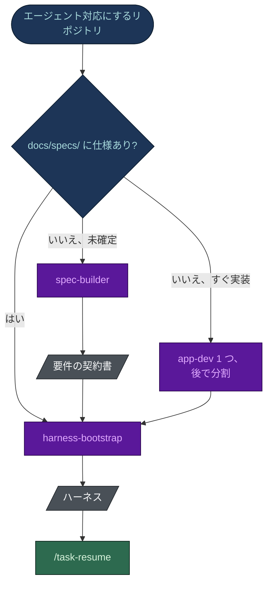

- **仕様は必須ではありません。** 仕様がなければ `harness-bootstrap` は小さな編成にします。`app-dev` を 1 つと、
  モジュールが見えてきたら分割するための登録済みタスクです。
- **インテークが spec-builder を呼びます。** 仕様がないと分かると、`Skill` ツールで `spec-builder` を起動し、
  確定した `purpose_*` フラグを渡します。目的を聞くのは 2 つのスキルを通して 1 回だけで、コードを出荷しない
  リポジトリは spec-builder の軽い契約になります。
- **依存は一方向です。** `spec-builder` は `harness-bootstrap` が作る docs ツリーに書き込みます。セクション 03 と
  05 が埋まると、`docs/requirements/PRD-FR-NN-*.md`、`docs/context/glossary.md`、
  `docs/context/business-rules.md` も種まきします。これらは仕様を複製せず、仕様へリンクします。

## 2. harness-bootstrap の全体

3 段階です。**決める** (モデルと利用者)、**作る** (ほぼスキャフォルダで無料)、**検証する** (スクリプト)。
リポジトリの目的 - コード、リサーチ、戦略、ドキュメントの 1 つ以上 - が最初のインテーク質問で、編成と検証を
決めます。リサーチのリポジトリにテストスイートが渡されることはありません。

### 2a. 決める: モード、分析、インテーク

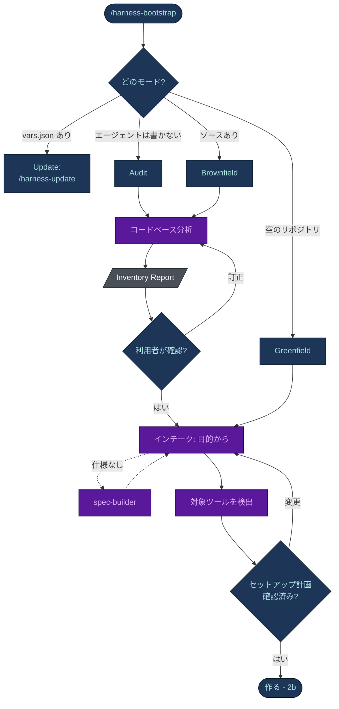

- **モードは上から順に判定し、最初に当てはまったものに決まります。** `vars.json` があれば update で、
  ブートストラップのやり直しはしません。エージェントがソースを変更しないなら、コードの量に関係なく audit です。
  ソースが少しでもあれば brownfield です。
- **Inventory Report がすべての関門です** (brownfield と audit)。その対応表 - モジュールから開発エージェント、
  規約からルール、危険な操作から deny ルールとフック - が後のすべての手順のパラメータになり、利用者が確認する
  まで何も生成しません。
- **インテークは短く。** 事前回答済みの質問票 1 つ、`AskUserQuestion` は最大 2 回、利用者が書いた言語で聞きます。
  brownfield では、コードで決まる回答をすべて事前に埋めます。
- **対象ツールは証拠の強さで判断します。** Strong は、フックを持つ `.claude/settings.json`、`.cursor/` 独自の形式、
  `.codex/` の設定だけです。`CLAUDE.md` と `.claude/agents/` は Weak、`AGENTS.md` だけでは何も証明しません。
  回答は `target_cursor` / `target_codex` として保存され、`/harness-update` は聞き直さずに移植します。

### 2b. 作る: 編成、スキャフォールド、記述

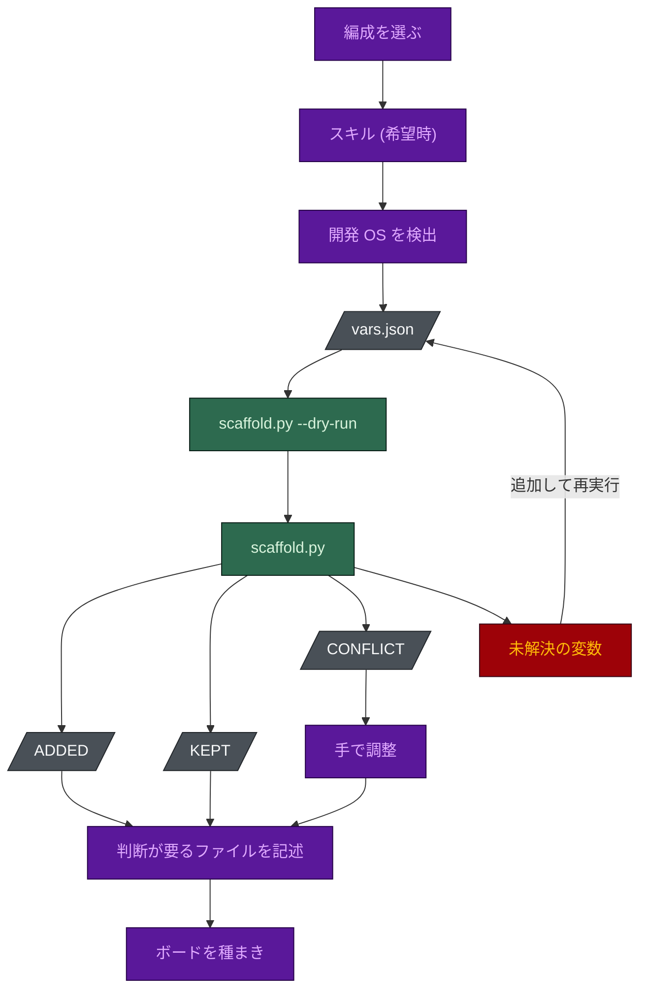

| 手順 | 決めること |
|---|---|
| 編成 | 目的が土台を決めます。コード: オプトインのオーケストレーター、レビューゲート、`spec-guardian`、開発エージェント (プリセット S/M/L)。リサーチ、戦略、ドキュメント: `checker` を含む 3 から 5 席。すべての席に `model`、`effort`、`tools`、`maxTurns` を明示します。 |
| スキル | 質問票で希望したときだけ。候補ごとにファイルを読み、個別のチェックなしには何も入れません。`/skill-wire` がスキルを席に割り当て、合うものがなければ `/new-skill` で作ります。 |
| 開発 OS | Windows は `.ps1` のフック、macOS と Linux は `.sh`。`windows` / `posix` のどちらか 1 つだけを立てます。 |
| `vars.json` | `vars` (名前、コマンド、glob)、`flags`、`modules` (各モジュールに 40 行以内の `CLAUDE.md`)。フラグ: 4 つの `purpose_*`、続いて `ui`、`db`、`db_engineer`、`db_seeder`、`ai`、`audit`、`tdd`、`ddd`、`light`、`unit`、`e2e`、`tests`、`deploy_ask`、`long`、`solo_review`、`merge_gate`、`hooks_strict`、`terse`、`rtk`、`pr_cli`、`target_cursor`、`target_codex`。 |
| 判断が要るファイル | テンプレートでは分からないもの: `AGENTS.md` の編成表とルーティング表、各開発エージェントの範囲、`tech-stack.md`、`coding-standards.md`、`git-workflow.md`、`settings.json` の実際の deny コマンド、`.env.example`。 |
| 配線 | `master-plan.md` の種まき (brownfield では分析のギャップ一覧から Phase 1)、入口としての `AGENTS.md`、薄い `@AGENTS.md` インポートとしての `CLAUDE.md`。 |

**CONFLICT は失敗ではなくキューです。** スキャフォルダは利用者が書いたファイルを上書きしません。差分のある
ファイルを一覧にして終了コード 0 で終わり、それぞれを手で残す、適応する、フラグを立てる、のいずれかにします。
実行を止めるのは未解決の `{{VAR}}` だけです。生きたルールに残ったプレースホルダーは何にも一致せず、黙って失敗する
からです。

### 2c. 検証して出す

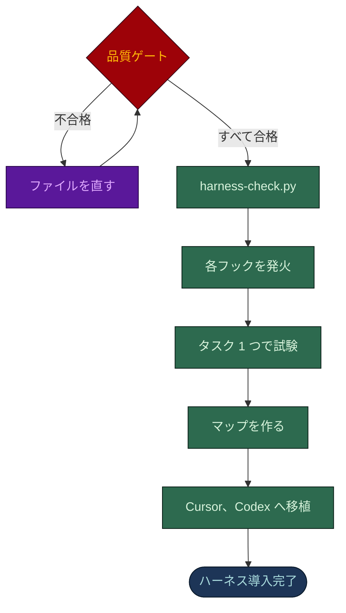

どの確認も、出力を示した本物のコマンドです。実行していない確認は合格ではありません。

| 確認 | 合格の条件 |
|---|---|
| 品質ゲート | `SKILL.md` のチェックリスト: 各席が 1 回ずつ埋まる、ルールにパス範囲がある、タイムスタンプがない、ガードレールの 4 層がそろう、deny リストがスタックに合っている。 |
| `harness-check.py` | すべての席、ティア、ルート、フック、引用、スキルのリンクが解決する。 |
| フック | このマシンでサンプルの入力に対して発火する: ブロックは終了コード 2、通過は 0。 |
| 試験 | 本物のタスクを 1 つ登録し、記録し、`/task-resume` で再開し、`board-check.py` が 0 で終わる。 |
| マップ | `code-graph.py` (モジュール境界マップ、コードのリポジトリ)、`docs-graph.py --check` (孤立 ID)、`harness-graph.py --html` (配線)。 |
| 移植 | 記録された対象だけ: `port.py --tool cursor`、`codex`、`all`。移植できないものを表示します。 |

### 各成果物がどこから来るか

フローチャートは手順で、下の図は *由来* です。上段は、生成された各ファイルがどのソース - コードベース、仕様、
インテークの回答 - にさかのぼるかを示します。下段は、生成されたもの同士がどう抑え合うかを示します。

  

- **モデルが書くのは、テンプレートにできないものだけです。** ルーティング表、各開発エージェントの範囲、
  プロジェクト固有の 3 つのルールです。残りはすべてファイルのコピーです。
- **単独で信用される席はありません。** オプトインのオーケストレーターは計画とディスパッチをしますが `docs/` と `.claude/` の外には書けません。
  レビュアーはゲートを担いますが `Edit` も `Write` も持ちません。ボードはセッションログが証明できることだけを
  記録します。フックは、ディスパッチする側も含めてすべてのエージェントを縛ります。

## 3. スキャフォルダの詳細

`scripts/scaffold.py` は標準ライブラリだけで動き、スキルを安くしているものです。モデルに再生成させる代わりに、
本物の資産ファイルをコピーします。推測を拒む赤い停止点を除けば、すべて緑です。

### 3a. マニフェストの各エントリ

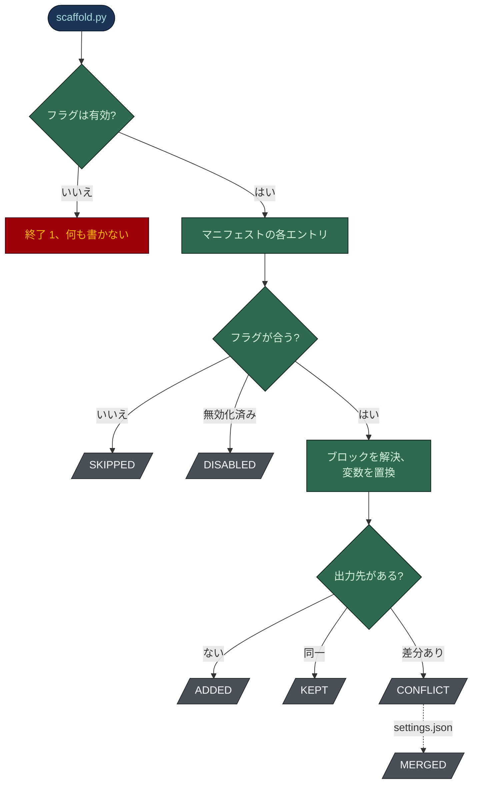

| 結果 | 意味 |
|---|---|
| フラグが無効 | 未知のフラグ、OS フラグが 1 つでない、矛盾、`purpose_code` なしのコード専用フラグ。問題ごとに表示します。 |
| `SKIPPED` | エントリの `when` (すべて)、`when_any` (いずれか)、`when_not` (どれもない) を満たさない。例: `ui` なしの `frontend.md`。 |
| `DISABLED` | `/harness-toggle` が `.claude/disabled.json` に載せたもの。再実行しても復活しません。 |
| 解決、置換 | `{{#IF_X}}` のブロックはフラグ X があれば残り、`{{^IF_X}}` はなければ残ります。続いて `{{VAR}}` を `vars` から埋めます (出力先のパスも)。足りないキーは空にせず記録します。 |
| `ADDED` / `KEPT` | 存在しないので書き込み待ちに / すでにバイト単位で同一なので触らない。 |
| `CONFLICT` | 存在して差分がある。`--force` がなければ書きません。 |
| `MERGED` | `settings.json` だけ: このバージョンが出荷するフック登録を追加し、何も削除しません。 |

ループの前に、フラグから導かれるものを決めます。目的がなければ `purpose_code`、コード以外の目的があれば
`checker` を追加、OS フラグがフックの実行コマンドと拡張子を決めます。

### 3b. 実行の終わり

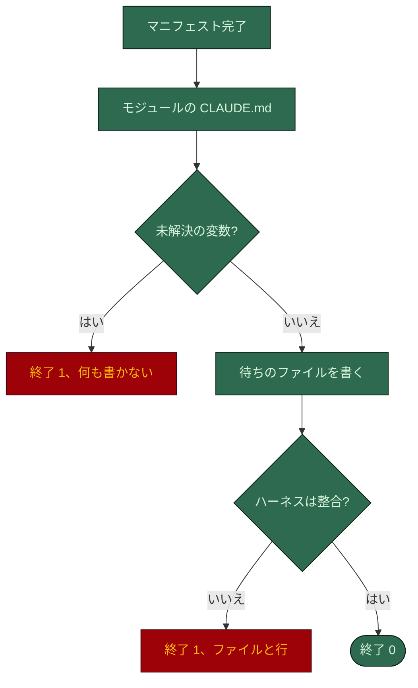

「整合」とは 3 つの確認に通ることです。`Agent` ツールを持つ席が 1 つ以下、入れた制御がすべて配線済み、
`harness-check.py --stage scaffold` がすべてのリンクを解決できる。マニフェストか資産が見つからなければ終了 2 です。

スキャフォルダは 3 つのことを意図的に拒みます。

- **上書きしません。** brownfield のリポジトリでは、差分のあるファイルはたいてい人が書いたものです。置き換えると
  決めたファイルのために `--force` があります。
- **プレースホルダーを書きません。** deny ルールに残った `{{DB_RESET_CMD}}` は何にも一致しません。未解決のものが
  あれば何も書かないので、失敗した実行が作りかけのハーネスを残すことはありません。
- **整合しないハーネスを出しません。** どの拒否も、直すべきファイルと行を示します。

変更のないリポジトリで再実行しても冪等で、すべて `KEPT` になります。

## 4. 生成されたハーネスを通る 1 つの機能

### 4a. まずティアを選ぶ

メインセッションは、どのティアでも 1 つのリポジトリ、1 つのドメインの中なら、認証やスキーマも含めて自分で作業
します。生成された `AGENTS.md` のティア表が、何かを書く前に、その依頼にどれだけの確認をかけるかを決めます。

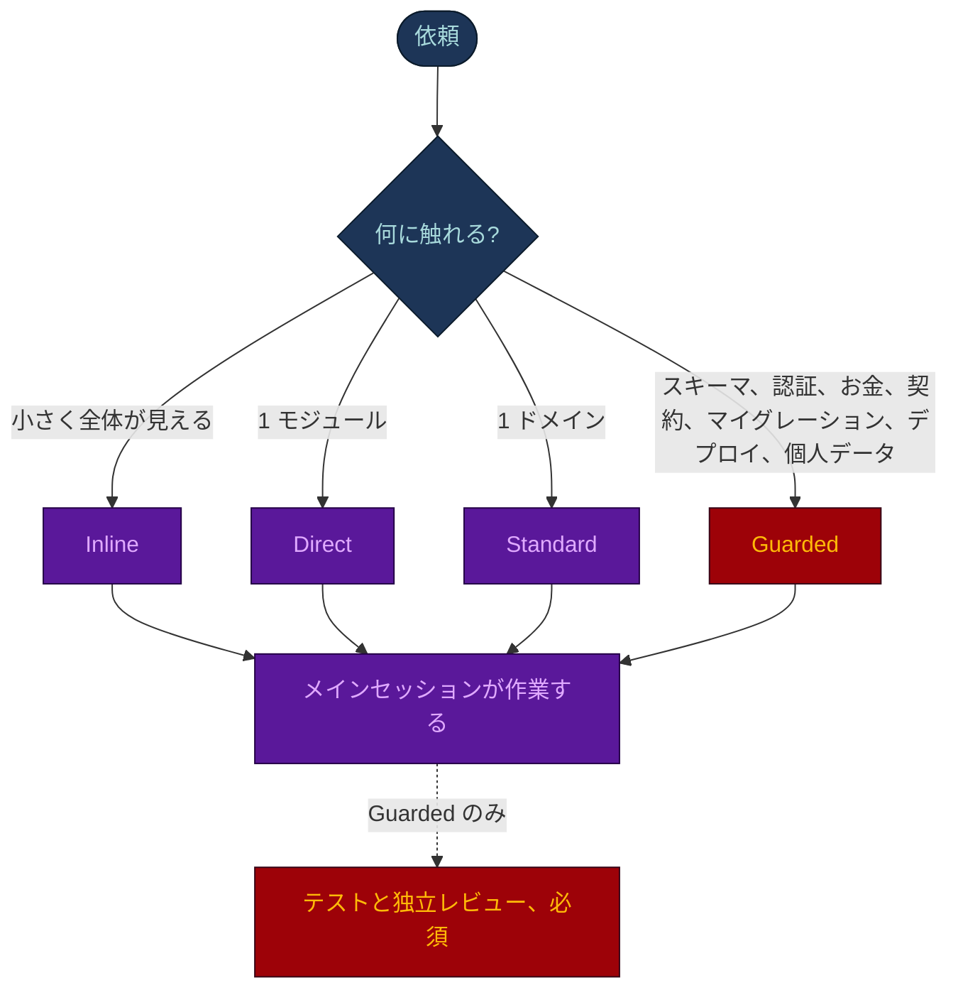

| ティア | 変更 | 加わるもの |
|---|---|---|
| Inline | 質問、調べもの、全体が見える小さな編集 | 変えたものを 1 回確かめる |
| Direct | 1 モジュール、元に戻せる | 各基準を自分で証明し、どう確かめたかを述べる |
| Standard | 1 ドメイン、複数ファイル、または背後に FR がある | 変更に触れるテスト (スイートがなければ手での確認)。圧縮をまたぐ必要があるときだけタスクファイル |
| Guarded | スキーマ、認証、お金、公開契約、マイグレーション、デプロイ、個人データ | 下のゲート - 必須で、省略しない |

変更に対して重すぎるティアは慎重さではなく欠陥です。Guarded の変更に軽いティアを当てるのは、この表が防ぐ
ために存在する失敗です。

サブエージェントを既定でディスパッチするのは 3 つの場合だけです。読み取り専用の独立したレビュアー (Guarded では
必須、頼まれたときも)、要約だけを返す大きな読み取り、互いに独立した並列のバッチです。メインセッションはすべての
ディスパッチを待ち、最終回答の前に結果を確かめます。書き込みできる席 (開発エージェント、`qa-test`、
`ba-analyst`、`data-modeler`、`writer`) は引き続き同梱されますが、利用者が名指ししたときだけ動きます。
`guard-agent-spawn` は、プロンプトに `TASK-NNN` か `TIER: direct` / `TIER: standard` がなければそうしたディスパッチを
拒みます。`orchestrator` はタスクを登録する側なので対象外です。

`orchestrator` はオプトインです。利用者が求めたときだけ、複数のドメインやリポジトリにまたがるミッションのために
動きます。どのティアもここへは振り分けません。

このセクションの残りはコード向けの **Guarded** ゲートで、3 つのシーケンスに分けています。編成は既定 (`tests` あり、
レビュアー分割) です。`tests` がなければ `qa-test` とそのゲートは存在しません。`solo_review` では 1 つの
`reviewer` 席が 2 人のレビュアーの代わりになります。

### 4b. タスクを登録し、契約を固める

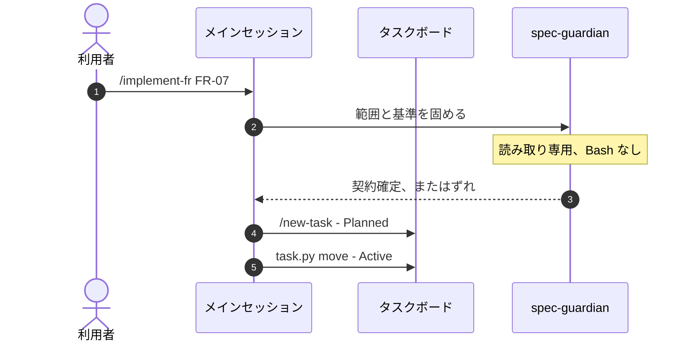

- 状態を動かすのは `task.py` だけです。タスクファイルのフロントマター、そのフォルダ、master-plan の行を一緒に
  書き、行を読み返します。`guard-board` は行の手編集をブロックします。
- `spec-guardian` は FR ごとに 1 回、コードより前に動きます。FR は `docs/specs/index.json` で
  `Confirmed` でなければなりません。

### 4c. ブランチで作る

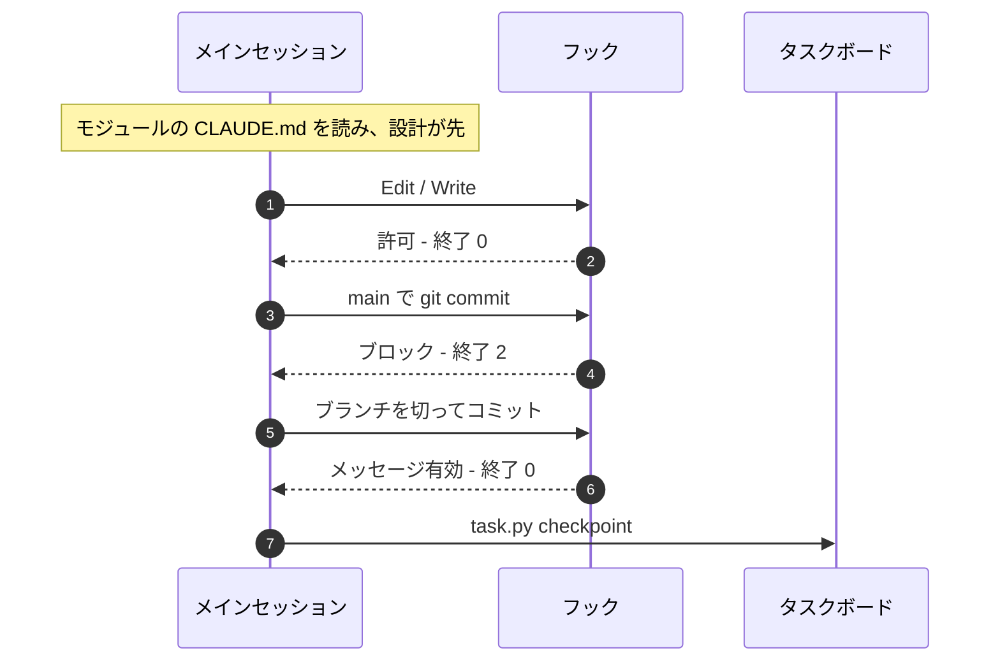

| フック | イベント | 役割 |
|---|---|---|
| `protect-adr`、`protect-secrets`、`guard-board` | PreToolUse、編集 | Accepted の ADR、秘密のファイル、ボードの行への編集をブロック |
| `guard-main-commit` | PreToolUse、Bash | 既定ブランチへのコミットをブロック |
| `check-commit-msg` | PreToolUse、Bash | Conventional Commits を強制 |
| `specs-reminder`、`graph-stale` | PostToolUse | 仕様を思い出させる、境界マップにないモジュール間インポートを指摘 |

ブロックしてくるフックは、破ろうとしていたルールです。シェルの同等コマンドで回り道をしてはいけません。ルーティング
表がその領域の担当を示します。メインセッションはそのモジュールの `CLAUDE.md` とそのパスのルールを読み、設計を
タスクファイルに書き、テストをコードと一緒に出します。作っている間は変更に触れるテストだけを走らせ、完全な
スイートはゲートで 1 回だけ走らせます。

### 4d. ゲートは 1 回、そして引き渡し

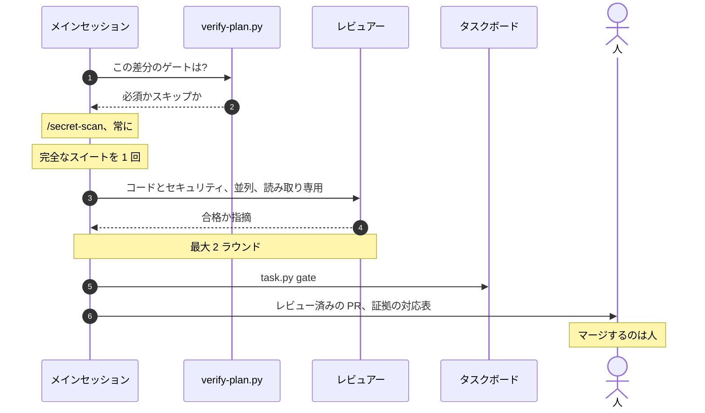

- **ゲートはブランチで、プルリクエストの境界で 1 回だけ** 走ります。ステップごとではありません。
  ステップごとのレビュアーは同じファイルを読み直し、同じ指摘を毎回返します。
- **何を走らせるかは差分が決めます。** `verify-plan.py` は各ゲートを必須かスキップかに分け、理由を示します。
  ドキュメントだけの変更に必要なのは秘密スキャンだけです。検証台帳は、まったく同じバイトで合格したゲートを
  スキップし、ファイルが変わったゲートを変更分に絞ります。
- **独立レビューは Guarded の変更で必須です。** `/review-changes` は、どんなに小さくても Guarded の変更では省略
  しません。`/db-migration` も同じゲートで終わります。
- **`guard-agent-spawn` がディスパッチ時に強制します。** 合格済みの内容への再実行、3 ラウンド目のレビュー、
  同一の指示、タスクの予算 (`dispatch_budget`、既定 24) を超えるディスパッチを拒みます。
- **レビュアーは編集できません。** どちらも `Edit` も `Write` も持ちません。編集するレビュアーは開発エージェントに
  なっています。2 ラウンド目は修正の差分だけ、blocker と should-fix の指摘だけを対象にし、残りは利用者に
  渡します。
- **ゲートはその行があるときだけ数えます。** `task.py gate` は台帳の行とセッションログの行を 1 手で書きます。
  レビュアーの行がないログに「すべてのゲートが合格」と書くのが典型的な失敗です。
- **このフローの中でマージする者はいません。** `/review-changes` はマージもデプロイもしません。マージするのは人で、
  フラグ `merge_gate` があれば任意の `merge-manager` 席が、プルリクエストを 1 つずつ、メインラインの最新の先端に
  対して行います。
- **複数のドメインやリポジトリにまたがるミッション** で使うのが、オプトインの `orchestrator` です。セッション開始時に
  ボードを走査し (`task.py resume`、`task.py check`)、席を計画してディスパッチし、状態を `docs/tasks/` に記録します。
  こちらもマージはしません。

**コスト:** レビュアーとデバッガーは Opus の席、開発エージェント、`qa-test`、`spec-guardian` は Sonnet、機械的な席
(`history-tracker`、`db-seeder`) は `low` effort の Haiku です。フックはシェルスクリプトで費用はかからず、「いいえ」
と言える唯一の参加者です。

## 5. spec-builder

同じ形で、契約が違います。利用者が持ち込んだものを読み、人にしか分からないことだけを聞き、セクションの骨組みは
スクリプトに敷かせ、トークンは中身に使います。**何も作り出しません。** 述べられていない要件は、担当者つきの
仮定 (`AS-nn`) か未解決の問い (`OI-nn`) になります。もっともらしく作られた要件は見積もられ、実装され、UAT で
発覚するからです。

### 5a. 読む、聞く、FR 一覧を確定する

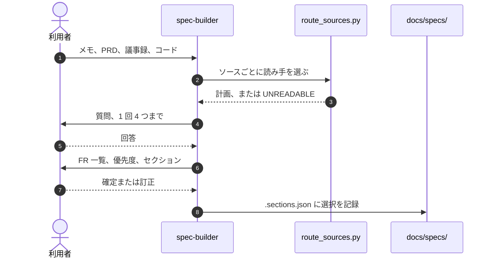

- 読み取り計画は先に利用者に見せます。読めないソースは、直し方つきの `OI-nn` になります。
- 質問はコードで決まらないことに限ります: 優先度、権限の範囲、NFR の目標値、量、セキュリティの姿勢、出力言語。
  答えのないものは `AS-nn` か `OI-nn` になります。
- **何かを書く前の関門は 1 つ:** MoSCoW の優先度案つきの FR 一覧、ロール、未解決の問い、資料が裏付ける任意の
  セクション。以降のすべてのセクションはこの一覧から導かれます。

### 5b. 骨組み、記入、検査

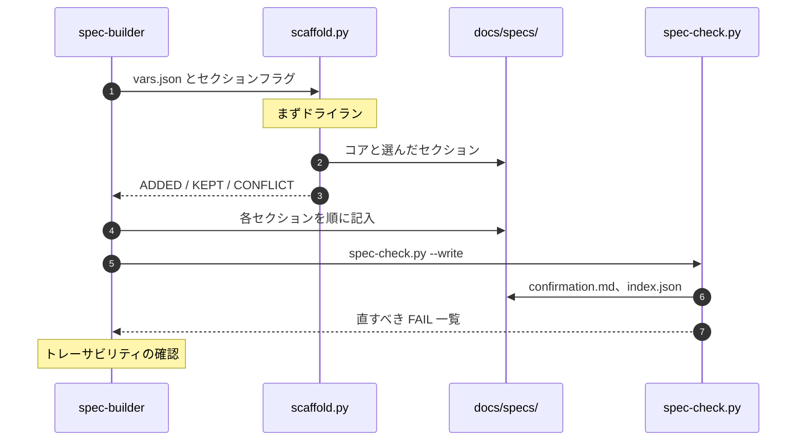

| 手順 | 詳細 |
|---|---|
| 骨組み | コア (README、01、03、05、07、11、13) は常に、加えて関門で選んだ最大 8 つの任意のセクション。`.sections.json` がないか、フラグと矛盾すると拒みます。フラット、または `--module` でモジュールごと。 |
| 軽い契約 | コードが製品でないリポジトリ (リサーチ、戦略、ドキュメント) は README、05、11、13 だけで、各項目は `Done when` の基準を持つ `FR-nn`。harness-bootstrap と同じ `purpose_*` フラグで選ばれます。 |
| 記入 | 順番どおり。各セクションは前のものに依存するからです。05: 否定の受け入れケースを持つ観察可能な FR。07: セキュリティ NFR、「TBD」は不可。12: すべての FR に Yes、Partial、No。 |
| `spec-check.py` | 一意な ID、生きた FR すべてに検査可能な基準、担当者のいる未解決の問い、派生ファイルの同期。`confirmation.md` (プロダクトオーナー向け) と `index.json` (エージェント向け) を書きます。 |
| トレーサビリティ | 05 のすべての FR が 12 にある (両方を数える)、10 のすべての画面が FR を名指す、06 のすべてのロールとエンティティが 03 と 08 にある。 |

### 5c. 確認して引き渡す

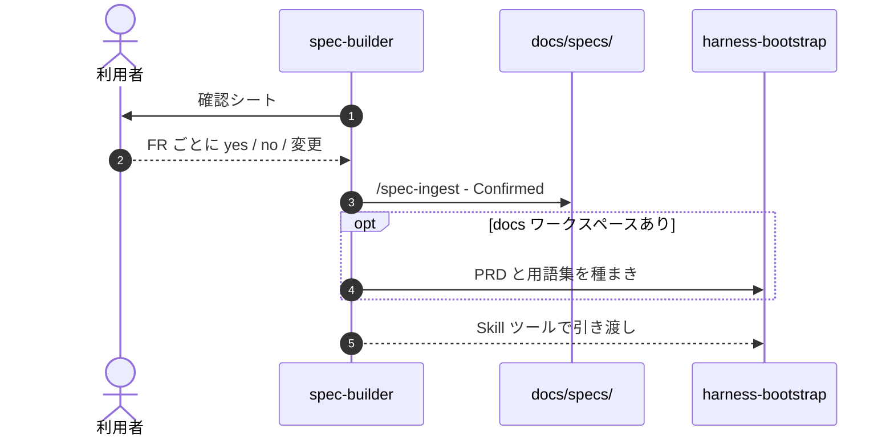

- シートには、すべての `OI`、すべての `AS`、すべての Partial と No、受け取ったのではなく提案した NFR の目標値を
  載せます。誰も知らされていない仮定を、プロダクトオーナーは訂正できません。
- `/spec-ingest` は各回答を取り込み、yes ごとに `Status: Confirmed` を付け、改訂履歴に 1 行を加えます。シートの
  約束をすべて守る変更には、仕様の作業は要りません。
- 引き渡しは `FR_LIST` と `GLOSSARY_SEED` を事前に埋めるので、harness-bootstrap は FR 一覧から開発エージェントを
  まとめます。次の手順は `/implement-fr` です。
- `index.json` があるので、1 つの FR に触れるタスクはセクション全体ではなく 1 ブロックだけを読みます。

## 6. コンテキストの読み込み - ハーネスが安い理由

`benchmark/RESULTS.md` の数値の裏にある仕組みです。`.claude/rules/` のルールで **`paths:` フロントマターがない**
ものは、起動時にすべてのエージェントのすべてのセッションに読み込まれます。一度きりの費用ではなく家賃です。
`paths:` があれば、Claude が一致するファイルに触れたときだけ読み込まれます。

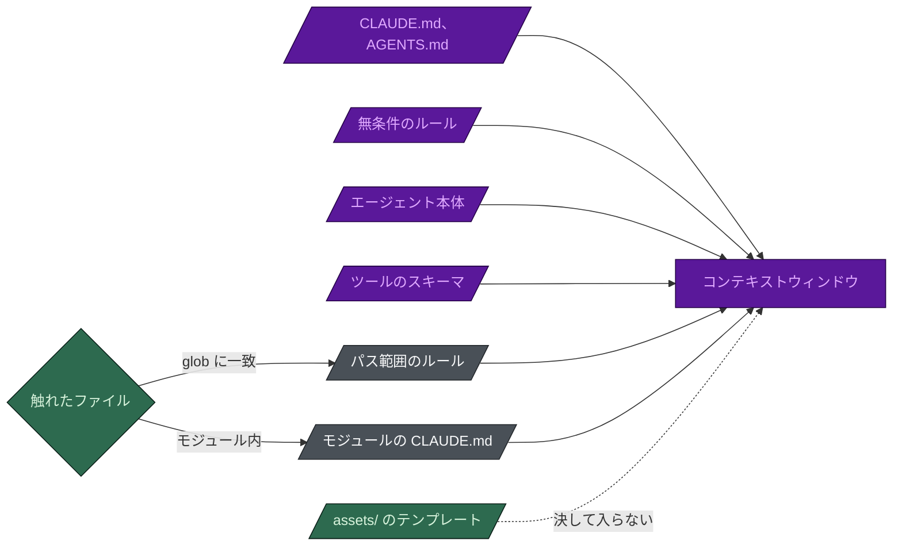

紫は毎リクエスト課金、灰色は一致したときだけ、緑は決して入りません。モデルが読むのは `SKILL.md` と参照文書で、
フック、コマンド、テンプレート、エージェント本体は `scaffold.py` がコピーし、コンテキストウィンドウには入りません。

| ルール | 読み込み | 出荷の条件 |
|---|---|---|
| `00-overview`、`agent-guardrails`、`task-tracking`、`model-policy`、`conventional-commits` | 常に | すべてのハーネス |
| `ai-governance` | 常に | `ai` |
| `output-style` | 常に | `terse` |
| `code-quality`、`performance`、`security-privacy` | ソースファイル | コードのリポジトリ |
| `testing` | テストとソース | `tests` |
| `frontend` | UI のファイル | `ui` |
| `data-model` | スキーマとマイグレーションのファイル | `db` |
| `ddd` | ソースファイル | `ddd` |
| `ip-compliance` | ソースと依存マニフェスト | コードのリポジトリ |
| `docs-workflow` | `docs/**` | すべてのハーネス |
| `model-tiers` | `.claude/agents/**`、`settings.json` | すべてのハーネス |

`conventional-commits` が無条件なのは、ファイルではなくコミットメッセージを律するからで、どの glob でも範囲を
限れません。`model-policy` は、どのファイルに触れるより前に、何をどこへ送ってよいかを決めます。

無条件のルールが 7 つ、パス範囲のルールが 10 個: **ルール本文の 75% が既定のセッションの外に出ます**。
データベースのエージェントはもうフロントエンドのルールを抱えず、UI のエージェントはもうマイグレーションの
ルールを抱えません。

ほかに 3 つのてこがあります。

- **モジュールの指針はモジュールに置きます。** モジュール自身の `CLAUDE.md` (40 行以内: 担当、範囲、不変条件、
  コマンド) は、Claude がそこのファイルを読んだときだけ読み込まれます。
- **すべてのツールが毎リクエスト費用になります。** エージェントの `tools:` にある各ツールは、呼び出しごとに JSON
  スキーマを運びます。`tools:` を省くとマシン上のすべての MCP サーバーを含むすべてのツールを継承し、品質ゲートは
  それをバグとして扱います。
- **タイムスタンプを入れません。** 常時読み込まれる帯はプロンプトキャッシュの前置部分なので、`Generated: <date>`
  の 1 行が、そのエージェントのキャッシュを毎回外させます。

## 7. デリバリーコマンドをコマンドごとに

メインセッションが製品を作る間に使うコマンドです。ハーネス自体を調整するコマンドは
[`TUNING.ja.md`](TUNING.ja.md) にあります。

| 段階 | コマンド |
|---|---|
| 計画 | `/new-task`、`/new-adr`、`/new-spec-section`、`/scaffold-feature`、`/brainstorm` |
| 実装 | `/implement-fr`、`/db-migration`、`/seed-db` |
| ゲート | `/secret-scan`、`/test`、`/review-changes` |
| 出荷 | `/deploy` - 人が入力したときだけ |
| 記憶を保つ | `/sync-context`、`/task-resume` |
| 監査モードのみ | `/security-scan`、`/triage-findings` |

### 作業の登録と計画

#### `/new-task <short-title>`

タスクを登録します。ただし利用者が合意した作業だけです。まず、その作業が依頼されたものか、書類仕事より大きいかを
確かめます。誤字、名前の変更、登録済みの作業の 1 手順はタスクではなく、途中で気づいたことは報告すべき発見です。
断るのは普通の結果です。利用者のメッセージがすでに求めていない限り、`AskUserQuestion` で提案し、yes のときだけ
作ります。

残りは `task.py new` が 1 手で行います。`active/`、`pending/`、`done/` を通して次の `TASK-NNN` を割り当て、
`docs/templates/TASK.md` を `status: Planned` で埋め、ボードの行を追加して読み返し、最初のセッションログの行を
書きます。`--requested-by` は何を頼まれたかを記録し、観察可能な基準が 2 つ以上必要です。`--fr` で FR に結び付け、
`docs/specs/index.json` を更新します。コードグラフがあれば、影響範囲のヒントとして「関連モジュール」の行を加えます。

**書くもの:** タスクファイル、master-plan の行、最初のセッションログの行。**拒むもの:** 誰も頼んでいないタスク、
番号の再利用、2 つ未満の基準、タイトルなし。**出荷:** 常に。

#### `/new-adr <decision-title>`

`docs/templates/ADR.md` から `ADR-NNN` を作ります: 文脈、決定、選択肢、帰結 - 否定的なものも含めて (「欠点が
記録されていない ADR は広告です」)。`status: Proposed` のままにし、承認するのは利用者だけです。

**書くもの:** ADR とその索引の行。**拒むもの:** 英語以外の言語、Accepted の ADR の編集 (`protect-adr` が
ブロック) - 考えが変わったら、それを置き換える新しい ADR を書きます。**出荷:** 常に。

#### `/new-spec-section <section-number-or-name>`

プロジェクトの BA 構造で仕様のセクションの骨組みを作り、`ba-analyst` をディスパッチします。引数がなければ
足りないセクションを一覧にして聞きます。すべての FR に ID、受け入れ基準、ユースケースが付きます。

**書くもの:** セクション、改訂履歴の行。**拒むもの:** 要件の作り出し - 答えのない問いは未解決として記録します
(「作られた要件は、欠けた要件より悪い」)。並行する番号体系。**出荷:** `purpose_code`。

#### `/scaffold-feature <feature-slug>`

`coding-standards.md` に沿って機能の骨組みを作ります。入口 (検証と委譲だけ)、ライブラリモジュール (ロジック、
トランスポートなしでテスト可能)、既存の部品から作る UI コンポーネント、受け入れ基準を名指す失敗するテスト。
構造だけで、振る舞いはありません。

**書くもの:** 骨組み、担当のいないドメインならルーティング表の行。**拒むもの:** ビジネスロジックを書くこと、
スラッグなし。**出荷:** `purpose_code`。

### 実装

#### `/implement-fr <FR-id>`

1 つの FR に対するセクション 4 の Guarded ゲートを、メインセッションが実行します。作業が Direct だと分かれば、そう
言ってそのティアで行います。引数がなければ、Confirmed で yes と決まり、未解決の問いもタスクもない FR を一覧にして聞きます。

1. `docs/specs/index.json` の FR のエントリと、そのブロックだけを読みます。**`Confirmed` と `yes` でなければ
   止まります。**
2. `spec-guardian` が範囲と基準を固めます。観察可能な基準のない FR はここで止まります。
3. `/new-task` で登録し、Active に動かし、メインセッションで実装します。ルーティング表は領域の担当を示しますが、その席は利用者が頼んだ
   ときだけディスパッチします。
4. タスクファイルで設計してからコード: TDD ならテストが先、DDD なら同じ変更でテスト、スイートがなければ
   基準ごとの手作業の確認メモ。
5. FR 全体が終わってから、`/review-changes TASK-NNN` を 1 回。
6. 証拠マップ - `AC-nn.n` ごとにテスト、コマンド、画面を名指す 1 行 - とチェックポイントで閉じます。

**書くもの:** セッションログの行、チェックポイント、コード (メインセッション内)。**拒むもの:** Confirmed でない
FR、デプロイ、レビューゲートの省略 (Lightweight でも)、証拠のない基準。**出荷:** `purpose_code`。

#### `/db-migration <migration-name>`

スキーマを `docs/specs/` のデータモデルと比べ (設計が新しければ ERD とデータ辞書を更新)、**ローカルの開発用
データベースだけ** に対してマイグレーションを生成し、適用前に SQL を見直します。

**書くもの:** マイグレーション、ERD と辞書の更新、シードスクリプト、`tool-changelog.md` の項目。**拒むもの:**
共有、ステージング、本番のデータベース (完全に範囲外)。データのある列の `DROP`、既定値なしの `NOT NULL`、
破壊的な型変更の自動適用 (「生成されたことは安全を意味しない」)。**出荷:** `db`。

#### `/seed-db`

`db-seeder` をディスパッチし、ERD に沿った決定的な合成データでローカルのデータベースを埋めます。固定のシード、
upsert、テーブルごとの行数の確認。

**書くもの:** ローカルのデータベースの行。**拒むもの:** ローカルか開発用以外の接続先、本物や本番のデータ。
**出荷:** `db` と `db_seeder`。

### 品質ゲート

#### `/test`

lint と、`verify-plan.py` がこの変更に必要だというテスト層を走らせます。HEAD ですでに記録された合格は引用し、
繰り返しません。エンドツーエンドは計画が名指すフローだけ。本物のネットワーク呼び出しをするテストは、通っても
失敗です。カバレッジを目標と比べ、各失敗を担当エージェントと基準に対応させます。

**書くもの:** セッションログの行。完全なスイートが合格なら `task.py checkpoint --green` がコミットを記録します。
**拒むもの:** 通すためにテストを編集すること。**出荷:** `tests`。

#### `/review-changes`

現在の差分に対するレビューゲートです。`TASK-NNN` を付けることもできます。

1. `verify-plan.py --base <既定ブランチ>` が 3 点の差分を読み、各ゲートを必須かスキップかに分けて理由を示します。
   同じバイトで合格したゲートは台帳から引用し、ファイルが変わったゲートはそこに絞ります。
2. 最初に `/secret-scan`。本物の秘密は blocker です。
3. 必須の席だけを並列で: `reviewer` (`solo_review` のとき) または `code-reviewer` と `security-reviewer`、
   結び付いた FR には `spec-guardian`、変わったコード以外の主張には `checker`。
4. CI は終端状態で合格でなければなりません。pending は数えません。
5. 指摘は重大度別: blocker、should-fix、suggestion。走った各ゲートを `task.py gate` で記録します。
6. 最大 2 ラウンド。2 ラウンド目は修正の差分だけ。残りは利用者に渡します。

| ゲート | 差分が触れたら必須 |
|---|---|
| 秘密スキャン | 常に |
| 仕様の検証 | `docs/specs/` |
| コードレビュー | コード、テスト、スキーマ、依存、インフラ |
| セキュリティレビュー | 認証、秘密、入力の解析、データの扱い、依存、フック |
| テスト | 振る舞い - まず範囲を絞り、完全なスイートは 1 回 |
| エンドツーエンド | `.claude/verify-map.json` が名指すフロー |
| 内容の確認 | 主張が変わった文章 |

**書くもの:** ゲートごとに台帳の行とセッションログの行。**拒むもの:** マージやデプロイ (「レビューは承認では
ない」)。**出荷:** 常に。

#### `/secret-scan`

`git diff` とステージ済みの変更を調べます。認証情報のパターン (`sk-`、`AKIA`、`AIza`、`ghp_`、`glpat-`、`xox`、
JWT、秘密鍵のヘッダー、ハードコードされた `password=` など)、禁止ファイル (`.env.example` 以外の `.env*`、`*.pem`、
`*.key`、`*.tfvars`、サービスアカウントの JSON)、フィクスチャの本物らしい個人データ、CI 設定、ロックファイル、
ドキュメント、コメントの秘密。

**書くもの:** なし - `file:line` とパターンの種類を報告します。**拒むもの:** 値の表示 (切り詰めても)、値が差分から
消えて *かつ* ローテーションされるまで先へ進むこと。**出荷:** 常に。

### リリース

#### `/deploy`

`disable-model-invocation: true` を持つ唯一のコマンドで、人が `/deploy` と入力したときだけ動きます。PR が承認されて
マージ済み、CI が終端状態で合格、接続先にすべての環境変数がある (存在を確認するだけで読まない)、マイグレーションが
きれい、のどれかが欠ければ理由を示して拒みます。そのあと: 前進のマイグレーション、マージ済みコミットからの
デプロイ、ヘルスエンドポイントの確認 (「デプロイされたことは健全であることと同じではない」)。

**書くもの:** `tool-changelog.md` の項目。**拒むもの:** 満たされない前提条件、利用者なしの再試行や前進修正 -
失敗したらロールバックして止まります。**出荷:** `purpose_code`。デプロイ権限は `/harness-tune` が動かすまで
`permissions.deny` で人だけに限られます。

このファイル自身の `allowed-tools` は狭く (`git status`、`git log`、`Read`)、説明しているデプロイ手順を実行する
ツールを名指していません。これはコマンドファイルの欠落で、推測した仕組みではありません。

### 記憶を最新に保つ

#### `/sync-context`

前回の同期以降に既定ブランチに入ったものを `docs/context/` に記録します。振る舞いの変化を FR か ADR に紐づいた
`BR-NN` の規則として、問題を回避策とともに、ツールとインフラの変化を、新しいドメイン用語を。

**書くもの:** `business-rules.md`、`known-issues.md`、`tool-changelog.md`、`glossary.md`。**拒むもの:** 履歴の
削除 (直った問題は解決済みにする)、秘密や本物の顧客データのコピー、差分の言い直し。**出荷:** 常に。

#### `/task-resume [TASK-NNN]`

引数がなければ、未完了のタスクを人のゲートを先にして一覧にし、何も再開しません。ID があれば、`task.py resume` が
ボードの行、チェックポイント、未達の基準、最後のログの行、HEAD と作業ツリーがチェックポイントと合うかを表示
します。この要約は会話の記憶より優先です。ずれがあれば先に調整します (`task.py check` が食い違いを示します)。

**書くもの:** ログの行 (`task.py log`)、状態の移動 (`task.py move`)、止まる前の新しいチェックポイント。
**拒むもの:** 見つけた未コミットの作業の stash や破棄。**出荷:** 常に。

### 決定を探る

#### `/brainstorm <topic>`

`strategist` をディスパッチし (選択肢に証拠が要るときは `researcher` の後で)、Accepted の ADR を含む制約とともに
決定を組み立て、トレードオフ表つきの本物の選択肢を 3 から 5 つ出し、1 つを推奨します。測っていない仮定には、
先に小さな時間制限つきの試行をします。

**書くもの:** 直接はなし - スタックの決定は `/new-adr` へ、製品の決定は PRD へ、残りはタスクの決定セクションへ。
**拒むもの:** わら人形の選択肢、利用者に代わって決めること。**出荷:** `long`。

### 監査専用の 2 つ

**監査モード** (`audit` フラグ) でだけ出荷されます。エージェントは走査して記録し、修正はすべて人が適用します。

#### `/security-scan [repo-slug]`

`sast-runner` をディスパッチし、固定した走査ツール群 (SAST、秘密、依存の CVE、インフラのポリシー) を Docker で
**読み取り専用のマウント** を通して走らせます。走査ツールが製品のソースに書き込むことは構造的にできません。
生の出力は `docs/findings/raw/` に入り、正規化され、`docs/findings/<repo>/` と重複を除かれ、秘密はディスクに
触れる前に伏せられます。

**書くもの:** 生の出力と、新しい結果ごとに `status: New` の発見ファイル。再発した発見は `Confirmed` に戻ります。
**拒むもの:** 重大度の付与 (それはトリアージの仕事)、落ちた走査ツールを隠すこと - カバレッジの欠落として報告
します。**出荷:** `audit`。

#### `/triage-findings [repo-slug]`

`New` の各発見を、確認、重大度、要件への結び付け、タスク登録へと進めます。却下した発見は理由を残したまま
`False-positive` になり、次の走査で議論が蒸し返されません。`spec-guardian` が確認済みの発見を検証済みの基準表に
結び付け、それぞれが `/new-task` で双方向にリンクしたタスクになります。

**書くもの:** 発見の状態の変更、タスクファイル。**拒むもの:** 未検証の基準表の行への結び付け、修正したという
主張だけで閉じること (`Verified` にするのはきれいな再確認だけ)、修正そのものの適用。**出荷:** `audit`。

### クイックリファレンス

| コマンド | 書く / 変えるもの | 出荷 |
|---|---|---|
| `/new-task` | タスクファイル、master-plan の行、最初のログの行 (合意した作業だけ) | 常に |
| `/new-adr` | ADR ファイル、ADR 索引の行 | 常に |
| `/new-spec-section` | 仕様のセクション、改訂履歴の行 | `purpose_code` |
| `/scaffold-feature` | 骨組みのファイル、新しいドメインのルーティング行 | `purpose_code` |
| `/implement-fr` | ログの行、チェックポイント、メインセッション内のコード | `purpose_code` |
| `/db-migration` | マイグレーション、ERD と辞書、シードスクリプト、tool-changelog | `db` |
| `/seed-db` | ローカルのデータベースの行だけ | `db` + `db_seeder` |
| `/test` | ログの行 (合否、カバレッジ) | `tests` |
| `/review-changes` | ゲートごとに台帳の行とログの行 | 常に |
| `/secret-scan` | なし - `file:line` とパターンの種類 | 常に |
| `/deploy` | tool-changelog の項目 | `purpose_code`、人だけ |
| `/sync-context` | `docs/context/` の 4 ファイル | 常に |
| `/task-resume` | ログの行、チェックポイント、`task.py move` での状態 | 常に |
| `/brainstorm` | 直接はなし - 結果を振り分ける | `long` |
| `/security-scan` | `docs/findings/raw/`、`docs/findings/<repo>/` | `audit` |
| `/triage-findings` | 発見の状態、タスクファイル | `audit` |

## 正確さについての注記

- バイト数とファイル数はディスクから数えた正確な値です。`benchmark/RESULTS.md` のトークン数は 3.6 文字/トークンで
  **推定** したもので、桁の目安であって見積もりではありません。
- オーケストレーターのセッション開始時の走査 (`task.py resume`、`task.py check`) はフックではなく、エージェント
  本体の手順です。常に登録されるのは `PreToolUse` (protect-adr、guard-agent-scope、guard-task-scope、guard-board、
  protect-secrets、guard-main-commit、check-commit-msg、guard-destructive、guard-agent-spawn)、`PostToolUse`
  (specs-reminder、graph-stale)、`SubagentStop` (agent-history) です。残りは、それを出荷するフラグのブロックの中で
  登録されます: `hooks_strict`、`db`、`long`、`purpose_research`、`purpose_docs`、`rtk`、`audit`。ブロックする
  ガードは `onFailure: block` で登録されるので、落ちたりタイムアウトしたりしたガードはツール呼び出しを通さずに
  止めます。全体の表は `assets/claude/hooks/README.md` です。
- `CONFLICT` はスキャフォルダの終了コードを **変えません**。未解決の `{{VAR}}`、無効なフラグの組み合わせ、`Agent`
  を持つ 2 つ目の席、配線されていない制御、解決できないリンクは終了 1、マニフェストか資産がなければ終了 2 です。
