# Flows

**English** · [日本語](FLOWS.ja.md)

How the two skills work, in diagrams: `spec-builder` writes the requirements contract,
`harness-bootstrap` builds the machine that implements it. Each diagram is drawn from the source
(`SKILL.md`, `reference/`, `scripts/scaffold.py`, `assets/`), and the details sit in the prose or
table under it. Section 7 is a command reference rather than a diagram.

## Legend

**Green is free, purple is billed.** A green step is a script and costs no tokens; a purple one needs
a model. `harness-bootstrap` moves as much work as it can from purple to green: its assets are real
files that `scaffold.py` copies, not prose for a model to retype.

Mermaid colours flowcharts only. The sequence diagrams in sections 4 and 5 carry the same meaning in
their notes.

## 1. Overall system flow - how the two skills relate

`spec-builder` answers *what must be true*. `harness-bootstrap` answers *who builds it, under which
guardrails, at what cost*. The fork is whether `docs/specs/` already holds a requirements set.

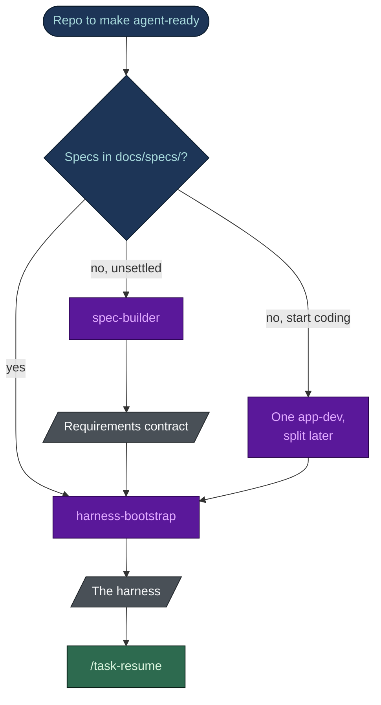

- **Specs are not required.** Without them, `harness-bootstrap` fields a smaller roster: one
  `app-dev` and a registered task to split it once modules emerge.
- **Intake calls spec-builder for you.** When it finds no specs it invokes `spec-builder` through the
  `Skill` tool and passes the confirmed `purpose_*` flags, so the purpose is asked once across both
  skills, and a repo that ships no code gets spec-builder's light contract.
- **The dependency runs one way.** `spec-builder` writes into the docs tree `harness-bootstrap`
  creates. Once sections 03 and 05 are filled it also seeds `docs/requirements/PRD-FR-NN-*.md`,
  `docs/context/glossary.md` and `docs/context/business-rules.md`, which link back to the spec
  rather than copy it.

## 2. harness-bootstrap, end to end

Three stages: **decide** (model and user), **build** (mostly the scaffolder, for free) and
**verify** (scripts). The repo's purpose - code, research, strategy, docs, one or more - is the
first intake question and decides the roster and the verification, so a research repo is not handed
a test suite.

### 2a. Decide: mode, analysis, intake

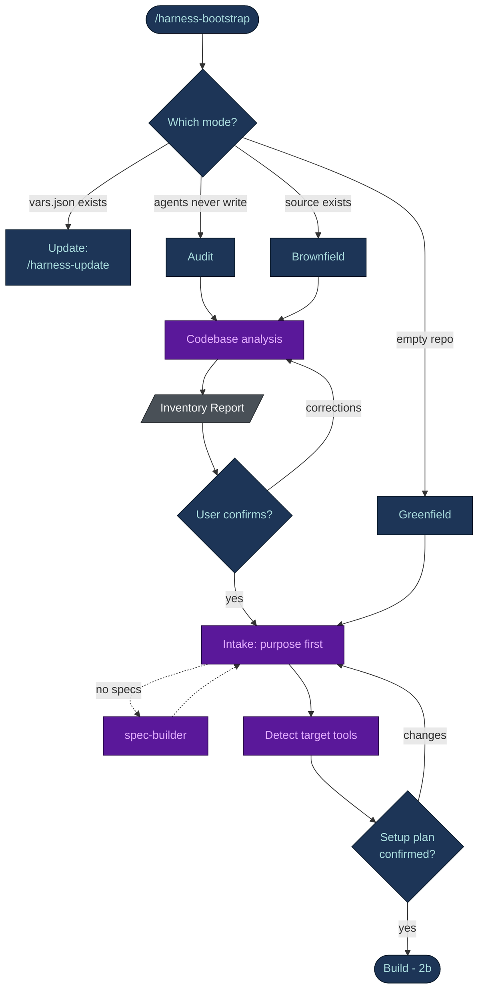

- **Mode is checked top to bottom; the first match wins.** An existing `vars.json` means update,
  never a re-bootstrap. If agents will never modify the source, it is audit however much code
  exists. Any source at all means brownfield.
- **The Inventory Report gates everything** in brownfield and audit. Its mapping tables - modules to
  dev agents, conventions to rules, risky operations to deny rules and hooks - parameterize every
  later step, and nothing is generated before the user confirms it.
- **Intake is short.** One pre-answered questionnaire, at most two `AskUserQuestion` calls, in the
  language the user writes in. Brownfield pre-fills every answer the code settles.
- **Target tools are ranked evidence.** Only `.claude/settings.json` with hooks, `.cursor/`'s own
  formats and `.codex/` config are Strong; `CLAUDE.md` and `.claude/agents/` are Weak, and
  `AGENTS.md` alone proves nothing. The answer is stored as `target_cursor` / `target_codex`, so
  `/harness-update` re-ports without asking again.

### 2b. Build: roster, scaffold, authoring

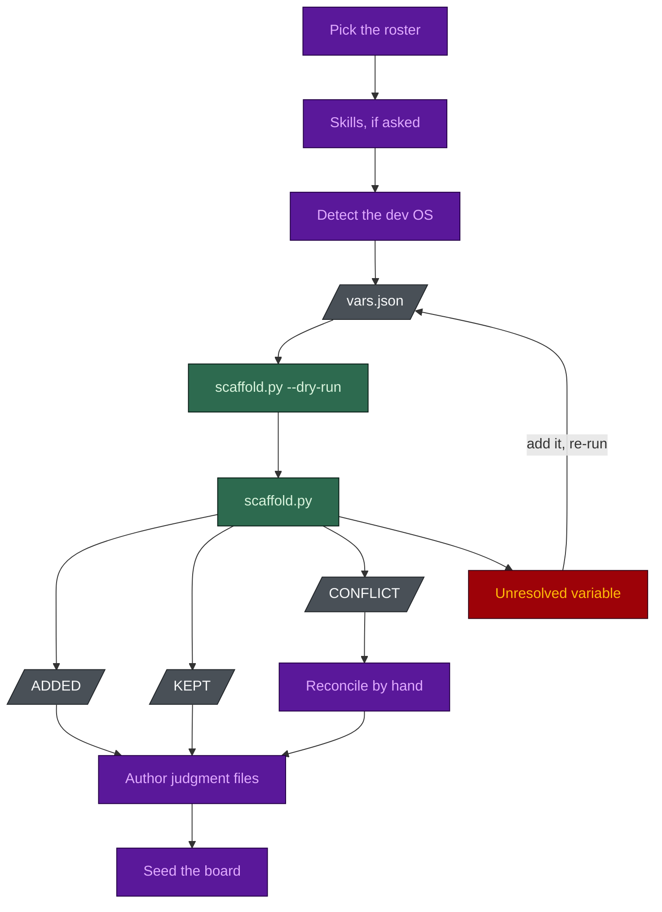

| Step | What it decides |
|---|---|
| Roster | The purpose sets the base. Code: the opt-in orchestrator, review gate, `spec-guardian`, dev agents (preset S/M/L). Research, strategy, docs: three to five seats with a `checker`. Every seat gets explicit `model`, `effort`, `tools` and `maxTurns`. |
| Skills | Runs only when the questionnaire asks. Each candidate's files are read; nothing installs without its own tick. `/skill-wire` maps a skill to a seat, `/new-skill` creates one when nothing fits. |
| Dev OS | Windows gets `.ps1` hooks, macOS and Linux `.sh`. Exactly one of the `windows` / `posix` flags. |
| `vars.json` | `vars` (names, commands, globs), `flags` and `modules` (one module `CLAUDE.md` each, 40 lines at most). Flags: the four `purpose_*`, then `ui`, `db`, `db_engineer`, `db_seeder`, `ai`, `audit`, `tdd`, `ddd`, `light`, `unit`, `e2e`, `tests`, `deploy_ask`, `long`, `solo_review`, `merge_gate`, `hooks_strict`, `terse`, `rtk`, `pr_cli`, `target_cursor`, `target_codex`. |
| Judgment files | What no template can know: the roster and routing tables in `AGENTS.md`, each dev agent's scope, `tech-stack.md`, `coding-standards.md`, `git-workflow.md`, the real deny commands in `settings.json`, `.env.example`. |
| Wiring | `master-plan.md` seeded (brownfield: Phase 1 from the analysis gap list), `AGENTS.md` as the entry point, `CLAUDE.md` as a thin `@AGENTS.md` import. |

**CONFLICT is a queue, not a failure.** The scaffolder never overwrites a file the user wrote: it
lists the differing ones and exits 0, and each is kept, adapted or flagged by hand. Only an
unresolved `{{VAR}}` stops the run, because a placeholder in a live rule matches nothing and fails
silently.

### 2c. Verify and ship

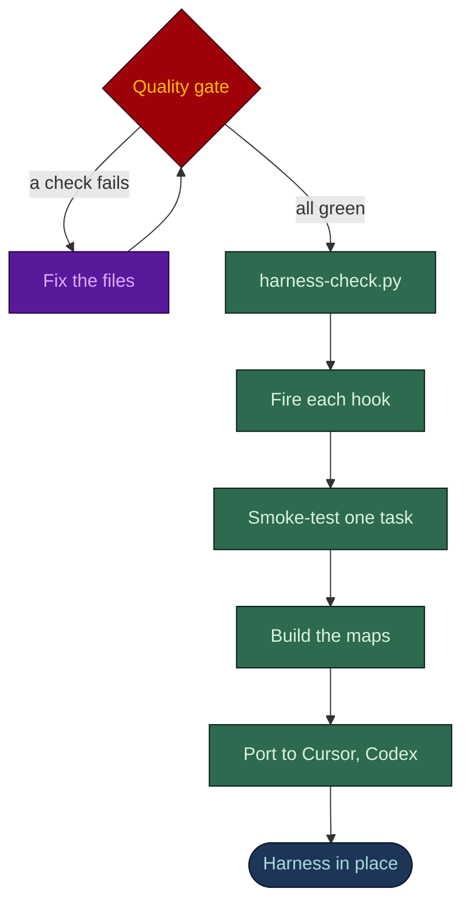

Every check is a real command with its output shown; a check that was not run is not passed.

| Check | Passes when |
|---|---|
| Quality gate | The `SKILL.md` checklist: seats filled once, rules path-scoped, no timestamps, all four guardrail layers, deny list fitted to the stack. |
| `harness-check.py` | Every seat, tier, route, hook, citation and skill link resolves. |
| Hooks | Each fires on this machine with a sample payload: a block exits 2, a pass exits 0. |
| Smoke test | One real task is registered, logged and resumed with `/task-resume`, and `board-check.py` exits 0. |
| Maps | `code-graph.py` (module-boundary map, code repos), `docs-graph.py --check` (orphan IDs), `harness-graph.py --html` (the wiring). |
| Port | Only for the recorded targets: `port.py --tool cursor`, `codex` or `all`. It prints what does not port. |

### Where each artifact comes from

The flowcharts are the procedure; the picture below is the *derivation*. The top panel shows which
source each generated file traces back to - the codebase, the specs or an intake answer. The bottom
panel shows how the generated pieces hold each other in check.

  

- **The model authors only what cannot be templated:** the routing table, each dev agent's scope and
  the three project-specific rules. Everything else is a file copy.
- **No seat is trusted on its own.** The opt-in orchestrator plans and dispatches but cannot write outside `docs/` and
  `.claude/`. Reviewers gate but hold no `Edit` or `Write`. The board records only what the session
  log can prove. The hooks bind every agent, including the one dispatching them.

## 3. The scaffolder in detail

`scripts/scaffold.py` is stdlib-only and makes the skill cheap: it copies real asset files instead of
asking a model to regenerate them. It is all green apart from the red stops where it refuses to
guess.

### 3a. Each manifest entry

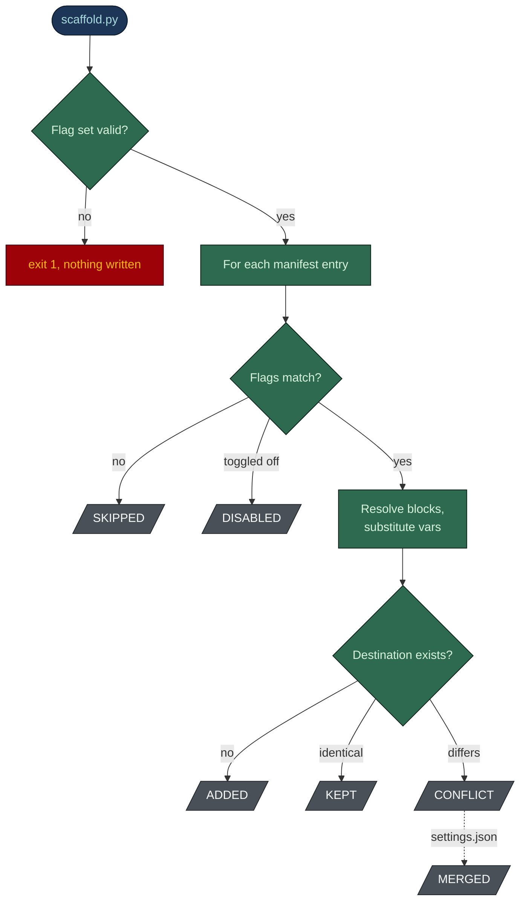

| Outcome | Meaning |
|---|---|
| Flag set invalid | An unknown flag, not exactly one OS flag, a contradiction, or a code-only flag without `purpose_code`. Each problem is printed. |
| `SKIPPED` | The entry's `when` (all), `when_any` (any) or `when_not` (none) flags are not met - for example `frontend.md` without `ui`. |
| `DISABLED` | Listed in `.claude/disabled.json` by `/harness-toggle`; never brought back by a re-run. |
| Resolve, substitute | `{{#IF_X}}` blocks are kept when flag X is set, `{{^IF_X}}` when it is not; then `{{VAR}}` is filled from `vars`, in the destination path too. A missing key is recorded, not blanked. |
| `ADDED` / `KEPT` | Did not exist, so it is queued to write / already byte-identical, so it is left alone. |
| `CONFLICT` | Exists and differs: not written unless `--force`. |
| `MERGED` | `settings.json` only: hook registrations this version ships are added, nothing is removed. |

Before the loop it derives what follows from the flags: no purpose means `purpose_code`, any non-code
purpose adds `checker`, and the OS flag sets the hook runner and extension.

### 3b. End of the run

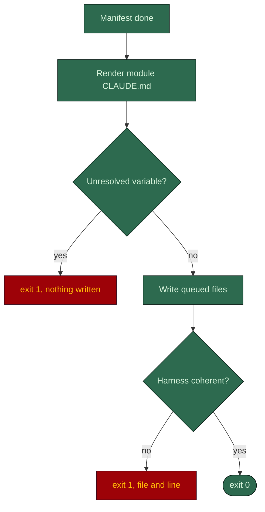

"Coherent" means three checks pass: no more than one seat holds the `Agent` tool, every control that
was installed is wired, and `harness-check.py --stage scaffold` resolves every link. A missing
manifest or asset exits 2.

The scaffolder refuses three things on purpose:

- **It never overwrites.** On a brownfield repo a differing file is usually something a human wrote.
  `--force` exists for files you have decided to replace.
- **It never writes a placeholder.** A literal `{{DB_RESET_CMD}}` in a deny rule would match nothing.
  When one is unresolved, nothing at all is written, so a failed run cannot leave a half-built
  harness.
- **It never ships an incoherent harness.** Each refusal names the file and line to fix.

Re-running on an unchanged repo is idempotent: everything comes back `KEPT`.

## 4. One feature, end to end through the generated harness

### 4a. Pick the tier first

The main session does the work at every tier, inside one repository and one domain - auth and schema
included. The tier table in the generated `AGENTS.md` decides, before anything is written, how much
checking a request gets.

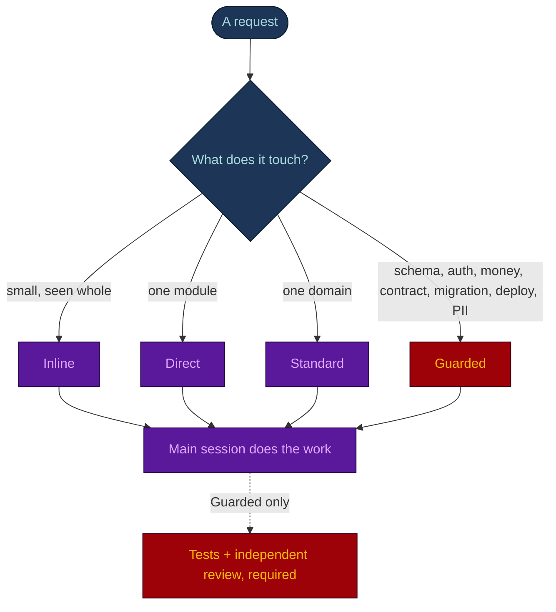

| Tier | The change | What it adds |
|---|---|---|
| Inline | A question, a lookup, a small edit seen whole | One check of the thing changed |
| Direct | One module, reversible | Prove each criterion yourself and say how |
| Standard | One domain, several files, or an FR behind it | The tests over what changed (a hand check without a suite); a task file only if the work must survive compaction |
| Guarded | Schema, auth, money, a public contract, a migration, a deploy, personal data | The gate below - required, never skipped |

A heavier tier than the change needs is a defect, not caution; a lighter one for a Guarded change is
the failure the table exists to prevent.

A subagent is dispatched by default only for three things: the independent read-only reviewer
(required on a Guarded change, or on request), a large read that returns a summary, and independent
parallel batches. The main session waits for every dispatch and checks its result before the final
answer. A seat that can write (the dev agents, `qa-test`, `ba-analyst`, `data-modeler`, `writer`)
still ships, but runs only when the user names it. `guard-agent-spawn` refuses such a dispatch unless
the prompt carries a `TASK-NNN` or `TIER: direct` / `TIER: standard`; the `orchestrator` is exempt,
since it registers the tasks.

The `orchestrator` is opt-in: it runs only when the user asks for it, for a mission across several
domains or repositories. No tier routes to it.

The rest of this section is the **Guarded** gate for code, split into three sequences. The roster
shown is the default (`tests` set, split reviewers). Without `tests`, `qa-test` and its gate do not
exist. With `solo_review`, one `reviewer` seat replaces the two reviewers.

### 4b. Register the task and lock the contract

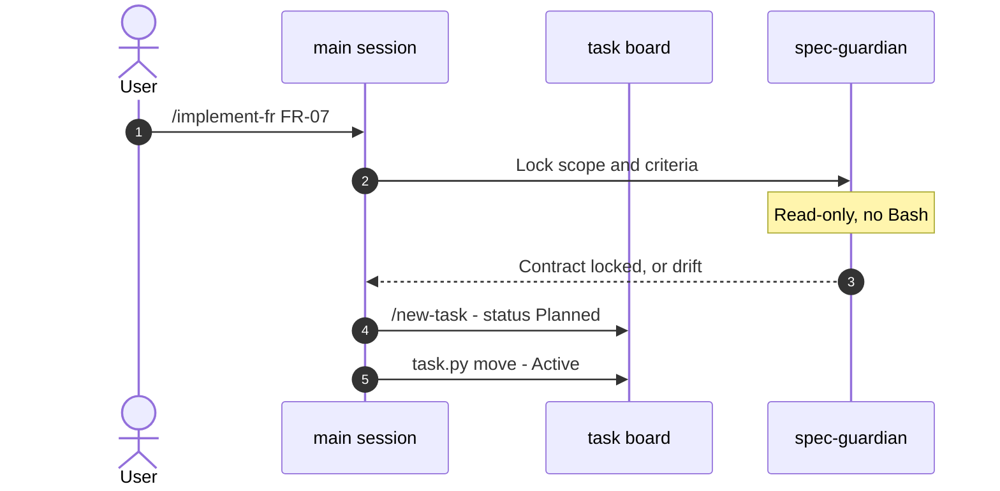

- `task.py` is the only way a status moves. It writes the task file's frontmatter, its folder and
  its master-plan row together and reads the row back. `guard-board` blocks a hand edit of a row.
- `spec-guardian` runs once per FR, before any code. The FR must be `Confirmed` in
  `docs/specs/index.json`.

### 4c. Build on a branch

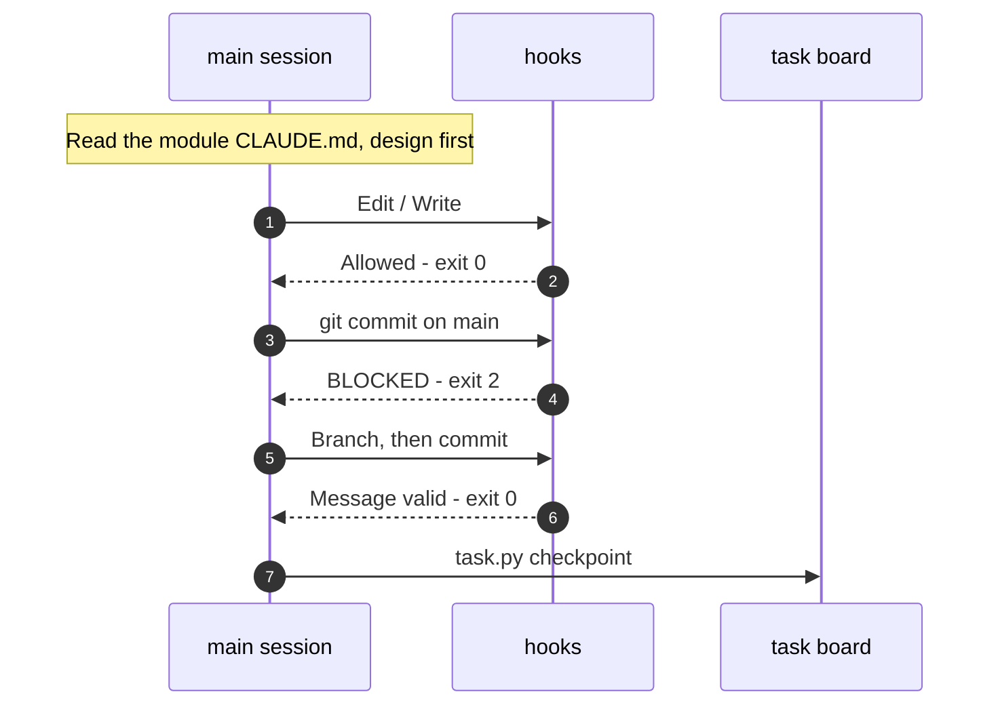

| Hook | Event | Does |
|---|---|---|
| `protect-adr`, `protect-secrets`, `guard-board` | PreToolUse, edits | Block an edit to an Accepted ADR, a secret file, a board row |
| `guard-main-commit` | PreToolUse, Bash | Blocks a commit on the default branch |
| `check-commit-msg` | PreToolUse, Bash | Enforces Conventional Commits |
| `specs-reminder`, `graph-stale` | PostToolUse | Remind about specs; name a cross-module import the boundary map does not list |

A hook that blocks you is a rule you were about to break; never route around it with a shell
equivalent. The routing table names the owner of the area: the main session reads that module's
`CLAUDE.md` and the rules for its paths, states the design in the task file, and ships the tests
with the code. While building it runs only the tests that touch what it changed. The full suite runs
once, at the gate.

### 4d. Gate once, then hand over

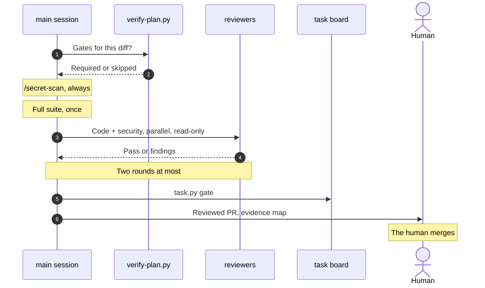

- **The gate runs once, on the branch, at the pull-request boundary** - not after each step. A
  reviewer per step re-reads the same files and reports the same findings each time.
- **What runs is decided by the diff.** `verify-plan.py` prints each gate as required or skipped
  with the reason; a docs-only change needs the secret scan and nothing else. The verification
  ledger skips a gate that passed on these exact bytes and narrows one whose files changed.
- **The independent review is required on a Guarded change.** `/review-changes` is never skipped
  for one, however small; `/db-migration` ends in the same gate.
- **`guard-agent-spawn` enforces it at dispatch time.** It refuses a re-run on content that passed,
  a third review round, an identical brief, and a dispatch past the task's budget
  (`dispatch_budget`, default 24).
- **Reviewers cannot edit.** Neither holds `Edit` or `Write`; a reviewer that edits has become a dev
  agent. The second round covers only the fix delta and only blocker and should-fix findings; what
  remains goes to the user.
- **A gate counts only when its row exists.** `task.py gate` writes the ledger line and the
  session-log row in one step. "All gates green" over a log with no reviewer rows is the classic
  failure.
- **Nothing in this flow merges on its own.** `/review-changes` does not merge and does not deploy.
  The human merges; with the `merge_gate` flag, the optional `merge-manager` seat does, one pull
  request at a time against the live mainline tip.
- **A mission across several domains or repositories** is where the opt-in `orchestrator` comes in:
  it scans the board at session start (`task.py resume`, `task.py check`), plans and dispatches the
  seats, and records state in `docs/tasks/`. It never merges either.

**Cost:** the reviewers and the debugger are Opus seats; the dev agents, `qa-test` and
`spec-guardian` are Sonnet; the mechanical seats (`history-tracker`, `db-seeder`) are Haiku at
`low` effort. The hooks are shell scripts and cost nothing, and they are the only participant that
can say no.

## 5. spec-builder

Same shape, different contract: read what the user brought, ask only what a human knows, let the
script lay down the sections, then spend tokens on content. **Nothing is invented**: an unstated
requirement becomes an assumption (`AS-nn`) or an open issue (`OI-nn`) with an owner, because a
plausible invented requirement gets estimated, built, and discovered in UAT.

### 5a. Read, ask, confirm the FR list

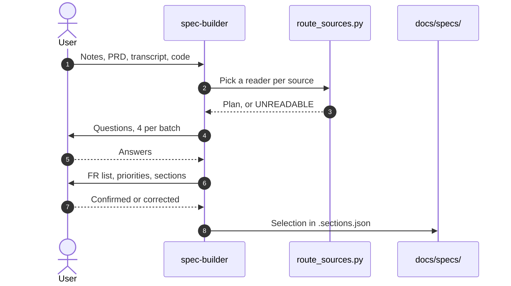

- The read plan is shown to the user first. An unreadable source becomes an `OI-nn` with the fix.
- Questions cover what code cannot settle: priorities, permission scope, NFR targets, volumes,
  security posture, output language. Anything unanswered becomes `AS-nn` or `OI-nn`.
- **One gate, before anything is written:** the FR list with proposed MoSCoW priorities, the roles,
  the open issues, and which optional sections the material justifies. Every later section derives
  from this list.

### 5b. Scaffold, fill, check

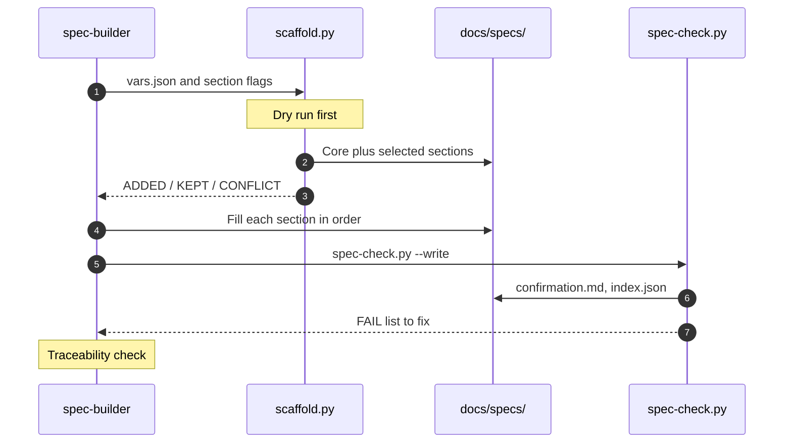

| Step | Detail |
|---|---|
| Scaffold | The core (README, 01, 03, 05, 07, 11, 13) always, plus up to 8 optional sections the gate selected. It refuses without `.sections.json` or when it contradicts the flags. Flat, or per module with `--module`. |
| Light contract | A repo whose product is not code (research, strategy, docs) gets README, 05, 11 and 13 only, each item an `FR-nn` with `Done when` criteria. The same `purpose_*` flags as harness-bootstrap pick it. |
| Fill | In order, because each section depends on the last. 05: observable FRs with a negative acceptance case. 07: security NFRs, never "TBD". 12: every FR gets Yes, Partial or No. |
| `spec-check.py` | Unique IDs, checkable criteria on every live FR, owned open issues, derived files in step. Writes `confirmation.md` (for the product owner) and `index.json` (for agents). |
| Traceability | Every FR in 05 appears in 12 (count both), every screen in 10 names an FR, every role and entity in 06 exists in 03 and 08. |

### 5c. Confirm and hand over

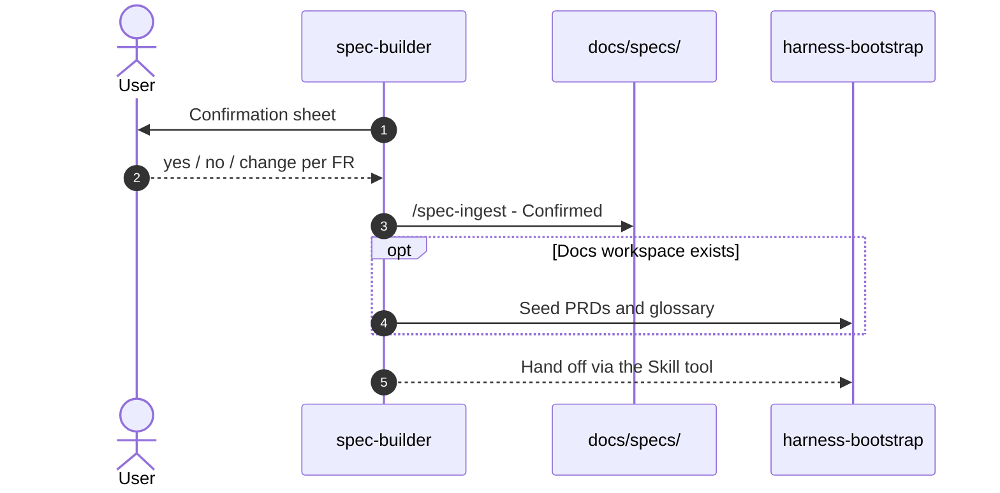

- The sheet lists every `OI`, every `AS`, every Partial or No, and every NFR target that was proposed
  rather than received. A product owner cannot correct an assumption nobody told them was made.
- `/spec-ingest` folds each answer in, sets `Status: Confirmed` on each yes and adds one revision
  row. A change that keeps every promise on the sheet needs no spec work.
- The handoff pre-fills `FR_LIST` and `GLOSSARY_SEED`, so harness-bootstrap clusters dev agents from
  the FR list. The next step is `/implement-fr`.
- `index.json` exists so a task touching one FR loads one block, not the whole section.

## 6. Context loading - why the harness is cheap

This is the mechanic behind the figures in `benchmark/RESULTS.md`. A rule in `.claude/rules/` with
**no `paths:` frontmatter** loads at launch into every session of every agent. It is rent, not a
one-time cost. With `paths:`, it loads only when Claude touches a matching file.

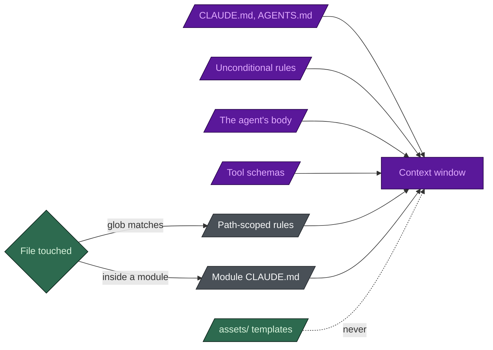

Purple is paid on every request, grey only on a match, green never. The model reads `SKILL.md` and
the reference docs; `scaffold.py` copies the hooks, commands, templates and agent bodies without them
ever entering a context window.

| Rule | Loads | Ships with |
|---|---|---|
| `00-overview`, `agent-guardrails`, `task-tracking`, `model-policy`, `conventional-commits` | Always | Every harness |
| `ai-governance` | Always | `ai` |
| `output-style` | Always | `terse` |
| `code-quality`, `performance`, `security-privacy` | Source files | Code repos |
| `testing` | Tests and source | `tests` |
| `frontend` | UI files | `ui` |
| `data-model` | Schema and migration files | `db` |
| `ddd` | Source files | `ddd` |
| `ip-compliance` | Source and dependency manifests | Code repos |
| `docs-workflow` | `docs/**` | Every harness |
| `model-tiers` | `.claude/agents/**`, `settings.json` | Every harness |

`conventional-commits` stays unconditional because it governs commit messages, not files - no glob
can scope it. `model-policy` decides what may be sent where before any file is touched.

7 unconditional rules, ten path-scoped ones: **75% of the rule content is kept out of the default
session**, so the database agent no longer carries the frontend rules and the UI agent no longer
carries the migration rules.

Three more levers:

- **Module guidance lives in the module.** A module's own `CLAUDE.md` (40 lines at most: owner,
  scope, invariants, commands) loads only when Claude reads files there.
- **Every tool costs on every request.** Each tool in an agent's `tools:` list ships its JSON schema
  with each call. Omitting `tools:` inherits every tool, including every MCP server on the machine,
  and the quality gate treats that as a bug.
- **No timestamps.** The always-loaded band is prompt-cache prefix content, so one
  `Generated: <date>` line cold-misses that agent's cache on every run.

## 7. Delivery commands, command by command

The commands the main session runs while building the product. Commands that adjust
the harness itself are in [`TUNING.md`](TUNING.md).

| Stage | Commands |
|---|---|
| Plan | `/new-task`, `/new-adr`, `/new-spec-section`, `/scaffold-feature`, `/brainstorm` |
| Build | `/implement-fr`, `/db-migration`, `/seed-db` |
| Gate | `/secret-scan`, `/test`, `/review-changes` |
| Ship | `/deploy` - typed by a human only |
| Keep memory | `/sync-context`, `/task-resume` |
| Audit mode only | `/security-scan`, `/triage-findings` |

### Registering and planning work

#### `/new-task <short-title>`

Registers a task - only for work the user agreed to. It first asks whether the work was requested
and is bigger than the paperwork: a typo, a rename or a step inside registered work is not a task,
and something noticed along the way is a finding to report. Refusing is a normal outcome. Unless the
user's message already asked for it, it proposes the task with `AskUserQuestion` and creates it only
on a yes.

`task.py new` does the rest in one step: allocates the next `TASK-NNN` across `active/`, `pending/`
and `done/`, fills `docs/templates/TASK.md` with `status: Planned`, adds and reads back the board
row, and logs the first session-log row. `--requested-by` records what was asked for, and at least
two observable criteria are required. With `--fr` it links an FR and refreshes
`docs/specs/index.json`. If a code graph exists, it adds a "Relevant modules" blast-radius line.

**Writes:** the task file, a master-plan row, the first session-log row. **Refuses:** a task nobody
asked for, a reused number, fewer than two criteria, no title. **Ships:** always.

#### `/new-adr <decision-title>`

Creates `ADR-NNN` from `docs/templates/ADR.md`: context, decision, options, consequences - including
the negative ones ("an ADR with no downside recorded is an advertisement"). Leaves `status:
Proposed`; only the user accepts it.

**Writes:** the ADR and its index row. **Refuses:** any language but English; editing an Accepted
ADR, which `protect-adr` blocks - a change of mind is a new ADR that supersedes it. **Ships:**
always.

#### `/new-spec-section <section-number-or-name>`

Scaffolds a spec section in the project's BA structure, dispatching `ba-analyst`. With no argument
it lists the missing sections and asks. Every FR gets an ID, acceptance criteria and a use case.

**Writes:** the section, a revision-history row. **Refuses:** inventing a requirement - an
unanswered question is recorded as open, because "a fabricated requirement is worse than a missing
one"; a parallel numbering scheme. **Ships:** `purpose_code`.

#### `/scaffold-feature <feature-slug>`

Creates a feature's skeleton per `coding-standards.md` - entry point (validation and delegation
only), library module (the logic, testable without transport), UI component from existing
primitives, and a failing test naming its acceptance criterion. Structure only, no behaviour.

**Writes:** the skeleton; a routing-table row if the domain has no owner. **Refuses:** writing the
business logic; no slug. **Ships:** `purpose_code`.

### Implementing

#### `/implement-fr <FR-id>`

The Guarded gate of section 4, for one FR, run by the main session. If the work turns out to be
Direct, it says so and does it at that tier. With no argument it lists the FRs that are Confirmed, decided yes, and have
no open issues or task, and asks.

1. Reads the FR's entry in `docs/specs/index.json` and only its block. **Stops unless it says
   `Confirmed` and `yes`.**
2. `spec-guardian` locks scope and criteria; an FR with no observable criteria stops here.
3. Registers via `/new-task`, moves it to Active, and implements in the main
   session. The routing table names the area owner; that seat is dispatched only if the user asked.
4. Design pass in the task file, then code: test-first under TDD, tests in the same change under
   DDD, a hand-verification note per criterion where there is no suite.
5. Once the whole FR is done, `/review-changes TASK-NNN` once.
6. Closes with an evidence map - one line per `AC-nn.n` naming the test, command or screen - and the
   checkpoint.

**Writes:** session-log rows, the checkpoint, the code (in the main session). **Refuses:** an FR that
is not Confirmed; deploying; skipping the review gate, even under Lightweight; a criterion with no
evidence. **Ships:** `purpose_code`.

#### `/db-migration <migration-name>`

Diffs the schema against the data model in `docs/specs/` (updating the ERD and data dictionary if the
design is new), generates the migration against the **local development database only**, and reviews
the SQL before applying it.

**Writes:** the migration, ERD and dictionary updates, the seed script, a `tool-changelog.md` entry.
**Refuses:** any shared, staging or production database - out of scope entirely; auto-applying a
`DROP` of populated data, a `NOT NULL` without a default, or a destructive type change ("generated
does not mean safe"). **Ships:** `db`.

#### `/seed-db`

Dispatches `db-seeder` to fill the local database with deterministic synthetic data per the ERD:
fixed seeds, upserts, row counts verified per table.

**Writes:** rows in the local database. **Refuses:** any target but local or development; real or
production data. **Ships:** `db` and `db_seeder`.

### Quality gates

#### `/test`

Runs lint and the test layers `verify-plan.py` says this change needs; a green run already logged at
HEAD is cited, not repeated. End-to-end runs only for the flows the plan names. A test that makes a
real network call fails even when it passes. Reports coverage against the target and maps each
failure to its owning agent and criterion.

**Writes:** a session-log row; on a green full suite, `task.py checkpoint --green` records the
commit. **Refuses:** editing a test to make it pass. **Ships:** `tests`.

#### `/review-changes`

The review gate on the current diff, optionally for a `TASK-NNN`.

1. `verify-plan.py --base <default branch>` reads the three-dot diff and prints each gate as
   required or skipped, with the reason. A gate that passed on these bytes is cited from the ledger;
   one whose files changed is narrowed to them.
2. `/secret-scan` first - any real secret is a blocker.
3. Only the required seats, in parallel: `reviewer` (under `solo_review`) or `code-reviewer` and
   `security-reviewer`; `spec-guardian` for the linked FR; `checker` for changed non-code claims.
4. CI must be green in a terminal state - pending never counts.
5. Findings by severity: blocker, should-fix, suggestion. Each gate is recorded with `task.py gate`.
6. Two rounds at most; the second covers only the fix delta. What remains goes to the user.

| Gate | Required when the diff touches |
|---|---|
| Secret scan | Always |
| Spec validation | `docs/specs/` |
| Code review | Code, tests, schema, dependencies, infrastructure |
| Security review | Auth, secrets, input parsing, data handling, dependencies, hooks |
| Tests | Behaviour - scoped first, the full suite once |
| End-to-end | A flow named in `.claude/verify-map.json` |
| Content check | Prose whose claims changed |

**Writes:** a ledger line and session-log row per gate. **Refuses:** merging or deploying -
"reviewing is not approving." **Ships:** always.

#### `/secret-scan`

Scans `git diff` plus staged changes for credential patterns (`sk-`, `AKIA`, `AIza`, `ghp_`,
`glpat-`, `xox`, JWTs, private-key headers, hardcoded `password=` and similar), forbidden files
(`.env*` except `.env.example`, `*.pem`, `*.key`, `*.tfvars`, service-account JSON), real-looking
personal data in fixtures, and secrets in CI config, lockfiles, docs and comments.

**Writes:** nothing - it reports `file:line` and the pattern type. **Refuses:** printing the value,
even truncated; proceeding until the value is out of the diff *and* rotated. **Ships:** always.

### Release

#### `/deploy`

The one command with `disable-model-invocation: true`: only a human typing `/deploy` runs it. It
refuses, naming the reason, unless the PR is approved and merged, CI is green in a terminal state,
every environment variable is present at the target (checked, never read), and migrations are clean.
Then: forward migrations, deploy from the merged commit, verify the health endpoint - "deployed is
not the same as healthy."

**Writes:** a `tool-changelog.md` entry. **Refuses:** any unmet precondition; retrying or fixing
forward without the user - on failure it rolls back and stops. **Ships:** `purpose_code`. Deploy
rights default to human-only in `permissions.deny` until `/harness-tune` moves them.

The file's own `allowed-tools` is narrow (`git status`, `git log`, `Read`) and does not name the tool
that runs the deploy steps it describes. That is a gap in the command file, not an inferred
mechanism.

### Keeping memory current

#### `/sync-context`

Records what landed on the default branch since the last sync in `docs/context/`: behaviour changes
as `BR-NN` rules sourced to an FR or ADR, issues with their workaround, tool and infrastructure
changes, new domain terms.

**Writes:** `business-rules.md`, `known-issues.md`, `tool-changelog.md`, `glossary.md`.
**Refuses:** deleting history (a fixed issue is marked resolved); copying a secret or real customer
data; restating the diff. **Ships:** always.

#### `/task-resume [TASK-NNN]`

With no argument, lists unfinished tasks, human gates first, and resumes nothing. With an ID,
`task.py resume` prints the board row, the checkpoint, open criteria, the last log rows, and whether
HEAD and the tree match the checkpoint. That digest beats conversation memory. On drift it
reconciles first (`task.py check` names the disagreement).

**Writes:** log rows (`task.py log`), status moves (`task.py move`), a fresh checkpoint before
stopping. **Refuses:** stashing or discarding uncommitted work it finds. **Ships:** always.

### Exploring a decision

#### `/brainstorm <topic>`

Dispatches `strategist` (after `researcher` when the options need evidence) to frame the decision
and its constraints, including Accepted ADRs, produce 3 to 5 real options with a trade-off matrix,
and recommend one. An unmeasured assumption gets a small timeboxed spike first.

**Writes:** nothing directly - a stack decision goes to `/new-adr`, a product one to the PRD, the
rest to the task's decisions section. **Refuses:** straw-man options; deciding for the user.
**Ships:** `long`.

### Audit-only pair

These ship only in **audit mode** (the `audit` flag): agents scan and record, a human applies every
fix.

#### `/security-scan [repo-slug]`

Dispatches `sast-runner` to run the pinned scanner matrix (SAST, secrets, dependency CVEs,
infrastructure policy) in Docker through a **read-only mount**, so no scanner can write into product
source. Raw output goes to `docs/findings/raw/`, then is normalized, deduplicated against
`docs/findings/<repo>/`, and secrets are redacted before anything touches disk.

**Writes:** raw output and one `status: New` finding file per new result; a reopened finding goes
back to `Confirmed`. **Refuses:** assigning severity (that is triage); hiding a scanner that crashed -
it is reported as missing coverage. **Ships:** `audit`.

#### `/triage-findings [repo-slug]`

Walks each `New` finding through confirmation, severity, requirement anchoring and task registration.
A rejected finding becomes `False-positive` and keeps its reasoning, so the next scan does not
re-open the argument. `spec-guardian` anchors each confirmed finding to the verified standards
table; each becomes a task via `/new-task`, linked both ways.

**Writes:** finding status changes, task files. **Refuses:** anchoring to an unverified standards
row; closing on a claim of a fix - only a clean re-check sets `Verified`; applying the fix.
**Ships:** `audit`.

### Quick reference

| Command | Writes / changes | Ships |
|---|---|---|
| `/new-task` | Task file, master-plan row, first log row (agreed work only) | Always |
| `/new-adr` | ADR file, ADR index row | Always |
| `/new-spec-section` | Spec section, revision-history row | `purpose_code` |
| `/scaffold-feature` | Skeleton files, routing row for a new domain | `purpose_code` |
| `/implement-fr` | Log rows, checkpoint, code in the main session | `purpose_code` |
| `/db-migration` | Migration, ERD and dictionary, seed script, tool-changelog | `db` |
| `/seed-db` | Rows in the local database only | `db` + `db_seeder` |
| `/test` | Log row (pass/fail, coverage) | `tests` |
| `/review-changes` | Ledger line and log row per gate | Always |
| `/secret-scan` | Nothing - `file:line` and pattern type | Always |
| `/deploy` | tool-changelog entry | `purpose_code`; human only |
| `/sync-context` | The four `docs/context/` files | Always |
| `/task-resume` | Log rows, checkpoint, status via `task.py move` | Always |
| `/brainstorm` | Nothing directly - routes the outcome | `long` |
| `/security-scan` | `docs/findings/raw/`, `docs/findings/<repo>/` | `audit` |
| `/triage-findings` | Finding status, task files | `audit` |

## Accuracy notes

- Byte and file counts are exact, counted from disk. The token figures in `benchmark/RESULTS.md` are
  **estimated** at 3.6 chars/token: an order of magnitude, not a quote.
- The orchestrator's session-start scan (`task.py resume`, `task.py check`) is a procedure in its
  agent body, not a hook. Always registered: `PreToolUse` (protect-adr, guard-agent-scope,
  guard-task-scope, guard-board, protect-secrets, guard-main-commit, check-commit-msg,
  guard-destructive, guard-agent-spawn), `PostToolUse` (specs-reminder, graph-stale) and
  `SubagentStop` (agent-history). The rest register with the flag that ships them: `hooks_strict`,
  `db`, `long`, `purpose_research`, `purpose_docs`, `rtk` and `audit`. Blocking guards register with
  `onFailure: block`, so a guard that crashes or times out stops the tool call instead of letting it
  through. `assets/claude/hooks/README.md` is the full table.
- `CONFLICT` does **not** change the scaffolder's exit code. An unresolved `{{VAR}}`, an invalid flag
  set, a second `Agent`-holding seat, an unwired control or an unresolved link exits 1; a missing
  manifest or asset exits 2.
