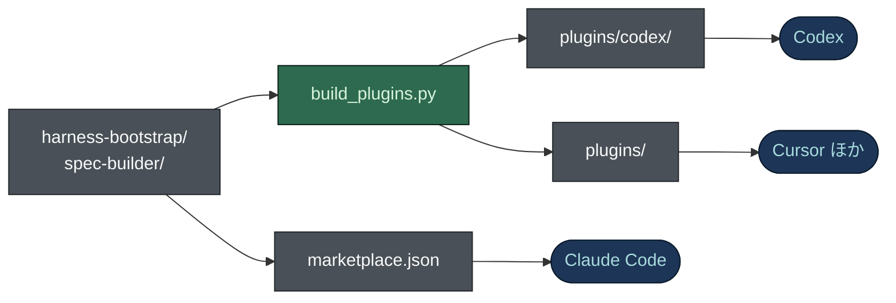

# プラグインとしてのインストール

[English](PLUGIN.md) · **日本語**

2 つのスキル `harness-bootstrap` と `spec-builder` は、Claude Code、Codex、Cursor、そして
[Agent Plugins](https://agent-plugins.org/) 標準を読むあらゆるクライアントにプラグインとしてインストールできます。
これが推奨の経路です。更新はクライアント自身の更新コマンドで届き、インストールした版はいつでも識別できます。
GitHub Releases の zip は、オフラインで版を固定する代替手段として引き続きサポートします。



スキルのフォルダーが唯一の正です。Claude Code はそれを直接読み、`build_plugins.py` が 2 つの生成ツリーにコピー
します。コピーがずれると CI が失敗します (`--check`)。

| クライアント | 読むもの | このリポジトリでの置き場所 |
|---|---|---|
| Claude Code | スキルフォルダーの `.claude-plugin/plugin.json` と、直下の `SKILL.md` | スキルフォルダー。`.claude-plugin/marketplace.json` に掲載 |
| Codex | `.codex-plugin/plugin.json` | `plugins/codex/<skill>/`。`.agents/plugins/marketplace.json` に掲載 |
| Cursor、VS Code、Copilot、Kiro、ChatGPT | プラグインのルートにある Agent Plugins の `plugin.json` | `plugins/<skill>/` |

**Codex に専用のツリーがある理由。** Codex はルートに `plugin.json` があるとそれを検証し、Agent Plugins が必須と
する `$schema` キーを拒否します。`$schema` を外すと標準に適合しないマニフェストを出荷することになるので、スキル
ごとにルートを 2 つ用意しました。Codex にルートの外の `skills` パスを指させる方法も使えません。Codex はプラグインの
ルートだけをキャッシュにコピーするからです。

## Claude Code

```bash
/plugin marketplace add nguyenhx2/agent-harness-bootstrap
/plugin install harness-bootstrap@agent-harness-bootstrap
/plugin install spec-builder@agent-harness-bootstrap
```

どちらか一方でも、両方でもインストールできます。追加の設定は要りません。

Claude Code ではスキルフォルダーそのものが、Claude のプラグインディレクトリにそのまま出せるプラグインです。
`.claude-plugin/plugin.json` と `icon.png`、プラグインが何を実行し何を送り何を取りに行くかを書いた `README.md`、
マニフェストに記した AGPL ライセンスがそろっており、`claude plugin validate ./harness-bootstrap --profile
directory --strict` は二つとも通ります。マニフェストは `build_plugins.py` が、アイコンは `make_icons.py` が
生成するので、どちらも手では編集しません。

## どのエージェントでも: `skills` CLI

```bash
npx skills add nguyenhx2/agent-harness-bootstrap --skill harness-bootstrap --skill spec-builder
```

[skills.sh](https://skills.sh) の CLI は、二つのスキルフォルダーをエージェントのスキルディレクトリにコピーします
(Claude Code なら `.claude/skills/`。`-a codex`、`-a cursor` などで対象を選び、`-g` で全プロジェクト共通に
入れます)。二つのスキル名を必ず指定してください。`--skill` を付けないと、このリポジトリに同梱している
`impeccable` スキルも候補に出ます。プラグインのコマンド (`/harness-update` など) はスクリプトを
`${CLAUDE_PLUGIN_ROOT}` から探すので、この経路では入りません。コマンドが必要ならプラグインの経路を使ってください。

## Codex

```bash
codex plugin marketplace add nguyenhx2/agent-harness-bootstrap
```

そのあと Codex CLI で `/plugins` を開き、`harness-bootstrap`、`spec-builder`、または両方をインストールします。

## Cursor とその他の Agent Plugins クライアント

`plugins/` の下の各ディレクトリは Agent Plugins 1.1.0 のパッケージです。ルートに `plugin.json`、`skills/` の下に
スキルがあります。Cursor はローカルのプラグインをフォルダー単位で読み込みます。

```bash
git clone https://github.com/nguyenhx2/agent-harness-bootstrap
cp -r agent-harness-bootstrap/plugins/harness-bootstrap ~/.cursor/plugins/local/
```

そのあとウィンドウを再読み込みします。ほかの Agent Plugins クライアントも同じディレクトリを使います。

## スキルの呼び出し

```
/harness-bootstrap:harness-bootstrap
/spec-builder:spec-builder
```

zip からインストールした場合と同じく、各スキルは `SKILL.md` の description にあるトリガーの語句でも起動します。

## 更新

```bash
/plugin update harness-bootstrap@agent-harness-bootstrap
/plugin update spec-builder@agent-harness-bootstrap
```

更新を提示するかどうかは、各スキルの `.claude-plugin/plugin.json` と、`.claude-plugin/marketplace.json` の
エントリにある `version` で決まります。前者はスキルのバージョンから `build_plugins.py` が書き、後者と食い違うと
`build_plugins.py` は実行を拒否します。どちらかを上げ忘れたリリースは `validate_release.py` が失敗させます
([`RELEASING.ja.md`](RELEASING.ja.md) を参照)。

## プラグインの経路か zip の経路か

| | プラグイン | zip |
|---|---|---|
| インストール | クライアントのプラグインコマンド | `.claude/skills/` に展開 |
| 更新 | クライアントから必要なときに | 手でファイルを置き換える |
| ネットワーク | このリポジトリへのアクセスが必要 | オフラインで動く |
| 版 | マーケットプレイスのエントリ | アーカイブの `VERSION` ファイルに固定 |

どちらの経路も廃止の予定はありません。

`tools/harness-view` の Rust バイナリはプラグインではありません。GitHub Releases から自分のプラットフォーム用を
ダウンロードしてください。

## どこまで検証したか

この構成を導入したときに、3 つの経路すべてを実際のクライアントで試しました。

- **Claude Code** (`claude` 2.x): 両方のプラグインをインストールし、クライアントがスキルの読み込みを報告。
- **Codex** (`codex-cli` 0.148.0): 両方のプラグインをインストールし、`~/.codex/plugins/cache/.../skills/<skill>/` に
  `SKILL.md` があることを確認。以前の構成では、ここが黙って欠けていました。
- **Cursor** (`cursor-agent` 2026.08.11): 生成したツリーを `--plugin-dir` で読み込み。グローバルにインストール済みの
  スキルが代わりに答えないよう、名前を変えたコピーを使いました。

このとき見つかった 3 つの欠陥はすべて修正済みです。`policy.installation` は `AVAILABLE` でなければならない。
マーケットプレイスのソースパスはリポジトリのルートから解決される (`./plugins/...`)。`.codex-plugin/plugin.json` には
明示的な `skills` パスと `interface` ブロックが必要。
