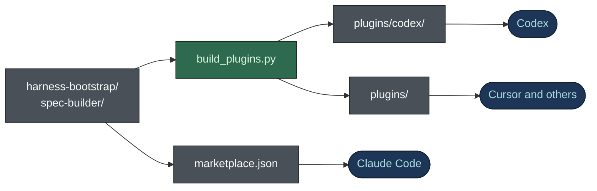

# Installing as a plugin

**English** · [日本語](PLUGIN.ja.md)

Both skills, `harness-bootstrap` and `spec-builder`, install as plugins in Claude Code, Codex,
Cursor and any other client that reads the [Agent Plugins](https://agent-plugins.org/) standard.
This is the recommended route: updates arrive through the client's own update command, and the
installed version is always identifiable. The zip from GitHub Releases stays supported as the
offline, pinned alternative.



The skill folders are the single source. Claude Code reads them directly; `build_plugins.py`
copies them into the two generated trees, and CI fails if a copy drifts (`--check`).

| Client | Reads | Where it lives here |
|---|---|---|
| Claude Code | `SKILL.md` at the directory root (single-skill plugin) | `.claude-plugin/marketplace.json` |
| Codex | `.codex-plugin/plugin.json` | `plugins/codex/<skill>/`, listed by `.agents/plugins/marketplace.json` |
| Cursor, VS Code, Copilot, Kiro, ChatGPT | Agent Plugins `plugin.json` at the plugin root | `plugins/<skill>/` |

**Why Codex has its own tree.** Codex validates a root `plugin.json` when one is present and
rejects the `$schema` key that Agent Plugins requires. Dropping `$schema` would ship a manifest the
standard calls non-conformant, so each skill gets two roots. Pointing Codex at a `skills` path
outside its root does not work either: Codex copies only the plugin root into its cache.

## Claude Code

```bash
/plugin marketplace add nguyenhx2/agent-harness-bootstrap
/plugin install harness-bootstrap@agent-harness-bootstrap
/plugin install spec-builder@agent-harness-bootstrap
```

Install either plugin, or both. No further configuration is needed.

## Codex

```bash
codex plugin marketplace add nguyenhx2/agent-harness-bootstrap
```

Then open `/plugins` in Codex CLI and install `harness-bootstrap`, `spec-builder`, or both.

## Cursor and other Agent Plugins clients

Each directory under `plugins/` is an Agent Plugins 1.1.0 package: `plugin.json` at the root, the
skill under `skills/`. Cursor loads a local plugin by folder:

```bash
git clone https://github.com/nguyenhx2/agent-harness-bootstrap
cp -r agent-harness-bootstrap/plugins/harness-bootstrap ~/.cursor/plugins/local/
```

Then reload the window. Any other Agent Plugins client consumes the same directories.

## Invoking the skills

```
/harness-bootstrap:harness-bootstrap
/spec-builder:spec-builder
```

Each skill also triggers on the phrases in its `SKILL.md` description, as it does from the zip.

## Updating

```bash
/plugin update harness-bootstrap@agent-harness-bootstrap
/plugin update spec-builder@agent-harness-bootstrap
```

The Claude Code plugins have no `plugin.json` of their own, so the `version` field of each entry in
`.claude-plugin/marketplace.json` decides whether an update is offered. Both entries move with every
release, and `validate_release.py` fails a release that forgets them (see
[`RELEASING.md`](RELEASING.md)).

## Plugin route or zip route

| | Plugin | Zip |
|---|---|---|
| Install | the client's plugin command | unzip into `.claude/skills/` |
| Updates | on demand, through the client | replace the files by hand |
| Network | needs access to this repository | works offline |
| Version | the marketplace entry | pinned to the archive's `VERSION` file |

Neither route is being deprecated.

`tools/harness-view`, the Rust binary, is not a plugin. Download it for your platform from GitHub
Releases.

## How far this was verified

All three routes were exercised against the real clients when the layout was introduced:

- **Claude Code** (`claude` 2.x): both plugins installed, the client reported the skill loaded.
- **Codex** (`codex-cli` 0.148.0): both plugins installed, and `SKILL.md` confirmed inside
  `~/.codex/plugins/cache/.../skills/<skill>/`, the part an earlier layout had silently lost.
- **Cursor** (`cursor-agent` 2026.08.11): the generated tree loaded with `--plugin-dir`, using a
  uniquely named copy so the globally installed skills could not answer instead.

That round found three defects, all fixed: `policy.installation` must be `AVAILABLE`; the
marketplace source path resolves from the repository root (`./plugins/...`); and
`.codex-plugin/plugin.json` needs an explicit `skills` path and an `interface` block.
