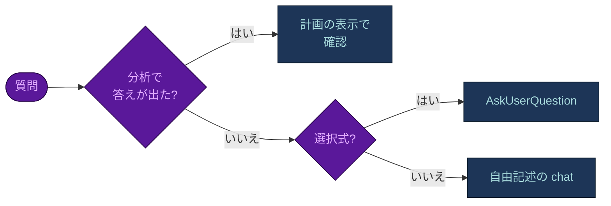
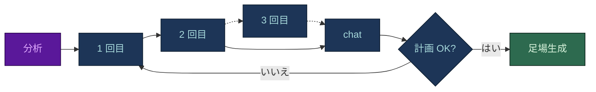
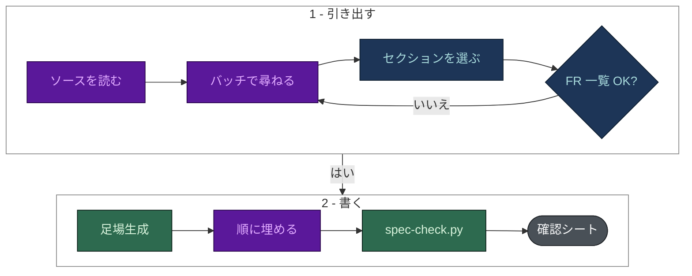

# 質問票

[English](QUESTIONNAIRES.md) · **日本語**

各スキルが何を、なぜ尋ねるのか。質問が来る前に分かるようにまとめています。完全なソースは、
`harness-bootstrap` については [`intake.md`](../harness-bootstrap/reference/intake.md)、`spec-builder` については
[`elicitation.md`](../spec-builder/reference/elicitation.md) と [`SKILL.md`](../spec-builder/SKILL.md) です。

両方のスキルを律するルールは一つです。**推測できることは推測し、決定、優先度、方針は必ず尋ねます。** 誰も答えを
知らなければ、その空白は担当者つきの未決事項として記録し、もっともらしい推測で埋めることはしません。

## `harness-bootstrap` のインテーク

最初にコードベースの分析が走ります。そのあと各質問は、次の 3 つのどれかで答えが決まります。

- **確認**: 分析が強い根拠で答えを見つけたもの。質問はせず、計画の表示に一行として載り、一語で訂正できます。
- **AskUserQuestion**: 選択式の質問。選択肢は最大 4 つで、根拠のあるものを先頭に「(Recommended)」と付け、
  説明に根拠を引用します。
- **chat**: 名前、数値、安全な既定値のない方針。

質問はすべて、利用者が書いた言語で尋ねます。フラグ名とエージェント向けのファイルは英語のままです。

### インタビューの順序

選択式の質問は、**最大 2 回の `AskUserQuestion` 呼び出し**からなる一つの質問票にまとめ、3 回目は残った空白だけに
使います。自由記述 (識別情報、コミットの識別情報、ガバナンス) は chat で尋ねます。

| 呼び出し | 質問 |
|---|---|
| 1 - 形 | 目的、チームの形 (Lean / Standard / Long-running / High-throughput)、フックの厳しさ、検証の程度 |
| 2 - 方針 | デプロイ権限、方法論 (DDD / TDD / 両方 / Lightweight)、配線するスキル、effort のプロファイル |
| 3 - 必要なときだけ | 検出で決まらなかったもの: DB の席、データの機密度、任意のアドオン |

**目的 (Q0) は残りすべてを左右するので、呼び出し 1 の最初に来ます。** Code、Research、Strategy、Documentation から
一つ以上を選びます。Code がなければ、スタック、テスト、方法論、データベースの質問は飛ばし、コード専用のフラグは
立てません。紛れ込んだフラグは scaffolder が拒否します。コード以外のリポジトリでは、質問票全体が 6 問です。

### エクスプレスのインテーク

「既定値を使う」を選ぶと、確認済みの検出結果か推奨の選択肢があるものはすべてそれを採り、想定した値を一つの表に
まとめて確認を取ります。次の 4 つは決して既定値にしません。

- プロジェクトの識別情報 (Q1)
- デプロイ権限 (Q18 の半分)
- バッチ G、監査の範囲
- バッチ H、ガバナンス

### バッチ

質問は `intake.md` で Q1-Q27 と番号が振られ、バッチにまとめられています。

| バッチ | 尋ねること | なぜ重要か |
|---|---|---|
| A - 識別情報 | 名前、ドメイン、ドキュメントの言語、仕様の有無、対象の AI ツール | すべてのファイルの語彙を決める。仕様がなければ目的のフラグを持って `spec-builder` に引き継ぐ。対象ツールの回答は記録されるので (`target_cursor`、`target_codex`)、`/harness-update` は聞き直さずに再移植できる |
| B - スタック | 言語とフレームワーク、DB と ORM、連携先とその代替手段、製品のロケール、認可とテナンシー、環境、開発 OS | どのルールを読み込むか、`db` フラグ、Windows と POSIX のどちらのフックが発火するかを決める |
| C - git と CI | プラットフォームと CLI、コミットの識別情報、マージ権限を持つボット、既定ブランチ、コミットのスコープ | `guard-main-commit` と PR/MR の用語に使われる。申告されていない自動マージのボットはレビューゲートを迂回する |
| D - 品質と安全 | チームの形、テスト、方法論、データの機密度とコンプライアンス体制、effort のプロファイル、履歴の詳細度、運用の姿勢、デプロイ権限 | ロースターの規模、`qa-test` と `/test` を出荷するか、ガードレールの厳しさ、デプロイを `deny` と `ask` のどちらに置くかを決める |
| E - DB 運用 | DB の席、シードの方針、実際の破壊的な DB コマンド | リセットコマンドを推測ではなく `permissions.deny` のエントリにする |
| F - ブランディング | ブランド資産、アイコンの方針、アクセシビリティの目標 | `rules/frontend.md` になる |
| G - 監査モード | 対象のリポジトリ、標準、スキャナーの戦略 | 読み取り専用の制御プレーンの境界を決める。エクスプレスにはしない |
| H - ガバナンス | データ分類ごとのモデル、データの所在地、依存のライセンス、ゲート付きの操作とインシデントの経路 | 組織だけが持てる方針。必ず chat で尋ね、既定値にしない |

## `spec-builder` の要件引き出し

これはビジネスアナリストの質問です。モデルは利用者が持ち込んだもの (アイデア、議事録、PRD、コードベース) から
*構造*を推測し、*決定*だけを尋ねます。

- **読めないソースは未決事項 (`OI-nn`) になります。** ファイル名と直し方を記録します。
- **質問はバッチで尋ねます。** `AskUserQuestion` 1 回につき最大 4 つで、一人が一度に答えられるようにまとめます。
- **セットアップのバッチ**で、出力の言語、素材が裏付ける任意のセクション、標準のプロファイルを選びます。選択は
  `docs/specs/.sections.json` に書かれ、これがないと scaffolder は動きません。
- **書く前のゲートは一つです。** MoSCoW の優先度案つきの FR 一覧、役割、ここまでの未決事項を確認します。
- **確認シート**には、すべての未決事項、前提、Partial/No の実現可能性の判定、提案した NFR の目標値が載ります。
  プロダクトオーナーは、前提とされたことをここで訂正できます。

| バッチ | 尋ねること | なぜ重要か |
|---|---|---|
| 範囲 | 目的、必須の機能、対象外、出力の言語 | FR 一覧の下書きになる。一覧が間違っていると、後のすべてのセクションが代償を払う |
| 人 | 利用者グループ、役割、認可モデルとテナンシー、誰が決めて誰が承認するか | 役割の名前は推測できるが、権限の範囲 (Own/Team/All) と緊急時の特権経路は推測できない |
| データとシステム | エンティティ、保持と削除、量、連携先とその代替手段、ID プロバイダー、ロケール、既存システムからの切り替え | データ辞書 (08) と連携の NFR (09) になる。推測した量は、隠れた設計上の決定になる |
| 制約 | 名前のついたセキュリティとコンプライアンスの体制、期限、予算、スタックの制約 | セクション 07 のセキュリティ NFR は決して「TBD」にしない。分からないものは担当者つきの未決事項になる |

**エクスプレスの要件引き出しで詰められるのは進め方だけで、中身は詰めません。** 次のバッチを開く前に 01-05 を
下書きする、ソースがすでに答えているバッチをまとめる、浅めの初回であることを明示する、のいずれかです。
優先度、NFR の目標値、セキュリティの姿勢、量は、どの進め方でも必ず尋ねます。
