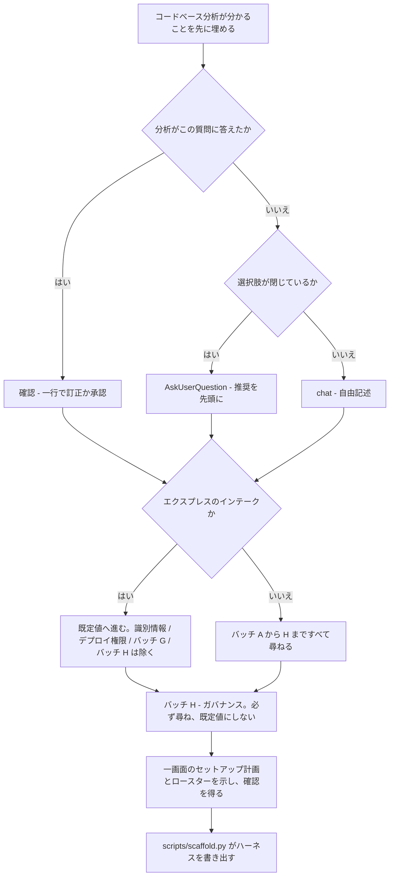
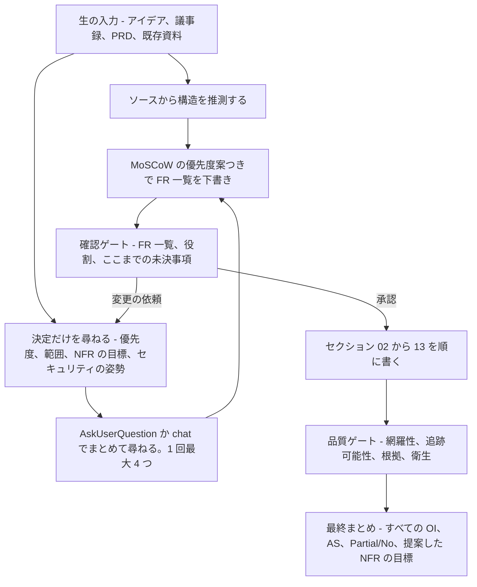

# 質問票

[English](QUESTIONNAIRES.md) · **日本語**

各スキルの質問が実際に何を探っているのか、そしてなぜなのか。聞かれる前に、何を聞かれるのかが分かるように
まとめています。完全なソースは、`harness-bootstrap` については [`intake.md`](../harness-bootstrap/reference/intake.md)、
`spec-builder` については [`elicitation.md`](../spec-builder/reference/elicitation.md) と
[`SKILL.md`](../spec-builder/SKILL.md) です。

## `harness-bootstrap` のインテーク

最初にコードベースの分析が走り、分かることは先に埋めておきます。そこから先の質問はどれも 2 種類のどちらかです。
**確認** (分析がすでに答えを見つけているので、一行で訂正するか受け入れる) か、**本当の質問** (推測する材料が
ない) です。本当の質問は、選択肢が閉じているものは `AskUserQuestion` (選択肢は最大 4 つ、推奨のものを先頭に
ラベル付き) で、答えが名前、数値、または安全な既定値のない方針である場合は `chat` の自由記述で尋ねます。
**エクスプレスの経路** (「既定値を使う」) は、既定値のあるものすべてをそのまま既定値にし、想定した表を一度だけ
表示して確認を取ります。例外は、プロジェクトの識別情報、制御レベルの質問のうちデプロイ権限の半分、
バッチ G (監査モード - 範囲は既定値にできない)、そしてエクスプレスモードが一切触れないバッチ H です。

| バッチ | 引き出すもの | なぜ重要か |
|---|---|---|
| A - プロジェクトの識別情報 | 名前、ドメイン、ドキュメントの言語、仕様がすでにあるか、対象の AI ツール (Q3a - 複数選択。強い根拠があるときだけ事前に埋め、選ぶ前に失われるものを示す: どちらのツールにも `maxTurns` と席ごとの `tools:` 許可リストがなく、Codex にはパス単位のルールがない) | 生成されるすべてのファイルの語彙と、どのツール向けの出力 (Cursor、Codex) を移植するかを決める。ツールの回答はバッチ A で唯一残り続ける回答で、フラグ `target_cursor`/`target_codex` と `tool-changelog.md` の一行として記録される。だから `/harness-update` は、ツリーからはもう答えられない質問を聞き直さずに再移植できる |
| B - 技術スタック | 言語/フレームワーク (記憶から思い出すのではなく `tech-presets.md` でバージョンを確認)、DB + ORM、連携先とその代替手段・更新頻度、製品の国際化、認可モデルとテナンシー、環境とそれぞれの責任者、開発 OS | どのルールを読み込むか、`db` フラグ、Windows と POSIX のどちらのフックが実際に発火するか、そして `tech-stack.md` と `data-model.md` を書く前提となるロケールとテナンシーの事実を決める |
| C - git と CI | プラットフォーム、コミットの識別情報、既存のマージ権限を持つボット、既定ブランチ、コミット規約とスコープ | main へのコミットのガードと、PR/MR の用語に使われる。識別情報を間違えるとコミットの帰属を誤り、申告されていない自動マージのボットは `merge-manager` のゲートを迂回できる |
| D - 品質と安全 | ロースターの形 (プロジェクトの期間 - フラグ `long`、役割の粒度 - レビュアーを分けるか `reviewer` に統合するか、フラグ `solo_review`、優先度)、テストの選択 (unit+e2e / unit のみ / e2e のみ / なし - フラグ `unit`、`e2e`、`tests`) とフレームワーク、方法論 (既定は DDD、TDD、TDD+DDD、または軽量のオプトアウト - フラグ `light`)、データの機密度とそれを縛るコンプライアンス体制 (GDPR/CCPA/HIPAA/PCI-DSS/SOC2/ISO 27001/APPI/Decree 13) および保持期間と削除の権利、effort のプロファイル、エージェント実行履歴の詳細度 (full/summary/minimal/off)、運用の姿勢 (稼働率、可観測性、インシデントのエスカレーション)、制御レベル | ロースターの規模とレビューの形、デリバリーの規律、`qa-test`/`/test`/`rules/testing.md` をそもそも出荷するか、AI/PII/コンプライアンスのガードレールの厳しさ、各エージェント実行をどこまで保存するか、運用の基準線、そしてデプロイ権限を `deny` と `ask` のどちらに置くかを決める |
| E - DB 運用とシード | DB エージェントのロースター、シードの方針、実際の破壊的な DB コマンド | リセットコマンドを推測ではなく、強制できる `permissions.deny` のエントリに変える |
| F - ブランディングとフロントエンド | ブランド資産、アイコンの方針、アクセシビリティの目標 | `rules/frontend.md` と、エージェントが満たすべき a11y の基準になる |
| G - 監査モード | リポジトリの範囲、リポジトリごとの標準、スキャナーの戦略 | 読み取り専用の制御プレーンの境界を決める。範囲は推測できないので、エクスプレスのインテークの対象には決してならない |
| H - ガバナンス | データ分類ごとのモデル主権、データの所在地、依存のライセンス、ゲート付きの操作とインシデントの経路 (出荷した AI 機能に限らず、本番のあらゆるインシデントを対象とするようになった) | 組織だけが持てる方針。必ずすべて尋ね、既定値にせず、推測もしない |

## `spec-builder` の要件引き出し

これはインテークの質問ではなく、BA の質問です。仕様が勝手に作り出せないビジネス上の事実、つまり優先度、
権限の範囲、NFR の目標値、量、セキュリティの姿勢をはっきりさせます。それ以外は利用者が持ち込んだもの
(アイデア、議事録、PRD、コードベース) から推測し、尋ねるのは決定だけです。質問は相手ごとにまとめます
(範囲、人、データとシステム、制約)。上と同じ `AskUserQuestion`/`chat` の使い分けで、1 回の呼び出しにつき最大
4 つです。急いでいる利用者は*進め方*を詰めることはできますが (次のバッチを開く前に 01-05 を下書きする、
ソースがすでに答えているバッチをまとめる、浅めの初回であることを明示する)、*中身*を詰めることは決してできません。
誰も述べていないビジネス上の事実は、どんな進め方でも、どんなに急いでいても推測しません。

| 質問のバッチ | 引き出すもの | なぜ重要か |
|---|---|---|
| 範囲 | 目的、必須の機能、明示的な対象外、出力の言語 | セクション 02 以降の土台となる FR 一覧の下書きになる。一覧が間違っていると、下流のすべてのセクションが代償を払う |
| 人 | 利用者グループ、役割、認可モデルとテナンシーの分離、誰が決めるか、誰が承認するか | 役割の*名前*は推測できる。権限の*範囲* (Own/Team/All)、RBAC/ABAC のモデル、緊急時の特権経路はほとんど推測できないので、推測せずに尋ねる |
| データとシステム | エンティティ、保持期間と削除の権利、量、連携先と利用できないときの代替手段、ID プロバイダー、製品のロケール対応、既存システムからの切り替え | データ辞書 (08) と連携の NFR (09) になる。量や保持期間を推測すると、それは設計上の決定を偽装したものになる |
| 制約 | セキュリティ/コンプライアンスの義務 (単に「安全」ではなく体制の名前)、期限、予算、スタックの制約 | セクション 07 のセキュリティ NFR は必須で、決して「TBD」のままにしない。答えが得られなかったものは、名前と担当者のついた未決事項になる |

両方のスキルを同じように律するルールが一つあります。すでにあるものから推測できる答えは推測します。決定、
優先度、方針である答えは必ず尋ね、誰も知らなければその空白を記録します。担当者のついた未決事項として記録し、
本当の答えの代わりにもっともらしい推測を置くことは決してしません。
