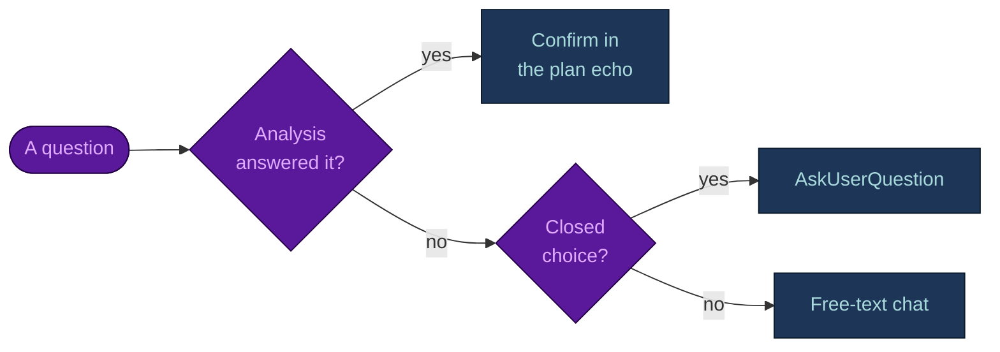
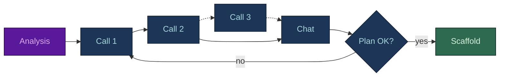
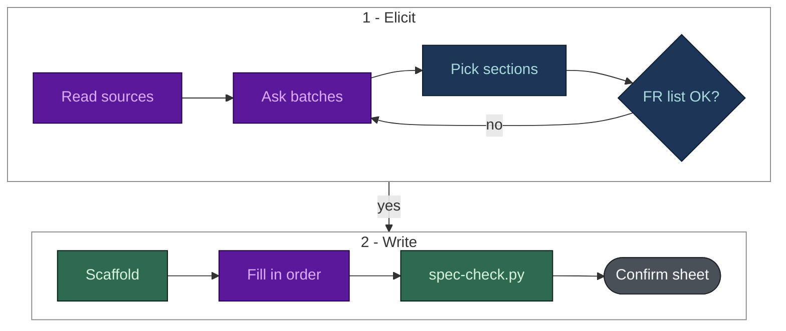

# Questionnaires

**English** · [日本語](QUESTIONNAIRES.ja.md)

What each skill asks you, and why, so you know the questions before they arrive. Full source:
[`intake.md`](../harness-bootstrap/reference/intake.md) for `harness-bootstrap`;
[`elicitation.md`](../spec-builder/reference/elicitation.md) and
[`SKILL.md`](../spec-builder/SKILL.md) for `spec-builder`.

One rule governs both: **what can be inferred is inferred; a decision, a priority or a policy is
always asked.** If nobody knows the answer, the gap is recorded as an open issue with an owner,
never filled with a plausible guess.

## `harness-bootstrap` intake

Codebase analysis runs first. Each question is then answered one of three ways:

- **Confirm**: the analysis found the answer with strong evidence. It is not asked; it appears as a
  row in the plan echo, where one word corrects it.
- **AskUserQuestion**: a closed choice. At most 4 options, the evidence-backed one first and labelled
  "(Recommended)", its description quoting the evidence.
- **Chat**: a name, a number or a policy position with no safe default.

Every question is asked in the language you wrote in. Flag names and agent-facing files stay
English.

### The order of the interview

The closed choices are one questionnaire of **at most two `AskUserQuestion` calls**, plus a third
only for gaps. Free text (identity, commit identity, governance) stays in chat.

| Call | Questions |
|---|---|
| 1 - the shape | Purpose, team shape (Lean / Standard / Long-running / High-throughput), hook strictness, verification appetite |
| 2 - policy | Deployment rights, methodology (DDD / TDD / both / Lightweight), skills to wire, effort profile |
| 3 - only if needed | What detection could not settle: DB seats, data sensitivity, optional add-ons |

**Purpose (Q0) opens Call 1 because it gates the rest.** Pick one or more of Code, Research,
Strategy and Documentation. Without Code, the stack, testing, methodology and database questions
are skipped and no code-only flag is set; the scaffolder refuses one that slips through. A non-code
repo's whole questionnaire is six questions.

### Express intake

"Use defaults" takes the confirmed finding or the recommended option for everything that has one,
and prints the assumed values as one table to confirm. Four things are never defaulted:

- project identity (Q1);
- deployment rights (half of Q18);
- Batch G, audit scope;
- Batch H, governance.

### The batches

The questions are numbered Q1-Q27 in `intake.md`, grouped into batches:

| Batch | Asks | Why it matters |
|---|---|---|
| A - identity | Name, domain, docs language, whether specs exist, target AI tools | Sets the vocabulary of every file. No specs means a handoff to `spec-builder`, carrying the purpose flags. The target-tools answer is recorded (`target_cursor`, `target_codex`), so `/harness-update` re-ports without asking again |
| B - stack | Language and framework, DB and ORM, integrations and their fallback, product locales, authorization and tenancy, environments, dev OS | Decides which rules load, the `db` flag, and whether the Windows or POSIX hooks fire |
| C - git and CI | Platform and CLI, commit identity, bots with merge rights, default branch, commit scopes | Feeds `guard-main-commit` and the PR/MR wording. An unflagged auto-merge bot bypasses the review gate |
| D - quality and safety | Team shape, testing, methodology, data sensitivity and compliance regime, effort profile, history detail, operations posture, deploy rights | Sets roster size, whether `qa-test` and `/test` ship, guardrail strictness, and whether deploy sits in `deny` or `ask` |
| E - DB operations | DB seats, seed policy, the real destructive DB command | Turns the reset command into a `permissions.deny` entry instead of a guess |
| F - branding | Brand assets, icon policy, accessibility target | Feeds `rules/frontend.md` |
| G - audit mode | Repos in scope, standards, scanner strategy | Bounds a read-only control plane. Never express |
| H - governance | Model per data class, residency, dependency licences, gated actions and the incident path | Positions only the organisation can hold. Always asked in chat, never defaulted |

## `spec-builder` elicitation

These are business-analyst questions. The model infers the *structure* from what you brought (an
idea, a transcript, a PRD, a codebase) and asks only for *decisions*.

- **An unreadable source becomes an open issue** (`OI-nn`) naming the file and the fix.
- **Questions come in batches** of at most 4 per `AskUserQuestion` call, grouped so one person can
  answer a batch in one sitting.
- **The setup batch** picks the output language, the optional sections the material justifies, and
  the standards profile. The choice is written to `docs/specs/.sections.json`, and the scaffolder
  refuses to run without it.
- **One gate before writing**: the FR list with proposed MoSCoW priorities, the roles and the open
  issues so far.
- **The confirmation sheet** lists every open issue, assumption, Partial/No feasibility verdict and
  proposed NFR target, so a product owner can correct what was assumed.

| Batch | Asks | Why it matters |
|---|---|---|
| Scope | Purpose, must-have features, non-goals, output language | Becomes the draft FR list. A wrong list costs every later section |
| People | User groups, roles, authorization model and tenancy, who decides and signs off | Role names can be inferred; permission scope (Own/Team/All) and any break-glass path cannot |
| Data and systems | Entities, retention and deletion, volumes, integrations and their fallback, identity provider, locales, legacy cutover | Feeds the data dictionary (08) and integration NFRs (09). A guessed volume is a hidden design decision |
| Constraints | Named security and compliance regime, deadlines, budget, stack limits | Section 07's security NFRs are never "TBD"; an unknown one becomes an owned open issue |

**Express elicitation compresses the pacing, never the content.** Draft 01-05 before opening the
next batch, merge batches the source already answers, or take a labelled shallow first pass.
Priorities, NFR targets, security posture and volumes are asked at every pace.
