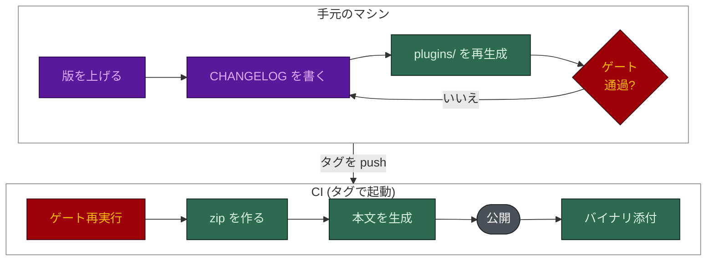

# リリース

[English](RELEASING.md) · **日本語**

2 つのスキル `harness-bootstrap` と `spec-builder`、そしてツール `harness-view` は、一つのバージョン (`vX.Y.Z`) で
まとめてリリースします。リリースは CHANGELOG 駆動です。GitHub のリリース本文は CHANGELOG ファイルから組み立て、
手では書きません。`.claude/skills/release/` の `release` スキルが、このページを実行できる形にしたものです。



## バージョンが書かれている場所

以下のすべてが `X.Y.Z` でなければなりません。一つでも古いと、自分の版を偽って名乗るものが出荷されるか、
利用者に届きません。

| ファイル | なぜ重要か | 検査するもの |
|---|---|---|
| `harness-bootstrap/SKILL.md`、`spec-builder/SKILL.md` (`version:`) | インストールしたスキルが自分の版を名乗る | `validate_release.py`、`package.py --check` |
| `tools/harness-view/Cargo.toml` | バイナリに埋め込まれる (`--version`、Windows の VERSIONINFO、ページのフッター) | `validate_release.py`、`binaries` ジョブ |
| `tools/harness-view/Cargo.lock` | `binaries` ジョブは `--locked` でビルドするので、古いロックはタグの push 後に全プラットフォームで失敗する。`cargo update -p harness-view` を実行する | `validate_release.py` |
| `.claude-plugin/marketplace.json` | `/plugin update` が読む唯一のフィールド。上げないとプラグインの利用者にリリースが届かない | `validate_release.py X.Y.Z` |
| `plugins/` (生成物) | Cursor、Codex、Agent Plugins 向けのスキルのコピー | `build_plugins.py --check` |
| `docs/assets/CAPTURED.json` | UI のスクリーンショットはピクセルに版を焼き込む | `validate_release.py X.Y.Z` |

## 手順

1. **バージョンを上げます。** 上の表のファイルすべてです。ただし `plugins/` は生成物なので除きます。
2. **CHANGELOG のエントリを書きます。**
   - 各スキルの `CHANGELOG.md` と `tools/harness-view/CHANGELOG.md` の先頭に `## [X.Y.Z] - YYYY-MM-DD` を追加
     します ([Keep a Changelog](https://keepachangelog.com/en/1.1.0/) 形式、新しいものが先)。機能上の変更がない
     スキルにも、その旨の一行を書きます。
   - リポジトリ直下の `CHANGELOG.md` には `## vX.Y.Z` の説明を追加します。
   - リリースページを読む人に向けて、何が変わり、なぜその人にとって重要かを Added、Changed、Fixed、Removed に
     分けて書きます。Fixed には修正内容ではなく、どう壊れていたかを書きます。em ダッシュは使わず、数値はすべて
     スクリプトに辿れるものにします。
3. **プラグインのツリーを再生成します**: `py -3.13 scripts/build_plugins.py`
4. **ゲートを実行します。** すべて通る必要があります。

   ```bash
   py -3.13 scripts/validate_release.py X.Y.Z
   py -3.13 scripts/build_plugins.py --check
   py -3.13 scripts/package.py --version X.Y.Z --check
   py -3.13 eval/guardrail_eval.py
   py -3.13 benchmark/benchmark.py
   py -3.13 scripts/check_numbers.py
   py -3.13 scripts/check_mermaid.py
   ```

5. **タグを付けて push します。**

   ```bash
   git tag -a vX.Y.Z -m "vX.Y.Z"
   git push origin vX.Y.Z
   ```

6. **CI が公開します。** `release` ワークフローが eval、ベンチマーク、`package.py --check`、
   `validate_release.py X.Y.Z` を再実行し、zip を作り、`release_notes.py X.Y.Z` で本文を生成して (各 CHANGELOG の
   節がそれぞれのブロックになる) 公開します。続いて `binaries` ジョブが `harness-view` の実行ファイルをビルドして
   添付します。
7. **公開されたものを確認します**: `gh release view vX.Y.Z --json assets -q '.assets[].name'`。アセットのない
   リリースは、ただのタグです。

## 何がこれを強制しているか

| ルール | 強制するもの |
| --- | --- |
| 各スキルとツールに、正しい形式の `## [X.Y.Z] - YYYY-MM-DD` が新しい順にある | `validate_release.py X.Y.Z` (リリースのゲート) |
| スキルの最新の CHANGELOG の版が `SKILL.md` と一致し、2 つのスキルが一致する | `validate_release.py`。push ごとにも実行 (`eval.yml` の `guardrails` ジョブ) |
| 直下の `CHANGELOG.md` に `## vX.Y.Z` があり、タグが `SKILL.md` と一致する | `package.py --version X.Y.Z --check` |
| プラグインのマニフェストが `LICENSE.md` のライセンスを示す | `validate_release.py` |
| 生成された `plugins/` がスキルと一致する | `build_plugins.py --check` (`eval.yml`) |
| リリース本文が CHANGELOG から作られる | `release.yml` から呼ばれる `release_notes.py`。エントリがなければ非ゼロで終了 |
| すべてのアーカイブに、タグと一致する `VERSION` ファイルがある | `release.yml` の "Assert VERSION is inside every archive" |
| ビルドしたバイナリがリリースの版を名乗る | `binaries` ジョブが `harness-view --version` と exe のメタデータを確認 |
| 再実行しても既存のリリースで失敗しない | `gh release edit` と `gh release upload --clobber` |
| アプリケーションのアイコンがそろっている | `make_icons.py --check` (`eval.yml`) |
| 本文に em ダッシュがない | 慣習。レビューで確認 |

## リリースの取り下げ

```bash
gh release delete vX.Y.Z --yes --cleanup-tag
```

そのうえで、影響を受けた `CHANGELOG.md` の **Removed** に理由とともに記録します。
