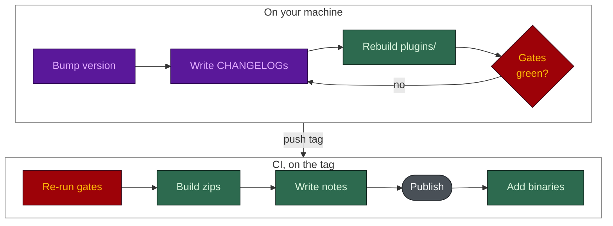

# Releasing

**English** · [日本語](RELEASING.ja.md)

Both skills, `harness-bootstrap` and `spec-builder`, and the `harness-view` tool release together
under one version (`vX.Y.Z`). The release is CHANGELOG-driven: the GitHub release body is assembled
from the CHANGELOG files, never typed by hand. The `release` skill in `.claude/skills/release/` is
the executable form of this page.



## Where the version lives

Every one of these must carry `X.Y.Z`. A stale one ships something that misreports itself or never
reaches the user.

| File | Why it matters | Checked by |
|---|---|---|
| `harness-bootstrap/SKILL.md`, `spec-builder/SKILL.md` (`version:`) | An installed skill identifies itself | `validate_release.py`, `package.py --check` |
| `tools/harness-view/Cargo.toml` | Compiled into the binary (`--version`, Windows VERSIONINFO, page footer) | `validate_release.py`, the `binaries` job |
| `tools/harness-view/Cargo.lock` | The `binaries` job builds `--locked`; a stale lock fails every platform after the tag is pushed. Run `cargo update -p harness-view` | `validate_release.py` |
| `.claude-plugin/marketplace.json` | The only field a `/plugin update` reads; without the bump, plugin users never get the release | `validate_release.py X.Y.Z` |
| `plugins/` (generated) | The Cursor, Codex and Agent Plugins copies of the skills | `build_plugins.py --check` |
| `docs/assets/CAPTURED.json` | The UI screenshots burn the version into their pixels | `validate_release.py X.Y.Z` |

## Procedure

1. **Bump the version** in every file in the table above except `plugins/`, which is generated.
2. **Write the CHANGELOG entries.**
   - Each skill's own `CHANGELOG.md` and `tools/harness-view/CHANGELOG.md` get
     `## [X.Y.Z] - YYYY-MM-DD` at the top ([Keep a Changelog](https://keepachangelog.com/en/1.1.0/),
     newest first). A skill with no functional change still gets a one-line entry saying so.
   - The repo-root `CHANGELOG.md` gets a `## vX.Y.Z` narrative section.
   - Write for the person on the release page: what changed and why it matters to them, grouped
     under Added, Changed, Fixed and Removed. A Fixed entry names the failure mode, not the patch.
     No em dashes; every figure traces to a script.
3. **Regenerate the plugin tree**: `py -3.13 scripts/build_plugins.py`.
4. **Run the gates.** All must pass:

   ```bash
   py -3.13 scripts/validate_release.py X.Y.Z
   py -3.13 scripts/build_plugins.py --check
   py -3.13 scripts/package.py --version X.Y.Z --check
   py -3.13 eval/guardrail_eval.py
   py -3.13 benchmark/benchmark.py
   py -3.13 scripts/check_numbers.py
   py -3.13 scripts/check_mermaid.py
   ```

5. **Tag and push.**

   ```bash
   git tag -a vX.Y.Z -m "vX.Y.Z"
   git push origin vX.Y.Z
   ```

6. **CI publishes.** The `release` workflow re-runs the eval, the benchmark, `package.py --check`
   and `validate_release.py X.Y.Z`, builds the zips, generates the body with
   `release_notes.py X.Y.Z` (each CHANGELOG's section becomes its own block), and publishes. The
   `binaries` job then builds and attaches the `harness-view` executables.
7. **Check what was published**: `gh release view vX.Y.Z --json assets -q '.assets[].name'`. A
   release with no assets is a tag, not a release.

## What enforces this

| Rule | Enforced by |
| --- | --- |
| Each skill and the tool have a valid `## [X.Y.Z] - YYYY-MM-DD` entry, newest first | `validate_release.py X.Y.Z` (release gate) |
| A skill's newest CHANGELOG version matches its `SKILL.md`, and both skills agree | `validate_release.py`, also on every push (`eval.yml`, `guardrails` job) |
| The repo-root `CHANGELOG.md` has a `## vX.Y.Z` section, and the tag matches `SKILL.md` | `package.py --version X.Y.Z --check` |
| The plugin manifests state the licence in `LICENSE.md` | `validate_release.py` |
| The generated `plugins/` tree matches the skills | `build_plugins.py --check` (`eval.yml`) |
| The release body comes from the CHANGELOGs | `release_notes.py`, called by `release.yml`; exits non-zero when no entry exists |
| Every archive carries a `VERSION` file matching the tag | `release.yml`, "Assert VERSION is inside every archive" |
| The built binary reports the release version | the `binaries` job runs `harness-view --version` and checks the exe metadata |
| A re-run does not fail on an existing release | `gh release edit` and `gh release upload --clobber` |
| The application icons are complete | `make_icons.py --check` (`eval.yml`) |
| No em dashes in the notes | convention, checked in review |

## Withdrawing a release

```bash
gh release delete vX.Y.Z --yes --cleanup-tag
```

Then record it, with the reason, under **Removed** in the affected `CHANGELOG.md`.
