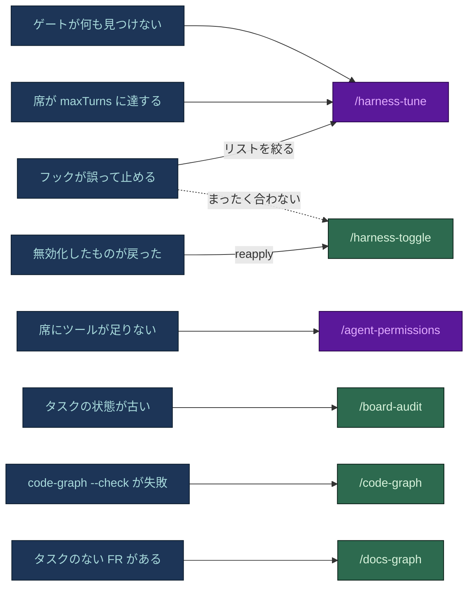
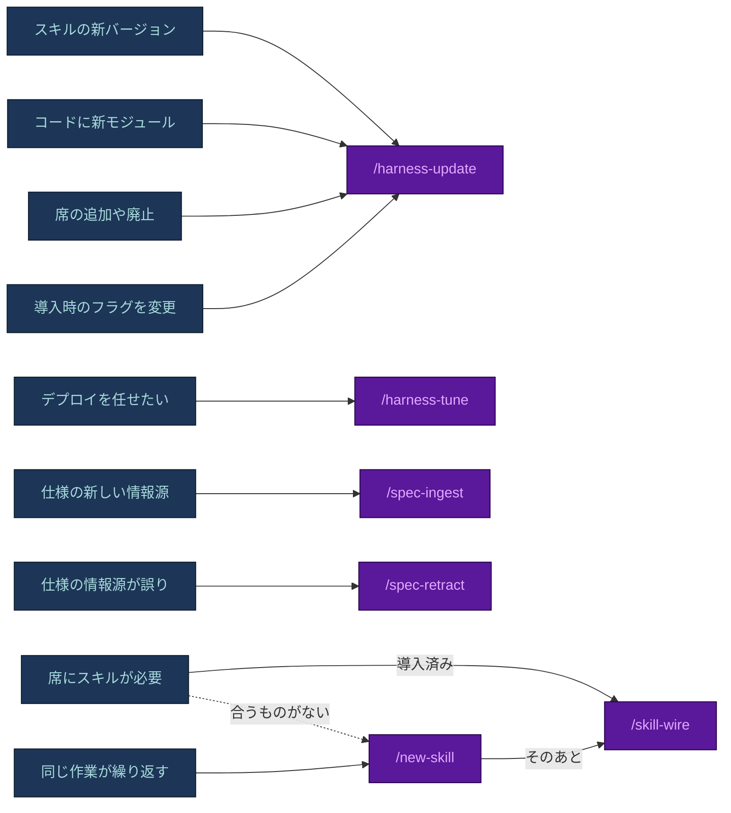

# ブートストラップ後の調整

[English](TUNING.md) · **日本語**

`harness-bootstrap` は導入時に出発点となる姿勢を決めます。実際のプロジェクトはそこからずれていきます。デプロイの
コマンドが信頼を得る、席がツールを必要とする、フックが正しい作業を止める、スキルが新しい資産を配布する、
モジュールマップが古くなる。以下のコマンドがそのずれを扱います。

- **変えるのはデータで、フックのロジックではありません。** リスト、上限、席のフロントマター、`vars.json`、無効化の
  台帳です。`.sh`/`.ps1` のフックを書き換えるのは調整ではなく、レビューを通す通常のコード変更です。
- **デリバリーのコマンドは別の系統です。** `/new-task`、`/implement-fr`、`/test`、`/review-changes`、`/deploy`
  などは製品を作るもので、ハーネスを作るものではありません。説明は
  [`docs/FLOWS.ja.md` のセクション 7](FLOWS.ja.md#7-デリバリーコマンドをコマンドごとに) にあります。
- **目安:** ダイヤル 1 つなら `/harness-tune` か `/agent-permissions`、統制 1 つのオン/オフは `/harness-toggle`、
  構造の変更 (席、フラグ、新しい資産、範囲の見直し) は `/harness-update` です。

## コマンド一覧

全リポジトリに 9 つが入ります (`/code-graph` はコード目的のときのみ)。さらに 2 つが `spec-builder` の仕様セットと
一緒に届きます。

| コマンド | 使うとき | 変えるもの |
|---|---|---|
| [`/board-audit`](#board-audit) | タスクの状態が古そう、クラッシュや長い中断のあと、リリースの前 | なし - 報告のみ |
| [`/code-graph`](#code-graph) | `code-graph.py --check` が失敗した、タスクがモジュールの境界をまたぐ | コミットされたモジュールマップ |
| [`/docs-graph`](#docs-graph) | 仕様を編集したあと、孤立した ID や参照切れを探す | `.claude/state/docs-graph.json` のみ |
| [`/harness-tune`](#harness-tune) | 実行記録に摩擦がある: ガードの誤検知、何も見つけないゲート、上限到達、デプロイの信頼の変化 | 最大 4 つのダイヤル。それぞれをチェックで証明 |
| [`/harness-toggle`](#harness-toggle) | ルール、コマンド、フック、席の 1 つがこのリポジトリに合わず、戻せる形でオフにしたい | `.claude/disabled.json` と移動したファイル |
| [`/agent-permissions`](#agent-permissions) | 席にツールが 1 つ足りない、または 1 つ多すぎる | 1 つの席の 1 つのツール |
| [`/skill-wire`](#skill-wire) | 導入済みか作ったばかりのスキルを、ある席に事前読み込みさせたい | 1 つの席の `skills:` に名前 1 つ |
| [`/new-skill`](#new-skill) | 同じワークフローを何度も説明し直していて、公開スキルに合うものがない | `.claude/skills/` の新しいスキル |
| [`/harness-update`](#harness-update) | スキルの新バージョン、新しいモジュール、フラグの変更、席の追加や廃止 | 再スキャフォールド。編集済みのファイルは `CONFLICT` |
| [`/spec-ingest`](#spec-ingest) | 新しい情報源 (メモ、文字起こし、見つかった文書) を仕様に取り込む | 仕様のセクションとその波及先 |
| [`/spec-retract`](#spec-retract) | 仕様の元になった情報源が誤り、または古いと分かった | ID を取り下げるか `OI-nn` に変える |

プラグインとして導入すると、`harness-bootstrap` は `/new-skill` 以外の 8 つのハーネス用コマンドを
`/harness-bootstrap:<command>` としても提供します。このコピーにはプロジェクト固有の値がないため、提案の前に
デプロイのコマンド、リセットのコマンド、席を `.claude/` から読み取ります。

## 状況から選ぶ

青は見えている状況やしたいこと、緑はスクリプトを動かして報告するコマンド、紫はモデルが変更を提案してあなたが
確認するコマンドです。

**何かがうまくいっていない。**



正しい作業を止めるガードは、まずリストの問題です。`/harness-tune` が証拠をもとに deny や allow の項目を絞ります。
`/harness-toggle` でガードを止めるのは、そのガードがこのリポジトリで役目を持たないときだけで、HARD の統制は
それすら拒否します。

**何かが変わった、またはもっと必要。**



## 診断: 読み取りのみのコマンド

### `/board-audit`

**何をするか。** 最初に `python .claude/scripts/board-check.py` を実行します。フロントマターの列挙値 (`status`、
`attempts`、`priority`、`human_gate`)、`deps:` の循環、タスクのフォルダ、`status:`、ボードの行の食い違いを
調べます。終了コードが非 0 ならボード自体が壊れているので、その指摘を何よりも先にそのまま報告します。そのあと
`docs/tasks/` を git と `.claude/state/history/` に突き合わせ、`WHAT | WHERE | SUGGESTED ACTION` で報告し、
`BOARD CLEAN` か指摘の件数で終わります。

**拾うもの:**

- **古い Active** - `Active` なのに最近のセッションログの行も、履歴に対応する実行もない。
- **記録されていない完了** - サブエージェントの実行はアーカイブされたのに、セッションログに行がない。
- **ボードのずれ** - `board-check.py` から: フォルダ、フロントマター、ボードの行が食い違う、またはファイルのない行。
- **試行上限の超過** - `attempts: 3` 以上なのに `Blocked` ではなく `Active` のまま。
- **知らないワークツリーとブランチ** - ボードが参照していない場所での作業。
- **解除条件のない Blocked** - 担当も条件も書かれておらず、自然には浮上しない。
- **レビューされていないモジュール間の辺** (コードのリポジトリ) - `code-graph.py --check` が 1 で終わる。辺ごとに
  判断します: import を外すか、`/code-graph` で受け入れるか。

```text
/board-audit
2 findings - board needs reconciliation
  Stale Active | docs/tasks/active/TASK-014.md | last session-log row is 4 days old - reassign or close
  Unlogged completion | .claude/state/history/2026-08-01-143201-dev-agent.json | names TASK-009 - collect the result
Next: reconcile TASK-014 first, it blocks the master-plan row above it.
```

**しないこと:** 何も修正しません。突き合わせはオーケストレーターかユーザーが行います。

### `/code-graph`

**何をするか。** モジュール境界のマップを保守します。答える問いは 1 つ: 誰も合意していないモジュールの境界を
またいで import していないか。ファイルは 2 つです:

- `docs/context/code-graph.md` は **コミットされる** - モジュールごとに 1 行 (担当、依存先、利用元)。この一覧が
  そのまま、許されたモジュール間の辺の集合です。
- `.claude/state/code-graph.json` は gitignore 対象 - モジュール、ファイル、件数と担当付きの辺。
  `guard-agent-scope`、`/new-task`、ハーネスのグラフが読みます。

ブロックしない `graph-stale` フックが、マップにないモジュール間の import を、それを足した編集の時点で指摘します。
`code-graph.py --check` はそれがあると 1 で終わります (レビューや CI で実行)。コード目的のときに入ります。

**使うとき:** `--check` が失敗したとき、モジュールの境界をまたぐタスクを割り当てる前、ツリー全体を読まずに
「このモジュールを他に誰が使うか」を知りたいとき。

```text
python .claude/scripts/code-graph.py --check
  NEW EDGE  billing -> notifications (billing/invoice.py imports notify_customer)
Accepted: python .claude/scripts/code-graph.py
  14 modules, 212 files, 38 import edges.
git diff docs/context/code-graph.md
  billing: depends on  + notifications
```

**しないこと:** 辺をあなたの代わりに受け入れません。再構築が受け入れ、レビューがマップの差分を承認します。

**限界。** 辺は、リポジトリのパスに解決できる静的な import です: 相対パス、ワークスペースのパッケージ名
(`package.json`、`go.mod`、`Cargo.toml`)、ディスク上にある Python モジュール、`@/` と `~/` のエイリアス。実行時に
組み立てる import、その他のエイリアス、C# の `using` は見えないので、辺がないことは分離の証明ではありません。
既定のエンジンは標準ライブラリの抽出器で、コードインデックスの MCP サーバーに置き換えてもファイルの約束は
変わりません。モジュールの担当はハーネスのグラフに入るので、再構築のあとにそれも更新します。

### `/docs-graph`

**何をするか。** ドキュメントのトレーサビリティを調べます。要求、決定、タスクの各 ID をどの文書が定義し、どの
文書が引用し、どの ID が孤立しているか。件数と孤立した ID の一覧を出力し、`.claude/state/docs-graph.json` を
書きます。Markdown は書かず、自動では再構築されません。

**使うとき:** 仕様を編集したあと、`spec-guardian` が差分の主張する ID を確かめるとき、まだ何も計画していない
要求を一覧したいとき。

```text
python .claude/scripts/docs-graph.py --check
docs-graph: 42 docs, 118 IDs, 96 edges, 3 orphan(s) -> .claude/state/docs-graph.json
  orphan FR-017  (only in docs/specs/05-functional-requirements.md)
  orphan BR-009  (only in docs/specs/07-business-rules.md)
  orphan ADR-0007  (only in docs/decisions/ADR-0007.md)
```

`--check` は孤立した ID が 1 つでもあれば 1 で終わります。それぞれ、まだ始まっていない作業 (定義はあるが誰も
引用しない) か、参照切れ (引用はあるがどこにも定義がない) のどちらかです。

## 調整: ダイヤル 1 つ、統制 1 つ、ツール 1 つ

### `/harness-tune`

**何をするか。** 新しく聞き取るのではなく、リポジトリで実際に起きたことから調整します。証拠を読み取り専用で
1 回たどり、順位を付けた提案を最大 4 つ、質問は 1 回、選ばれた変更を適用してそれぞれを証明します。証拠
(欠けている情報源はレポートの 1 行になり、止まる理由にはなりません):

- **実行のアーカイブ** (`.claude/state/history/`) - 使われない席、`maxTurns` で打ち切られた実行、1 つの席への偏り。
- **ブロックと拒否** - 正しい作業に反応するガード、手作業で迂回された deny の項目。
- **リトライと試行の上限** - 上限が捕まえたループ。
- **検証** - `verify-plan.py` のログの行: 毎回走って何も見つけないゲート、スキップされたあとで壊れた変更。
- **構造** - PATH にあれば `harness-view assess . --json`、なければ `harness-graph.py` と `board-check.py`。
- **記録された意図** - `tool-changelog.md` と `.claude/disabled.json`。記録された判断を黙って覆すことはしません。

**ダイヤルは次の 7 つだけです:**

| ダイヤル | 置き場所 |
|---|---|
| デプロイの権限 | デプロイのコマンドを `permissions.deny` (人間のみ)、`ask`、または本番以外の変種を `allow` に |
| 破壊的なコマンド | リセット、強制プッシュ、`rm -rf`、スタック固有のものの deny 項目 |
| 起動の許可リスト | `.claude/hooks/spawn-allowlist` |
| 上限 | 席ごとの `maxTurns`、`task-tracking.md` の試行上限 |
| モデルと effort | 席の `effort:`、または `model-tiers.md` の段階、そのあと席の `model:` |
| レビューのゲート | `verify-plan.py` が `.claude/verify-map.json` から読む起動条件 |
| 履歴の詳しさ | `.claude/state/history-level` |

証拠がなければ何も提案しません。「調整することはない」も結果で、それを示す数字と一緒に報告します。
`/harness-tune cost` のような引数は証拠の重みを変えますが、読み取りを省きはしません。

```text
/harness-tune deploy
Change 1 of 2: Deployment rights
Evidence: 6 session logs record "deploy" asked by hand, no run touched production.
Proposed: agent-with-approval (fly deploy moves from permissions.deny to permissions.ask)
--- .claude/settings.json
-  "deny": ["Bash(fly deploy*)", ...]
+  "ask":  ["Bash(fly deploy*)", ...]
```

**変更ごとに証明します。** 権限の項目は JSON として読み、止めるべきペイロードを 1 つそのフックに通します。席、
上限、モデル、effort の編集は `harness-graph.py`、ゲートの変更は `verify-plan.py --files` を通します。失敗した
チェックはその変更だけを戻します。最後に `harness-check.py` (終了コード 0 が必須) を実行し、変更ごとに
`tool-changelog.md` に 1 件記録します。

**拒否すること:** レビューのゲートを丸ごと外すこと (起動条件を絞るだけ)、置き換える統制を示さずに deny の項目を
消すこと、フックのロジックの編集。上限を上げるときや履歴を `full` (プロンプト全体、個人情報を含めてディスクに
残る) にするときは、そのコストを明示します。

### `/harness-toggle`

**何をするか。** ルール、コマンド、フック、エージェントの席を 1 つ、戻せる形でオフまたはオンにします。変更を
加えるのは `python .claude/scripts/harness-toggle.py` だけです。ファイルを `.claude/disabled/` に移し、
`settings.json` の登録を外す (または戻す)、変更を `.claude/disabled.json` に記録し、ハーネスのグラフを再生成して
その項目を灰色で表示します。

**使うとき:** 統制がこのリポジトリに合わず、ファイルを失わずにオフにしたいとき。再スキャフォールドやマージで
チームが無効にしたものが戻ったとき (`harness-toggle.py reapply`)。

```text
python .claude/scripts/harness-toggle.py disable hook/protect-adr --yes --reason "no docs/adr/ yet"
  moved .claude/hooks/protect-adr.sh -> .claude/disabled/hooks/protect-adr.sh
  removed settings.json PreToolUse registration
  recorded in .claude/disabled.json
  regenerated harness-graph.json + harness-graph.html
```

**安全の段階 (スクリプト自身が強制):**

| 段階 | 対象 | 無効にするには |
|---|---|---|
| HARD | フック `protect-secrets`、`guard-agent-spawn`。ルール `security-privacy`、`agent-guardrails`。コマンド `/review-changes`。席 `orchestrator`、`code-reviewer`、`security-reviewer`、`reviewer`、`spec-guardian` | `--confirm "disable <name>"` にその語句そのものが、ユーザー自身の言葉として入っていなければ終了コード 2 |
| SOFT | フック `guard-main-commit`、`check-commit-msg`、`protect-adr`。ルール `ai-governance`。その他すべての席 | ユーザーが確認したあとの `--yes` |

`.claude/disabled.json` はコミットされ、`/harness-update` と `scaffold.py` の両方が読むので、無効にした項目は
再実行で戻りません。席を休ませるのはトグルで、席の追加や廃止は `/harness-update` です。

### `/agent-permissions`

**何をするか。** 1 つの席の 1 つのツールを付与または剥奪します:
`/agent-permissions <agent> grant|revoke <Tool>`。席を読み、不変条件を確かめ、差分を示し、確認を取り、適用して
`tool-changelog.md` に記録します。剥奪には不変条件の確認は要りません。

```text
/agent-permissions app-dev grant Bash
.claude/agents/app-dev.md
- tools: Read, Grep, Glob, Edit, Write
+ tools: Read, Grep, Glob, Edit, Write, Bash
Apply? [y/N]
```

**拒否すること (上書きの確認は出しません):**

- レビューの席 (`code-reviewer`、`security-reviewer`、`reviewer`、`spec-guardian`、`checker`) への `Edit` や
  `Write`。指摘を自動で適用したいなら、それは開発エージェントのタスクです。
- オーケストレーター以外の席への `Agent`。2 つ目の起動元はスキャフォルダーもビルドで失敗させます。
- ワイルドカードの付与。席には正確なツールを並べます。
- `model:` と `effort:` は権限ではありません。ロスターのファイルと `cost-model.md` を案内します。

## 拡張: 席にスキルを

### `/skill-wire`

**何をするか。** `.claude/skills/` に導入済みか `/new-skill` で作ったスキルを 1 つ、ある席の `skills:` フロント
マターに加えます。結び付けは能力の判断なので `/agent-permissions` と同じ形を取ります。スキルと席を読み、スキルの
全ファイルを読み直し (導入後に `npx skills update` で変わっているかもしれない)、範囲が役割に合うか確かめ、差分を
示して記録します。事前読み込みしたスキルは起動のたびに全文がかかるので、その席がほとんどの実行で使うものだけを
結び付けます。そのあと `skill-check.py` がそのスキルを孤立と報告しないことを確かめます。

**使うとき:** `npx skills add <owner/repo>@<skill>` や `/new-skill` の直後、または導入済みのスキルが持つ能力を
ある席が何度も必要とするとき。探し方の基準は `reference/skill-discovery.md` にあります。

```text
/skill-wire pdf-processing qa-test
Content review: 3 files read, no config-edit or exfiltration instructions found.
Scope: report parsing fits qa-test's artifact checks.
  + skills: pdf-processing
```

**拒否すること:** `.claude/`、`settings.json`、フックの編集を指示するスキル (どの席にも結び付けない)、
`disable-model-invocation: true` のスキル (事前読み込みできない)、レビューの席への書き込みのあるスキル、
オーケストレーター以外の席へのスキルを導入するスキル。結び付けは名前を足すだけで、手順をエージェント本体に
写すことはしません。

### `/new-skill`

**何をするか。** 繰り返すワークフローがプロジェクトのスキルに値するかを判断し、値するときだけ作ります。まず
内容を正しい置き場所に振り分けます: 毎セッション必要な事実は `AGENTS.md`、パスの制約は範囲付きのルール、名前で
始める手順はコマンド、決定的なチェックはスクリプト。そのうえで、繰り返している証拠を添えて 1 回だけ聞き、
はいがなければ何も作りません。はいなら `.claude/templates/skill/` を写して埋め (説明、手順、終了コードが完了を
表す `scripts/validate.py`)、6 つの起動ケースを書き、`skill-check.py --skill` で検査し、`/skill-wire` を
実行します。

```text
/new-skill release-notes docs-writer
Home check: a procedure started by name once per release is a command, not a skill.
Evidence it recurs: 4 release-note rewrites in the session logs. Create it? [yes/no]
```

**拒否すること:** 誰も合意していないスキル、既存スキルの手で同期するコピー、結び付けのないまま残るスキル
(毎セッション説明文の分だけかかる)。スキルの削除もこのコマンドの仕事です: 結び付けを外し、削除し、理由を
記録します。作らないことも普通の結果です。

## 再同期: 構造の変更

### `/harness-update`

**何をするか。** ブートストラップ済みのリポジトリでスキャフォルダーを、安全に何度でも再実行します:

1. 変わった部分のコードを読み直し、モジュールと席の対応を更新します。
2. 既存の `vars.json` で再スキャフォールドします (フラグを変えるなら先に更新)。編集したファイルは `CONFLICT` に
   なり、上書きされません。唯一の追加的な例外が `settings.json` で、このバージョンが配布するのにファイルに
   登録のないフックを登録し (`MERGED`)、あなたが書いたものは変えず、`.claude/disabled.json` にあるものは戻さず、
   2 回目は何も足しません。
3. 無効にしたものがあれば `harness-toggle.py reapply` を実行します。
4. 導入時に記録した移植先 (`target_cursor`、`target_codex`) に `port.py` で移植し直します。聞き直しはしません。
   `generated by port.py` の印がない `.cursor/` や `.codex/` のファイルは人が書いたもので、`CONFLICT` のまま残します。
5. 起動の境界、ルーティング表、既知の悪いペイロードでのフックを確かめ、ハーネスのグラフを再生成し、
   `harness-check.py` (終了コード 0 が必須) で終わります。

```text
/harness-update
  src/billing/ is new since bootstrap - no seat owns it.
  ADDED     .claude/commands/new-skill.md       (new in this skill version)
  KEPT      .claude/agents/app-dev.md
  CONFLICT  .claude/rules/testing.md            (you edited this, skill version differs)
  MERGED    .claude/settings.json: registered guard-board
Suggested: a dev-agent seat scoped to src/billing/, plus its routing row in the same change.
```

席とそのルーティングの行は一緒に入るか、どちらも入らないかです。席を廃止するときは先に `/board-audit` を実行し、
その席を担当とする Active のタスクが残っていないことを確かめます。**触らないもの:** `tech-stack.md`、
`coding-standards.md`、範囲、そのほかコードや導入時の回答から導いたもの。これらは `CONFLICT` の列を通ります。

## 仕様の側

この 2 つは `harness-bootstrap` ではなく `spec-builder` と一緒に入ります。ハーネスだけをブートストラップした
リポジトリでは、`spec-builder` も導入したときに使えるようになります。

### `/spec-ingest`

**何をするか。** 新しい情報源を、何も再生成せずに既存の `docs/specs/` に取り込みます:
`/spec-ingest <path-or-pasted-source>`。記述ごとに置き場所のセクションを決めて突き合わせます:

- 新しい事実は出典のメモ付きで追加する。
- 既存の記述との矛盾は並べて示し、`AskUserQuestion` で決め、採らなかった方を記録する。
- 同じ事実の繰り返しは追加せず、裏付けとして記す。
- プロジェクトが選んでいないセクション向けの記述は指摘として挙げる。

```text
/spec-ingest meeting-notes-2026-08-12.txt
Mapped 6 statements: 2 to 05, 1 to 07, 3 to 03.
Conflict: 05 says "refund window: 14 days", the note says "30 days". Which wins?
Applied: FR-22 added, NFR-09 updated, 3 glossary terms. docs-graph --check: 0 new orphans.
```

**書くもの:** セクション、`13-revision-history.md` の 1 行、ハーネスがあればその波及先 (用語集、ビジネス
ルール、担当の席の FR 一覧、担当モジュールのない FR は Pending のタスク)。そのあと `docs-graph.py --check`、
`spec-check.py --write` (新しい FR は確認シートに未判断で載る)、`tool-changelog.md` への記録。**拒否すること:**
手書きの内容の上書き、ID の振り直し、生の情報源を仕様の代わりにすること。

### `/spec-retract`

**何をするか。** 情報源が仕様に入れたものを取り除くか直します:
`/spec-retract <source-name | ID | quoted-claim>`。まず影響範囲 (セクション、`docs-graph.json` で引用している
文書、タスク) を示し、誤った値はその場で直し、出典がなくなった主張は消さずに未解決事項 (`OI-nn`) に変えます。
黙って消した要求は、最初からなかった要求と見分けがつかないからです。

```text
/spec-retract "vendor-api-notes.pdf"
Blast radius: FR-14, FR-15 (only source), BR-07 (corroborated - stays), TASK-031, TASK-033.
FR-14, FR-15 -> Withdrawn. TASK-031, TASK-033 -> Blocked, human_gate: requirement withdrawn.
```

**書くもの:** 改訂履歴の 1 行。取り下げた ID を担当の席から外し、それを実装中の Active のタスクを Blocked にし、
その情報源だけが定義した用語を係争中とし、`/spec-ingest` と同じチェックを再実行します。**拒否すること:**
取り下げた ID の再利用、出典が消えたというだけで主張を削除すること。

## すべてに共通する 3 つの不変条件

コマンドでも、レビューを通した手作業の編集でも、次の 3 つは動きません:

1. **レビュー担当は書き込みの権限を得ない。** `code-reviewer`、`security-reviewer` (`solo_review` では
   `reviewer`)、`spec-guardian`、`checker` は読み取り専用のままです。
2. **起動するのはオーケストレーターだけ。** スキャフォルダーと `guard-agent-spawn` が強制します。
3. **レビューのゲートは外せない。** 起動させるパスを絞れるだけです。

関連: 各席の役割は [`roster.md`](../harness-bootstrap/reference/roster.md)、調整のコストは
[`cost-model.md`](../harness-bootstrap/reference/cost-model.md)、`/board-audit` が照合するボードの仕組みは
[`task-control.md`](../harness-bootstrap/reference/task-control.md)。
