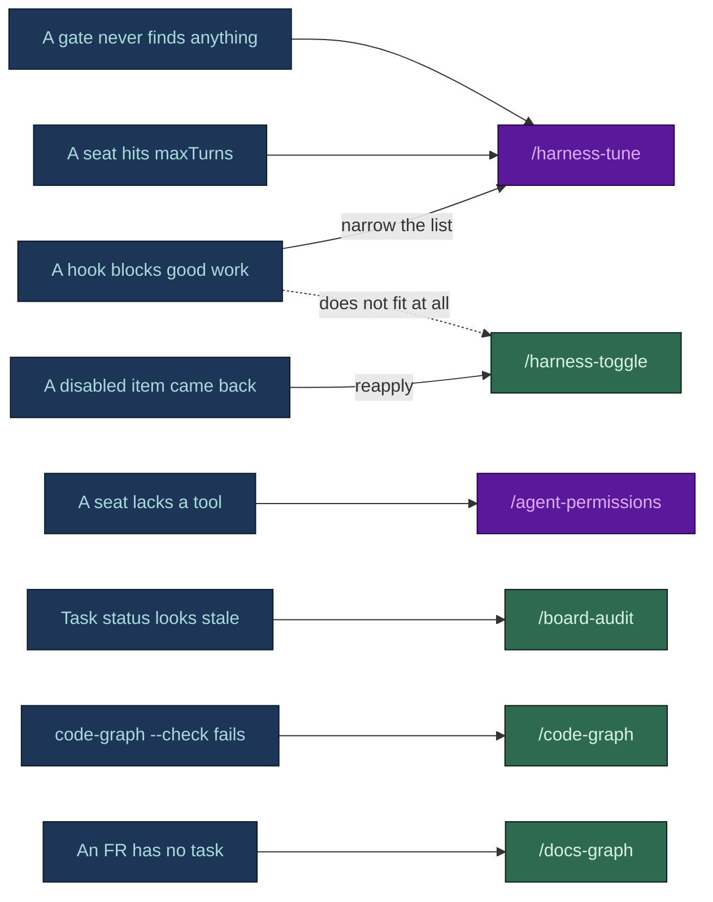
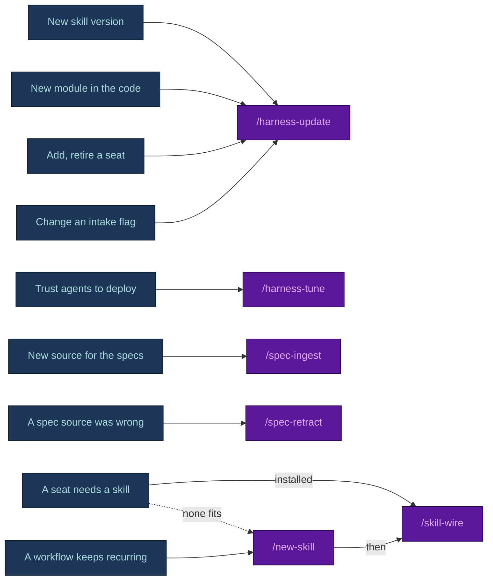

# Post-bootstrap tuning

**English** · [日本語](TUNING.ja.md)

`harness-bootstrap` sets a starting posture at intake. Real projects drift from it: a deploy command
earns trust, a seat needs a tool, a hook blocks good work, the skill ships new assets, the module map
goes stale. The commands below handle that drift.

- **They change data, never hook logic.** Lists, caps, seat frontmatter, `vars.json` and the disabled
  ledger. Rewriting a `.sh`/`.ps1` hook is a normal reviewed code change, not a tuning.
- **Delivery commands are a different family.** `/new-task`, `/implement-fr`, `/test`,
  `/review-changes`, `/deploy` and the rest build the product, not the harness. They are documented in
  [`docs/FLOWS.md` section 7](FLOWS.md#7-delivery-commands-command-by-command).
- **Rule of thumb:** one dial is `/harness-tune` or `/agent-permissions`, one control on or off is
  `/harness-toggle`, anything structural (seats, flags, new assets, a re-scope) is `/harness-update`.

## The commands at a glance

Nine ship into every bootstrapped repo (`/code-graph` only with the code purpose). Two more arrive
with a `spec-builder` spec set.

| Command | Use it when | Changes |
|---|---|---|
| [`/board-audit`](#board-audit) | Task status feels stale, after a crash or a long gap, before a release | Nothing - reports only |
| [`/code-graph`](#code-graph) | `code-graph.py --check` fails, or a task crosses a module line | The committed module map |
| [`/docs-graph`](#docs-graph) | After a spec edit, to find orphan or dead IDs | `.claude/state/docs-graph.json` only |
| [`/harness-tune`](#harness-tune) | The run record shows friction: a guard misfires, a gate finds nothing, a cap is hit, deploy trust changed | Up to four dials, each proved by a check |
| [`/harness-toggle`](#harness-toggle) | One rule, command, hook or seat does not fit this repo and should be off, reversibly | `.claude/disabled.json` and the moved file |
| [`/agent-permissions`](#agent-permissions) | A seat needs one more tool, or holds one too many | One tool on one seat |
| [`/skill-wire`](#skill-wire) | A seat should preload a skill that is installed or was just created | One name in one seat's `skills:` |
| [`/new-skill`](#new-skill) | A workflow keeps being re-explained and no published skill fits | A new skill under `.claude/skills/` |
| [`/harness-update`](#harness-update) | A new skill version, a new module, a flag change, a seat to add or retire | Re-scaffolds; your edits come back as `CONFLICT` |
| [`/spec-ingest`](#spec-ingest) | A new source (notes, a transcript, a found document) must be folded into the specs | Spec sections and their ripples |
| [`/spec-retract`](#spec-retract) | A source the specs were built from proves wrong or superseded | Withdraws IDs or turns them into `OI-nn` |

Installed as a plugin, `harness-bootstrap` also exposes the eight harness commands other than
`/new-skill` as `/harness-bootstrap:<command>`. Those copies carry no project values: they read the
deploy command, reset command and seats out of `.claude/` before proposing anything.

## Which command, by situation

Blue is what you see or want, green a command that runs scripts and reports, purple a command where
the model proposes a change and you confirm it.

**Something went wrong.**



A guard that blocks legitimate work is a list problem first: `/harness-tune` narrows the deny or
allow entry with evidence. Switch the guard off with `/harness-toggle` only when it has no job in this
repo, and note that the HARD controls refuse even that.

**Something changed, or you want more.**



## Diagnose: read-only commands

### `/board-audit`

**Does.** Runs `python .claude/scripts/board-check.py` first: frontmatter enums (`status`, `attempts`,
`priority`, `human_gate`), `deps:` cycles, and drift between a task's folder, its `status:` and its
board row. A non-zero exit means the board itself is malformed, and those findings are reported
verbatim before anything else. Then it sweeps `docs/tasks/` against git and `.claude/state/history/`,
and reports `WHAT | WHERE | SUGGESTED ACTION`, ending with `BOARD CLEAN` or a finding count.

**Catches:**

- **Stale Active** - `Active` with no recent session-log row and no matching run in the history.
- **Unlogged completion** - a subagent run archived, but no session-log row records it.
- **Board drift** - from `board-check.py`: folder, frontmatter and board row disagree, or a row has no file.
- **Attempt-cap breach** - `attempts: 3` or more and still `Active` instead of `Blocked`.
- **Unknown worktrees and branches** - work outside anything the board references.
- **Blocked with no unblocker** - no owner or condition named, so it never resurfaces.
- **Unreviewed module edge** (code repos) - `code-graph.py --check` exits 1. Each edge is a decision:
  remove the import or accept it with `/code-graph`.

```text
/board-audit
2 findings - board needs reconciliation
  Stale Active | docs/tasks/active/TASK-014.md | last session-log row is 4 days old - reassign or close
  Unlogged completion | .claude/state/history/2026-08-01-143201-dev-agent.json | names TASK-009 - collect the result
Next: reconcile TASK-014 first, it blocks the master-plan row above it.
```

**Never** fixes anything. The orchestrator or the user reconciles.

### `/code-graph`

**Does.** Maintains the module-boundary map, which answers one question: does the code import across
a module line nobody agreed to? Two files:

- `docs/context/code-graph.md`, **committed** - one row per module (owner, depends on, used by). That
  list *is* the set of allowed cross-module edges.
- `.claude/state/code-graph.json`, gitignored - modules, files, edges with counts and owners, read by
  `guard-agent-scope`, `/new-task` and the harness graph.

The non-blocking `graph-stale` hook names an unlisted cross-module import on the edit that adds it, and
`code-graph.py --check` exits 1 on one (run it in review or CI). Ships with the code purpose.

**Use it** when `--check` fails, before dispatching a task that crosses a module line, or to answer
"what else uses this module" without reading the whole tree.

```text
python .claude/scripts/code-graph.py --check
  NEW EDGE  billing -> notifications (billing/invoice.py imports notify_customer)
Accepted: python .claude/scripts/code-graph.py
  14 modules, 212 files, 38 import edges.
git diff docs/context/code-graph.md
  billing: depends on  + notifications
```

**Never** accepts an edge for you: the rebuild accepts it, and review approves the diff of the map.

**Limits.** Edges are static imports resolved to repo paths: relative paths, workspace package names
(`package.json`, `go.mod`, `Cargo.toml`), Python modules on disk, and the `@/` and `~/` aliases.
Runtime-built imports, other aliases and C# `using` are not seen, so a missing edge is not proof of
isolation. The default engine is the stdlib extractor; a code-index MCP server may replace it without
changing the file contract. A rebuild refreshes the harness graph, since module owners feed it.

### `/docs-graph`

**Does.** Checks documentation traceability: which document defines each requirement, decision or
task ID, which documents cite it, and which IDs are orphans. It prints the counts and the orphan list
and writes `.claude/state/docs-graph.json`. It writes no Markdown and is not rebuilt automatically.

**Use it** after a spec edit, when `spec-guardian` checks a diff's claimed IDs, or to list
requirements nothing schedules yet.

```text
python .claude/scripts/docs-graph.py --check
docs-graph: 42 docs, 118 IDs, 96 edges, 3 orphan(s) -> .claude/state/docs-graph.json
  orphan FR-017  (only in docs/specs/05-functional-requirements.md)
  orphan BR-009  (only in docs/specs/07-business-rules.md)
  orphan ADR-0007  (only in docs/decisions/ADR-0007.md)
```

`--check` exits 1 on any orphan. Each one is either unstarted work (defined, cited by nothing) or a
dead reference (cited, defined nowhere).

## Adjust: one dial, one control, one tool

### `/harness-tune`

**Does.** Tunes from what happened in the repo, not from a fresh interview. One read-only pass over
the evidence, at most four ranked proposals, one question, then each chosen change applied and
proved. Evidence (a missing source is a line in the report, not a stop):

- **Run archive** (`.claude/state/history/`) - idle seats, runs cut off at `maxTurns`, one seat dominating.
- **Blocks and denials** - a guard firing on legitimate work, or a deny entry routed around by hand.
- **Retry and attempt caps** - loops the caps caught.
- **Verification** - `verify-plan.py` log lines: gates that always run and never find anything, or were
  skipped on changes that later broke.
- **Structure** - `harness-view assess . --json` when on PATH, otherwise `harness-graph.py` and `board-check.py`.
- **Recorded intent** - `tool-changelog.md` and `.claude/disabled.json`. A recorded decision is never
  undone silently.

**The seven dials, and only these:**

| Dial | Where it lives |
|---|---|
| Deployment rights | the deploy command in `permissions.deny` (human-only), `ask`, or a non-production variant in `allow` |
| Destructive commands | deny entries for reset, force push, `rm -rf` and the stack's own |
| Spawn allowlist | `.claude/hooks/spawn-allowlist` |
| Caps | `maxTurns` per seat, the attempt cap in `task-tracking.md` |
| Model and effort | a seat's `effort:`, or its tier in `model-tiers.md` and then its `model:` |
| Review gates | the triggers `verify-plan.py` reads from `.claude/verify-map.json` |
| History detail | `.claude/state/history-level` |

With no evidence it proposes nothing; "nothing to tune" is a result, with the numbers that show it.
An argument such as `/harness-tune cost` weights the evidence but never skips the read.

```text
/harness-tune deploy
Change 1 of 2: Deployment rights
Evidence: 6 session logs record "deploy" asked by hand, no run touched production.
Proposed: agent-with-approval (fly deploy moves from permissions.deny to permissions.ask)
--- .claude/settings.json
-  "deny": ["Bash(fly deploy*)", ...]
+  "ask":  ["Bash(fly deploy*)", ...]
```

**Proves each change.** A permission entry is parsed and one payload it should stop is piped through
its hook; a seat, cap, model or effort edit goes through `harness-graph.py`; a gate change through
`verify-plan.py --files`. A failing check reverts that one change. It ends with `harness-check.py`
(exit 0 required) and one `tool-changelog.md` entry per change.

**Refuses** to remove a review gate entirely (it can only narrow what triggers it), to drop a deny
entry without naming its replacement, and to edit hook logic. Raising a cap, or history to `full`
(whole prompts, PII included, on disk), states its cost.

### `/harness-toggle`

**Does.** Turns one rule, command, hook or agent seat off or back on, reversibly.
`python .claude/scripts/harness-toggle.py` is the only mutator: it moves the file under
`.claude/disabled/`, removes or restores the `settings.json` registration, records the change in
`.claude/disabled.json`, and regenerates the harness graph so the item shows greyed out.

**Use it** when a control does not fit this repo and you want it off without losing the file, or
when a re-scaffold or a merge brought back something the team had disabled (`harness-toggle.py reapply`).

```text
python .claude/scripts/harness-toggle.py disable hook/protect-adr --yes --reason "no docs/adr/ yet"
  moved .claude/hooks/protect-adr.sh -> .claude/disabled/hooks/protect-adr.sh
  removed settings.json PreToolUse registration
  recorded in .claude/disabled.json
  regenerated harness-graph.json + harness-graph.html
```

**Safety tiers, enforced by the script:**

| Tier | Items | To disable |
|---|---|---|
| HARD | hooks `protect-secrets`, `guard-agent-spawn`; rules `security-privacy`, `agent-guardrails`; command `/review-changes`; seats `orchestrator`, `code-reviewer`, `security-reviewer`, `reviewer`, `spec-guardian` | exit 2 unless `--confirm "disable <name>"` carries that exact phrase in the user's own words |
| SOFT | hooks `guard-main-commit`, `check-commit-msg`, `protect-adr`; rule `ai-governance`; every other agent seat | `--yes`, after the user confirmed |

`.claude/disabled.json` is committed, and both `/harness-update` and `scaffold.py` read it, so a
disabled item does not come back on a re-run. Parking a seat is a toggle; adding or retiring one is
`/harness-update`.

### `/agent-permissions`

**Does.** Grants or revokes exactly one tool on exactly one seat:
`/agent-permissions <agent> grant|revoke <Tool>`. It reads the seat, checks the invariants, shows the
diff, asks, applies, and records the change in `tool-changelog.md`. A revoke needs no invariant check.

```text
/agent-permissions app-dev grant Bash
.claude/agents/app-dev.md
- tools: Read, Grep, Glob, Edit, Write
+ tools: Read, Grep, Glob, Edit, Write, Bash
Apply? [y/N]
```

**Refuses, with no override prompt:**

- `Edit` or `Write` on a review seat (`code-reviewer`, `security-reviewer`, `reviewer`, `spec-guardian`,
  `checker`). An auto-applied finding is a task for a dev agent.
- `Agent` on any seat but the orchestrator. The scaffolder fails the build on a second spawner too.
- Wildcard grants. A seat lists exact tools.
- `model:` and `effort:` are not permissions: it points at the roster file and `cost-model.md`.

## Extend: skills on seats

### `/skill-wire`

**Does.** Adds one skill, installed in `.claude/skills/` or made with `/new-skill`, to one seat's
`skills:` frontmatter. Wiring is a capability decision, so it follows the `/agent-permissions` shape:
read the skill and the seat, re-read every file of the skill (an `npx skills update` may have changed
it since install), check the scope fits the role, show the diff, record it. A preloaded skill costs its
full content on every spawn, so wire only what the seat uses on most runs. Afterwards `skill-check.py`
must no longer report the skill as an orphan.

**Use it** right after `npx skills add <owner/repo>@<skill>` or `/new-skill`, or when a seat keeps
needing a capability an installed skill already provides. Discovery criteria live in
`reference/skill-discovery.md`.

```text
/skill-wire pdf-processing qa-test
Content review: 3 files read, no config-edit or exfiltration instructions found.
Scope: report parsing fits qa-test's artifact checks.
  + skills: pdf-processing
```

**Refuses** a skill that instructs `.claude/`, `settings.json` or hook edits (wired to no seat, ever),
a skill with `disable-model-invocation: true` (it cannot be preloaded), a write-capable skill on a
reviewer, and a skill-installing skill on any seat but the orchestrator. The wire adds a name; it never
copies steps into the agent body.

### `/new-skill`

**Does.** Decides whether a recurring workflow earns a project skill, and only then creates it. First
it sorts the content into its proper home: a fact every session needs goes to `AGENTS.md`, a path
constraint to a scoped rule, a procedure started by name to a command, a deterministic check to a
script. Then it asks once, with the evidence that the workflow recurs, and creates nothing without a
yes. On a yes it copies `.claude/templates/skill/`, fills it (description, steps, a
`scripts/validate.py` whose exit code means done), writes six trigger cases, lints with
`skill-check.py --skill`, and runs `/skill-wire`.

```text
/new-skill release-notes docs-writer
Home check: a procedure started by name once per release is a command, not a skill.
Evidence it recurs: 4 release-note rewrites in the session logs. Create it? [yes/no]
```

**Refuses** a skill nobody agreed to, a hand-synced copy of an existing skill, and an unwired skill left
behind (it costs its description in every session). Removing a skill is also its job: unwire, delete,
record why. Refusing to create one is a normal outcome.

## Re-sync: structural change

### `/harness-update`

**Does.** Re-runs the scaffolder on a bootstrapped repo, safely and any number of times:

1. Re-reads the code for changed areas and updates the module-to-seat mapping.
2. Re-scaffolds with the existing `vars.json` (update it first for a flag change). A file you edited
   comes back as `CONFLICT` and is never overwritten. `settings.json` is the one additive exception:
   hooks this version ships but the file lacks are registered (`MERGED`), nothing you wrote changes,
   nothing in `.claude/disabled.json` comes back, and a second run adds nothing.
3. Runs `harness-toggle.py reapply` if anything is disabled.
4. Re-ports to the targets intake recorded (`target_cursor`, `target_codex`) with `port.py`, without
   asking again. A `.cursor/` or `.codex/` file without the `generated by port.py` marker is a human's
   and stays a `CONFLICT`.
5. Checks the spawn boundary, the routing table and a known-bad hook payload, regenerates the harness
   graph, and ends with `harness-check.py` (exit 0 required).

```text
/harness-update
  src/billing/ is new since bootstrap - no seat owns it.
  ADDED     .claude/commands/new-skill.md       (new in this skill version)
  KEPT      .claude/agents/app-dev.md
  CONFLICT  .claude/rules/testing.md            (you edited this, skill version differs)
  MERGED    .claude/settings.json: registered guard-board
Suggested: a dev-agent seat scoped to src/billing/, plus its routing row in the same change.
```

A seat and its routing row land together, or neither does. Retiring a seat runs `/board-audit` first,
so no Active task still names it. **Never touches** `tech-stack.md`, `coding-standards.md`, scopes or
anything derived from your code or intake answers - those go through the `CONFLICT` queue.

## The spec side

These two ship with `spec-builder`, not `harness-bootstrap`: a repo that only bootstrapped the harness
has them once `spec-builder` is installed too.

### `/spec-ingest`

**Does.** Folds a new source into an existing `docs/specs/` set without regenerating anything:
`/spec-ingest <path-or-pasted-source>`. Each statement is mapped to its home section and diffed
against it:

- a new fact is added with a source note;
- a conflict with existing text is shown side by side and `AskUserQuestion` decides, the loser recorded;
- a restated fact is skipped and the corroboration noted;
- a statement for a section the project never selected becomes a finding.

```text
/spec-ingest meeting-notes-2026-08-12.txt
Mapped 6 statements: 2 to 05, 1 to 07, 3 to 03.
Conflict: 05 says "refund window: 14 days", the note says "30 days". Which wins?
Applied: FR-22 added, NFR-09 updated, 3 glossary terms. docs-graph --check: 0 new orphans.
```

**Writes** the sections, one `13-revision-history.md` row, and where a harness exists the ripples:
glossary, business rules, the owning seat's FR list, and a Pending task for an FR no module owns. Then
`docs-graph.py --check`, `spec-check.py --write` (a new FR appears undecided on the confirmation
sheet), and a `tool-changelog.md` entry. **Refuses** to overwrite hand-written content, to renumber an
ID, or to let the raw source replace the spec.

### `/spec-retract`

**Does.** Removes or corrects what a source put into the specs:
`/spec-retract <source-name | ID | quoted-claim>`. It shows the blast radius first (sections, citing
documents from `docs-graph.json`, tasks), then fixes a wrong value in place, and turns a claim left
with no source into an open issue (`OI-nn`) rather than deleting it - a silently deleted requirement
looks like one that never existed.

```text
/spec-retract "vendor-api-notes.pdf"
Blast radius: FR-14, FR-15 (only source), BR-07 (corroborated - stays), TASK-031, TASK-033.
FR-14, FR-15 -> Withdrawn. TASK-031, TASK-033 -> Blocked, human_gate: requirement withdrawn.
```

**Writes** one revision-history row, drops withdrawn IDs from the owning seat, blocks Active tasks
that implement them, marks glossary terms only that source defined as disputed, and reruns the same
checks as `/spec-ingest`. **Refuses** to reuse a withdrawn ID, or to delete a claim just because its
source went away.

## The three invariants that hold across all of them

Whatever the route - a command or a reviewed hand edit - three things do not move:

1. **Reviewers never gain write access.** `code-reviewer`, `security-reviewer` (or `reviewer` under
   `solo_review`), `spec-guardian` and `checker` stay read-only.
2. **Only the orchestrator spawns.** Enforced by the scaffolder and by `guard-agent-spawn`.
3. **The review gate cannot be removed**, only rescoped to the paths that trigger it.

See also: [`roster.md`](../harness-bootstrap/reference/roster.md) for what each seat is for,
[`cost-model.md`](../harness-bootstrap/reference/cost-model.md) for what a tuning costs, and
[`task-control.md`](../harness-bootstrap/reference/task-control.md) for the board mechanics
`/board-audit` checks.
