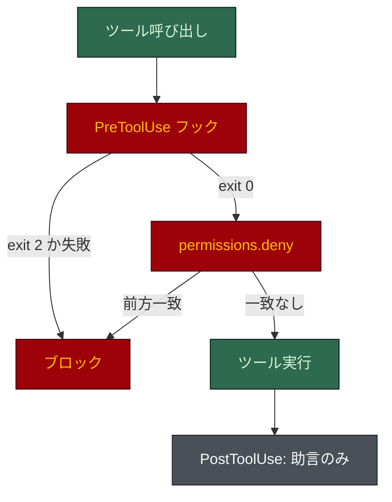

# Claude Code でのハーネス

[English](claude-code.md) · **日本語**

Claude Code はハーネスが**生成される**場所であり、最も完全に強制が効く場所です。読み込むのは
`.claude/` (エージェント、ルール、フック、`settings.json`) と `AGENTS.md`、`CLAUDE.md` です。Cursor と
Codex は同じハーネスの移植版を動かし、ここがその参照実装です。

## セットアップ

移植の手順はありません。Claude Code で `/harness-bootstrap` を実行します (既存の `.claude/` を
コピーしてもかまいません)。Python 3 が必要で、ブロッキングフックが閉じる側に倒れる (fail closed)
には Claude Code 2.1.295 以降が必要です。以下はすべて `scripts/scaffold.py` が書き、手書きは
しません。

## 配置されるもの

| パス | 役割 |
|---|---|
| `.claude/agents/` | リポジトリの目的とフラグで選ばれる **18席のうち3〜17席**。どれも明示的な `model`、`effort`、`tools`、`maxTurns` を持つ |
| `.claude/rules/*.md` | 最大 17 のルール (全フラグ有効時、無条件 7、パス限定 10)。`paths:` フロントマターで遅延読み込みになる |
| `.claude/hooks/` | 最大 26 のフックスクリプト (macOS/Linux は `.sh`、Windows は `.ps1`) と README。どれを入れて登録するかはフラグが決める |
| `.claude/scripts/` | ハーネスが自分自身に使う標準ライブラリのみの Python: `task.py`、`verify-plan.py`、`board-check.py`、`harness-check.py`、`harness-graph.py`、`code-graph.py`、`docs-graph.py`、`skill-check.py`、`harness-toggle.py`、`env-read.py` |
| `.claude/settings.json` | 権限の許可/拒否リスト、`env` 内のスポーン上限、フックの登録 |
| モジュールごとの `CLAUDE.md` | モジュールごとに一つ、40 行以内。そこにあるファイルを読んだときだけ読み込まれる |
| `AGENTS.md` + `CLAUDE.md` | ベンダー中立の契約。`CLAUDE.md` は `@AGENTS.md` の薄いインポートと Claude 固有の部分 |

`paths:` のないルールは毎セッション読み込まれ、`paths: [glob]` を持つルールは一致するファイルに
触れたときだけ付きます。無条件に読み込まれるのは 7 つ: `00-overview`、`agent-guardrails`、
`model-policy`、`task-tracking`、`conventional-commits`、`ai-governance`、`output-style`。最後の二つは
`ai` と `terse` フラグのときだけ入るので、既定のインストールではもっと少なくなります。席の階層は
パス限定の `model-tiers` にあります。

## ツール呼び出しはどう確かめられるか



- 拒否リストは**前方一致**で、フラグの並べ替え (`rm -r -f`) で破られます。減速帯であって、関門は
  フックです。
- ブロッキングフックは終了コード 2 で拒否します。どのブロッキングハンドラも `onFailure: "block"` と
  30 秒のタイムアウトを持つので、クラッシュしたりハングしたガードは呼び出しを通さず拒否します。
- 同じイベントのフックは並列に動きます。git 専用のガードは `"if": "Bash(*git *)"` で登録されるので、
  既定のハーネスではただの `ls` で起動するフックのプロセスは 4 つではなく 2 つです。

## 強制されるもの、助言だけのもの

| 統制 | イベント | 効果 |
|---|---|---|
| `protect-secrets` | PreToolUse (Bash、PowerShell、読み取り、編集) | `.env`、鍵、`~/.ssh`、`.npmrc` の読み取りをブロック |
| `protect-adr` | PreToolUse (編集) | 承認済み (Accepted) の ADR の編集をブロック |
| `guard-main-commit` | PreToolUse (Bash、PowerShell) | 既定ブランチへの直接のコミットと push をブロック。git のグローバルオプション付きも含む |
| `check-commit-msg` | PreToolUse (Bash、PowerShell) | Conventional Commits に従わない、または AI の帰属表示を含むコミットメッセージをブロック |
| `guard-destructive` | PreToolUse (Bash、PowerShell) | リポジトリのルートやホームへの `rm -rf`、保護ブランチへの force push、`git reset --hard`、ローカル以外のホストへの DROP をブロック |
| `guard-agent-spawn` | PreToolUse (Agent/Task) | 編成外のエージェント、固定されていないモデル、タスクも階層マーカーもない書き込み可能なディスパッチ、検証台帳が合格済みと示す再実行をブロック |
| `guard-board` | PreToolUse (編集) | ボードのタスク行の手編集をブロック。書き手は `task.py` |
| `guard-task-scope` | PreToolUse (編集) | 依頼の記録がない、または実のある基準が二つ未満のタスクファイルをブロック |
| `guard-agent-scope` | PreToolUse (編集) | 助言のみ。ペイロードに呼び出し元のサブエージェントが含まれないので、促すだけでブロックできない |
| `specs-reminder` | PostToolUse | 事後に注意を促す |
| `graph-stale` | PostToolUse | `.claude/` の編集でハーネスのグラフを更新し、新しいモジュール間の import を名指しする。ブロックしない |
| `agent-history` | SubagentStop | サブエージェントの履歴を記録。観察のみ |
| `hooks_strict` のガード | 各種 | オプトイン: 大きなファイル、外部送信、固定されていない依存、プロンプトと出力内のシークレット、設定変更、証拠のない「完了」。`.claude/hooks/README.md` を参照 |
| `settings.json` の `permissions.deny` | すべてのツール呼び出し | force push、`rm -rf`、本番デプロイ、シークレットの読み取り、DB リセットをブロック (前方一致) |
| `.claude/rules/*.md` | コンテキストに読み込まれる | 助言のみ。コンパクション後にモデルがルールから外れることがある |

## 動作を確かめる

既知の悪いペイロードをフックに渡し、終了コード 2 を確かめます:

```bash
echo '{"cwd":".","tool_name":"Bash","tool_input":{"command":"cat .env"}}' \
  | bash .claude/hooks/protect-secrets.sh ; echo "exit=$?"    # exit=2 を期待
```

Windows では `.ps1` のフックを使い、`$?` ではなく必ず `$LASTEXITCODE` を確認します。全体を確かめる
には、このリポジトリの `python eval/guardrail_eval.py` が、本物の生成ハーネスに 314 のペイロードを
撃ち込み 314/314 を期待します。そのハーネスは `hooks_strict`、`long`、`db` を有効にしているので、
既定のインストールにはもっと少ないフックしかありません。ツール自体でも、`.env` を読もうとしたり
`main` にコミットしようとしたりして、それぞれがブロックされることを確かめてください。

## 関連

- [メイン README](../../README.ja.md)
- [AGENTS.md の契約](../../harness-bootstrap/assets/root/AGENTS.md)
- [フックの README](../../harness-bootstrap/assets/claude/hooks/README.md)
