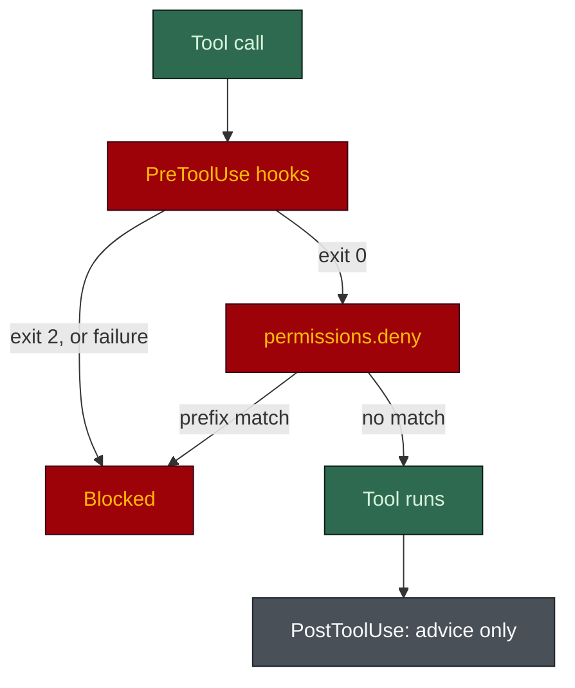

# The harness in Claude Code

**English** · [日本語](claude-code.ja.md)

Claude Code is where the harness is **generated** and where it enforces most completely. It reads
`.claude/` (agents, rules, hooks, `settings.json`) plus `AGENTS.md` and `CLAUDE.md`. Cursor and Codex
run ports of the same harness; this is the reference implementation.

## Setup

No porter step. Run `/harness-bootstrap` in Claude Code (or copy an existing `.claude/` in). It needs
Python 3, and Claude Code 2.1.295 or later for the blocking hooks to fail closed. Everything below is
written by `scripts/scaffold.py`, not by hand.

## What lands

| Path | What it does |
|---|---|
| `.claude/agents/` | 3 to 17 of the 18 seats, picked by the repo's purpose and flags, each with an explicit `model`, `effort`, `tools` and `maxTurns` |
| `.claude/rules/*.md` | Up to 17 rules (7 unconditional, 10 path-scoped, with every flag on); `paths:` frontmatter makes a rule load lazily |
| `.claude/hooks/` | Up to 26 hook scripts (`.sh` on macOS/Linux, `.ps1` on Windows) plus a README; the flags decide which are installed and registered |
| `.claude/scripts/` | Stdlib Python the harness runs on itself: `task.py`, `verify-plan.py`, `board-check.py`, `harness-check.py`, `harness-graph.py`, `code-graph.py`, `docs-graph.py`, `skill-check.py`, `harness-toggle.py`, `env-read.py` |
| `.claude/settings.json` | Permission allow/deny list, the spawn caps in `env`, and the hook registrations |
| per-module `CLAUDE.md` | One per module, 40 lines at most, loaded only when files there are read |
| `AGENTS.md` + `CLAUDE.md` | The vendor-neutral contract; `CLAUDE.md` is a thin `@AGENTS.md` import plus Claude-only bits |

A rule with no `paths:` loads in every session; a rule with `paths: [glob]` attaches only when a
matching file is touched. Seven load unconditionally: `00-overview`, `agent-guardrails`,
`model-policy`, `task-tracking`, `conventional-commits`, `ai-governance` and `output-style`. The last
two ship only with the `ai` and `terse` flags, so a default install loads fewer. Seat tiers live in
the path-scoped `model-tiers`.

## How a tool call is checked



- The deny list is a **prefix match**, defeated by re-ordering flags (`rm -r -f`). It is a speed
  bump; the hooks are the gate.
- A blocking hook exits 2 to deny. Every blocking handler carries `onFailure: "block"` and a 30 s
  timeout, so a guard that crashes or hangs refuses the call rather than letting it through.
- Hooks on one event run in parallel. The git-only guards register with `"if": "Bash(*git *)"`, so a
  plain `ls` starts 2 hook processes rather than 4 on a default harness.

## What enforces vs. what is advice-only

| Control | Event | Effect |
|---|---|---|
| `protect-secrets` | PreToolUse (Bash, PowerShell, reads, edits) | Blocks reads of `.env`, keys, `~/.ssh`, `.npmrc` |
| `protect-adr` | PreToolUse (edits) | Blocks edits to an Accepted ADR |
| `guard-main-commit` | PreToolUse (Bash, PowerShell) | Blocks a direct commit or push to the default branch, git global options included |
| `check-commit-msg` | PreToolUse (Bash, PowerShell) | Blocks a non-conventional or AI-attributed commit message |
| `guard-destructive` | PreToolUse (Bash, PowerShell) | Blocks `rm -rf` on the repo root or home, a force push to a protected branch, `git reset --hard`, a DROP on a non-local host |
| `guard-agent-spawn` | PreToolUse (Agent/Task) | Blocks an off-roster agent, a non-pinned model, a write-capable dispatch with no task or tier marker, and a re-run the verification ledger shows already passed |
| `guard-board` | PreToolUse (edits) | Blocks a hand edit of a task row on the board; `task.py` is the writer |
| `guard-task-scope` | PreToolUse (edits) | Blocks a task file with no recorded request or fewer than two real criteria |
| `guard-agent-scope` | PreToolUse (edits) | Advisory only: the payload names no calling subagent, so it nudges and cannot block |
| `specs-reminder` | PostToolUse | Reminds after the fact |
| `graph-stale` | PostToolUse | Refreshes the harness graph on a `.claude/` edit and names a new cross-module import; never blocks |
| `agent-history` | SubagentStop | Records subagent history; observational |
| `hooks_strict` guards | various | Opt-in: large files, egress, unpinned dependencies, secrets in prompts and output, config changes, evidence-free "done". See `.claude/hooks/README.md` |
| `settings.json` `permissions.deny` | Every tool call | Blocks force push, `rm -rf`, prod deploy, secret reads, DB reset (prefix match) |
| `.claude/rules/*.md` | Loaded into context | Advice only. A model can drift from a rule after a compaction |

## Verify it works

Feed a known-bad payload to a hook and confirm it exits 2:

```bash
echo '{"cwd":".","tool_name":"Bash","tool_input":{"command":"cat .env"}}' \
  | bash .claude/hooks/protect-secrets.sh ; echo "exit=$?"    # expect exit=2
```

On Windows use the `.ps1` hook and check `$LASTEXITCODE`, never `$?`. For the full sweep, the repo
ships `python eval/guardrail_eval.py`, which fires 314 payloads at a real generated harness and
expects 314/314. That harness has `hooks_strict`, `long` and `db` on, so a default install carries
fewer hooks. In the tool itself, try to read `.env` or commit to `main` and confirm each is blocked.

## See also

- [Main README](../../README.md)
- [AGENTS.md contract](../../harness-bootstrap/assets/root/AGENTS.md)
- [Hooks README](../../harness-bootstrap/assets/claude/hooks/README.md)
