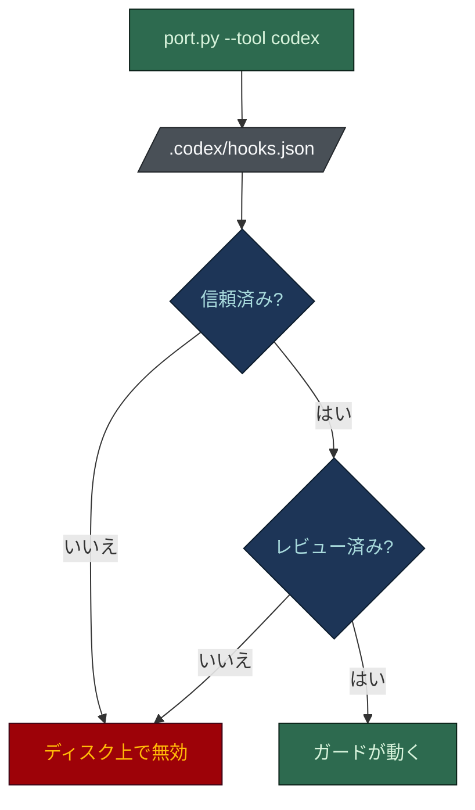

# Codex でのハーネス

[English](codex.md) · **日本語**

Codex はスキルを実行しません。スキルが生成したハーネスを動かします。フックのペイロードが
Claude Code と**同一**なので、ポーターは既存のフックをアダプターなしで `.codex/hooks.json` に直接
登録します。

Codex はルートと入れ子の `AGENTS.md` をそのまま読むので、ルールの変換は行いません。ただし、それで
得られるものは正確に言うべきです。スキャフォールドされた `AGENTS.md` は `.claude/rules/` を
**指し示す**だけで、中身は含みません。Codex にはパス限定のルールがなく (スコープはディレクトリの
配置だけ)、ルール本文はパスに一致したときに自動で付くコンテキストではなく、モデルが開くかもしれない
ファイルです。

## セットアップ

まず Claude のハーネスをスキャフォールドし (リポジトリに `.claude/rules/` と `.claude/hooks/` が
必要)、リポジトリのルートで移植します:

```bash
python ~/.claude/skills/harness-bootstrap/scripts/port.py --target . --tool codex
```

Python 3 が必要です。`--tool all` で Cursor と Codex を一度に設定します。その後、下の二つの前提を
満たさないと何も動きません。



- **信頼。** プロジェクトローカルの `.codex/` 層は、プロジェクトが信頼済み
  (`[projects.<path>] trust_level = "trusted"`) のときだけ読み込まれます。
- **レビュー。** 管理されていないフックは、CLI の `/hooks` でハッシュ固定の明示的なレビューが
  必要です。

両方が済むまで、ガードはディスク上にあっても動きません。移植の失敗と判断する前に確かめてください。

## 配置されるもの

| パス | 役割 |
|---|---|
| `AGENTS.md` | 生成済み。Codex がそのまま読み、ポーターは触れない |
| `.codex/hooks.json` | 既存の `.claude/hooks/*` を PreToolUse に登録: `Bash` は `guard-main-commit`、`check-commit-msg`、`protect-secrets` を、`apply_patch` は `protect-secrets` を実行 |

フックは同じ `.sh` (または `.ps1`) のファイルで、何も書き換えません。Codex は素のコマンド文字列で
登録するので、ポーターは実行したマシン上でインタプリタ (`bash`、`pwsh`、`powershell`) を解決します。

## 強制されるもの、助言だけのもの

| 統制 | Codex のマッチャー | 効果 |
|---|---|---|
| `guard-main-commit` | `Bash` | 既定ブランチへの直接のコミットをブロック |
| `check-commit-msg` | `Bash` | Conventional Commits に従わない、または AI の帰属表示を含むコミットメッセージをブロック |
| `protect-secrets` | `Bash` + `apply_patch` | シークレットの読み取りと、シークレットに触れるパッチをブロック |
| `protect-adr` | 登録されない | Codex は編集対象のパスを `tool_input.command` に入れ、フックは `file_path` を読むため |
| `AGENTS.md` | そのまま読まれる | 助言。強制できないルールは Codex が自主的に守る |
| その他のフック | 移植されない | `guard-destructive`、ボードのガード、`guard-agent-spawn` とその台帳、strict フックは Claude Code 専用 |

Bash のガード (シークレット、コミット先、コミットメッセージ) は正確です。

## 正直な制限

- **ADR のガードがありません。** Codex はファイルの編集を `apply_patch` で行い、パスはコマンドの
  中にあるので、承認済み ADR の編集はブロックされません。
- **スポーンの境界はまだ移植できません。** Codex には `agent_type` マッチャー付きの
  `SubagentStart` と `SubagentStop` がありますが、エージェントの種類は markdown の席ではなく
  `[agents.<name>]` の TOML 表から来ます。ポーターがその表も出力しない限り、フックの編成チェックが
  照合する相手がありません。到達はできるが、まだ同等ではありません。

## 動作を確かめる

ペイロードは Claude Code と共通なので、フックを直接試せます:

```bash
echo '{"cwd":".","tool_name":"Bash","tool_input":{"command":"git commit -m x"}}' \
  | bash .claude/hooks/guard-main-commit.sh ; echo "exit=$?"    # main 上なら exit=2 を期待
```

Windows では `.ps1` のフックを使い、`$LASTEXITCODE` を確認します。ツール自体でも、`.env` を読もう
としたり `main` にコミットしようとしたりして、それぞれがブロックされることを確かめてください。

## 関連

- [メイン README](../../README.ja.md)
- [AGENTS.md の契約](../../harness-bootstrap/assets/root/AGENTS.md)
