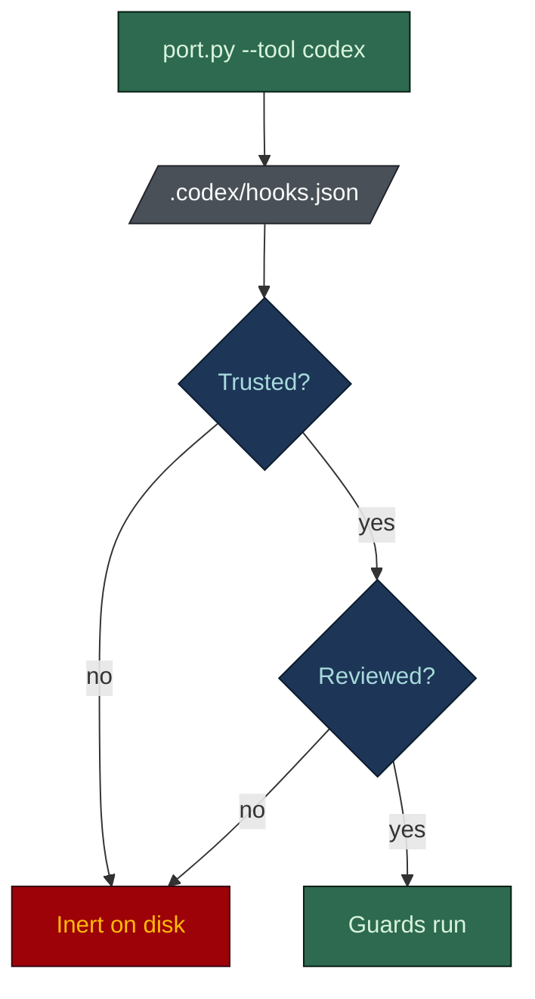

# The harness in Codex

**English** · [日本語](codex.ja.md)

Codex does not run the skills. It runs the harness the skills produce. Its hook payload is
**identical** to Claude Code's, so the porter registers the existing hooks directly in
`.codex/hooks.json`, with no adapter.

Codex reads `AGENTS.md` natively, root and nested, so no rule conversion runs. Be exact about what
that buys: the scaffolded `AGENTS.md` **points at** `.claude/rules/`, it does not contain them.
Codex has no path-scoped rules (its only scoping is directory placement), so on Codex the rule
bodies are files the model may choose to open, not context that attaches itself on a path match.

## Setup

Scaffold the Claude harness first (the repo needs `.claude/rules/` and `.claude/hooks/`), then port
it from the repo root:

```bash
python ~/.claude/skills/harness-bootstrap/scripts/port.py --target . --tool codex
```

Requires Python 3. `--tool all` sets up Cursor and Codex at once. Then complete the two
prerequisites below, or nothing runs.



- **Trust.** A project-local `.codex/` layer loads only when the project is marked trusted
  (`[projects.<path>] trust_level = "trusted"`).
- **Review.** Non-managed hooks need an explicit, hash-pinned review through `/hooks` in the CLI.

Until both are done the guards are present and inert. Check this before concluding the port failed.

## What lands

| Path | What it does |
|---|---|
| `AGENTS.md` | Already generated. Codex reads it natively; the porter does not touch it |
| `.codex/hooks.json` | Registers the existing `.claude/hooks/*` under PreToolUse: `Bash` runs `guard-main-commit`, `check-commit-msg` and `protect-secrets`; `apply_patch` runs `protect-secrets` |

The hooks are the same `.sh` (or `.ps1`) files; nothing is rewritten. Codex registers a bare command
string, so the porter resolves the interpreter (`bash`, `pwsh` or `powershell`) on the machine it
runs on.

## What enforces vs. what is advice-only

| Control | Codex matcher | Effect |
|---|---|---|
| `guard-main-commit` | `Bash` | Blocks a direct commit to the default branch |
| `check-commit-msg` | `Bash` | Blocks a non-conventional or AI-attributed commit message |
| `protect-secrets` | `Bash` + `apply_patch` | Blocks a secret read and a patch that touches secret material |
| `protect-adr` | not registered | Codex puts the edited path inside `tool_input.command`, and the hook reads `file_path` |
| `AGENTS.md` | read natively | Advice; Codex self-complies with the rules it cannot enforce |
| Every other hook | not ported | `guard-destructive`, the board guards, `guard-agent-spawn` and its ledger, the strict hooks stay Claude Code only |

The Bash guards (secrets, commit target, commit message) are exact.

## Honest limits

- **No ADR guard.** Codex routes file edits through `apply_patch` with the path inside the command,
  so an edit to an Accepted ADR is not blocked.
- **The spawn boundary does not travel yet.** Codex ships `SubagentStart` and `SubagentStop` with an
  `agent_type` matcher, but its agent types come from an `[agents.<name>]` TOML table rather than
  markdown seats. The hook's roster check has nothing to match against unless the porter emits that
  table too. Reachable, not yet equivalent.

## Verify it works

The payload is shared with Claude Code, so test a hook directly:

```bash
echo '{"cwd":".","tool_name":"Bash","tool_input":{"command":"git commit -m x"}}' \
  | bash .claude/hooks/guard-main-commit.sh ; echo "exit=$?"    # on main, expect exit=2
```

On Windows use the `.ps1` hook and check `$LASTEXITCODE`. In the tool itself, try to read `.env` or
commit to `main` and confirm each is blocked.

## See also

- [Main README](../../README.md)
- [AGENTS.md contract](../../harness-bootstrap/assets/root/AGENTS.md)
