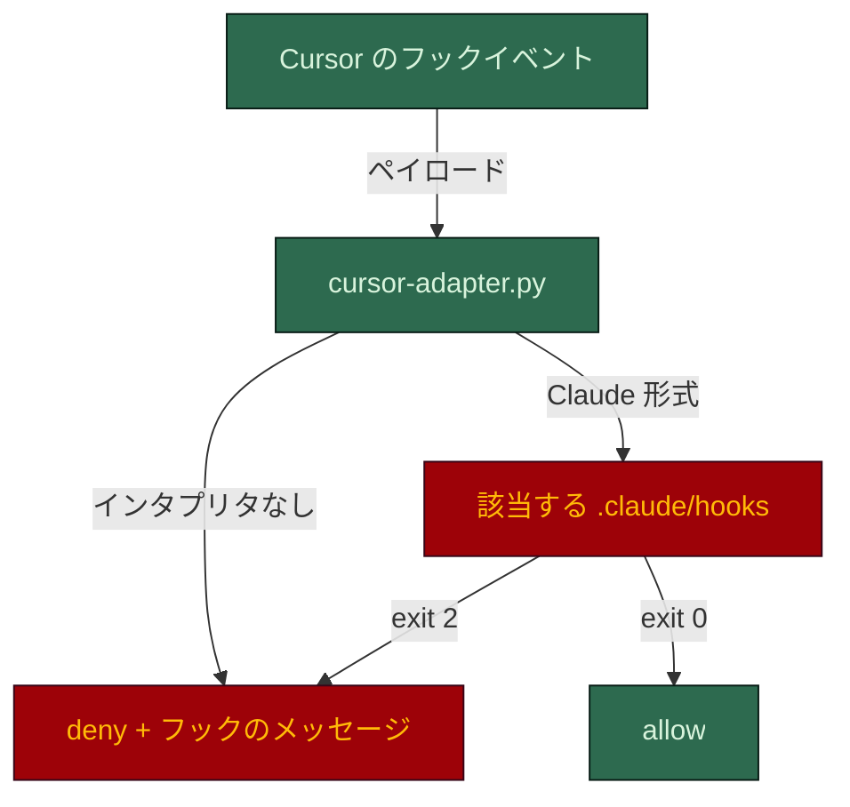

# Cursor でのハーネス

[English](cursor.md) · **日本語**

Cursor はスキルを実行しません。スキルが生成したハーネスを動かします。`AGENTS.md` と
`.cursor/rules/*.mdc` を読み、強制は `.cursor/hooks.json` と生成されたアダプターで行います。アダプターは
Cursor のフックのペイロードを `.claude/hooks/` が期待する形に変換し、終了コードを Cursor の応答に
戻します。

## セットアップ

まず Claude のハーネスをスキャフォールドし (リポジトリに `.claude/rules/` と `.claude/hooks/` が
必要)、リポジトリのルートで移植します:

```bash
python ~/.claude/skills/harness-bootstrap/scripts/port.py --target . --tool cursor
```

Python 3 と、フックの種類に合ったインタプリタが `PATH` に必要です: `.sh` なら `bash`、`.ps1` なら
`pwsh` か `powershell`。ポーターはスキルに同梱されています。

## 呼び出しはどう確かめられるか



| Cursor のイベント | アダプターが実行するフック |
|---|---|
| `beforeShellExecution` | `guard-main-commit`、`check-commit-msg`、`protect-secrets` |
| `beforeReadFile` | `protect-adr`、`protect-secrets` |
| `afterFileEdit` | `protect-adr`、`protect-secrets` (観察のみ: Cursor は編集を取り消せない) |

実行できないガードは allow ではなく **deny** と答えます。答えを知らないからです。

## 配置されるもの

| パス | 役割 |
|---|---|
| `.cursor/rules/*.mdc` | `.claude/rules/*.md` ごとに一つ。`paths:` なしは `alwaysApply: true`、`paths: [glob]` は `globs: glob` になる |
| `.cursor/hooks.json` | アダプターを `beforeShellExecution`、`beforeReadFile`、`afterFileEdit` に登録 |
| `.cursor/hooks/cursor-adapter.py` | ペイロードを `{cwd, tool_name, tool_input}` に正規化し、フックを実行し、`{"permission": "allow"\|"deny", ...}` を出す |
| `AGENTS.md` | 生成済み。Cursor がそのまま読む |

## 強制されるもの、助言だけのもの

| 統制 | Cursor での効果 |
|---|---|
| `protect-secrets` | シェルでもファイル読み取りでも、シークレットの読み取りをブロック |
| `guard-main-commit` | 既定ブランチへの直接のコミットをブロック |
| `check-commit-msg` | Conventional Commits に従わない、または AI の帰属表示を含むコミットメッセージをブロック |
| `protect-adr` | 承認済み ADR の編集を事後に指摘 (制限を参照) |
| `.cursor/rules/*.mdc` | 助言のみ |
| その他のフック | 移植されない: `guard-destructive`、ボードのガード、`guard-agent-spawn` とその台帳、strict フックは Claude Code 専用 |

## 正直な制限

- **ADR のガードは遅れて発火します。** `afterFileEdit` は観察のみなので、承認済み ADR の編集は
  ブロックされず、起きた後に指摘されます。Cursor は今や `preToolUse` を公開しており、そのペイロードは
  Claude Code に十分近いので、そこに配線すれば事前ブロックを取り戻せます。まだ行っていません。
- **`protect-adr` は読み取りでも動きます。** `beforeReadFile` で承認済み ADR へのパスを見ると拒否
  するので、Cursor のエージェントは承認済みの決定を読めません。移植の既知の穴です。
- **スポーンの境界はまだ移植できません。** Cursor にはサブエージェントを許可または拒否できる
  `subagentStart` と `subagentStop` があります。足りないのはペイロードの一致です。フックの中心の
  チェック (`.claude/agents/<type>.md` が存在するか) は、Cursor が席自身の名前を渡すことに依存し、
  それは未検証です。到達はできるが、まだ同等ではありません。
- **Cursor に相当するものがない統制が二つあります。** 席ごとの `tools:` 許可リスト (Cursor には
  `readonly` しかない) と `maxTurns` です。どちらも配線では取り戻せません。

## 動作を確かめる

```bash
python ~/.claude/skills/harness-bootstrap/scripts/port.py --self-test    # 32/32 を期待
```

フックの種類ごとに、書き込みの契約、アダプターの配線、六つの振る舞いを確かめます: `cat .env` を
拒否、`main` へのコミットを拒否、`npm test` を許可、`.env` の読み取りを拒否、`src` の読み取りを
許可、承認済み ADR への編集イベントを拒否。CI でも同じテストが走ります。ツール自体でも、`.env` を
読もうとしたり `main` にコミットしようとしたりして、それぞれが拒否されることを確かめてください。

## 関連

- [メイン README](../../README.ja.md)
- [AGENTS.md の契約](../../harness-bootstrap/assets/root/AGENTS.md)
