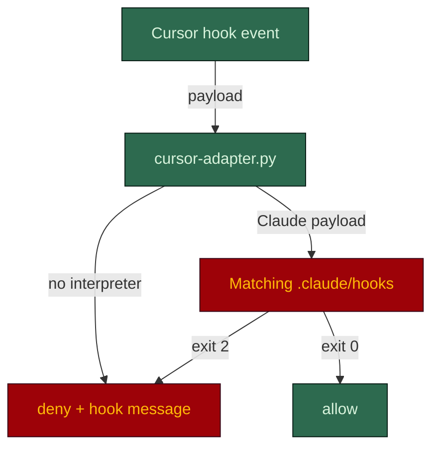

# The harness in Cursor

**English** · [日本語](cursor.ja.md)

Cursor does not run the skills. It runs the harness the skills produce: it reads `AGENTS.md` and
`.cursor/rules/*.mdc`, and enforcement runs through `.cursor/hooks.json` and a generated adapter
that translates Cursor's hook payload into the shape `.claude/hooks/` expect, then translates the
exit code back.

## Setup

Scaffold the Claude harness first (the repo needs `.claude/rules/` and `.claude/hooks/`), then port
it from the repo root:

```bash
python ~/.claude/skills/harness-bootstrap/scripts/port.py --target . --tool cursor
```

Requires Python 3 and the interpreter of your hook flavour on `PATH`: `bash` for `.sh` hooks, `pwsh`
or `powershell` for `.ps1`. The porter ships with the skill.

## How a call is checked



| Cursor event | Hooks the adapter runs |
|---|---|
| `beforeShellExecution` | `guard-main-commit`, `check-commit-msg`, `protect-secrets` |
| `beforeReadFile` | `protect-adr`, `protect-secrets` |
| `afterFileEdit` | `protect-adr`, `protect-secrets` (observational: Cursor cannot undo the edit) |

A guard that cannot execute answers **deny**, never allow: it does not know the answer.

## What lands

| Path | What it does |
|---|---|
| `.cursor/rules/*.mdc` | One per `.claude/rules/*.md`. No `paths:` becomes `alwaysApply: true`; `paths: [glob]` becomes `globs: glob` |
| `.cursor/hooks.json` | Registers the adapter on `beforeShellExecution`, `beforeReadFile` and `afterFileEdit` |
| `.cursor/hooks/cursor-adapter.py` | Normalises the payload to `{cwd, tool_name, tool_input}`, runs the hooks, emits `{"permission": "allow"\|"deny", ...}` |
| `AGENTS.md` | Already generated; Cursor reads it natively |

## What enforces vs. what is advice-only

| Control | Effect in Cursor |
|---|---|
| `protect-secrets` | Blocks a secret read, by shell or by file read |
| `guard-main-commit` | Blocks a direct commit to the default branch |
| `check-commit-msg` | Blocks a non-conventional or AI-attributed commit message |
| `protect-adr` | Flags an edit to an Accepted ADR after the fact (see limits) |
| `.cursor/rules/*.mdc` | Advice only |
| Every other hook | Not ported: `guard-destructive`, the board guards, `guard-agent-spawn` and its ledger, the strict hooks stay Claude Code only |

## Honest limits

- **The ADR guard fires late.** `afterFileEdit` is observational, so an edit to an Accepted ADR is
  flagged after it happens rather than blocked. Cursor now exposes `preToolUse`, with a payload close
  enough to Claude Code's that wiring the guard there would restore pre-hoc blocking. It has not been
  done.
- **`protect-adr` also runs on reads.** On `beforeReadFile` it sees a path to an Accepted ADR and
  denies, so an agent in Cursor cannot read an accepted decision. A known gap in the port.
- **The spawn boundary does not travel yet.** Cursor ships `subagentStart` and `subagentStop`, able
  to allow or deny a subagent. What is missing is a payload match: the hook's central check (does
  `.claude/agents/<type>.md` exist) depends on Cursor surfacing the seat's own name, which is
  unverified. Reachable, not yet equivalent.
- **Two controls have no Cursor equivalent.** Per-seat `tools:` allowlists (Cursor offers only
  `readonly`) and `maxTurns`. Neither is recoverable by wiring.

## Verify it works

```bash
python ~/.claude/skills/harness-bootstrap/scripts/port.py --self-test    # expect 32/32
```

Per hook flavour it checks the write contract, the adapter wiring, and six behaviour cases: deny
`cat .env`, deny a commit to `main`, allow `npm test`, deny reading `.env`, allow reading `src`,
and deny an edit event on an Accepted ADR. CI
runs the same test. In the tool itself, try to read `.env` or commit to `main` and confirm each is
denied.

## See also

- [Main README](../../README.md)
- [AGENTS.md contract](../../harness-bootstrap/assets/root/AGENTS.md)
