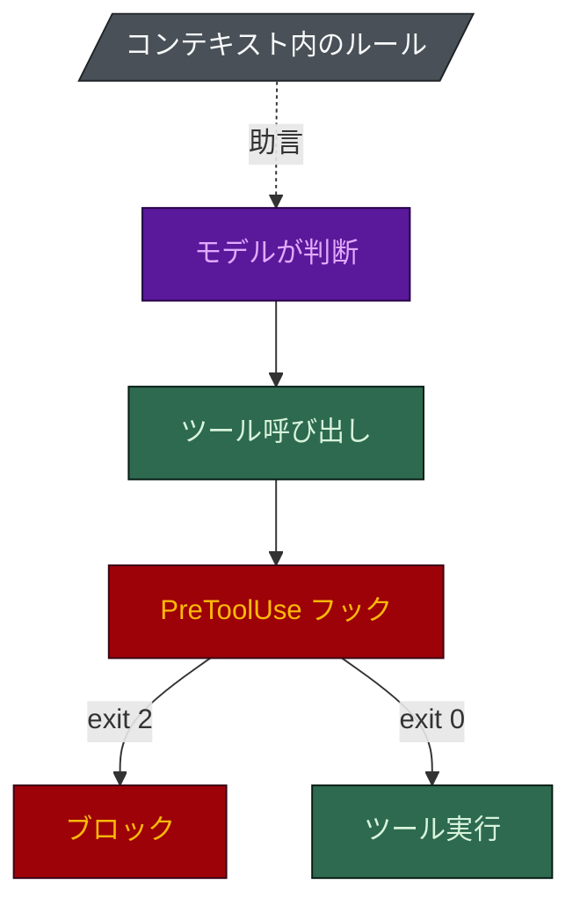

# FAQ

[[English|FAQ]] · **日本語**

## Claude Code でしか動きませんか?

Claude Code 向けに作られていますが、移植できます。
`python harness-bootstrap/scripts/port.py --target . --tool all` はルールを Cursor の形式に変換し、
フックを Cursor と Codex に登録します。Codex のフックのペイロードは Claude Code と同じなので直接
登録し、Cursor にはペイロードと応答を変換する小さなアダプターを付けます。

移植で運ばれるのは助言だけでなく**強制**です。対象はシークレット、コミット、ADR のガードで、
それ以外のフックは Claude Code 専用です。アダプターは CI で両方のフックの種類について自己テスト
されています。

## spec-builder は PDF、Word、Excel を読めますか?

読めます。そして読めない場合を自分で分かっています。`route_sources.py` が各ソースを開ける読み手に
振り分け、理由を表示します。スキャンされた PDF は「抽出」に成功したように見えてほとんど何も返さず、
これがモデルが仕様をでっち上げる経路なので、1 ページあたり 80 文字未満のものは画像として読む
工程に回します。何をもってしても開けないファイルは、ファイル名、理由、直し方を書いた名前付きの
未解決事項 (`OI-nn`) になります。黙った欠落にも推測にもなりません。

## 安全性は使うモデルに左右されますか?

されません。それが中心の主張です。ガードレールはシェルスクリプトと終了コードなので、モデルに
問い合わせません。`python eval/guardrail_eval.py` は strict、長期セッション、データベースの各フック
(`hooks_strict`、`long`、`db`) を有効にしたハーネスにペイロードを撃ち込みます。既定のインストールは
これより少ないフックを持ち、strict 系のガードで既定で入るのは `guard-destructive` だけです。

安いモデルで変わるのは、書かれるコードの質とレビューの深さです。それは上限の話で、eval は測りません。
モデルに依存しないのは下限です。

## ルールをプロンプトに書くだけではだめですか?

指示として書いたルールは読み飛ばせます。終了コード 2 を返すフックは飛ばせません。

ハーネスは両方を使い、どちらがどちらかを明示しています:
[`docs/ASSESSMENT.ja.md`](https://github.com/nguyenhx2/agent-harness-bootstrap/blob/main/docs/ASSESSMENT.ja.md)
が、何が強制で何が助言だけかを挙げています。

## 既存の `.claude/` を上書きしますか?

しません。スキャフォルダは存在するファイルを決して上書きしません。`ADDED`、`KEPT`、`CONFLICT` を
報告し、`CONFLICT` はあなたが解決します。唯一の追加的な例外は `settings.json` で、この版が同梱する
フックの登録は追加され (`MERGED`)、あなたが書いたものは変更も削除もされません。

## エージェントが少なすぎませんか? 他のキットはもっと多く入れます。

それが狙いです。[[テーラードビルド|Tailored-Build-ja]] を参照してください。誰も作業を振らない席は、
温存された能力ではなく、コンテキストの請求書と読みにくいルーティング表です。一回の実行で
インストールされるのは、リポジトリの目的と、契約とコードベースが正当化するものに応じて
**18席のうち3〜17席** で、それに実在するモジュールごとの dev エージェントが加わります。

## 両方のスキルを使う必要がありますか?

いいえ。どちらも単独で動きます。契約はハーネスを良くし、ハーネスは契約を強制可能にします。

## ルールとフックの違いは?

ルールはエージェントが読むガイダンスで、フックはツール呼び出しの前後に動いてそれをブロックできる
スクリプトです。ルールは振る舞いを形づくり、フックはそれを強制します。[[Rule Reference]] と
[[Hook Reference]] を参照してください。

## なぜほとんどのルールがパス限定なのですか?

毎セッション読み込まれるルールは、すべてのリクエストでコンテキストを使います。パス限定のルールは、
一致するファイルに触れたときだけ入ります。無条件に読み込まれるのは、本当に普遍的なルールだけです。

## エージェントがガードレールを無効にできますか?

できません。`/harness-toggle` はエージェントを門前払いし、安全上重要な統制には人間が入力する
フレーズが必要で、すべてのトグルはコミットされる `.claude/disabled.json` に記録されます。
`hooks_strict` では、セッション中にガードを止める設定変更も `guard-config` がブロックします。

## フックでセッションは遅くなりますか?

少しだけ、ツール呼び出しのときだけです。同じイベントのフックは並列に動くので、待ち時間は一番遅い
ものが決めます。git 専用のガードは `"if": "Bash(*git *)"` で登録されるので、既定のハーネスでは
ただの `ls` で起動するフックのプロセスは 4 つではなく 2 つです。

## 小さなプロジェクトには大げさではありませんか?

そうかもしれません。質問票にはそのための軽量な答えがあります: 最小限の手続き、方法論ルールなし、
レビューゲートは維持。最も軽いコード向けの構成は 6 席で、調査やドキュメントのリポジトリなら 3 席で
済みます。小さな作業がオーケストレーターを通されることもありません。Inline や Direct の変更は、
メインセッションか担当の席に直接行きます。それでも多すぎるなら `.claude/` を削除してください。

## コードをどこかに送りますか?

スキルもツールもローカルで動き、`harness-view` はネットワーク通信をしません。Claude Code の
セッションが何を送るかはあなたとプロバイダーの間の話で、ハーネスは何も足しません。`model-policy`
ルールで、どのデータ区分をどのプロバイダーに送ってよいかを書き留められます。

## この Wiki の主張が正しいとどう分かりますか?

横に書かれたスクリプトを実行してください。`python scripts/check_numbers.py` は公開されている
すべての数字をスクリプトと照合して矛盾で失敗し、この Wiki のリファレンスページはアセットから生成
されています。
