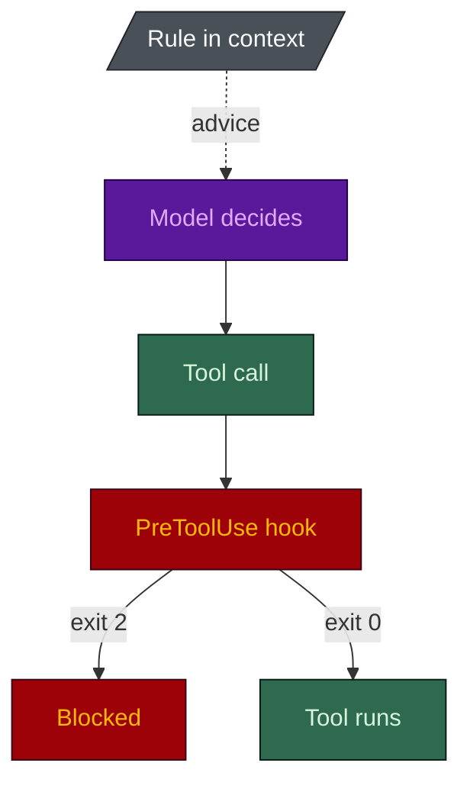

# FAQ

**English** · [[日本語|FAQ-ja]]

## Does this only work with Claude Code?

It is built for Claude Code, and it ports. `python harness-bootstrap/scripts/port.py --target . --tool all`
converts the rules to Cursor's format and registers the hooks for Cursor and Codex. Codex's hook
payload matches Claude Code's, so its hooks are registered directly; Cursor gets a small adapter
that translates the payload and the answer.

The port carries **enforcement**, not just advice, for the secret, commit and ADR guards. The rest of
the hook set stays Claude Code only. The adapter is self-tested in CI on both hook flavours.

## Can spec-builder read my PDF, Word and Excel files?

Yes, and it knows when it CANNOT. `route_sources.py` routes each source to a reader that can open it
and prints why. A scanned PDF "extracts" successfully and returns almost nothing, which is how a
model ends up inventing a spec, so anything under 80 characters a page goes to a vision pass. A
file nothing installed can open becomes a named open issue (`OI-nn`) with the file, the reason and
the fix. Never a silent gap, never a guess.

## Does the safety depend on which model I use?

No, and that is the central claim. The guardrails are shell scripts and exit codes, so no model is
consulted. `python eval/guardrail_eval.py` fires its payloads at a harness scaffolded with the
strict, long-session and database hooks on (`hooks_strict`, `long`, `db`). A default install
carries fewer hooks; `guard-destructive` is the one strict-class guard it ships by default.

A cheaper model does change the quality of the code and the depth of the review. That is the
ceiling, and the eval does not measure it. The floor is what is model-independent.

## Why not just write the rules in a prompt?

A rule written as an instruction can be skipped. A hook that exits 2 cannot.

The harness uses both and says which is which:
[`docs/ASSESSMENT.md`](https://github.com/nguyenhx2/agent-harness-bootstrap/blob/main/docs/ASSESSMENT.md)
lists what is enforced and what is only advisory.

## Will it overwrite my existing `.claude/`?

No. The scaffolder never overwrites a file that exists. It reports `ADDED`, `KEPT` or `CONFLICT`,
and a `CONFLICT` is yours to resolve. The one additive exception is `settings.json`, where a hook
registration this version ships is added (`MERGED`) and nothing you wrote is changed or removed.

## Why so few agents? Other kits ship far more.

That is the point. See [[Tailored Build]]. A seat nobody routes work to is a context bill and a
harder routing table, not capability in reserve. A run installs 3 to 17 of the 18 seats, depending on
what the repo is for and what the contract and codebase justify, plus one dev agent per module.

## Do I have to use both skills?

No. Each stands alone. The contract makes the harness better and the harness makes the contract
enforceable.

## What is the difference between a rule and a hook?

A rule is guidance the agent reads; a hook is a script that runs before or after a tool call and can
block it. Rules shape behaviour, hooks enforce it. See [[Rule Reference]] and [[Hook Reference]].

## Why are most rules path-scoped?

A rule loaded in every session costs context on every request. A path-scoped rule enters the window
only when a matching file is touched. Only the genuinely universal rules load unconditionally.

## Can an agent disable a guardrail?

No. `/harness-toggle` refuses agents outright, safety-critical controls need a phrase typed by a
human, and every toggle is recorded in the committed `.claude/disabled.json`. With `hooks_strict`,
`guard-config` also blocks a mid-session settings change that switches a guard off.

## Do the hooks slow the session down?

A little, and only on tool calls. Hooks on one event run in parallel, so the slowest decides the
wait. The git-only guards register with `"if": "Bash(*git *)"`, so a plain `ls` starts 2 hook
processes rather than 4 on a default harness.

## Is this over-engineering for a small project?

Possibly, and the questionnaire has a lightweight answer for that: minimal ceremony, no methodology
rule, the review gate kept. The leanest code build is six seats, and a research or documentation
repo needs as few as three. Small work is also never forced through the orchestrator: the main
session does the work at every tier, and the orchestrator runs only when you ask. If that is still too much,
delete `.claude/`.

## Does it send my code anywhere?

The skills and the tool run locally, and `harness-view` makes no network calls. What your Claude
Code session sends is between you and your provider; the harness adds nothing, and the
`model-policy` rule lets you write down which data classes may reach which provider.

## How do I know a claim on this wiki is true?

Run the script named next to it. `python scripts/check_numbers.py` checks every published figure
against the scripts and fails on a contradiction, and the reference pages here are generated from
the assets.
