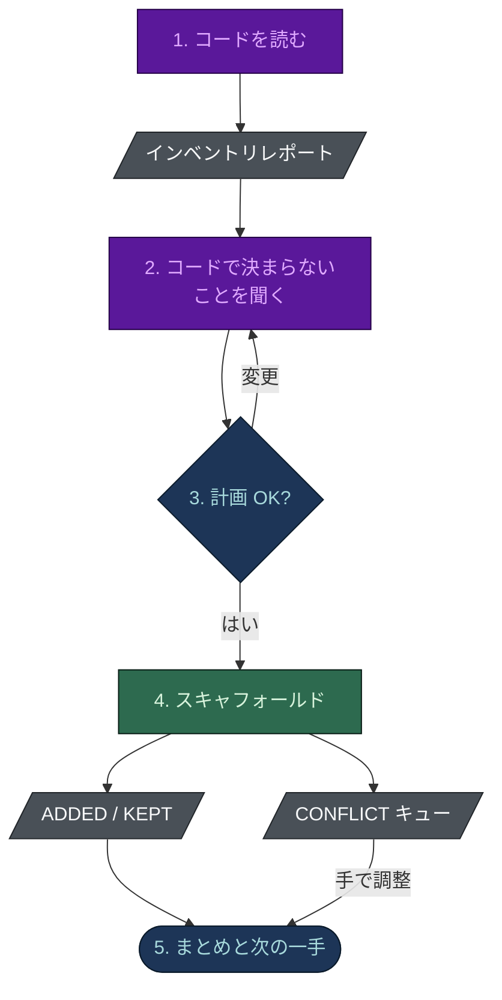

# はじめに

[[English|Getting-Started]] · **日本語**

## インストール

推奨はプラグインマーケットプレイスです。任意の Claude Code セッションの中で:

```text
/plugin marketplace add nguyenhx2/agent-harness-bootstrap
/plugin install harness-bootstrap@agent-harness-bootstrap
/plugin install spec-builder@agent-harness-bootstrap
```

以後の更新は `/plugin update` で届きます。オフラインで版を固定したいときは、
[最新リリース](https://github.com/nguyenhx2/agent-harness-bootstrap/releases/latest) からバンドルを
ダウンロードし、スキルのディレクトリに展開します:

```bash
unzip agent-harness-bootstrap.zip -d ~/.claude/skills/
```

Claude Code は次のセッションでスキルを認識します。各スキルのディレクトリには `VERSION` ファイルが
あり、`~/.claude/skills/harness-bootstrap/VERSION` を読めば手元の版が分かります。

ブロッキングフックは `onFailure: "block"` を宣言しているので、クラッシュやタイムアウトしたガードは
呼び出しを通さずに拒否します。このキーには Claude Code 2.1.295 以降が必要です。

## どちらのスキルを先に

すでに何を持っているかで決まります。

| 状況 | 実行するもの |
|---|---|
| アイデア、書き起こし、メモ、既存の文書があり、仕様はない | まず `/spec-builder`、次に `/harness-bootstrap` |
| 既存のコードベースがある (仕様の有無は問わない) | `/harness-bootstrap` - まずコードを読みます |
| 分析はするが決して変更してはならないリポジトリ | `/harness-bootstrap` を実行し、監査専用と答える |

どちらのスキルも単独で動きます。`/harness-bootstrap` から始めて仕様がなければ、`spec-builder` への
引き継ぎを提案します。

## harness-bootstrap を実行すると何が起きるか



1. **まずコードを読みます。** ソースが少しでもあれば分析は必須です。インベントリレポートは
   スタック、モジュール、規約、危険な操作、ギャップを挙げ、何かを書く前にあなたに見せます。
2. **コードで決まらないことを聞きます。** 最初の質問はリポジトリの目的 (コード、調査、戦略、
   ドキュメント、任意の組み合わせ) で、以降の質問はその目的が必要とする場合だけです。選択式の
   質問は、回答を事前に埋めた一つの質問票として、最大二回の呼び出しで、あなたの言語で出ます。
   分析で答えが出たことは聞き直しません。
3. **計画を見せます。** 作成、維持、変更されるファイルと、各席のモデルと effort を含む編成です。
   確定するか、変更します。
4. **スキャフォールドします。** スキャフォルダは**既存のファイルを決して上書きしません**。
   各ファイルは `ADDED`、`KEPT` (同一)、`CONFLICT` (存在して内容が違う) のいずれかです。
   `CONFLICT` はエラーではなく調整のキューです。各モジュールに短い `CLAUDE.md` も書き、最後に席、
   フック、ルール、コマンドの間のリンクがすべて解決できるかを確かめます。
5. **まとめと次の一手が出ます。** たいていは `/task-resume` です。

## 最初のループ

ループが一度回るまで、ハーネスは完成していません:

```bash
/new-task          # まず確認し、docs/tasks/active/TASK-NNN-<slug>.md とボードの行を書く
/task-resume       # タスクのチェックポイントを読み、次のステップから再開する
/review-changes    # PR を開く前のレビューゲート
```

- `/new-task` は、あなたが合意した作業についてだけ、あなたが「はい」と言ってからタスクを開きます。
- 以後のタスクの状態は `python .claude/scripts/task.py` で変えます。ファイル、フォルダ、ボードの
  行がそろって動きます。ボードの行を手で編集すると拒否されます。
- ボードが空なのはエラーではなく答えです。ブラウンフィールドでは分析のギャップ一覧からボードが
  埋まるので、初日から本物の作業があります。

## 本当に守っているかを確かめる

```bash
python eval/guardrail_eval.py
```

このリポジトリで実行すると、eval は本物のハーネス (strict、長期セッション、データベースの各フックを
有効化) を生成し、既知の悪いペイロードと良いペイロードをフックの種類ごとに撃ち込みます。モデルは
使わず、CI も同じコマンドを実行します。`benchmark/benchmark.py` は、ブロックすべきペイロードを
ハーネスありのリポジトリと `.claude/` を除いた同じリポジトリに再生します。

あなたのリポジトリでは、`python .claude/scripts/harness-check.py` が、何も指していないリンクの
ファイルと行を示します。

## 取り外す

```bash
rm -rf .claude/
```

これでエージェント、ルール、フック、コマンドはすべて消えます。スキャフォールドは `AGENTS.md`、
`CLAUDE.md`、`docs/` ツリー、モジュールごとの `CLAUDE.md` も書いています。どれも普通のファイルで、
`git status` に出ます。デーモンもサービスもなく、リポジトリの外に片付けるものはありません。

## 次へ

- [[テーラードビルド|Tailored-Build-ja]] - 編成がカタログより小さい理由
- [[Harness View|Harness-View-ja]] - 作ったものを見て採点する
- [[トラブルシューティング|Troubleshooting-ja]] - フックが発火しないとき
