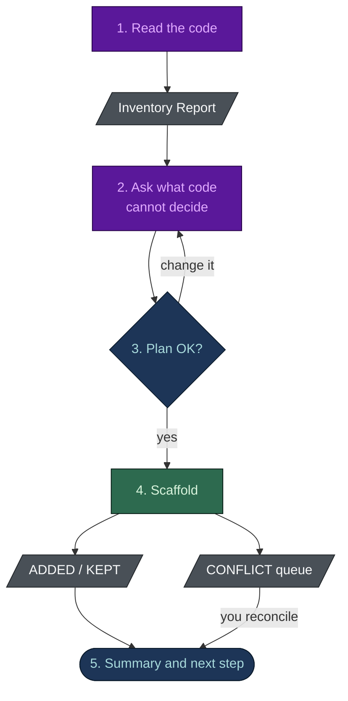

# Getting Started

**English** · [[日本語|Getting-Started-ja]]

## Install

The recommended path is the plugin marketplace, from inside any Claude Code session:

```text
/plugin marketplace add nguyenhx2/agent-harness-bootstrap
/plugin install harness-bootstrap@agent-harness-bootstrap
/plugin install spec-builder@agent-harness-bootstrap
```

Updates then arrive with `/plugin update`. For an offline, pinned install, download the bundle from
the [latest release](https://github.com/nguyenhx2/agent-harness-bootstrap/releases/latest) and unzip
it into your skills directory:

```bash
unzip agent-harness-bootstrap.zip -d ~/.claude/skills/
```

Claude Code picks the skills up on the next session. Each skill directory carries a `VERSION` file,
so `~/.claude/skills/harness-bootstrap/VERSION` tells you what you have.

The blocking hooks declare `onFailure: "block"`, so a guard that crashes or times out refuses the
call instead of letting it through. That key needs Claude Code 2.1.295 or later.

## Which skill first

It depends on what you already have.

| Your situation | Run |
|---|---|
| An idea, a transcript, notes or legacy docs, and no specs | `/spec-builder` first, then `/harness-bootstrap` |
| An existing codebase, with or without specs | `/harness-bootstrap` - it reads the code first |
| A repo you must analyse but never modify | `/harness-bootstrap`, and answer that it is audit-only |

Each skill stands alone. If you start with `/harness-bootstrap` and there are no specs, it offers to
hand over to `spec-builder`.

## What happens when you run harness-bootstrap



1. **It reads your code first.** With any source in the repo the analysis is mandatory. The
   Inventory Report lists the stack, the modules, the conventions, the risky operations and the
   gaps, and you see it before anything is written.
2. **It asks what code cannot decide.** The first question is the repo's purpose (code, research,
   strategy, docs, in any combination); later questions are asked only where that purpose needs
   them. The closed choices come as one pre-answered questionnaire of at most two calls, in your
   language. Anything the analysis already answered is not asked again.
3. **It shows the plan.** Files created, kept and modified, and the roster with each seat's model
   and effort. You confirm or change it.
4. **It scaffolds.** The scaffolder **never overwrites a file**. Each one is `ADDED`, `KEPT`
   (identical) or `CONFLICT` (exists and differs). A `CONFLICT` is the reconciliation queue, not an
   error. It also writes a short `CLAUDE.md` into each module, and ends by checking that every link
   between seats, hooks, rules and commands resolves.
5. **You get a summary and a next step**, usually `/task-resume`.

## Your first loop

The harness is not finished until the loop has run once:

```bash
/new-task          # asks first, then writes docs/tasks/active/TASK-NNN-<slug>.md and its board row
/task-resume       # reads the task's checkpoint and picks up from the next step
/review-changes    # the review gate, before you open a PR
```

- `/new-task` opens a task only for work you agreed to, and only after you say yes.
- Task state then changes through `python .claude/scripts/task.py`, which keeps the file, its
  folder and the board row in step. A hand edit of a board row is refused.
- An empty board is an answer, not an error. In a brownfield repo the analysis seeds the board from
  its gap list, so there is real work on day one.

## Verify it actually guards

```bash
python eval/guardrail_eval.py
```

From this repository, the eval scaffolds a real harness (strict, long-session and database hooks
on) and fires known-bad and known-good payloads at it, per hook flavour. No model is consulted, and
CI runs the same command. `benchmark/benchmark.py` replays the must-block payloads against a
harnessed repo and the same repo without `.claude/`.

In your own repo, `python .claude/scripts/harness-check.py` names the file and line of any link that
points at nothing.

## Removing it

```bash
rm -rf .claude/
```

That removes every agent, rule, hook and command. The scaffold also wrote `AGENTS.md`, `CLAUDE.md`,
the `docs/` tree and the per-module `CLAUDE.md` files; they are plain files, and `git status` lists
them. There is no daemon, no service and nothing outside the repository to clean up.

## Next

- [[Tailored Build]] - why the roster is smaller than the catalogue
- [[Harness View]] - see what you just built, and score it
- [[Troubleshooting]] - when a hook does not fire
