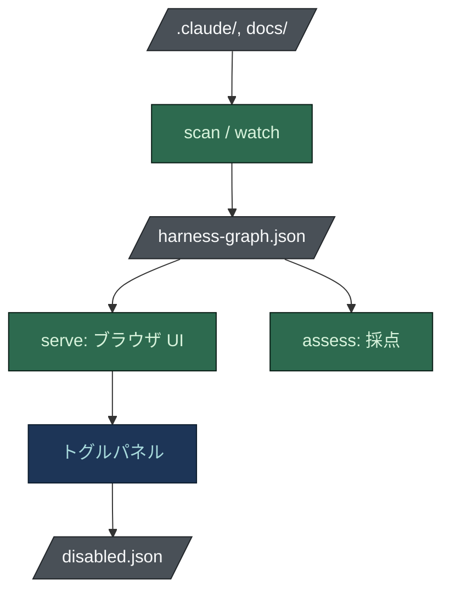

# Harness View

[[English|Harness-View]] · **日本語**

点検できないハーネスは、信じるしかないハーネスです。`harness-view` はディスク上にあるものを読み、
描画し、採点し、その一部をオフにできるようにします。

**モデルは一切使いません。** だからブラウザと CI の実行が答えで食い違うことはありません。

## インストール

Windows、macOS、Linux 向けのビルド済みバイナリが、チェックサム付きで
[各リリース](https://github.com/nguyenhx2/agent-harness-bootstrap/releases/latest) に添付されて
います。ソースからビルドすることもできます:

```bash
cargo install --path tools/harness-view
```

Windows ではバイナリをダブルクリックすると、現在のフォルダで `serve` が起動します。

## コマンド



```bash
harness-view scan   .    # .claude/state/harness-graph.json を書いて終了
harness-view serve  .    # http://127.0.0.1:7420/ でハーネスを閲覧
harness-view watch  .    # ファイルの変更に合わせてグラフを再構築
harness-view assess .    # 採点。重大な所見が残っていれば終了コード 1
harness-view rubric      # すべての採点の根拠になるルーブリックを表示
```

`assess` が非ゼロで終わるので、パイプラインで使えます。レビュアーがブラウザで見るチェックが、
そのままビルドを落とせるチェックです。

## ビューに表示されるもの

- **Flow** は統制の層を左から右に並べます: ルール、フックと設定、エージェントの席、マージゲート、
  人間、コマンド。「変更はどう抑えられているか」に一画面で答えます。
- **Graph** は同じデータを力学レイアウトで表示し、順序ではなくまとまりを見るときに使います。
- **Master plan** は `docs/tasks/master-plan.md` があるリポジトリでだけ現れ、各タスクのボード上の
  状態を示します。ボードが自己矛盾していれば `DRIFT` と出ます。

すべてのノードはファイルです。クリックすると整形済みまたは生の内容が出ます。エージェントを選ぶと、
`model`、`effort`、`tools`、`description` をピッカーで編集でき、コマンドのステップはその場で
並べ替え、無効化、タイトル変更ができます。

## Assess が採点するもの

所見は公開されたルーブリック (`tools/harness-view/RUBRIC.md`、または `harness-view rubric`) から
出ます。各所見はルール ID、`file:line` 形式の証拠、なぜ重要か、具体的な修正を示します。

- **六つのカテゴリ:** 安全性、コスト管理、トレーサビリティ、ボードの健全性、ドキュメントの品質、
  契約。それぞれ 100 から始まり所見ごとの重みが引かれるので、ルーブリックだけから点数を再計算
  できます。
- **目的に応じる:** ルールはすべてのリポジトリ、コードリポジトリ、非コードリポジトリのいずれかに
  適用され、目的はブートストラップが記録した `purpose_*` フラグから読みます。調査リポジトリに
  コードレビューコマンドを足せとは言いません。
- **作業リスト:** 所見をルールごとにまとめ、重み x 件数 / 手間の順に並べ、各ルールを解消した後の
  総合点を示します。
- **`--since prev.json`:** 直った所見、新しい所見、動いたすべての点数を示します。ビューアも前回の
  チェックを覚えていて同じことをします。

よく出る所見:

- 毎セッション読み込まれるのに、どのファイルにも一致しないルール
- モジュールのない席、または持ち主のいないモジュール
- インストール済みなのに、どこにも配線されていないスキル
- 同梱されているのに `settings.json` に登録されていないフック
- 明示的な `model` や `effort` のないエージェント (呼び出し元の階層で黙って課金される)
- `Edit` や `Write` を持つレビュアー
- 持ち主が存在しないタスク
- 成果物を確認する読み取り専用の席がない調査やドキュメントのリポジトリ

三つの実在するハーネスで、生成されたものは 99、手で保守されている二つは 79 と 64 でした。主な原因は、
毎セッション読み込まれる 18 のルールと、ボードを追従させずに名前を変えた席です。

## データの出どころ

実行が書く `.claude/state/harness-graph.json` です。スキーマはバージョン付きで共有されており、
スキルの Python スキャナと Rust のツールは同じリポジトリでバイト単位で同一の出力を出します。
`scripts/check_graph_parity.py` がそれを確かめます。

このファイルは実行への入力ではなく、実行が残したものです。概要図で `state` が入口ではなく下に
あるのはそのためです。

## オフにする

ビューアのトグルパネルと `/harness-toggle` は同じ契約を書きます。統制は `.claude/disabled/` に
移り、コミットされる `.claude/disabled.json` に変更が記録されます。フックの `settings.json` の
登録もそのまま保存されるので、有効化するとバイト単位で元に戻ります。

安全上重要な統制は、クリックではなく確認フレーズの入力が必要です。エージェントは何もトグルできません。

## 関連

- [[Hook Reference]] - 各フックが何をブロックするか
- [[テーラードビルド|Tailored-Build-ja]] - Assess が報告する所見と、それが重要な理由
