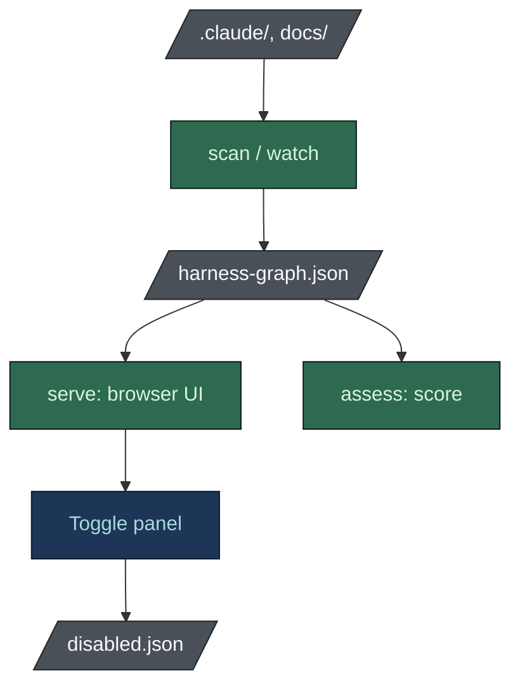

# Harness View

**English** · [[日本語|Harness-View-ja]]

A harness you cannot inspect is one you trust on faith. `harness-view` reads what is on disk,
renders it, scores it, and lets you switch parts of it off.

**No model is involved.** A browser and a CI run therefore cannot disagree about the answer.

## Install

Prebuilt binaries for Windows, macOS and Linux, with checksums, are attached to
[every release](https://github.com/nguyenhx2/agent-harness-bootstrap/releases/latest). Or build from
source:

```bash
cargo install --path tools/harness-view
```

On Windows, double-clicking the binary starts `serve` on the current folder.

## Commands



```bash
harness-view scan   .    # write .claude/state/harness-graph.json and exit
harness-view serve  .    # browse the harness at http://127.0.0.1:7420/
harness-view watch  .    # rebuild the graph as files change
harness-view assess .    # score it; exit 1 when a high finding is outstanding
harness-view rubric      # print the rubric every score comes from
```

`assess` exiting non-zero is what makes it usable in a pipeline: the check a reviewer runs in the
browser is the one that can fail a build.

## What the views show

- **Flow** lays the control plane out left to right: rules, hooks and settings, agent seats, the
  merge gate, the human, commands. It answers "how is a change kept in check" in one screen.
- **Graph** is the same data as a force layout, for clusters rather than order.
- **Master plan** appears when the repo has `docs/tasks/master-plan.md`, with each task's board
  status, or `DRIFT` when the board disagrees with itself.

Every node is a file. Click it for the real content, formatted or raw. Selecting an agent also lets
you edit its `model`, `effort`, `tools` and `description` from pickers, and a command's steps can be
reordered, switched off or retitled in place.

## What Assess scores

Findings come from a published rubric (`tools/harness-view/RUBRIC.md`, or `harness-view rubric`).
Each names its rule id, the evidence as `file:line`, why it matters and a concrete fix.

- **Six categories:** safety, cost control, traceability, board health, docs quality, contract.
  Each starts at 100 and loses the weight of every finding, so the score can be recomputed from the
  rubric alone.
- **Purpose-aware:** a rule applies to every repo, to code repos or to non-code ones, read from the
  `purpose_*` flags the bootstrap recorded. A research repo is not told to add a code review command.
- **Worklist:** findings grouped by rule, ordered by weight times count over effort, with the
  overall score after each rule is cleared.
- **`--since prev.json`:** findings fixed, findings new and every score that moved. The viewer
  remembers the last check and does the same.

Typical findings:

- a rule loaded in every session that matches no file
- an agent seat with no module, or a module with no owner
- a skill installed but wired to nothing
- a hook that ships but is not registered in `settings.json`
- an agent with no explicit `model` or `effort`, which silently bills at the caller's tier
- a reviewer that holds `Edit` or `Write`
- a task whose owner does not exist
- a research or documentation repo with no read-only seat checking its deliverables

Against three real harnesses it scored the generated one 99 and two hand-maintained ones 79 and 64,
mostly for eighteen rules loading in every session and seats renamed without the board following.

## Where the data comes from

`.claude/state/harness-graph.json`, which the run writes. The schema is versioned and shared: the
skill's Python scanner and the Rust tool produce byte-identical output on the same repository, and
`scripts/check_graph_parity.py` checks it.

That file is not an input to the run. It is what the run leaves behind, which is why `state` sits
at the foot of the overview figure.

## Turning things off

The viewer's toggle panel and `/harness-toggle` write one contract. The control moves into
`.claude/disabled/`, and the committed `.claude/disabled.json` records the change, including a
hook's `settings.json` registration verbatim, so enabling restores it byte-exactly.

Safety-critical controls need a typed confirmation phrase, not a click. Agents cannot toggle
anything.

## See also

- [[Hook Reference]] - what each hook blocks
- [[Tailored Build]] - the findings Assess reports, and why they matter
