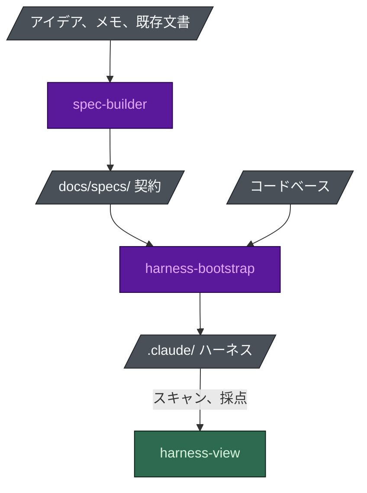

# Agent Harness Bootstrap

[[English|Home]] · **日本語**

二つの Claude Code スキルと、一つのビューアです:

- **`spec-builder`** は、あなたにも AI にも読める仕様を書きます。
- **`harness-bootstrap`** は、リポジトリに合ったエージェントチームを組みます。
- **`harness-view`** は結果を見せ、採点し、どの部分でもオフにできます。

この Wiki は**リファレンス**です。なぜこれが必要なのかは
[README](https://github.com/nguyenhx2/agent-harness-bootstrap/blob/main/README.ja.md) に、短縮版は
[ランディングページ](https://nguyenhx2.github.io/agent-harness-bootstrap/) にあります。どちらも
まだなら、そちらから始めてください。



紫はモデルが動く工程、緑は決定的なプログラム、灰色はディスク上のファイルです。

## ここから始める

| やりたいこと | 読むページ |
|---|---|
| インストールして一度動かす | [はじめに](Getting-Started-ja) |
| ビルドが意図して小さい理由を知る | [テーラードビルド](Tailored-Build-ja) |
| 席、ルール、フック、コマンド、フラグを調べる | 下のリファレンスページ |
| 自分のハーネスが実際にどうなっているかを見る | [Harness View](Harness-View-ja) |
| 何かが発火しない理由を突き止める | [トラブルシューティング](Troubleshooting-ja) |
| よくある疑問を確かめる | [FAQ](FAQ-ja) |

## リファレンス

次の五つのページは `scripts/build_wiki.py` が**リポジトリから生成**しています。数字を信用できるのは
そのためです (現時点では英語のみ):

- [[Agent Reference]] - 席、そのモデルと effort、それぞれがいつインストールされるか
- [[Rule Reference]] - どのルールが毎セッション読み込まれ、どれがパス限定か
- [[Hook Reference]] - 何が何をブロックし、どの終了コードがそれを行うか
- [[Command Reference]] - ハーネスがインストールするすべてのスラッシュコマンド
- [[Flag Reference]] - 質問票の各回答が何を有効にするか

Wiki の UI での編集は次のビルドで上書きされます。元のアセットを変更してください。

## 一段落で言うと

`spec-builder` は、持ち込まれたもの (アイデア、会議の書き起こし、既存の文書、空のリポジトリ) を、
安定した要件 ID を持つ一つの契約にします。`harness-bootstrap` はコードを読み、それに合った
`.claude/` ハーネスを組みます。契約と実在するモジュールから導いた編成、実在するパスに限定した
ルール、助言ではなくブロックするフックです。ガードレールはシェルスクリプトと終了コードなので、
安全の下限がモデルに左右されることはありません。`harness-view` は結果を読んで採点し、こちらも
モデルを使いません。

## 自分で走らせられる証拠

```bash
python eval/guardrail_eval.py                        # 安全の下限、フックの種類ごと
python benchmark/benchmark.py                        # ハーネスあり vs 素のリポジトリ
python harness-bootstrap/scripts/port.py --self-test # Cursor と Codex のアダプター
python scripts/check_numbers.py                      # 公開しているすべての数字 vs スクリプト
```

この Wiki の数字は記憶で書いたものではありません。ページとスクリプトが食い違えば、正しいのは
スクリプトで、ページがバグです。
