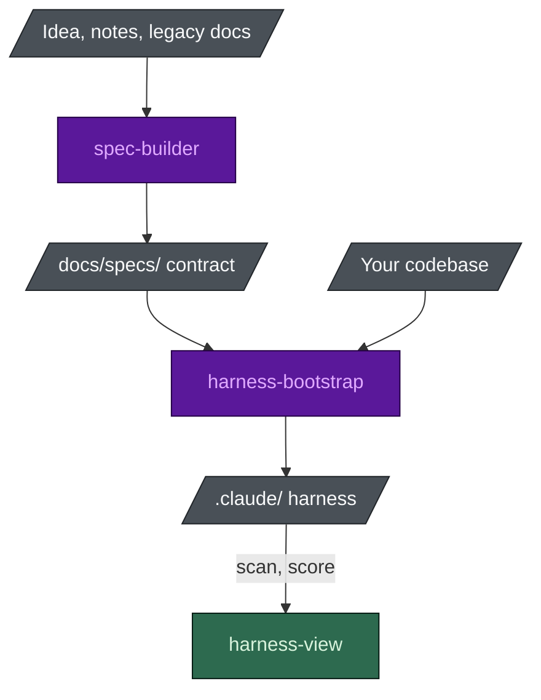

# Agent Harness Bootstrap

**English** · [[日本語|Home-ja]]

Two Claude Code skills and a viewer:

- **`spec-builder`** writes a spec that both you and the AI can read.
- **`harness-bootstrap`** fits an agent team to your repo.
- **`harness-view`** shows the result, scores it, and switches any part of it off.

This wiki is the **reference**. The [README](https://github.com/nguyenhx2/agent-harness-bootstrap#readme)
explains why any of it exists, and the [landing page](https://nguyenhx2.github.io/agent-harness-bootstrap/)
is the short version. Start there if you have read neither.



Purple runs a model, green is a deterministic program, grey is a file on disk.

## Start here

| If you want to | Read |
|---|---|
| Install it and run it once | [[Getting Started]] |
| Understand why the build is small on purpose | [[Tailored Build]] |
| Look up a seat, a rule, a hook, a command, a flag | the reference pages below |
| See what your harness actually looks like | [[Harness View]] |
| Work out why something is not firing | [[Troubleshooting]] |
| Ask the obvious question | [[FAQ]] |

## Reference

These five pages are **generated from the repository** by `scripts/build_wiki.py`, which is why
their counts can be trusted:

- [[Agent Reference]] - the seats, their model and effort, and when each is installed
- [[Rule Reference]] - which rules load in every session and which are path-scoped
- [[Hook Reference]] - what blocks what, and the exit code that does it
- [[Command Reference]] - every slash command the harness installs
- [[Flag Reference]] - what each questionnaire answer turns on

An edit made in the wiki UI is overwritten by the next build. Change the asset instead.

## The one-paragraph version

`spec-builder` turns whatever you brought - an idea, a meeting transcript, legacy documents, a bare
repo - into one contract with stable requirement IDs. `harness-bootstrap` reads your code, then
builds the `.claude/` harness that fits it: a roster derived from the contract and the modules that
exist, rules scoped to paths that exist, and hooks that block rather than advise. The guardrails
are shell scripts and exit codes, so the safety floor cannot depend on the model. `harness-view`
reads the result and scores it, also with no model in the loop.

## Proof you can run yourself

```bash
python eval/guardrail_eval.py                        # the safety floor, per hook flavour
python benchmark/benchmark.py                        # harnessed vs a bare repo
python harness-bootstrap/scripts/port.py --self-test # the Cursor and Codex adapter
python scripts/check_numbers.py                      # every published figure vs the scripts
```

No number on this wiki is remembered. If a page and a script disagree, the script is right and the
page is a bug.
