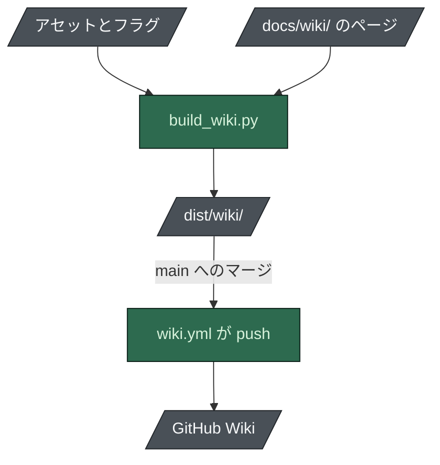

# Wiki の公開

[English](README-publishing.md) · **日本語**

このディレクトリのページは GitHub Wiki の**ソース**です。Wiki は別の git リポジトリ
(`<repo>.wiki.git`) で、どの CI も読みません。Wiki が腐るのはそのためです。

そこでリファレンスページは手で書きません。`scripts/build_wiki.py` がアセットから生成し、横にある
説明ページはそのままコピーします。



## ビルド

```bash
python scripts/build_wiki.py            # -> dist/wiki/
python scripts/build_wiki.py --check    # ビルドして検証: 表、リンク、テンプレートの目印
```

## 公開

**`main` へのマージごとに自動で。** `.github/workflows/wiki.yml` が Wiki を再ビルドして push し、
出力に差がなければ何もしません。パスフィルターは意図して付けていません: ビルダーはアセット、
スキャフォルダのフラグ集合、`benchmark.py` から導いた数字を読むので、実際の入力はリポジトリの
大半です。出力を比べる方法なら間違えようがありません。

`eval` ワークフローも毎回 Wiki をビルドするので、ページを壊す変更は Wiki に届く前に失敗します。

### 手で行う場合

```bash
python scripts/build_wiki.py
git clone https://github.com/nguyenhx2/agent-harness-bootstrap.wiki.git /tmp/ahb-wiki
cp dist/wiki/*.md /tmp/ahb-wiki/
cd /tmp/ahb-wiki && git add -A && git commit -m "docs: rebuild wiki from the repository" && git push
```

### 自動化ではできないこと

Wiki のリポジトリは、最初のページを GitHub の UI で作るまで存在しません。GitHub が API で公開して
いない一度きりの手作業です。このリポジトリでは済んでいます。フォークでは、ワークフローが push
できるようになる前に一度行う必要があります。

## Wiki の UI でページを編集しない

生成されたページは、次のマージでの次のビルドで上書きされます。元のアセット、または `docs/wiki/`
の説明ページのソースを変更してください。
