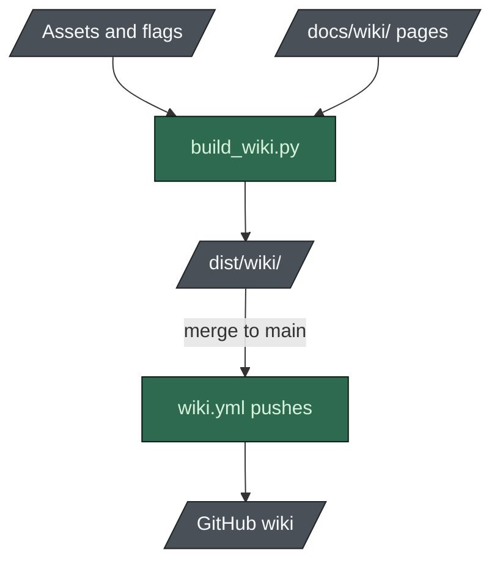

# Publishing the wiki

**English** · [日本語](README-publishing.ja.md)

The pages in this directory are the SOURCE for the GitHub wiki. The wiki is a separate git
repository (`<repo>.wiki.git`) that no CI reads, which is why wikis rot.

So the reference pages are never written by hand. `scripts/build_wiki.py` generates them from the
assets and copies the narrative pages beside them unchanged.



## Build

```bash
python scripts/build_wiki.py            # -> dist/wiki/
python scripts/build_wiki.py --check    # build and validate: tables, links, template markers
```

## Publish

**Automatically, on every merge to `main`.** `.github/workflows/wiki.yml` rebuilds the wiki and pushes
it, and is a no-op unless the output differs. There is no path filter on purpose: the builder reads
the assets, the scaffolder's flag set and figures derived from `benchmark.py`, so the real input set
is most of the repository. Comparing the output cannot be wrong.

The `eval` workflow also builds the wiki on every run, so a change that breaks a page fails before
it reaches the wiki.

### By hand, if you need to

```bash
python scripts/build_wiki.py
git clone https://github.com/nguyenhx2/agent-harness-bootstrap.wiki.git /tmp/ahb-wiki
cp dist/wiki/*.md /tmp/ahb-wiki/
cd /tmp/ahb-wiki && git add -A && git commit -m "docs: rebuild wiki from the repository" && git push
```

### One thing the automation cannot do

The wiki repository does not exist until its first page is created through the GitHub UI, a
one-time step GitHub does not expose over the API. It is done for this repo; a fork needs to do it
once before the workflow can push.

## Do not edit pages in the wiki UI

The next build, on the next merge, overwrites any generated page. Change the asset it comes from,
or the narrative source in `docs/wiki/`.
