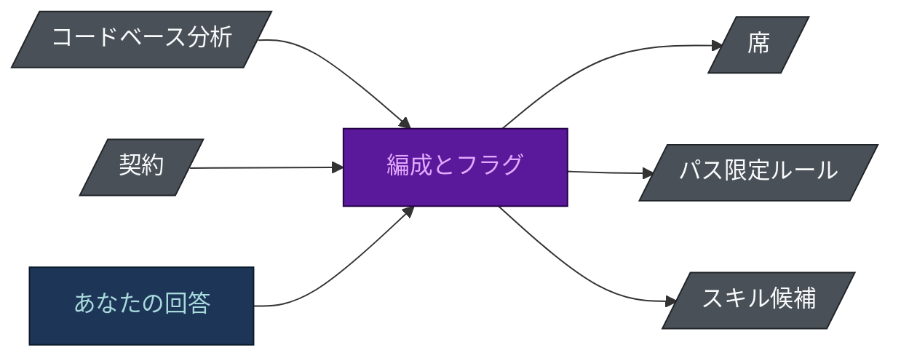
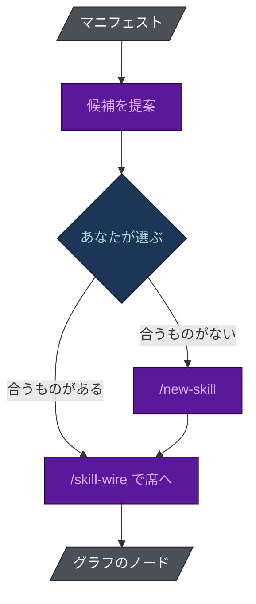

# テーラードビルド

[[English|Tailored-Build]] · **日本語**

`spec-builder` は契約で終わります。`harness-bootstrap` はコードベースから始まります。**その間の
ステップでチームが決まり**、ほとんどのエージェントキットにはこのステップがありません。

## 何に答えるのか

よくあるエージェントキットは全部を配ります。すべてのエージェント、百のスキル、すべてのルールと
フックを、誰かがコードベースを読む前にインストールします。その代償は見た目以上です:

- **すべてに対して、毎セッションでコンテキストを払う。** どのファイルにも一致しないルールは、
  すべてのリクエストにかかる税です。
- **持ち主のいない席が生まれる。** 誰も作業を振らないエージェントは、ルーティング表を読みにくく
  するだけの名前です。
- **助言が一般論になる。** どのリポジトリでも正しいガイダンスは、あなたのリポジトリで行動に移せる
  ほど具体的であることはまれです。
- **何が荷重を支えているか見えない。** すべてが入っていると、誰も安全に何かを取り除けません。

網羅性が適合性と取り違えられています。お金を払う価値があるのは適合性だけです。

## 何が何を決めるか

編成は証拠から決まり、それ以外からは決まりません。契約が示す作るべきもの、コードベースの分析が
見つけたもの、そしてあなたにしか出せない回答です。



| 何から決まるか | 何を決めるか |
|---|---|
| 実在するモジュール | モジュールごとに dev エージェントを一つ、実在するパスに限定して。モジュールがなければ席もない。 |
| リポジトリの目的 | コード、調査、戦略、ドキュメント、任意の組み合わせ。調査リポジトリには `researcher` と `checker`、ドキュメントリポジトリには `writer` と `checker` が付き、どちらにもテストスイートやコードレビューのゲートは付きません。 |
| 契約とあなたの回答 | 18 の席のどれを埋めるか。一回の実行でインストールされるのは **18席のうち3〜17席** で、既定で全部が入ることはありません。 |
| リポジトリ内のマニフェスト | どのスキルを提案するか。その候補からあなたが選びます。 |
| 実在するパス | どのルールをパス限定にするか。ルール本文の大半を既定のセッションの外に置けるのはこのためです。 |

## 数字は主張ではなく測定

最も軽い回答では 3 席 (ドキュメントや調査のリポジトリ) です。データベース、テスト、長期
プロジェクトのあるコードリポジトリでは 17 席になります。

`scripts/check_numbers.py` はこの範囲を、エージェントを左右するフラグの全組み合わせについて
**スキャフォルダ自身の選択関数**で計算します。実際の実行とずれることはありません。どのエージェントを
フラグで左右するかを変えると、範囲を引用している箇所 (このページを含む) はすべて、直すまで失敗します。

## 発見と配線は別の問題



- **スキル発見 (Skill Discovery)** - 読んだことのないカタログからは選べません。このプロジェクトの
  マニフェスト (Python、Ruby、.NET、Java と Kotlin、JavaScript、モノレポの目印) を読んでスタックを
  割り出し、それから提案します。マーケットプレイスは情報源であって権威ではありません。あなたが
  選ばない限り、何もインストールされません。
- **`/new-skill`** - 繰り返し発生するワークフローに合うものがないとき、まずプロジェクトスキルに
  値するかを判断し (断るのも普通の結果です)、それからスキャフォールドして `skill-check.py` で
  検査します。
- **`/skill-wire`** - インストール済みは到達可能と同じではありません。スキルを、それを使う席や
  コマンドに接続し、その接続を文書の慣習ではなくグラフのノードとして記録します。

配線がノードなので、`harness-view` はどのスキルが配線済みで、どれがディスクにあるだけかを示し、
`assess` はその差を所見として報告します。

## 検証できる

持ち主のいない席、誰も使えと言われていないスキル、どのファイルにも一致しないルールは、どれも
コストです。`harness-view assess` は三つとも名指しします:

```bash
harness-view assess .
```

「テーラード」は誰でも README に書ける言葉です。*18席のうち3〜17席、そしてモジュールのない席には
所見が出る* は、検証できることです。

## 関連

- [[Flag Reference]] - 各回答が何を有効にするか
- [[Agent Reference]] - 席と、それぞれがいつインストールされるか
- [[Harness View|Harness-View-ja]] - 採点エンジン
