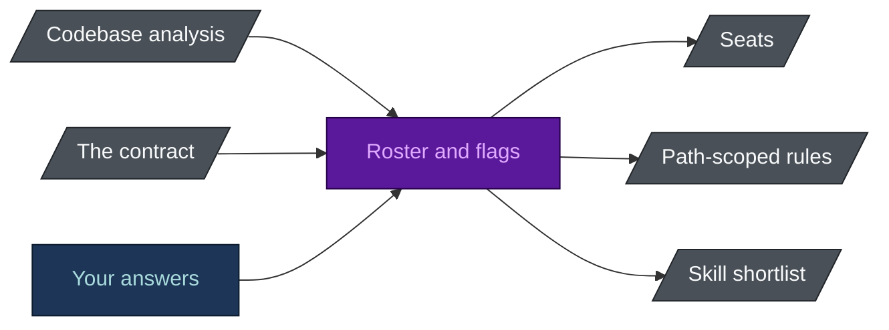
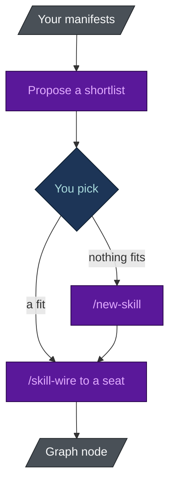

# Tailored Build

**English** · [[日本語|Tailored-Build-ja]]

`spec-builder` ends with a contract. `harness-bootstrap` begins with a codebase. **The step between
them is where the team gets decided**, and most agent kits do not have that step at all.

## The problem it answers

The usual agent kit ships everything - every agent, a hundred skills, every rule and hook -
installed before anyone has read the codebase. That costs more than it looks:

- **You pay context for all of it, in every session.** A rule that matches no file in your repo is
  a tax on every request.
- **Seats end up with no owner.** An agent nobody routes work to is a name that makes the routing
  table harder to read.
- **The advice goes generic.** Guidance true in any repository is rarely specific enough to act on
  in yours.
- **Nothing is visibly load-bearing.** When everything is installed, nobody can safely remove
  anything.

Completeness gets mistaken for fit. Only fit is worth paying for.

## What decides what

The roster comes from evidence and nothing else: what the contract says must be built, what the
codebase analysis found, and the answers only you can give.



| Decided from | What it decides |
|---|---|
| The modules that actually exist | One dev agent each, scoped to real paths. No module, no seat. |
| The repo's purpose | Code, research, strategy or docs, in any combination. A research repo gets `researcher` and `checker`, a docs repo `writer` and `checker`, and none of them gets a test suite or a code review gate. |
| The contract and your answers | Which of the 18 seats are filled. A run installs **3 to 17 of the 18 seats**, never all of them by default. |
| The manifests in your repo | Which skills are proposed. You choose from that shortlist. |
| The paths that exist | Which rules are path-scoped, which keeps most rule content out of the default session. |

## The numbers are measured, not claimed

The leanest answers give 3 seats (a documentation or research repo). A code repo with databases,
tests and a long-lived project gives 17.

`scripts/check_numbers.py` computes that range with the **scaffolder's own selection function**,
over every combination of the flags that gate an agent, so it cannot drift from a real run. Change
which agents are gated and every place that quotes the range, this page included, fails until it is
updated.

## Discovery and wiring are two problems



- **Skill Discovery** - you cannot choose from a catalogue you have never read. It reads this
  project's manifests (Python, Ruby, .NET, Java and Kotlin, JavaScript, monorepo markers), works out
  the stack, and only then proposes. Marketplaces are a source, not an authority. Nothing installs
  unless you pick it.
- **`/new-skill`** - when nothing fits a recurring workflow, it first decides whether the workflow
  earns a project skill at all (refusing is normal), then scaffolds one and lints it with
  `skill-check.py`.
- **`/skill-wire`** - installed is not reachable. It connects a skill to the seat or command that
  will use it and records that as a node in the graph, not a convention in a document.

Because the wire is a node, `harness-view` shows which skills are wired and which merely sit on
disk, and `assess` reports the difference as a finding.

## It is checkable

A seat nobody owns, a skill nobody is told to use and a rule that matches no file are all costs.
`harness-view assess` names all three:

```bash
harness-view assess .
```

"Tailored" is a word anyone can put in a README. *Three to seventeen of eighteen, and a finding when
a seat has no module* is something you can check.

## See also

- [[Flag Reference]] - what each answer turns on
- [[Agent Reference]] - the seats and when each is installed
- [[Harness View]] - the scoring engine
