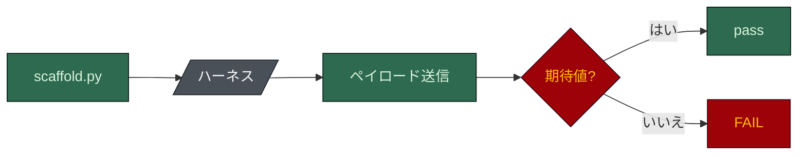

# eval

[English](README.md) · **日本語**

## 結果

`python eval/guardrail_eval.py` -> **290/290 正解 (must-block 123、must-allow 167)。**

`--flavor ps1` を付けると同じペイロードを `.ps1` フックにも流し、両方の種類で **580/580** です。
CI は両方を実行します。

ガードレールはフックと `settings.json` の拒否ルール、つまりシェルスクリプト、終了コード、glob の
一致です。モデルには問い合わせないので、結果がモデルに左右されることはありません。

## 実行の流れ



1. **スキャフォールド。** フックの種類ごとに一つのハーネスを、`guardrail_eval.py` 冒頭の `VARS`
   ブロックのフラグで `.eval-workdir/` に生成します。
2. **撃つ。** 各ケースは本物の生成フックにペイロードを送るか、`scaffold.py`、`harness-toggle.py`、
   `verify-plan.py` を直接実行し、終了コードを確かめます。終了コードだけでは「判断したフック」と
   「クラッシュしたフック」を区別できないので、多くのケースはファイルの状態や出力も確かめます。
3. **両側から。** どのブロッキングフックにも must-block と must-allow のケースがあります。すべてを
   ブロックするガードは結局オフにされるので、良い作業を通すことも、悪い作業を止めることと同じ厳しさで
   試します。

### この数字が測っているもの

現在の `VARS` は `posix`、`ui`、`db`、`ai`、`ddd`、`tests`、`unit`、`e2e`、`long`、`pr_cli`、`rtk`、
`target_cursor`、`hooks_strict` です。つまり件数には strict フック、長期セッションのフック、
マイグレーションのガードが含まれます。既定のインストールはこれより少ないフックを持ち、strict 系で
既定で入るのは `guard-destructive` だけです。それは `hooks_strict` なしで生成したハーネスで専用の
スイートが確かめています。調査とドキュメントの目的は実行の中で別のハーネスを生成します。`VARS` に
加えると、他のスイートが頼る編成が変わるためです。

"290/290" は「このフラグ集合で 290/290」と読み、すべてのインストールの性質とは読まないでください。

### どのインタプリタがフックを実行するか

- **`.sh` フック**は Windows では Claude Code と同じく Git Bash で実行します。そこで素の `bash` を
  呼ぶと System32 の WSL ランチャーに解決され、別の userland で `/mnt/c` に対して動きます。
- **`.ps1` フック**は Windows では生成された設定が呼ぶ `powershell` (Windows PowerShell 5.1) で、
  それ以外では `pwsh` で実行します。5.1 はパイプしたペイロードにバイトオーダーマークを付け、実際の
  Windows セッションで検証台帳を止めていました。`pwsh` で走る eval は緑のままでした。v1.20.1 で
  修正済みです。

## 何を確かめているか

| ハーネスが防ぐもの | 強制しているもの |
|---|---|
| `.env`、秘密鍵、`.npmrc`、`~/.ssh/` の読み取り | `protect-secrets` フック + 拒否ルール |
| Restricted なデータパスの読み取り | `settings.json` の `permissions.deny` |
| 既定ブランチへの直接のコミット (git のグローバルオプション付きも含む) | `guard-main-commit` |
| Conventional Commits に従わない、または AI の帰属表示を含むコミットメッセージ | `check-commit-msg` |
| 承認済み ADR の編集 | `protect-adr` |
| 編成外のエージェントのスポーン、席のモデルの格上げ、タスクを示さない書き込み可能なディスパッチ | `guard-agent-spawn` |
| 台帳が合格と示すゲートの再実行、三回目のレビュー、同一の指示、予算超過のディスパッチ | `.claude/state/verify-ledger.jsonl` を読む `guard-agent-spawn` |
| ボードの行の手編集、依頼の記録がないタスクファイル | `guard-board`、`guard-task-scope` |
| リポジトリのルートやホームへの `rm -rf`、保護ブランチへの force push、`git reset --hard` | `guard-destructive` |
| 大きなファイル、未知のホストへのアップロード、ロックファイルの手編集、プロンプト内のシークレット、ガードを止める設定変更、証拠のない「完了」 | `hooks_strict` のセット |
| 既定ブランチにすでにあるマイグレーションの編集 | `guard-migration` (フラグ `db`) |
| 同じ失敗する呼び出しの繰り返し | `retry-budget` (フラグ `long`) |
| 決して発火しないフックの登録 (不正な `if`、ツールを外すマッチャー) | `settings.json` を読むフック契約のスイート |
| 確認フレーズを入力せずに保護を無効化すること (大文字小文字を問わず) | `harness-toggle.py`、終了コード 2 |
| トグルの項目名でのパストラバーサル、壊れた `.claude/disabled.json` での操作 | `harness-toggle.py`、`scaffold.py`、終了コード 1 |
| 未知または矛盾するフラグの組、OS フラグと食い違うランナー | `scaffold.py` の `validate_flags()`、終了コード 1 |
| `Edit`/`Write` を持つレビュー席、階層と食い違う席のモデル、存在しないファイルの引用 | `scaffold.py` の席のチェック |
| 差分が必要としないゲート、または必要なのに飛ばしたゲート | `verify-plan.py` のスイート |

不正なペイロードでフックがクラッシュしないことも確かめます。クラッシュしたフックはかつて開く側に
倒れ (fail open)、守っているように見えて何も守っていませんでした。この eval はそれを二度捕まえて
います (`jq` がないとき、WSL 上)。v1.20.1 からはブロッキングフックが `onFailure: "block"` も
登録します。

## スイートが信頼に値する理由

一度も失敗したことのないケースは、その裏のチェックについて何も証明しません。いくつかはミューテーション
テストしています。使い捨てのコピーでガードを壊し、再実行し、ケースが赤くなるのを見る:

- `validate_flags()` から未知のフラグのチェックを外すと、`posx` のペイロードが有効なものとして
  スキャフォールドされた。
- 壊れた台帳で `read_disabled()` が `[]` を返すようにすると、本物のフックが隔離された。
- `parse_item()` から `..` の拒否を外すと、リポジトリのルートの `AGENTS.md` が
  `.claude/disabled/rules/` に移動した。トラバーサルのチェックだけが、トグルとハーネス外の本物の
  ファイルの間に立っている。
- `guard-main-commit` のブランチ判定を常に一致させると、フィーチャーブランチでの must-allow の
  ケースが失敗した (期待 0 に対し終了コード 2)。

ケースを書くことで本物のフックのバグも見つかっています。たとえば `agent-history.sh` は、他のフックが
すべて行うドライブレターの変換を飛ばしていたため、Windows の bash で文字どおりの `C:/` フォルダに
アーカイブしていました。

## この eval が扱わないもの

測るのは下限 (安いモデルに何をさせないか) で、上限 (安いモデルでも良い仕事ができるか) ではありません。

`benchmark/model_cost.py` によれば、1 機能のコストは既定の編成で約 $2.39、すべて Haiku の編成で
$0.61 です。Haiku の機能が出荷に値するかは分からず、このリポジトリの何をもってしても分かりません。
その問いが、ハーネスが戦略なのか (良いハーネスなら安いモデルで十分になる)、コスト最適化にすぎない
のか (やはりモデルの質が支配する) を決めます。

答えるには、実際のタスク、ルーブリック、API キー、そしてあなたのリポジトリが必要です:

1. **既知の良い結果を持つ課題タスク**: 根本原因が分かっているバグ、受け入れ基準の固まった機能、
   欠陥を仕込んだ差分。
2. **各タスクを複数の編成で実行**します (既定、Sonnet のみ、Haiku のみ)。変えるのはモデルだけです。
3. **ルーブリックで採点**します。レビュアーなら仕込んだ欠陥の再現率、dev の席なら満たした基準。
4. **差を報告**します。差がゼロのところも含めて。

これは作られていません。[`../docs/ASSESSMENT.ja.md`](../docs/ASSESSMENT.ja.md) の残作業の一覧に
あります。

## 実行方法

```bash
python eval/guardrail_eval.py                # 人が読む形式、.sh フックのみ
python eval/guardrail_eval.py --json         # 機械が読む形式、失敗が一つでもあれば終了コード 1
python eval/guardrail_eval.py --flavor ps1   # .ps1 フックも実行 (powershell か pwsh が必要)
KEEP_EVAL_WORKDIR=1 python eval/guardrail_eval.py   # 調べるために .eval-workdir/ を残す
```

`bash` と `git` が必要です。`powershell` も `pwsh` もなければ、`.ps1` の工程は注記付きで飛ばされ、
`.sh` の結果だけで合格します。同時に二つ走らせるときは、`HARNESS_EVAL_WORKDIR` を別々のディレクトリに
してください。そうしないと互いのハーネスを途中で消し合います。
