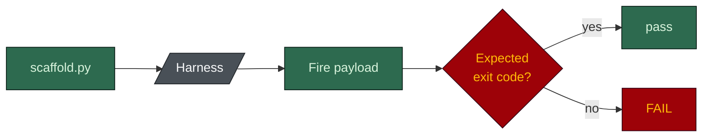

# eval

**English** · [日本語](README.ja.md)

## Result

`python eval/guardrail_eval.py` -> **290/290 correct (134 must-block, 178 must-allow).**

With `--flavor ps1` the same payloads also run through the `.ps1` hooks, for **624/624** across both
flavours. CI runs both.

The guardrails are hooks and `settings.json` deny rules: shell scripts, exit codes and glob matching.
No model is consulted, so the result cannot depend on the model.

## How it runs



1. **Scaffold.** One harness per flavour, into `.eval-workdir/`, with the flags in the `VARS` block
   at the top of `guardrail_eval.py`.
2. **Fire.** Each case sends a payload to a real generated hook, or runs `scaffold.py`,
   `harness-toggle.py` or `verify-plan.py` directly, and checks the exit code. Many cases also
   check file state or output, because an exit code alone cannot tell a hook that decided from one
   that crashed.
3. **Both sides.** Every blocking hook has a must-block and a must-allow case. A guard that blocks
   everything gets switched off, so letting good work through is tested as hard as stopping bad work.

### What the figure measures

Today `VARS` is `posix`, `ui`, `db`, `ai`, `ddd`, `tests`, `unit`, `e2e`, `long`, `pr_cli`, `rtk`,
`target_cursor` and `hooks_strict`. So the count includes the strict hooks, the long-session hooks
and the migration guard. A default install ships fewer hooks; `guard-destructive` is the one
strict-class guard it ships by default, and its own suite proves that on a harness scaffolded
without `hooks_strict`. The research and docs purposes get their own scaffolds inside the run,
because adding them to `VARS` would change the roster the other suites rely on.

Read "290/290" as "290/290 on this flag set", never as a property of every install.

### Which interpreter runs the hooks

- **`.sh` hooks** run through Git Bash on Windows, as Claude Code does. A bare `bash` there resolves
  to the WSL launcher in System32, which runs the hook in a different userland against `/mnt/c`.
- **`.ps1` hooks** run under `powershell` (Windows PowerShell 5.1) on Windows, because that is what
  the generated settings call, and under `pwsh` elsewhere. 5.1 prefixed piped payloads with a
  byte-order mark that switched the verification ledger off in real Windows sessions while an eval
  under `pwsh` stayed green. That was fixed in v1.20.1.

## What it covers

| The harness prevents | Enforced by |
|---|---|
| Reading `.env`, private keys, `.npmrc`, `~/.ssh/` | `protect-secrets` hook + deny rules |
| Reading Restricted data paths | `settings.json` `permissions.deny` |
| Committing straight to the default branch, git global options included | `guard-main-commit` |
| A non-conventional commit message, or an AI-attribution trailer | `check-commit-msg` |
| Editing an Accepted ADR | `protect-adr` |
| Spawning an off-roster agent, escalating a seat's model, or a write-capable dispatch naming no task | `guard-agent-spawn` |
| Re-running a gate the ledger shows passed, a third review round, an identical brief, a dispatch past budget | `guard-agent-spawn` reading `.claude/state/verify-ledger.jsonl` |
| Hand-editing a board row, or a task file with no recorded request | `guard-board`, `guard-task-scope` |
| `rm -rf` on the repo root or home, a force push to a protected branch, `git reset --hard` | `guard-destructive` |
| Large files, uploads to unknown hosts, hand-edited lockfiles, secrets in a prompt, a settings change that switches a guard off, an evidence-free "done" | the `hooks_strict` set |
| Editing a migration already on the default branch | `guard-migration` (flag `db`) |
| The same failing call repeated | `retry-budget` (flag `long`) |
| A hook registration that never fires (a malformed `if`, a matcher that misses its tool) | the hook-contract suite, reading `settings.json` |
| Disabling a protection without the typed confirmation phrase, in any letter case | `harness-toggle.py`, exit 2 |
| Path traversal in a toggle item name, or acting on a corrupt `.claude/disabled.json` | `harness-toggle.py`, `scaffold.py`, exit 1 |
| An unknown or contradictory flag set, or a runner that contradicts the OS flag | `scaffold.py` `validate_flags()`, exit 1 |
| A review seat holding `Edit`/`Write`, a seat model that contradicts its tier, a citation to a missing file | `scaffold.py` seat checks |
| A gate the diff does not need, or a skipped one it does | `verify-plan.py` suite |

It also checks that a malformed payload does not crash a hook. A hook that crashes used to fail open,
which looks like protection and provides none; this eval caught that twice, once with `jq` absent
and once under WSL. Since v1.20.1 the blocking hooks also register `onFailure: "block"`.

## How the suite earns trust

A case that has never failed proves nothing about the check behind it. Several were mutation-tested:
break the guard in a throwaway copy, re-run, watch the case go red.

- Removing the unknown-flag check in `validate_flags()` let a `posx` payload scaffold as if valid.
- Making `read_disabled()` return `[]` on a corrupt ledger let a real hook be quarantined.
- Removing the `..` rejection from `parse_item()` moved the repo-root `AGENTS.md` into
  `.claude/disabled/rules/`. The traversal check is the only thing between a toggle and a real file
  outside the harness.
- Forcing `guard-main-commit`'s branch check to always match failed the must-allow case on a
  feature branch, exit 2 against a wanted 0.

Writing cases has also found real hook bugs, for example `agent-history.sh` archiving into a literal
`C:/` folder under Windows bash because it skipped the drive-letter conversion every other hook does.

## What this eval does not cover

It measures the floor (what a cheap model is prevented from doing), not the ceiling (whether a
cheaper model still does good work).

`benchmark/model_cost.py` says a feature costs about $2.39 on the default roster and $0.61 on an
all-Haiku one. It cannot say whether the Haiku feature is worth shipping, and nothing here can.
That question decides whether the harness is the strategy (a good harness makes a cheap model
acceptable) or only a cost optimisation (model quality still dominates).

Answering it needs real tasks, rubrics, an API key and your own repo:

1. **Fixture tasks** with known-good outcomes: a bug with a known root cause, a feature with settled
   criteria, a diff with a planted defect.
2. **Run each task** at several roster profiles (default, Sonnet-only, Haiku-only), varying only the
   models.
3. **Score against a rubric**: recall on planted defects for a reviewer, criteria passed for a dev
   seat.
4. **Report the gap**, including where it is zero.

This is not built. It is on the remaining-work list in
[`../docs/ASSESSMENT.md`](../docs/ASSESSMENT.md).

## Running it

```bash
python eval/guardrail_eval.py                # human-readable, .sh hooks only
python eval/guardrail_eval.py --json         # machine-readable, exit 1 on any failure
python eval/guardrail_eval.py --flavor ps1   # ALSO run the .ps1 hooks (needs powershell or pwsh)
KEEP_EVAL_WORKDIR=1 python eval/guardrail_eval.py   # leave .eval-workdir/ on disk to inspect
```

It needs `bash` and `git`. Without `powershell` or `pwsh`, the `.ps1` pass is skipped with a note and
the run still passes on the `.sh` results. Two runs at once need separate `HARNESS_EVAL_WORKDIR`
directories, or each deletes the other's harness mid-run.
