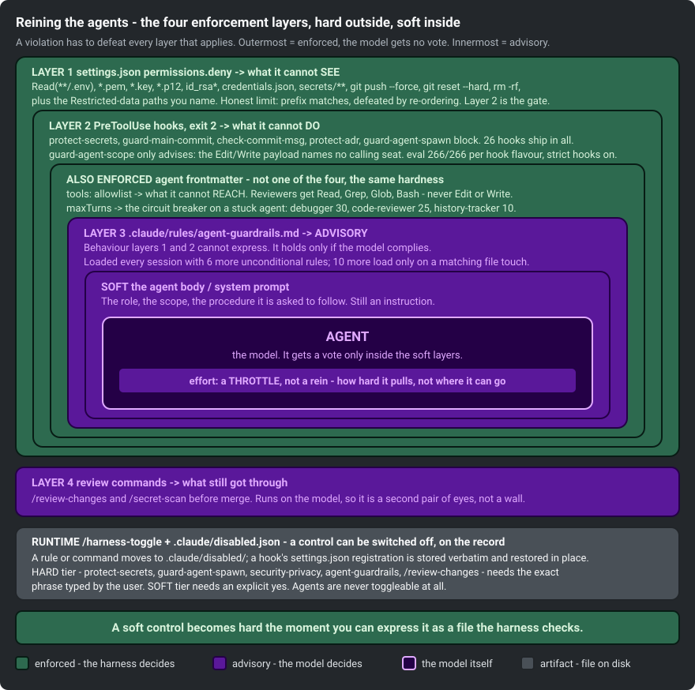
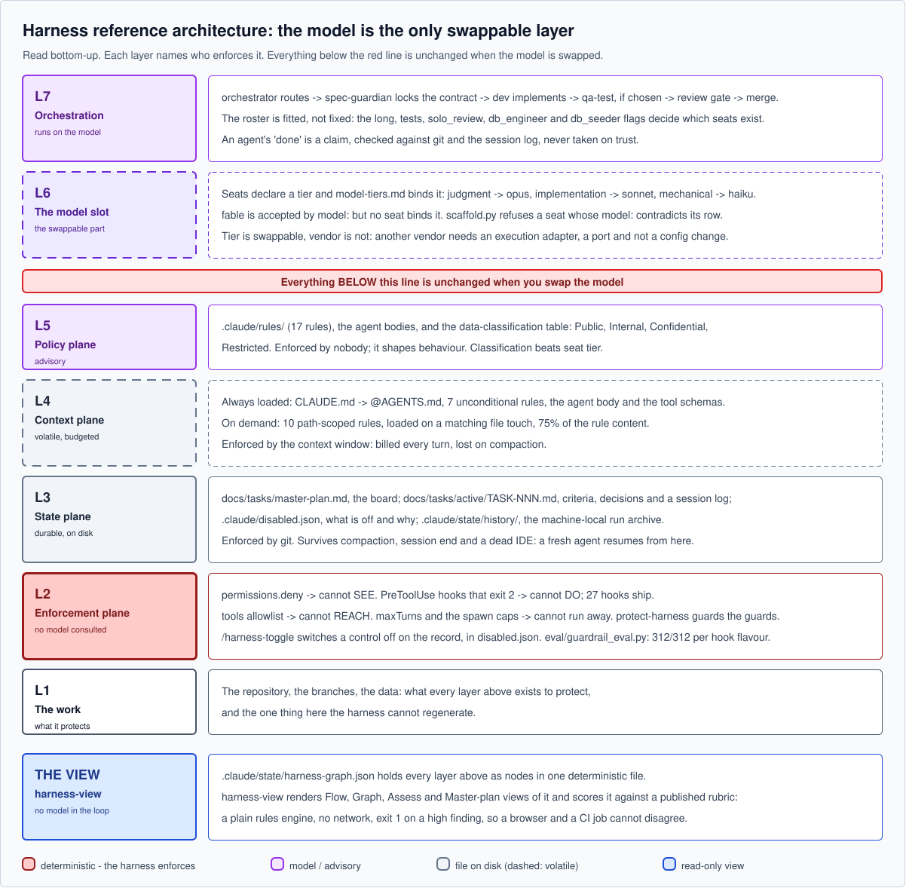

# Control surfaces, ranked by hardness

What matters is **enforced** versus **advisory**. This page says which of the harness's controls are
which; the quality gate and `docs/CONTEXT-MANAGEMENT.md` cite it.

## Enforced: the model does not get a vote

| Control | Where | What it stops |
|---|---|---|
| `permissions.deny` in `settings.json` | `Read(**/.env)`, `Read(**/*.pem)`, `Read(**/secrets/**)`, `Bash(git push --force:*)`, `Bash(rm -rf:*)`, plus a `{{RESTRICTED_DENIES}}` slot at the head of the list | What the agent cannot even **see**. The action never reaches a tool call |
| **PreToolUse hooks**, exit code 2 | `protect-secrets`, `guard-destructive`, `protect-harness`, `guard-main-commit`, `check-commit-msg`, `protect-adr` | What the agent cannot **do**: read a `.env`, commit to `main`, ship a non-conventional commit message, edit an ADR whose on-disk status is `Accepted` |
| `tools:` allowlist in agent frontmatter | e.g. `code-reviewer` and `security-reviewer` get `Read, Grep, Glob, Bash` | What the agent cannot **reach**. The frontmatter makes "reviewers do not edit" structural |
| `disallowedTools` in agent frontmatter | `Edit, Write, NotebookEdit` on every read-only seat | The same boundary stated twice, so a later grant to `tools:` cannot turn a judge into an author |
| `maxTurns` | e.g. `history-tracker: maxTurns: 10` | The circuit breaker. `cost-model.md`: *"the cost of a stuck agent is unbounded"* |
| Spawn caps in `settings.json` `env` | `CLAUDE_CODE_MAX_SUBAGENT_SPAWN_DEPTH=2`, `CLAUDE_CODE_MAX_CONCURRENT_SUBAGENTS=4` | How deep and wide delegation goes. Main session, orchestrator, seat - the runtime withholds `Agent` from a third layer, whatever a prompt says |
| `scaffold.py` seat checks | every `.claude/agents/*.md` | At scaffold time: a seat without `tools`, `model`, `effort` or `maxTurns`, a second seat holding `Agent`, a review seat with Edit, Write or `memory:`, or a `bypassPermissions` seat fails the run |

`eval/guardrail_eval.py` scaffolds a harness (the `hooks_strict`, `long` and `db` flags on; `VARS`
names the set) and fires its must-block and must-allow payloads at it, **all judged correctly**. Its
case count lives in `CASES_PER_FLAVOR`, asserted on every run - not in this sentence. Its header:

> `A cheap model cannot commit a secret. It cannot commit straight to main. It cannot edit an accepted
> ADR. It cannot ship an AI-attribution trailer. Not because it knows better, but because the hook
> exits 2 and the tool call never happens.`

The guardrails are shell scripts; no model is consulted. **The safety floor is model-independent.**

**The files the enforced layer lives in are enforced too.** `protect-harness` asks the user before
an agent edits `.claude/settings.json`, `.claude/settings.local.json` or anything under
`.claude/hooks/`, and refuses a shell command that writes there. Without it, a guard is one
`echo >> .claude/hooks/...` away from `exit 0`; verified live in Claude Code, in
`bypassPermissions` mode that write went through without the hook and was refused with it. The
README's [Security by design](../../README.md#security-by-design) section draws all of this as five
layers.

## Advisory

- **Rules in `.claude/rules/`.** Context, not configuration - Claude Code's docs: rules *"shape
  Claude's behaviour but are not a hard enforcement layer"*. They make the right thing likely, not
  the wrong thing impossible.
- **The agent body / system prompt.** Instruction, which can be outweighed, lost to compaction, or
  not followed.
- **`effort:`** is a **throttle**, not a control: how hard the model pulls, not where it may go.
  `cost-model.md`: *"Do not starve a judgment seat to save money."* Lowering it on an untrusted
  agent makes it worse, not safer.
- **Hooks that cannot see who is calling them.** `guard-agent-scope` would block a write to a module
  another seat owns, but the `PreToolUse` payload for `Edit|Write` names no calling subagent, so it
  advises instead - see its header and `assets/claude/hooks/README.md`.

Rules are one of four layers (the quality gate in `SKILL.md` names them), never a substitute for
the other three.

## The runtime band: switching a control off

Every control above can be switched off, deliberately - a guardrail nobody can remove gets routed
around. Removal is *recorded and graded* by `harness-toggle.py` and the viewer's `POST /toggle`:

| Tier | What is in it | What it costs to disable |
|---|---|---|
| **HARD** | `protect-secrets`, `guard-agent-spawn`, `protect-harness` hooks; `security-privacy`, `agent-guardrails` rules; `/review-changes`; the `orchestrator` and reviewer seats | the literal phrase `disable <name>`, compared byte for byte |
| **SOFT** | `guard-main-commit`, `check-commit-msg`, `protect-adr`; `ai-governance`; **every** agent seat | an explicit acknowledgement (`--yes` / `confirm_soft`) |
| unlisted | everything else | nothing beyond the record |

The phrase gates *authorship*, not knowledge. In the CLI the model may relay it only if the user
typed it, and never composes it; in the browser no model is in the loop, so the human typing it **is**
the gate. Enabling is never gated.

Nothing is deleted. Files move to `.claude/disabled/<kind>/`, a hook's `settings.json` registration
is stored verbatim with its position, and `.claude/disabled.json` is committed - the team sees what
was switched off and why, a scaffold re-run does not resurrect it, and `reapply` repairs a tree
where something came back. **A disabled control is a decision with a name on it.**

Weaker, and labelled so: switching off a single *step* inside a command (the viewer's step editor)
comments it out of the file. The rendered procedure drops it and the intent is recorded, but a model
reading the raw file still sees the text - a reversible edit, not a boundary. The boundary is the
file-level toggle.

## Turning an advisory control into an enforced one

A soft control becomes hard when it can be expressed as a file the harness checks: find the tool
call the violation is shaped like, and intercept it.

"Never commit to main" exists twice on purpose: as prose in `AGENTS.md` (advisory, so the agent knows
why) and as `.claude/hooks/guard-main-commit.sh`, which parses the `Bash` call, resolves the target
dir from any `cd` or `git -C`, checks the effective branch, and **exits 2** (enforced).

`docs/ASSESSMENT.md` walks the same move for data classification. `model-policy.md` is advisory, but
Restricted data lives at *known paths*, and `permissions.deny` on `Read(<those paths>)` means the
agent never obtains it - so no model on any provider can leak it, whether or not it read the rule.

## What could not be made hard

- **Model routing is still advisory.** Nothing stops an agent from putting Confidential-but-readable
  text into a prompt to a model the policy table does not permit: *"There is no tool call shaped
  like 'sent this text to that provider', so there is nothing for a hook to intercept."* No
  interceptable event, no hook.
- **Data the org cannot locate.** Restricted material with no nameable path is outside the deny
  list, and the classification table is advice. The intake forces that admission - *"but an
  admission is not a control."*

From `ASSESSMENT.md`: **this repo enforces model sovereignty at the data boundary, and governs it by
rule everywhere else.**

## The model as a layer

The memory hierarchy (`docs/CONTEXT-MANAGEMENT.md`, section 1) and this ranking are two views of one
stack.

Bottom-up: the work, then the enforcement plane (thickest - shell scripts and glob matching, no
model), the state plane (markdown in git), the context plane (the volatile window), the policy plane
(advice), and only then the **model** slot, with the seat-tier bindings (`judgment -> opus`,
`implementation -> sonnet`, `mechanical -> haiku`) drawn as replaceable contents.

**Every layer beneath the slot is model-agnostic.** Swap the tier bindings and the deny list, hooks,
tool grants, `maxTurns`, board, task files and run archive stay byte-for-byte the same.

The caveat (`docs/ASSESSMENT.md` Gap 2): **model tier is swappable; model vendor is not.** `model:`
takes `opus | sonnet | haiku | fable`, a full `claude-*` ID, or `inherit` - all Anthropic models - so
a self-hosted or third-party model is a **port**, not a config change; there is no execution
adapter. The tier table is not a generator either: each agent file names its own `model:`, so a tier
swap is a table edit AND a frontmatter sweep. `scaffold.py` refuses a harness whose seat `model:`
contradicts its `model-tiers.md` row, so the sweep cannot be left half done.

## Sources

`assets/claude/settings.json` (deny rules) · `assets/claude/hooks/` + `hooks/README.md` (the
PreToolUse hooks and contract) · `assets/claude/rules/agent-guardrails.md` (the always-loaded
guardrails) · `assets/claude/rules/model-policy.md` (the data-classification table) ·
`eval/guardrail_eval.py` (the payload suite) · `docs/ASSESSMENT.md` (enforced vs advisory, and why
model routing cannot be hooked) · `docs/CONTEXT-MANAGEMENT.md` (the memory hierarchy).
