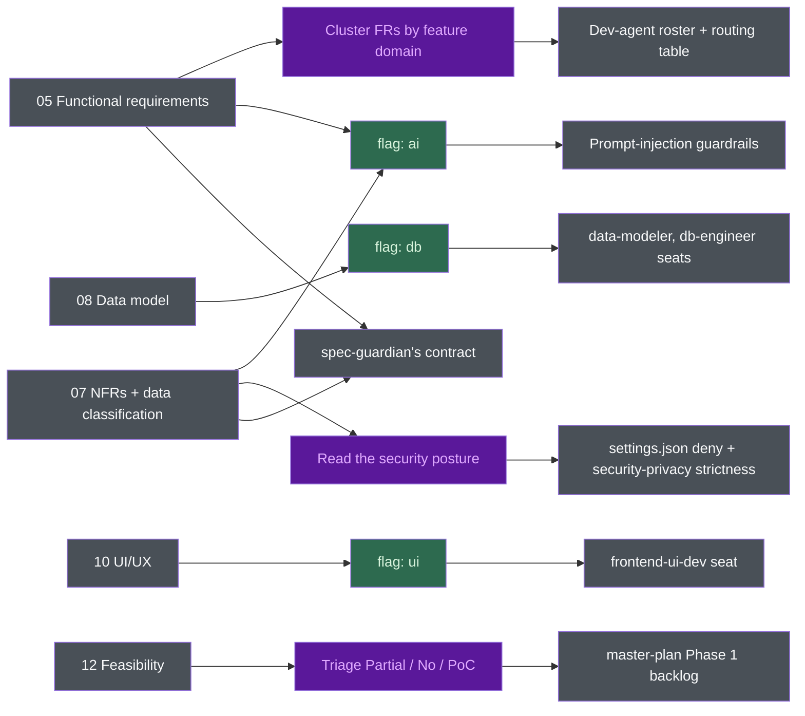

# BA standards - what this structure follows, why, and what it feeds

Part 1: which body of practice each section comes from. Part 2: why this shape. Part 3: how
`harness-bootstrap` consumes the output.

**This is an opinionated synthesis, not a certified implementation of any single standard.** No
auditor will accept it as evidence of conformance. It borrows the *content model* of the
requirements-engineering standards, the *quality-attribute taxonomy* of ISO/IEC 25010, the
*elicitation and traceability discipline* of BABOK, and the *security verification posture* of OWASP.
Where a section follows a standard, Part 1 says which; where the structure is a choice made here, it
says "synthesis" and Part 2 argues for it. Never overclaim a citation.

## Standards cited in this document

**Verified: 2026-07-14** against the publisher's catalogue page or project site. ISO and IEEE are
paywalled: edition, title and scope were verified against the ISO/IEC catalogue and IEEE Xplore; the
normative text was **not** read, so clause-level detail is a summary, not a quotation.

| Standard | Edition used here | Status | Scope |
|----------|-------------------|--------|-------|
| ISO/IEC/IEEE 29148 | 2018 | Current | Requirements engineering across the life cycle: elicitation, analysis, specification, validation. Defines the SRS content model and the characteristics of a well-formed requirement |
| IEEE 830 | 1998 | **Superseded** by ISO/IEC/IEEE 29148:2011, updated 2018. Still widely used because it is shorter | The SRS document itself: structure, content, and quality characteristics (unambiguous, complete, verifiable, modifiable, traceable, among others) |
| ISO/IEC 25010 | 2023 (2nd ed.) | Current | Product quality model. Nine characteristics. The 2023 edition renamed *usability* to *interaction capability* and *portability* to *flexibility*, and added *safety* |
| BABOK Guide | v3 (IIBA) | Current | Six knowledge areas, including Elicitation and Collaboration, and Requirements Life Cycle Management (traceability, baselining, approval) |
| MoSCoW | DSDM / Agile Business Consortium | Current practice | Prioritisation: Must / Should / Could / Won't. Devised by Dai Clegg (Oracle, 1994), donated to the DSDM Consortium |
| Use cases | Cockburn, *Writing Effective Use Cases* (2001) | Established practice | Primary actor, preconditions, guarantees, main success scenario, extensions |
| User stories + Gherkin | Connextra story format; Gherkin (Cucumber) | Established practice | "As a &lt;role&gt;, I want &lt;capability&gt;, so that &lt;benefit&gt;"; Given / When / Then acceptance criteria |
| C4 model | Simon Brown | Established practice | Context, container, component, code. Only the **context** level is used here |
| arc42 | Current template | Established practice | Architecture documentation template. Only the **context and scope** section is echoed here |
| OWASP ASVS | 5.0.0 (2025-05-30) | Current | Application security verification requirements |
| OWASP Top 10 for LLM Applications | 2025 edition | Current | `LLM01:2025` Prompt Injection, `LLM05:2025` Improper Output Handling, `LLM06:2025` Excessive Agency, and the rest |

For OWASP, `harness-bootstrap/assets/claude/rules/security-privacy.md` is the version of record; if
the two disagree, that rule file wins.

## Part 1 - Which standard each section draws on

| # | Section | What it is | Draws on | Why it exists |
|---|---------|-----------|----------|---------------|
| 01 | Overview | Context, problem, goals, non-goals, scope, success metrics, system context diagram | 29148 (the SRS "purpose / scope / product perspective" front matter); C4 level 1 and arc42 "context and scope" for the one diagram; BABOK *Strategy Analysis* for the problem-and-goals framing | A requirement set with no stated problem cannot be evaluated - you can only check it for internal consistency, never for whether it solves anything. Non-goals prevent more rework than any other list in the set |
| 02 | Stakeholders | Stakeholder map, influence, decision rights, escalation, sign-off | BABOK *Elicitation and Collaboration* (stakeholder analysis); 29148's stakeholder-requirements stage | A spec with no named decider changes every time a new person reads it. "Decision rights" is the column that ends arguments |
| 03 | Glossary | Domain terms, canonical enum values, role names, term collisions | 29148 (a definitions section is part of the SRS content model); BABOK glossary technique | Synthesis in its emphasis: this is the **anti-hallucination vocabulary**. When a downstream agent invents a plausible synonym, this table is what catches it. The "term collisions" table is not in any standard - it is here because a word meaning two things in two departments is how two teams ship incompatible features while both believing they read the same spec |
| 04 | Business flows | End-to-end processes, triggers, actors, exception branches | BABOK *process modelling*; 29148 concept-of-operations material | The system is a participant in a business process, not the whole of it. A flow that starts at the login screen is a UI walkthrough and hides every step where the work actually goes wrong |
| 05 | Functional requirements | FR-nn with input/output, business rules, acceptance criteria; use cases; user stories; the traceability matrix | 29148 + IEEE 830 (the functional-requirements content model and the characteristics of a good requirement); ISO/IEC 25010 *functional suitability*; Cockburn (the UC block: precondition, postcondition, main scenario, alternates, exceptions); Connextra + Gherkin (the US block and Given/When/Then); MoSCoW (the priority column) | The centre of the set. Everything else links here. 29148's *verifiable* and *singular* characteristics are what the "requirements are observable" rule in `writing-rules.md` operationalises |
| 06 | Access control | Roles, permission matrix (action **and** scope), action permissions, data-scope predicates, auth, audit | OWASP ASVS (access control and session management); 29148 treats this as an interface and security requirement | Split out from 07 deliberately - see Part 2. A matrix that answers "which action" but not "over whose records" leaks data on the day the second user signs in |
| 07 | Non-functional requirements | PERF, SEC, REL, USE, SCA, MNT categories, each with a number and a measurement | **ISO/IEC 25010:2023** for the taxonomy; **OWASP ASVS** and the **OWASP LLM Top 10 (2025)** for the mandatory security content; 29148 for the rule that every requirement is verifiable | See the category mapping below. The security subsections are mandatory and can never be "TBD" - Part 2 states the failure mode |
| 08 | Data model | Conceptual ERD, entities, data dictionary **with a classification column**, state machines | 29148 (information/data requirements); the classification column exists to satisfy ASVS data-protection verification and to feed NFR-SEC-01 | Conceptual, not physical: no indexes, no ORM, no partitioning. Those are ADR decisions made by whoever builds it. The classification column is what makes 07's encryption and retention rules checkable field by field |
| 09 | Integration interface | Per-integration contract, auth, **failure behaviour**, environment availability | 29148 *interface requirements*; C4 context level (the integration map); arc42 context and scope | Every boundary is a place the project can be blocked by someone who does not work here. The "failure behaviour" table is the one that otherwise gets written at 2am during an incident |
| 10 | UI/UX wireframes | Screen inventory, navigation, elements, **states** (empty / loading / error / no-permission / success) | Structural wireframing practice, not a standard; the "Serves" column is 29148/BABOK traceability applied to screens | Synthesis. A screen that serves no FR is scope creep; an FR with no screen is either a background job or a gap. The states table is here because an unspecified empty state gets built as a blank page |
| 11 | Assumptions and constraints | AS-nn, CO-nn, OI-nn, DP-nn, and what is explicitly not specified | BABOK *Requirements Life Cycle Management* (an unresolved requirement is tracked, not silently closed); 29148's *feasible* and *correct* characteristics | The pressure-release valve. This is the section that makes "never invent a requirement" a workable rule instead of a slogan - the gap has somewhere to go |
| 12 | Technical feasibility | Every FR rated Yes / Partial / No, with a reason, a confidence, and a mitigation; risks; PoCs | 29148's *feasible* characteristic, made into a per-requirement artefact; BABOK *Solution Evaluation* | Synthesis in its form. No standard asks for a feasibility table keyed by requirement ID. It is here because "Partial" and "No" are cheap in week one and ruinous in month four - and because it is the greenfield equivalent of the brownfield gap list |
| 13 | Revision history | Versioned change log of the **contract**, plus the requirement lifecycle (withdrawn / superseded) | BABOK *Requirements Life Cycle Management*; 29148 requirements-management and baselining | Git records file edits. This records *contract* movements - the ones that invalidate an estimate someone else made |
| 14 | Design system (optional appendix) | Design tokens (DT-nn), component inventory (DS-nn), brand assets, accessibility mapping | Design-token practice (W3C Design Tokens Community Group draft); WCAG via the NFR-USE mapping; no requirements standard covers this | Synthesis. 10 stays structural on purpose; when a design system is real, its decisions need one home with IDs, or every screen re-decides the palette. 13 remains the last mandatory section |
| - | README | Index, reading guide, ID schemes, the traceability diagram | Synthesis | The entry point a human and an agent both read first |

**Section selection.** Only `README`, 01, 03, 05, 07, 11, and 13 are unconditional; the rest come
from the setup batch in `elicitation.md`.

### 07's categories against ISO/IEC 25010:2023

Each NFR category code maps to a 25010:2023 characteristic:

| Code in 07 | ISO/IEC 25010:2023 characteristic |
|-----------|-----------------------------------|
| `PERF` | Performance efficiency |
| `SEC` | Security |
| `REL` | Reliability |
| `USE` | Interaction capability (called *usability* before the 2023 edition) |
| `SCA` | Scalability - a subcharacteristic of *flexibility* in 25010:2023, new in that edition; previously folded into adaptability |
| `MNT` | Maintainability |
| `COM` | Compatibility |

Two 25010:2023 characteristics have **no category in 07**:

- **Functional suitability** - covered by section 05 instead, so 07 alone is not a complete 25010
  quality model.
- **Safety** - added in the 2023 edition (operational constraint, risk identification, fail safe,
  hazard warning, safe integration). **There is no safety section in this spec set.** Where safety
  is a quality attribute, add it.

## Part 2 - Why this shape, and not something else

### Why numbered files, and not one SRS document

29148 and IEEE 830 describe a *document*; this is a set of files, because:

- **An agent can load one section.** A dev agent implementing FR-03 needs 05 and maybe 08, not the
  stakeholder map. A single SRS is loaded in full on every dispatch; separate files make the read
  selective and cacheable. The same argument splits an oversized section into a folder
  (writing-rules.md) and skips unneeded sections.
- **Diffability.** A permission-matrix change diffs in `06-access-control.md`, not somewhere in "the
  SRS".
- **One owner per file.** The security lead owns 07, the data lead 08, without merge conflicts.
- **Reviewability.** "Is the security section filled in" is answered by opening one file, which keeps
  the quality gate mechanical.

The cost: separate files can drift apart. The ID scheme, the traceability rules and the
link-resolution check in the quality gate pay it.

### Why stable IDs and anchors

The full prefix inventory and anchor forms live in writing-rules.md, the single authoring home.

BABOK and 29148 call for traceability without saying how. Here: **traceability is only real if it
is machine-checkable.** The ID scheme buys three things prose cannot:

- `grep -o 'FR-[0-9]*'` over 05 versus 12: differing sets mean an FR has no feasibility assessment.
  The check needs no judgment, so it is in the quality gate.
- A downstream tool can *address* a requirement: `/implement-fr FR-03` opens 05, finds `{#fr-03}`
  and reads the block; the PRD template ships with `Source requirement: `FR-NN``. The anchor is a
  runtime contract across a skill boundary.
- An ID survives a rename: withdrawn IDs are never reused (writing-rules.md) and 13 records the
  withdrawal.

### Why the five-way traceability chain

The README's diagram makes every FR reachable from five directions, each catching a distinct
defect:

| Link | The defect it catches |
|------|----------------------|
| FR &rarr; feasibility row (12) | A requirement nobody checked was buildable. Discovered in month four otherwise |
| FR &rarr; screen (10), and back | A screen serving no FR is scope creep. A user-facing FR with no screen is a gap in the design, not a background job - find out which |
| FR &rarr; entity (08) | A requirement that persists data nobody modelled, or an entity nobody needs |
| FR &larr; use case | The happy path was specified and the exception paths were not |
| FR &larr; user story | A story that points at no FR is scope creep arriving through the planning door. The rule in 05 is explicit: the story never carries a requirement that is not already an FR |

Each is a *bidirectional* check; the reverse direction (the screen that serves no requirement) is
the one people skip.

### Why security NFRs are mandatory and can never be "TBD"

Section 07's security subsections - data classification, encryption in transit and at rest, the
access-control model, secret management, and (when user content reaches a model) untrusted-content
handling and provider retention terms - must all be filled before the set is reviewable. Undecided
means an open issue with a named owner and a date, never a blank cell.

The failure mode: **a security requirement deferred to implementation is a security requirement
nobody writes.** A developer decides it under deadline, undocumented; a missing encryption-at-rest
requirement fails no test, only a later breach with no author. A blank permission-matrix cell is
read as "allowed". Classification comes *first* (08's column, enforced by NFR-SEC-01): no
encryption, retention or redaction rule can be chosen before knowing which fields are PII.

Where user or third-party content reaches an LLM, `NFR-SEC-11`..`NFR-SEC-15` are what stop a
document upload from becoming a command channel: `LLM01:2025` (untrusted content is data, never
instructions), `LLM05:2025` (model output validated against a schema before it reaches a database,
shell, browser, or API), `LLM06:2025` (minimal tool permissions; irreversible actions need a human
step). `NFR-SEC-14`, the provider's retention terms, is a **contractual fact, not a guess** - if
nobody has read the terms, that is an OI with an owner.

### Why "never invent a requirement" is the hardest rule

The argument lives in `elicitation.md`. Structurally, section 11 makes the rule workable: the gap
has somewhere to go.

### What this is not - the limits

- **Not certified against ISO/IEC/IEEE 29148.** No conformance claim is made or implied.
- **Not a regulated-industry SRS.** A medical device (IEC 62304), avionics (DO-178C), functional
  safety (IEC 61508 / ISO 26262), or anything under a regulator needs the actual standard, tooling
  and auditor; this set would only feel like coverage.
- **No safety quality attribute** (see the 25010 mapping above).
- **No formal verification or validation plan.** 29148 covers V&V; this set stops at acceptance
  criteria and a feasibility rating. There is no test-plan section, and QA is a downstream concern.
- **No cost, schedule, or resource model.** 12 carries an optional effort *indication* with its
  assumptions attached, and that is deliberately as far as it goes.
- **The ID scheme is flat** - no hierarchy or sub-numbering. Fine for tens of requirements; past a
  few hundred FRs use a requirements management tool with real link types.

## Part 3 - How it is ready for harness-bootstrap

The specs are `harness-bootstrap`'s **input contract**: specific sections determine specific
generated artefacts. Its intake answers land in `vars.json` as variables and flags, and **existing
specs answer that questionnaire with evidence instead of recall** (intake question 3 hands off to
`spec-builder` when they are missing).

### The consumption map

### 05 functional requirements to the dev-agent roster

The clustering key comes straight out of 05 and 08: FRs sharing data entities (the `Persistence`
row and 08's ERD), a pipeline stage (04's flows), or an external provider (09's integrations)
belong to one domain, one dev agent per cluster. A worked example:

| FR cluster (from 05) | Feature domain | Dev agent | Scope |
|---------------------|----------------|-----------|-------|
| FR-01, FR-02, FR-05 - all write `Submission`, all in BF-01 | Submission and approval | `submission-dev` | `src/lib/submission/` |
| FR-03, FR-04 - both call INT-01, neither persists | External sync | `sync-dev` | `src/lib/sync/` |
| FR-06 - reporting reads across every entity | Reporting | `reporting-dev` | `src/lib/reporting/` |

Downstream: the orchestrator's routing table, the commit scope list, and the roster preset
(roughly one dev agent per 2-3 FRs; more than ~5 at bootstrap is speculative). Without 05, the
fallback is a single `app-dev` owning everything.

### 08 data model to the `db` flag; 10 UI/UX to the `ui` flag

A real ERD in 08 sets `db`, which gates `rules/data-model.md`, `/db-migration`, and the DB seats;
08's entity list is what fills the rule's entity section, and its volume column (with `NFR-SCA-01`)
tells `data-modeler` whether indexing is a design concern. Screens in 10 set `ui`, gating
`rules/frontend.md` and the frontend seat; `NFR-USE-02` pre-answers the accessibility intake
question, and 10's "Serves" column is what lets `spec-guardian` tell an FR-implementing UI change
from unreviewed scope.

### 07 security NFRs and data classification to settings and rule strictness

| From 07 / 06 | Consumed by | How |
|--------------|-------------|-----|
| Data classification table (07, keyed to 08's fields) | Intake question 14 (`{{PII_OR_DATA}}`) | Decides how strict `rules/security-privacy.md` is, how aggressive the `/secret-scan` PII patterns are, and whether the synthetic-data rule is a hard blocker |
| `NFR-SEC-08` (no secret in the repo, secrets live in a named store) | `settings.json` deny list | The shipped deny core already blocks `Read(**/.env*)`, `Read(**/*.pem)`, `Read(**/*.key)`, `Read(**/secrets/**)`. 07 is what tells you which **additional** paths in this project need a deny glob |
| Permission matrix (06) with action **and** scope | `security-reviewer` | `security-privacy.md`'s "client-side-only authorization" check (`API1/API5:2023`, BOLA/BFLA) is a comparison between the handler and a matrix. Without 06 there is no matrix, and the check degrades to the reviewer's taste |
| `NFR-SEC-05` and `NFR-SEC-06` (authorisation server-side; scope filters in the data layer) | `security-reviewer`, `code-reviewer` | These are the assertions the reviewers test the diff against |
| `NFR-SEC-19` (retention and deletion) | `data-modeler`, `devops` | Soft-delete and archival design |

The boundary: `{{DB_RESET_CMD}}` and `{{DEPLOY_CMD}}` - the two templated deny rules - come from
intake questions 19 and 6, **not** from the specs. The specs set *strictness* and *coverage*; they
do not generate the deny list.

### The `ai` flag and the prompt-injection clauses

User or third-party content reaching an LLM sets `ai`. The signal is in the specs: 01's "AI in this
system" table, 05's model-versus-human boundary table, and above all `NFR-SEC-11`..`NFR-SEC-15`.
The flag pulls in `security-privacy.md`'s prompt-injection section, the human-in-the-loop
guardrails, and 12's model-feasibility table. 05 names the actions that must not auto-execute,
`NFR-SEC-13` requires the human step, the harness enforces it with deny rules and hooks.

### 12 feasibility to the master-plan Phase 1 backlog

**Section 12 is the greenfield equivalent of brownfield's gap list - by analogy, not by a wired
mechanism.** Nothing in `harness-bootstrap` reads 12 (no `{{VAR}}`, no flag). Turning it into the
Phase 1 backlog is manual, with this table as the checklist:

| Row in 12 | Becomes |
|-----------|---------|
| Every `No` | A scope conversation, and an OI in 11. Not a task - it is not buildable as specified |
| Every `Partial` | A P0/P1 task: the PoC, the fallback, or the scope cut named in the Mitigation column |
| Every PoC row | A Phase 1 task, ordered by uncertainty removed per day, with its exit criteria already written |
| Every `R-nn` risk with a mitigation | A registered task owned by the named role |
| Every `Yes` with **Low confidence** | A task to actually check. A low-confidence Yes means nobody looked |

### spec-guardian - why the specs are load-bearing at runtime

`spec-guardian` (Tier 0, every project, `Read/Grep/Glob` only) compares the diff against each
written acceptance criterion and reports `met` / `not met` / `drifted`. **Without the specs it has
nothing to guard** and degrades into a second code reviewer. The shipped `specs-reminder` hook
(fires on any edit under `docs/specs/`, names `13-revision-history.md`) assumes this layout too.

### What harness-bootstrap does not get from the specs

- The **tech stack**, the test/lint/build commands, the git platform, the commit identity, the dev OS.
  12's "technical approach" table may name a *candidate* stack, and 12 explicitly refuses to default
  to what the last project used - but the decision belongs to intake and to an ADR.
- The **destructive DB command** and the **deploy command** (the two templated deny rules).
- The **module paths that actually exist** - brownfield derives those from codebase analysis, never
  from the specs. Where a stakeholder wants what the code cannot support, that is a `Partial` or `No`
  row in 12, and the two sources are reconciled rather than one overwriting the other.

### The seeding handoff, once 03 and 05 are filled

Specified in SKILL.md step 7 ("Hand off"): PRD stubs per FR, the glossary copy, the business-rules
copy - seeded, never duplicated; the spec section stays the source of truth. Re-seeding is safe:
reconcile against the current 03 and 05, keep every human edit, and flag a mismatch as an `OI-nn`.
